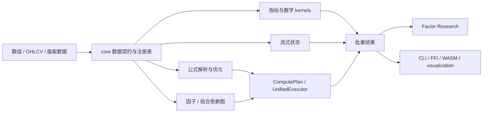

# Finkit 项目功能、架构与重构方案（2026-10-13）

> 审查基线：`main`，HEAD `5854e6fb9102f10429520545655c11e396ea88dd`（2026-10-11），workspace 版本 `0.2.0`。
> 验证范围：本机 Windows 上执行了公式、增量运行时、因子图、研究流程及结构门禁；没有覆盖全部 workspace target、其他操作系统和真实 GitHub Actions。门禁通过只对本次工作树和所列命令负责。

## 结论

Finkit 的主体是一个功能广泛的 Rust 金融计算库，外加因子研究、可视化、CLI、WASM 与多语言适配。它不是尚未贯通的原型，也不需要推倒重写。主要批量指标、公式、流式、因子图/统一执行和因子研究链路均已有实际实现；但“全部功能完成”“所有入口统一”“所有语言完整对等”都不成立。

本轮重点是公式 Plan 后端默认化的证据、feature 边界和对外支持矩阵，而不是继续堆模块或先拆 crate。此审查取代已删除的 2026-10-10 旧审查；状态矩阵中的历史验证仍按 SHA 留档。

| 问题 | 当前判断 |
|---|---|
| 核心功能是否全部实现？ | 核心计算/研究面已经较完整，但不是所有目标面都完成。字符串消费者现已接入 Plan；13 个受管辖入口仍为 Tree-only（其中 4 个列入后续接线）；部分 feature 组合明确不支持；移动端是 15/78 子集；绑定发布成熟度各异。回测和选股引擎属于产品边界外。 |
| 主体链路是否贯通？ | Rust 主链路大体贯通：输入 → 指标/公式/流式/因子图 → 结果；因子研究也有独立的请求、准备、执行、分析和报告层。CLI、FFI、WASM 是面向用户的适配链路。它们共享 Rust 核心，但并非所有操作都经过同一运行时或在所有绑定都有同等入口。 |
| 公式是否已运行在 Plan 后端？ | `Plan` 已可 opt-in；Tree 仍是默认。字符串字面量及其 4 个消费者已接通并做 Tree/Plan 对照。默认化暂缓：domestic 语料上 Plan 仍较慢，且绑定不能选择或查询后端；4 个入口后续接线的成本也需评估。 |
| 是否应整体重写或立即拆 crate？ | 不应。先明确 API/backend 合同、补齐 Plan 的结构性缺口并测量构建边界；只有独立发布、编译时间或安全隔离能证明收益时再拆 crate。 |

## 功能地图与主要链路

### 功能模块

| 模块 | 主要职责 | 主要代码位置 |
|---|---|---|
| 技术指标与数值核 | 批量指标、数学/SIMD kernel、价格变换和形态；滚动 warm-up、数值边界由各领域合同约束 | `core/src/indicators/`、`core/src/math/`、`core/src/patterns/` |
| 公式引擎 | 多方言解析、AST 优化、Tree 执行、ComputePlan/UnifiedExecutor 执行、增量与显式冻结的旧 bytecode/JIT 接口 | `core/src/formula/` |
| 流式与状态 | 每 bar 状态更新、checkpoint、forming-bar 修订和一部分批量/流式 parity | `core/src/streaming/` |
| 因子/组合图与 Runtime | 因子 provider、依赖图、计划执行、产物缓存、range/DirtyRange 和保守 full fallback | `core/src/factor_provider.rs`、`factor_graph.rs`、`semantic_graph.rs`、`unified_runtime.rs`、`runtime_context.rs` |
| 特征工程 | rolling transforms、标准化、标签和特征流水线 | `core/src/features/`、`transforms/` |
| Factor Research | 面板数据准备、因子分析/验证、多因子、组合表现、风险及报告；复用 core kernel | `factor-analysis/src/` |
| 可视化与 CLI | 图表渲染；指标、公式、流式、schema、factor-study 等命令行入口 | `visualization/src/`、`cli/src/` |
| 多语言交付 | C ABI/共用契约及 Python、Node、Go、Java、.NET、iOS、Android 绑定；独立 WASM crate | `ffi/`、`wasm/` |

### 架构和实现流程



Workspace 的依赖方向总体是 adapters → core，CLI 还依赖 visualization，Factor Research 作为独立 crate 依赖 core。`core` 是稳定公共 facade，也是主要复杂度集中处：单 crate 内有数学核、公式语言、流式、特征、图、运行时、数据契约和风险/收益基础设施。这个集中使跨语言复用和数值语义一致成为可能，同时让 feature 组合、编译边界和模块依赖成为主要维护成本。

公式链路分成两条明确的执行路径：`source → pest parser → AST → optimize` 后，Tree 路径解释执行；Plan 路径继续 `AST → SemanticGraph/ComputePlan → UnifiedExecutor`。Plan 对不支持的入口/语义显式报错，不静默回退。指标 batch、streaming 以及因子计划分别复用 canonical kernel/共享 executor 的不同部分，目前还不能概括为一个全覆盖的执行通道。

Factor Research 是研究工作流，不是回测/选股引擎。其数据合同、point-in-time 约束和组合分析不能被等同于交易模拟或选股排序能力。

## 合理性与主要问题

### P0：Plan 默认化有清晰价值，但尚未达到直接切换条件

**现状证据：** `core/src/formula/engine.rs` 将 `Tree` 标为默认和 reference，`Plan` 为 opt-in；同文件列出 Tree-only 入口，Plan 对这些入口明确返回 `BackendUnsupported`。字符串表和 `EM_REF` / `BLOCKDATA` / `BLOCKINDEX` / `BLOCKAVG` 的宿主数据通路现已接入 Plan，并在本轮增加 arity 边界核验。默认化剩余问题主要是 measured workload 的 domestic 性能、绑定缺少后端选择/查询以及 4 个 backlog 入口。

**评价：** 用户已确认希望优先评估 Plan 默认。切换可提升“计划复用/统一执行”的产品闭环，但直接翻转默认会把尚未支持的公式变成用户可见错误，且会影响绑定和兼容行为。正确目标是先消除或界定后端能力差异，再基于覆盖和真实工作负载决定默认值；不能只凭 Plan 已有大量 kernel 就视为完成。

### P1：feature 表达能力超过实际构建能力

`core/Cargo.toml` 的指标分类 feature 明确标注 tree-shaking scaffold 尚不可单独使用；`scripts/check_feature_matrix.py` 将若干单独组合登记为 `KNOWN_BROKEN`，仅 default、bare、no-std、tracing-only 等属于必过组合。近期提交修正了此前错误的 feature 合同，并建立可执行门禁，这是改进；但用户仍容易把 feature 名称误解成支持的裁剪构建。

**建议：** 将受支持组合视为产品合同，短期内保持已登记组合并确保文档/CI 一致；若希望支持 category-only 构建，作为单独的架构任务处理依赖方向和模块 gate，不要继续暗示任意 feature 子集可用。

### P1：多条执行路径和缓存的收敛目标需要以能力矩阵呈现

Tree、Plan、streaming、直接 kernel、factor/composite graph 均有合理用途，且存在差分/一致性合同。缓存也分属 FormulaEngine 与 RuntimeContext，key、淘汰和生命周期不同；FormulaEngine 的缓存是 `RefCell`，同一实例不是 `Sync`。这不必然是错误，但“一个 Runtime/一个缓存/全 API 共享 Plan”会超出当前实现。

**建议：** 保留用途不同的路径，统一入口覆盖、错误、观测和一致性合同；不要为形式上的单一缓存合并无关 key/lifetime。并发限制要体现在 API/绑定合同，而不只留在内部说明。

### P2：`core` crate 边界较粗，但拆分前置条件未满足

`core/src/lib.rs` 暴露的职责包括 indicators、formula、streaming、features、factor systems、runtime、schema 和 transforms。Factor Research 已有独立 crate，说明按产品职责分层有效。当前 feature 关系还存在实际不可组合的区域，直接拆 crate 会把未解决的依赖和数值合同扩散成跨 crate API。

**建议：** 先固化模块依赖方向与受支持 feature contracts，量化编译耗时/依赖影响，再决定是否抽取稳定子系统；维持 `finkit` facade 和公共 API 兼容。

### P2：绑定覆盖数不能代表完整功能或发布完成度

仓库文档区分源码存在、CI 验证、候选包、GitHub Release 资产、registry 发布。78/78 表示登记的 indicator surface，不能推导公式、研究、streaming API 都在每种语言完全 parity。iOS/Android 维持 15/78 是用户确认的范围，不列入本轮扩容目标。

**建议：** 按每个 binding 展示 API surface、运行/CI 状态、包状态和发布渠道；release 的最终 SHA 与 consumer install 应作为交付闭环。

### P3：旧性能与兼容入口需要防止误读

`formula-jit` / `formula-simd` 仍存在于 feature/API 中，但源码将它们标为冻结兼容面：`eval_simd` 是 `eval` 别名，JIT 名称也不表示 native codegen。保留它们是兼容决策，不该继续作为新架构目标；文档和示例需保持显眼且一致。

## 重构方案

原则：先证实合同，再变默认；每阶段限制公共行为变化；已有数值/绑定一致性门禁优先扩展而非复制新标准。按用户确认，Plan 默认化进入近期评估主线；移动端保持 15/78 子集。

### 阶段 0：建立 HEAD 对应的可信状态矩阵

1. 将 `docs/architecture/status-matrix.md` 的基线从 `496763b7` 更新到当前审查 SHA，并区分本次静态检查、历史本地测试结果、当前 CI 结果和公开发行事实。
2. 为公式入口矩阵逐项列出语法/方言/参数/多输出/字符串/streaming/range/last/into 对 Tree 和 Plan 的支持状态。
3. 为各绑定列出核心指标 surface、公式/研究入口、目标构建、候选产物和公开发行状态；保持移动端子集决策。
4. 修正过期的行数、版本、测试数或链接，禁止从旧 SHA 的绿灯推断当前 HEAD。

**完成条件：** 每一条“已实现/已验证/已发布”能链接到对应实现或证据，unknown 明确标 unknown；矩阵基线和 CI 同 SHA。

### 阶段 1：为 Plan 默认化补齐执行合同

1. 明确 string literal 的计划语义：包括字符串表生命周期、上下文可见性、重复/多输出行为和 FFI 序列化；若某方言有意不支持字符串，明确拒绝范围。
2. 逐个核对当前 tree-only 入口：判断需转成 Plan、改为显式 tree-only API，还是定义稳定的 unsupported 契约。不得静默 fallback。
3. 对 source-level API、显式 CompiledFormula/Plan API、上下文副作用、warm-up、错误和缓存行为建立一张 SSOT 矩阵；检查 Python/Node 等活跃绑定是否能选择/报告 backend。
4. 使用现有 Tree reference 与差分合同验证计划实现；必须同时覆盖绝对性质，避免两路径以相同方式出错。
5. 按真实应用公式语料/调用分布测量功能覆盖、结果一致性、性能和内存。仓库已记录的全覆盖 kernel 状态不替代字符串、入口及调用分布的证据。
6. 达到退出条件后，另行提出默认值变更及版本/迁移说明；Plan 成为默认前保留清晰的 Tree 选择途径。

**切换退出条件：** 目标公式语料无未解释差异；必要 API 的 Plan 行为有稳定支持或经确认可弃用；所有绑定默认/显式 backend 行为一致且有迁移说明；目标 workload 不出现不可接受的退化。未满足时维持 Tree 默认，但继续收敛 Plan 支持。

### 阶段 2：收敛 feature 和模块依赖合同

1. 把 `SUPPORTED` feature 组合写入用户安装说明与 CI 文档；将 `KNOWN_BROKEN` 作为内部已知缺口，不宣传为可工作的 tree-shaking 能力。
2. 依据 `check_dependency_direction.py` 的方向边界，为分类指标 feature 逐步建立明晰的依赖 closure；选择 category-only 构建为正式目标后再把相应组合提升到必过列表。
3. 从最小受支持构建和单 crate 构建审视可选依赖；避免依赖 workspace feature unification 的偶然成功。
4. 固定兼容 API 的冻结声明与弃用/移除节奏，避免 JIT/SIMD 命名产生错误产品预期。

**完成条件：** 每个宣称支持的 feature 组合可独立构建；每个不支持组合有明确状态，不会被默认构建掩盖。

### 阶段 3：研究/增量链路的边界验证

1. 保持 Factor Research 只负责研究分析；接口与文档明确回测/交易/选股引擎的外部边界。
2. 继续让 point-in-time、未来数据不可回写历史、面板对齐和资产日历成为输入/输出合同。
3. 对 DirtyRange 保留完整依赖锥安全判断；无法证明固定 lookback、增量安全和时间序列安全时回退 full execution。
4. 比较 range 与 full 的完整结果和对外 trace；未经过证明的横截面/动态窗口任务不做局部执行。

**完成条件：** 各研究路径、缓存材料化和局部执行可以由可复现的不变量/门禁支撑；full fallback 有效且可观察。

### 阶段 4：按证据决定 crate 拆分与绑定发布

1. 先测量编译耗时、feature 树和修改耦合；按“稳定职责/独立构建收益”选择候选，而不是按目录或行数拆分。
2. 如需抽取，先保留 `finkit` facade，并验证 standalone build、no-std/feature 和 FFI API 不依赖 workspace unification。
3. 绑定按 active/deferred tier 运行对应漂移、parity、目标平台 build 与 consumer install 检查；iOS/Android 维持 15/78。
4. 版本、候选包、release asset、registry package 状态分开记录；只在最终 SHA 的发布证据通过后更新用户文档。

**完成条件：** 拆分降低了实际构建/维护成本且无合同漂移；每个对外承诺目标均有同 SHA 的构建和消费验证。

## 本次审查边界与待确认事项

- 本次执行的具体命令、结果和未覆盖的平台列在文末；旧 SHA 验证仍在 `docs/architecture/status-matrix.md` 标记为历史记录，不能外推至当前工作树。
- 用户已确认：**优先评估 Plan 默认**；**iOS/Android 保持 15/78**。
- 是否最终切换 Plan 默认仍须由阶段 1 的合同和 workload 证据决定；本方案不预设一定切换。

## 相关资料

- [架构总览](architecture/overview.md)
- [公式引擎内部与入口矩阵](architecture/formula-engine.md)
- [公式入口矩阵（逐项 Tree/Plan SSOT）](architecture/formula-entry-matrix.md)
- [运行时与缓存合同](architecture/runtime-and-cache-contract.md)
- [数值语义](architecture/numerical-semantics.md)
- [实现现状矩阵](architecture/status-matrix.md)
- [语言绑定与发行状态](language-bindings.md)
- [Factor Research 架构](factor-research-architecture.md)

## 执行进展（2026-10-13 执行）

本节记录按本方案落地的工作。基线 HEAD `5854e6fb`。

### 阶段 0：完成

1. **0.1 现状矩阵重定位。** `docs/architecture/status-matrix.md` 基线由 `496763b7`
   更新到 `5854e6fb`，新增"§0 证据分类"章节，把**静态检查 / 历史本地测试 /
   当前 CI / 公开发行**四类证据分开；2026-10-10 的核验记录降级为"历史证据"，
   并明确"不得从旧 SHA 绿灯推断当前 HEAD"。
2. **0.2 公式入口矩阵。** 新增 `docs/architecture/formula-entry-matrix.md`：
   逐项列出每个 `FormulaEngine` 入口的后端归属（plan 可用 / 仅 tree / 后端显式 /
   后端无关），以及语法、方言、参数、多输出、字符串、流式、range、last、into
   在 Tree 与 Plan 下的支持状态。核对了源码守卫后补入此前两份文档都漏列的
   `eval_partial`，并记录"range/last/into 目前只存在于 tree 产物入口"这一能力差异。
3. **0.3 绑定矩阵。** 保留 78/78 指标 surface 与发行成熟度分离的表述，移动端
   15/78 维持不变。
4. **0.4 链接与陈旧数据。** 修正 `check_docs_links.py` 因新文档未被 git 跟踪而
   报的失败；矩阵中的版本、测试数与链接按当前 HEAD 重取。

### 对方案前提的一处修订（重要）

方案 P0 与阶段 1.1 假设"字符串字面量在 Plan 下完全不能运行，因为 plan executor
拿不到上下文"。该前提**已过期**：

- 修复在 `1717e17`（2026-10-04）落地，早于本方案；
- `unified_dispatch` 的 `string_base` + `core/tests/formula_string_literals.rs`
  证明两条路径都把字面量按同一顺序写入 `FormulaContext::string_table`，并发出
  **绝对表位置**（plan 侧 = `string_base` + 编译期局部下标）。

因此**阶段 1.1 的范围缩小**为：

1. 记录真实的字符串语义（已完成：`formula-engine.md`、runtime 合同新增 §3.5、
   入口矩阵 §2 脚注 1）；
2. 补齐**剩余 4 个消费下标的调用目标**（`EM_REF`、`BLOCKDATA`、`BLOCKINDEX`、
   `BLOCKAVG`）的 plan kernel。这属于"补齐 kernel"，不再是"设计字符串语义"。

### 阶段 1.1：完成

4 个消费下标的调用目标已补齐 plan kernel：

- `HostContext` 新增 `string_table` / `em_data` / `block_data` 三个借用字段，
  由 `FormulaEngine` 在构造 plan 执行器时从 `ctx` 填入；dispatcher 经
  `string_table` 把绝对下标解析回文本，再读 host 数据。
- 语义与 tree 路径逐条对齐：**无 host 数据 → 全 `NaN`（不是报错）**；
  **有 host 数据但 key 缺失 → 错误**；**序列长度不匹配 → 全 `NaN`（不是截断）**；
  `EM_REF` 的 `n` 走 `extract_n` 语义（`0` 报错）。
- 门禁升级：`formula_string_literals.rs` 的"缺口名册"测试替换为
  **正反两条**——四个函数必须在 Plan 下**运行成功**（回归守卫），且在有 host 数据时
  **逐值复现 tree 路径并匹配有限值个数**（只比两路径相等会漏掉"两边一起返回全 NaN"）。

至此字符串字面量在 Plan 路径上**无已知缺口**。这也是阶段 1 的最后一个结构性 kernel 缺口。

### 阶段 1.2：完成

13 个 tree-only 入口**逐项定性**，写入
[`docs/architecture/formula-entry-matrix.md`](architecture/formula-entry-matrix.md)
§1.2.1，使用受控词表：

- `by-design`（9 项）：`eval_ast`、`eval_lazy`、`eval_parallel`、`eval_optimized`、
  `eval_with_debug`、`eval_template`、`eval_zero_copy`、`eval_zero_copy_cached`、
  `eval_zero_alloc`——共同点是**本质属于 tree 侧**（AST 级变换、分配策略、诊断插桩），
  不打算给出 plan lowering。
- `backlog`（4 项）：`eval_with_validation`、`eval_with_defaults`、
  `eval_multi_with_dialect(Pine)`、`eval_multi_with_pine_security`——共同点是
  **尚未接线**而非"无法运行"，分两类：**方言/host 通道**（后两项）与
  **参数注入通道**（前两项，`eval_with_params` 已证明 plan 侧可接收参数）。
- `deprecate`（0 项）：暂无需弃用项。

以上 9+4+0 = 13 项即全部 tree-only 名册。注意 `eval` 本身是 plan 可用的 §1.1 入口，
`eval_range`/`eval_last`/`eval_into` 是 §1.3 后端显式入口，**三者都不在**该名册内。

关键结论：四个 `backlog` 项都是**通道未接线**，不是"该入口在 Plan 下不能运行"，
因此**不构成 Plan 默认化的阻断项**。

**曾记录一处设计不一致（已在阶段 1.3 消解）**：`eval_ast` 受
`require_tree_backend` 治理，而同为"接受 artifact"的 `eval_range` 走 backend-explicit
路径。该不一致由 §1.3.1 的**后端中立输入 vs 编译产物**判据消解，**未改动任何公共契约**
（详见下节）。

**门禁闭环**：`check_formula_engine_contract.py` 新增第 3b 项断言——每个 tree-only
入口必须有 §1.2.1 定性、定性词必须在受控词表内、且建议的 Plan 替代入口本身
**不得**是 tree-only（否则只是把一个 `BackendUnsupported` 换成下一个）。
用负向测试验证其有牙齿：删掉任意一行即报 `missing`，把替代项写成 tree-only 即报错。

### 阶段 1.3：完成

**`range`/`last`/`into` 在 Plan 侧无 source-level 入口**这一事实，已从"待界定"改为
**已定契约**（`by-design`），并同时消解了阶段 1.2 记录的疑似不一致：

- 新增判据 **§1.3.1 后端中立输入 vs 编译产物**：参数类型是**某后端编译器的产物**
  （`CompiledFormula`/`Bytecode`/`OptimizedBytecode`/`FormulaHotPlan`）→ 后端显式；
  参数类型**与后端无关**（`&str`/`&AstNode`/数值切片）→ 受管辖。
- 该判据**零行为变更**地解释了为何 `eval_ast(&AstNode)` 受管辖而
  `eval_range(&CompiledFormula)` 后端显式：`build_plan` 内部即
  `parse → ast → FormulaHotPlan::compile(&ast)`，**AST 可 lower**；而 `CompiledFormula`
  是 tree 编译器的产物，产物即后端选择。
- §3.1 给出四条结论：切 Plan **不改变**这些入口行为；**不算静默回退**（后端由产物类型
  选定，从未声明为 plan）；Plan 侧范围能力**已实现但故意不暴露**
  （`UnifiedExecutor::execute_range`/`execute_last`，经 `runtime_convergence.rs` 覆盖，
  只经 `unified_formula_executor*` 可达）；**不新增** `eval_plan_range` 类入口
  （无调用方，徒增公共面）。
- §3.1 同时写下**复评触发条件**（绑定/下游需要 plan 侧区间执行、1.4 测量显示区间是
  瓶颈、或 `FormulaHotPlan` 获得跨调用持久状态使流式 `last` 可对齐），
  在此之前"Plan 侧无 range/last/into 入口"是契约而非待办。

**门禁闭环**：`check_formula_engine_contract.py` 新增 §1.3.1 / §3.1 锚点断言，
并把"阶段 1 需要显式界定""不擅自改动公开契约"加入过期短语守卫——决策一旦被写回
成开放问题即报错。负向测试确认：去掉锚点即报 `missing`，重新引入旧措辞即报 stale。

### 阶段 1.4：完成（真实 workload 测量）

新增 `core/examples/formula_mode_workload_probe.rs`：在**真实语料**上按方案第 5 条
测量**覆盖 / 一致性 / 性能 / 内存**四维，Tree 与 Plan 对照。此前仓库**没有任何**
Tree-vs-Plan 的性能/内存基准（`FormulaExecutionMode` 只出现在 parity 测试里）。

```
cargo run -p finkit --release --example formula_mode_workload_probe [--scaled]
```

**覆盖与一致性（60 用例 = domestic 35 + Pine 25，两档规模）**

| 规模 | 语料 | Plan 可运行且与 Tree 一致（非退化） | 退化 | Plan 缺口 | 分歧 |
|---|---|---:|---:|---:|---:|
| 250 行 | domestic | **35/35** | 0 | 0 | 0 |
| 250 行 | Pine | **25/25** | 0 | 0 | 0 |
| 5000 行 | domestic | **35/35** | 0 | 0 | 0 |
| 5000 行 | Pine | **25/25** | 0 | 0 | 0 |

- **退化**指"两路径一致但双方全非有限"——即"在一无所有上取得一致"。探针显式统计它，
  因为方案第 4 条要求覆盖绝对性质。**未供 host 数据时** `chip_distribution_ths`
  恰好退化（`WINNER`/`COST` 全 `NaN`）：差分门禁把它计入"已验证"，而
  `core/tests/formula_host_context.rs` 已**书面说明**语料无法证明 host 上下文并
  另行覆盖。探针自行按 `input.chip_data` 构造筹码表，因此这里的 35/35 是比门禁
  **更强**的断言，而不是重复它。

**性能（warm = 复用 engine+ctx，仅执行；cold = 每次新建 engine+ctx）**

下表是 **5 次独立运行的 warm 比值中位数**（单次运行波动约 ±10%，故给区间而非单点）：

| 规模 | 语料 | cold Plan/Tree | warm Plan/Tree（中位数 / 区间） |
|---|---|---:|---|
| 250 行 | domestic | 1.26x | **1.92x（1.90–2.03）Plan 慢** |
| 250 行 | Pine | 1.48x | **0.231x（0.230–0.242）Plan 快 4.3x** |
| 5000 行 | domestic | 1.27x | **1.53x（1.36–1.58）Plan 慢** |
| 5000 行 | Pine | 1.47x | **0.478x（0.457–0.488）Plan 快 2.1x** |

**内存（每次 warm 执行的分配次数均值，确定性、无运行间波动）**：
domestic `1.537x`（Plan 多），Pine `0.089x`（Plan 少 11.3x）；
**与数据规模无关**（分配次数不随行数增长：250 行与 5000 行数值完全相同）。

**两个语料结论相反，原因已定位（不是噪声）**：

- **Pine：Plan 大幅胜出。** `eval_with_dialect` 的 Tree 分支对 Pine **不走**
  缓存路径 `compile_shared`，而是每次调用都 `parse_formula_with_dialect` +
  `eval_ast`（**Pine 无 AST 缓存**）；Plan 分支对**所有**方言都命中 `plan_cache`。
  故 warm Tree Pine ≈ 120–135 µs / 899 次分配，warm Plan Pine ≈ 28–31 µs / 80 次分配。
  随规模增大 Plan 优势收窄（4.3x → 2.1x），因为 Tree 的重解析成本是固定项而执行
  成本随行数增长。
- **domestic：Plan 略慢。** Tree 分支命中 `CompiledFormula` 缓存（`Arc` 克隆 +
  遍历），Plan 执行器的逐节点 dispatch 在 250–5000 行量级高于 AST 遍历。

**一处热点**：5000 行时 `smi_cross` 的 warm Plan/Tree = **4.36x**
（Tree 228 µs / Plan 995 µs），是全部用例中最差的一项，建议后续单独定位。

**对切换退出条件的含义**：覆盖与一致性两项**已满足**（60/60 非退化，两档规模）；
性能项**尚未满足**——domestic 出现约 1.5–2.0x 的 warm 退化，且 `smi_cross` 达 4.36x，
按"目标 workload 不出现不可接受的退化"应视为**未达标**。故维持 Tree 默认，
并按下面的阶段 1.5–1.6 收敛。

### 阶段 1.4 补充：`CALL:` 桥接热点的根因修复

上一节把 `smi_cross` 标为最差用例（4.36x）并建议单独定位。根因已查明并修复。

**根因**：桥接的两个委托循环（`TALIB_081_KERNELS`、`SCREENING_DELEGATES`）为**每个**
`CALL:` 节点构造一个**全长度**的 `FormulaContext`——五个 `len` 长度的零填充数组。
5000 根 bar 时这是每次调用约 200 KB 的纯内存流量，在调用密集的公式上压过真实计算。

**判据（按证据，不按假设）**：两张表引用的全部 57 个 `canonical_*` 函数逐一审计，
确认它们只读 `data_len`、不读任何 `ctx.<series>`；而 `data_len` 是公开字段。故改为
直接赋值、序列留空（新助手 `bridge_context`）。`formula_plan_differential.rs` 仍是
独立兜底：若将来某个委托开始读取 context 序列，plan 路径输出不再等于 tree 路径，
该门禁立即失败。

**测量**（同一 probe；warm 比值 = Plan/Tree，<1 表示 Plan 更快）

| 档位 | 语料 | warm Plan/Tree 修复前 | warm Plan/Tree 修复后 |
|---|---|---:|---|
| 250 行 | domestic | 1.92x（1.90–2.03） | **1.84x（1.67–2.08，5 次中位数）** |
| 250 行 | Pine | 0.231x（0.230–0.242） | **0.246x（0.224–0.261，5 次）** |
| 5000 行 | domestic | 1.53x（1.36–1.58） | **1.27x（1.22–1.38，3 次中位数）** |
| 5000 行 | Pine | 0.478x（0.457–0.488） | **0.494x（0.442–0.517，3 次）** |

- 内存（每次 warm 执行的分配次数均值，确定性、无运行间波动）：
  domestic **1.537x → 1.392x**（每次 warm 执行 Plan 60.4 次 / Tree 43.4 次）；Pine 0.089x 不变。
- 单例：5000 行 `smi_cross` **4.36x → 2.99x**（单次测量：Tree 299 µs / Plan 894 µs；
  修复前 Plan 侧 995 µs）。Plan 侧绝对时间下降 ~10%，与"每次调用少掉 200 KB"相符；
  Tree 侧的波动属运行间噪声（±10%）。
- 250 行档位**基本不变**，符合预期：被去掉的是 `O(len)` 的**每次调用**分配，250 行时
  只有约 10 KB，不构成瓶颈；5000 行时才成为主项。
- 覆盖与一致性不受影响：每一档、每一次运行均为 **60/60 非退化**。

**结论**：性能阻断项 (a) 从"5000 行 domestic 1.53x"收敛到 **1.27x**，但**并未消失**
（250 行 domestic 仍约 1.84x，来自 Plan 执行器逐节点 dispatch 的固定开销）。
按退出条件"目标 workload 不出现不可接受的退化"，仍维持 Tree 默认。

### 阶段 1.5：绑定后端能力核查（方案第 3 条的绑定部分）

方案第 3 条要求"检查 Python/Node 等活跃绑定是否能选择/报告 backend"。逐仓核查
8 个绑定，结论写入 [入口矩阵 §5](architecture/formula-entry-matrix.md)：

**没有任何绑定能选择或报告后端。** 全部绑定都调用 `FormulaEngine::new()`，即
**静默使用默认（Tree）**；唯一与后端相关的代码是 `BackendUnsupported` 的错误文案。

**这是默认化的第二个阻断项。** 若切换默认值，每个绑定的行为都会**静默改变**：使用者
既不能显式钉住 Tree 以规避阶段 1.4 的回归，也不能查询自己当前在哪个后端。方案退出条件
要求"所有绑定默认/显式 backend 行为一致且有迁移说明"——在补齐选择/报告面之前**不满足**。

**附带发现**：同一 `BackendUnsupported` 在 8 个绑定里有 4 种表现——错误码 `11`（C）、
`RuntimeError`（Python）、`GenericFailure`（Node）、以及**完全无类型化分支**（其余 5 个
退化为字符串）。使用者无法用同一套逻辑跨语言识别"后端不支持"。

**修复顺序建议**：先加**只读** backend 报告（无行为风险）→ 再加可选显式选择 →
最后统一 `BackendUnsupported` 映射并写迁移说明。**必须在默认值切换之前完成。**

**门禁闭环**：`check_formula_engine_contract.py` 新增第 3e 项——§5 表必须与磁盘上的
`ffi/*-binding` 逐一对应，且任何绑定源码出现后端选择符（`with_execution_mode` /
`set_execution_mode` / `FormulaExecutionMode`，跳过纯注释行）即报错，强制同一次改动
里更新 §5。负向测试确认：注入选择符即报错、删掉矩阵行即报错。

### 门禁增强（阶段 2 原则：优先扩展既有门禁）

`scripts/check_formula_engine_contract.py` 扩展为同时校验：

- `docs/architecture/formula-engine.md` 的仅 tree 表行（原有）；
- `docs/formula-runtime-contract.md` 的**两处**仅 tree 名册——§1.1 列表与 §3.4 表行
  （新增，且**分别**对账而非取并集，否则会漏掉"一处少列"的漂移）；
- 测试名册与枚举默认值（原有）；
- 新增过期短语守卫（含"Plan 下完全不能运行字符串字面量"类表述）。

本次即修复了 runtime 合同 §3.4 表行少列 `eval_multi_with_dialect(Pine)` 的真实漂移。

### 阶段 2.1：完成

`docs/installation.md` 的 Rust 安装章节新增"Supported Cargo feature combinations"，
把 `SUPPORTED`（default / bare / no-std / tracing-only）与 `KNOWN_BROKEN`
（std-only、单分类、formula-only、serde/rayon/metrics-only）写入用户安装说明，
并指向 `scripts/check_feature_matrix.py`。KNOWN_BROKEN 不宣传为可用的 tree-shaking 能力。

### 阶段 1.6 前置：SSOT「plan 内核必已注册」不变量的补洞

阶段 1.1 的 `formula/kernel_string_index.rs` 让 `EM_REF`/`BLOCKDATA`/`BLOCKINDEX`/
`BLOCKAVG` 成为 **plan 内核**，但四者从未在 `builtin_function_registry` 中声明。
后果与 `registry.rs` 既有注释描述的完全一致：**未注册的内核会被 planner 降级为带幻影
尾依赖的 stateful barrier**，无法共享或重排。`formula_function_ssot.rs` 的两条硬不变量
因此转红：

- `plan_kernel_coverage_is_exactly_the_recorded_set`
- `every_plan_kernel_is_registered_in_the_ssot`

修复按仓库既有模式补齐（与 `COST`/`PERIODTYPE`/`TR` 同型）：

| 名称 | category | input | lookback | 依据 |
|---|---|---|---|---|
| `EM_REF` | `Formula` | `Dynamic` | `Dynamic` | `data[i - n]`，warm-up 由参数决定 |
| `BLOCKDATA` | `Formula` | `Dynamic` | `None` | 逐元素读取 host 序列，无 warm-up |
| `BLOCKINDEX` | `Formula` | `Dynamic` | `None` | 同上 |
| `BLOCKAVG` | `Formula` | `Dynamic` | `None` | 同上 |

`InputKind::Dynamic` 是诚实的描述：它们的操作数是 `STRING_LITERAL` 下标（外加 `EM_REF`
的位移），没有数值签名可声明。测试名册同步记录，三面尺寸由
`(registry 321, formula 452, plan 内核 287)` 变为 **`(325, 452, 291)`**。

顺带修掉三处 `clippy::doc_markdown`（`types.rs` 的 `EastMoney` 与 `EM_*` 组、
`math/kernels/registry.rs` 的 `DirtyRange`），并把 `check_file_size_budget.py --write`
的换行固定为 LF——此前在 Windows 上会把整个 baseline 改写成 CRLF，使每次 `--write`
都产生整文件换行抖动（`gen_ssot_docs.py` 已用同样手法规避）。

### 结构：桥接执行面拆出 `bridge_dispatch.rs`

阶段 1.4 补充修改的桥接代码原本挤在 `unified_dispatch.rs`（4246 行，已超 4225 预算）。
本次把**桥接执行面**整体拆到新模块 `core/src/formula/bridge_dispatch.rs`：

- 两个选择名册 `SCREENING_KERNELS`、`TALIB_FORMULA_GAP_KERNELS`；
- 桥接执行器 `dispatch_formula_bridge_call`；
- 委托上下文构造器 `bridge_context`。

名→函数表（`TALIB_081_KERNELS`、`SCREENING_DELEGATES`）留在 `dispatch_modern_call`
内部，因为它们只在那里被遍历。结果：`unified_dispatch.rs` **4246 → 4006 行**，
回到预算内并留出余量；`bridge_dispatch.rs` 267 行。纯移动，无语义变化。

### 仍待办

- 阶段 1.6：默认值切换退出条件与迁移说明。**已知两个阻断项**：
  (a) 性能——5000 行 domestic warm 退化已由 1.53x 收敛到 1.27x，但 250 行档位仍约
  1.84x（阶段 1.4 及其补充）；`smi_cross` 由 4.36x 降到 2.99x；
  (b) 绑定——8 个绑定均无法选择/报告后端，切换会让使用者无退路（阶段 1.5）。
  （1.2 逐项定性、1.3 range/last/into 界定、1.4 真实 workload 测量、1.5 绑定后端能力
  核查均已完成，见上。）
- 阶段 2.2–2.4：分类 feature 依赖 closure、最小受支持构建审视、冻结 API 的弃用节奏。
- 阶段 3：研究/增量链路的边界验证。
- 阶段 4：按证据决定 crate 拆分与绑定发布闭环。

## 本轮三遍检查与发布验证记录（2026-10-13 至 2026-10-14）

检查按“每遍先修复、再进入下一遍”执行：

1. **第一遍：公式后端与 host-data 主链。** 核查 Tree/Plan 的字符串 literal、4 个 host-data 消费者、注册表 SSOT 和参数边界。修复 Plan 缺少这四个消费者的 dispatch/注册，并补 Tree/Plan 差分与 legacy trailing-argument 合同测试。
2. **第二遍：结构、状态与研究链。** 复查循环退出边界、Rust 模块可达性、公开模块孤儿、文档/脚本引用、依赖方向、增量运行时和因子研究约束。所有已执行静态门禁通过；列表和具体命令见 `docs/architecture/status-matrix.md` 与此记录末尾。
3. **第三遍：用户文档与发布交付链。** 清理被替代的 2026-10-10 审查；更新文档索引、Formula/API 使用说明、安装与开发说明。发现 unified package builder 指向从未纳入仓库的 `packaging/usage` 消费验证目录，且 Go verifier 会改写测试夹具。现已补齐七种消费端 smoke harness，并改成在临时副本验证 Go 模块，要求 C verifier 必须存在，补强子进程退出码检查。此轮构建验证结果记录在下方。

### 本次执行证据和边界

| 项目 | 状态 | 说明 |
|---|---|---|
| Rust workspace 测试 | 通过 | `cargo test -p finkit -p finkit-factor-analysis -p finkit-cli -p finkit-visualization -p finkit-ffi-common -p finkit-ffi -p finkit-go -p finkit-dotnet -p finkit-java -p finkit-android -p finkit-ios -p finkit-wasm --locked --no-fail-fast`，覆盖 12 个 workspace crate。 |
| 格式与补丁空白 | 通过 | `cargo fmt --all -- --check`、`git diff --check`。 |
| Workspace 类型检查 | 通过 | `cargo check --workspace --locked`；Windows 上须显式设定 `PYO3_PYTHON` 指向有效 Python。 |
| Clippy CI 门禁 | 通过 | `cargo clippy -p finkit --locked` 和 `cargo clippy --workspace --all-targets --locked`，加 `-D unfulfilled_lint_expectations`。项目按 warning budget 接受已知 lint；`-D warnings` 不属于 CI 合同，会因历史 lint 告警失败。 |
| Rustdoc | 通过 | `RUSTDOCFLAGS="-D warnings" cargo doc -p finkit --no-deps --locked`。包装脚本在这台 Windows 机器尝试调用未配置的 WSL 失败；直接运行它所要求的 Cargo/rustdoc 命令通过。 |
| Crates.io crate 包装验证 | 通过 | `cargo package -p finkit --locked --allow-dirty`；打包 541 个文件、8.1 MiB，并成功验证 crate 编译。 |
| 七语言安装消费 smoke | 通过 | Windows x64 上 Python、Node、Java、Go、C、.NET、WASM 均从候选产物安装/加载并执行 SMA smoke；统一构建汇总 `7 built+verified, 0 failed`。 |
| 使用包 manifest / bundle | 通过 | `dist/manifest.json` 覆盖 7 种语言、44 个组件；`finkit-0.2.0-windows-x64-usage-bundle.zip` 为 26,280,558 字节。Go/Node/.NET 发布树仅保留可安装模块/包；`refresh_release_manifests.py --check` 通过。 |
| Windows C 原生 archive | 通过 | `finkit-0.2.0-native-windows-x64.zip` 为 6,904,528 字节，SHA-256 `ebbf42746db5b4f4fbe70dbe04e64850223f34337b8be080f08bc4a603d15474`。 |
| 其他 OS、远端 CI 和 registry | 未验证 | Linux/macOS、iOS/Android 原生 runner、远端 GitHub Actions、registry 发布均未在本机验证；本轮不宣称已发布。 |

本次 Windows x64 候选包已通过 clean-consumer 验证，但多平台正式发布还需相应目标 runner、同一提交的远端 CI 与发布凭据。无本地证据的 platform/registry/remote-CI 项不得标成已通过；本方案本身不等于已创建 release tag 或公开发布。
