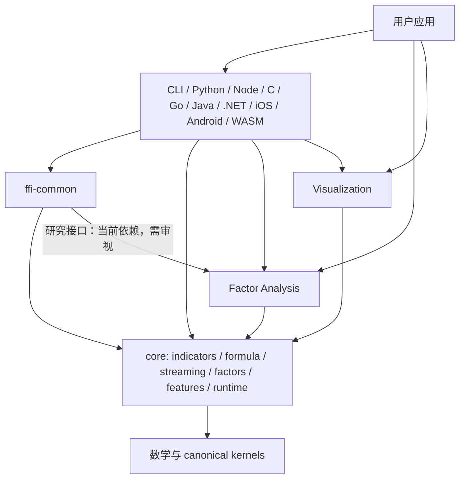

# Finkit 项目架构、开发细节审查与优化重构方案

> - 审查日期：2026-10-26（Asia/Shanghai）
> - 仓库位置：`P:\github_public\finkit`
> - 代码基线：`HEAD=5252c15`，workspace 版本 `0.2.0`；当前工作区包含大量未提交变更。
> 本文用途：把现有架构说明、模块边界合同和当前源码结构合并成一份可执行的审查与重构路线。它是审查建议，不代表本文中列出的工作已经实施或通过 CI。

## 1. 结论摘要

Finkit 的总体技术方向是合理的：以 Rust 计算内核承载数值语义，通过 CLI、WASM 和多语言 binding 暴露能力，并将因子研究、可视化作为独立 workspace crate。当前不适合推倒重写，也没有足够证据支持立即把 `core` 拆成多个 crate。

主要结构性问题集中在 **core 内聚度、能力合同可维护性、路径收敛程度和发布证据**：

1. **`core` 是明显的变化热点。** 指标、数学、公式语言、流式状态、因子/复合图、语义计划、执行 Runtime、schema 和数据契约均在一个 crate 内。仅公式、指标、流式三个目录分别约 4.9 万、3.4 万、3.2 万行 Rust（按当前工作树文件粗略统计）。这会扩大编译、评审、回归和维护者理解成本。
2. **workspace 分层总体单向，但共享集成层存在反向职责压力。** `ffi-common` 是绑定共享层，同时依赖 `finkit-factor-analysis` 和 `finkit`；这让面向所有绑定的公共请求/错误/序列化辅助层承担研究产品依赖，扩大构建面和变更影响范围。
3. **同一个“能力”横跨多种事实源和执行入口。** Indicator registry、OperationSpec、Formula callable registry、binding manifest、JSON schema、生成文档各自描述能力的不同侧面。现有合同已区分这些 SSOT，但新增功能仍须在多个边界同步；若缺少机器校验，容易出现“符号存在但语义/后端/绑定并不支持”的误读。
4. **Runtime 统一程度有限。** Unified Runtime 已覆盖若干计划、因子、范围和缓存工作流，但 batch、formula、streaming 并非所有执行都经由同一 executor。统一应以共享语义、资源合同和可验证复用为目标，不应强行合并不相同的状态机和输入语义。
5. **公式执行与 feature 支持矩阵复杂。** Tree/Plan 入口、被冻结的兼容 API、不同缓存/范围能力以及已知不受支持的 Cargo feature 组合，增加用户选择成本和 CI 漏测风险。
6. **测试、基准、脚本和文档治理已经丰富，但需要更严格的事实分层。** 源码、专项测试、差分/黄金正确性、消费者安装、平台构建、CI、公开发行应各自报告。历史文档和快照不能替代当前 SHA 的证据。

**推荐路线：先固定行为与能力合同，再降低横向重复和边界耦合，然后拆分超大模块，最后以量化收益决定是否提取 crate。** 每次重构应保留兼容 facade、独立回滚，并以语义合同与消费者工作流验收。

## 2. 范围、证据与限制

本次阅读了 workspace/Cargo 配置、`core/src/lib.rs`、workspace crate 清单、核心架构文档和已有 2026-10-23 项目审查。当前目录在审查时有大量未提交变更，涉及算法、FFI、Python/Node 等绑定、golden fixtures、CI、文档和脚本。本次没有重置、暂存、覆盖或清理这些改动；也没有把它们当成已验收功能。后续实施应先按变更归属审阅这些工作，再判断它们与本方案的交叉影响。

代码规模是当前工作树的粗略文件行数统计，受文件集与未提交状态影响，不等于活跃代码行数或复杂度测量：

| 子系统 | Rust 文件数 | 约行数 | 维护含义 |
|---|---:|---:|---|
| `core/src/formula` | 59 | 48,976 | 语法、方言、AST、优化、多个执行后端、缓存与兼容函数集中 |
| `core/src/indicators` | 56 | 34,413 | API/实现/数值语义大量聚集；适合按指标族与共享 kernel 归属治理 |
| `core/src/streaming` | 162 | 31,867 | 文件数很多，状态机与 batch 实现需维持明确的 parity 和状态合同 |
| `core/src/math` | 46 | 19,927 | 数学、rolling、SIMD 等共处；共享 kernel 的权威实现必须明确 |
| `core/src/patterns` | 10 | 12,090 | 单目录聚集较高，模式族/注册暴露可分组 |
| `core/src/features` | 31 | 9,097 | 与公式、指标和研究流程有多处关联 |
| `factor-analysis/src` | 29 | 6,025 | 独立研究产品 crate，宜维持消费 core 的方向 |
| `visualization/src` | 32 | 15,662 | 独立渲染 crate；各输出 feature 和跨语言集成仍需分别验收 |
| `ffi/ffi-common/src` | 21 | 8,823 | 公共 FFI 合同与研究依赖之间需要审视职责边界 |
| `ffi/python-binding/src` | 24 | 16,689 | 最大绑定之一，conversion、fast path、公式与 API surface 复杂 |

未在本轮执行全量测试或基准，因此本文不声称当前工作树在任一平台上通过测试、CI 或包发布。可复用的既有架构合同见文末参考。

## 3. 当前架构与主要开发链路

### 3.1 Workspace 分层



工作区包含 `core`、`factor-analysis`、`visualization`、`cli`、`wasm`、`ffi-common` 和多种 binding crate。整体依赖方向是对的：外围消费计算内核，核心数值实现不应依赖某种语言适配器。

需要特别核对的依赖边是 `ffi-common -> factor-analysis`。研究 API 的通用 JSON 请求、错误映射或共享操作枚举是否必须进入所有 binding 的公共依赖？如果只有部分语言暴露研究功能，应把研究请求适配放入较窄的研究 binding/helper，令通用 `ffi-common` 保持小型、领域中立。此项先做 cargo graph/feature/二进制体积基线，再移动接口，避免只凭目录名称判断。

### 3.2 主要执行路径

| 工作流 | 代码路径概览 | 主要合同 |
|---|---|---|
| 批量指标 | 输入切片/OHLCV → indicator API → math/canonical kernel → 输出数组或 caller-owned buffer | warm-up、NaN/Inf、短输入、输出长度、`*_into`、并行与 SIMD parity |
| 公式 | formula 文本 → lexer/parser → AST/优化/计划 → Tree 或 Plan 等入口 → 数值函数/host context → 多通道结果 | 方言、函数登记、参数边界、字符串/绘图、缓存、后端能力、Tree/Plan absolute golden + differential |
| Streaming | bar/更新 → 指标状态机 → 当前输出/形成中 bar 修订 → checkpoint/reset | batch 对齐、状态恢复、forming bar、长时间运行和缺失数据语义 |
| Factor/Composite/Runtime | 声明式图 → graph validation/lowering → plan/slot/cache → full/range/into 或受限局部执行 | 图依赖、顺序、Artifact 身份、输入失效、DirtyRange 安全条件及保守 fallback |
| Factor Research | panel/request → schema/data 检查 → prepare/IC/validation/risk/report → JSON/CLI/binding | 时间对齐、收益和因子对齐、缺失样本、避免未来信息、版本化输出合同 |
| Binding | 语言输入/数组 → 转换与错误边界 → FFI/common → core/product crate → 包装返回 | 所有权、生命周期、panic/error 映射、数据复制、包外安装消费测试 |
| Visualization | chart/data model → layout/scene → SVG/PNG/HTML/WebGL renderer | 坐标、viewport、渲染 feature、图表输入/输出格式与平台能力 |

这些链路是相互关联的能力，而不是同一个入口或同一个 executor。架构文档应明确“语义共享到什么程度”与“执行器各自负责什么”，防止以“统一 Runtime”名义把 batch、公式和流式状态语义错误合并。

依赖审计补充：`finkit-ffi-common` 中的研究 JSON 适配被 WASM、C、Go、Java、.NET、iOS、Android 和 Node 入口复用，Python 则直接调用 `finkit-factor-analysis`。因此 `ffi-common -> factor-analysis` 当前是已使用的共享路径；只为减少表面依赖而拆一个新 crate，预计不能减少这些产品的依赖闭包。应该保留该依赖并将其标记为研究适配职责，只有当存在不含研究能力的实际 consumer 或构建/体积测量显示收益时，再讨论拆分。另一个确切边界问题是 `core` 测试通过 dev-dependency 依赖了 `ffi-common`；本轮把 adapter catalog/dispatcher 合同移到 `ffi-common` 的测试目标，core 测试只保留核心公式/数值合同，并由依赖门禁禁止该测试依赖反转。

### 3.3 关键实现和工程细节

- `core/src/lib.rs` 暴露大量顶层模块，兼容性不只由少数根 re-export 决定；公开模块路径本身也可能成为下游依赖。crate 级 lint 允许缺少 docs/debug，需确保内部实现不会因 `pub mod` 无意成为承诺 API。
- Indicator、Formula、Operation、FFI/schema 并非同一 registry。它们是不同领域合同，但需有明确的权威字段、生成关系与交叉校验；不应把名称匹配计作语义支持。
- `core/Cargo.toml` 说明分类 indicators feature 是 tree-shaking scaffold，类别关闭或单类别组合不能作为受支持构建。公式兼容 feature `formula-jit`、`formula-simd` 的命名也容易让用户误以为存在本地代码生成或公式 SIMD 加速；实际冻结范围应由 API 文档和迁移计划表达清楚。
- 公式 Tree/Plan 入口和缓存/范围能力存在差异。切换默认执行器必须是单独的兼容决策，不能被内部优化顺手改变。
- DirtyRange/增量执行要保持“证明安全才局部计算，否则完整回退”。跨截面、动态回看或未登记影响范围的操作必须保守处理。
- 绑定需要区分“源码存在、独立编译、语言级测试、包外消费者、目标平台产物、公开发行”。一个状态不能代替另一个状态。
- 基准要把单 kernel 与端到端用户工作流分开；每份数字带 commit、平台/CPU、编译参数、输入形状、重复次数和原始结果。不能仅凭少量小型基准推断总体优越或默认执行器应改变。

## 4. 架构不合理与改进优先级

| 优先级 | 问题 | 判断/证据 | 风险 | 建议 |
|---|---|---|---|---|
| P0 | 工作区处于大量未提交改动状态，版本基线和审查快照容易混淆 | 本次 `git status` 显示算法、binding、CI、文档及 fixture 都有修改；HEAD 为 `5252c15` | 后续评审可能把“修改中”当成“当前已实现”，或新方案覆盖已有工作 | 以提交/PR 或清晰变更批次固定当前工作；新增方案只作为计划，不宣称改动通过；实施每阶段重新计算基线 |
| P1 | `core` 同时承载多个变化速度不同的领域 | 公式、指标、streaming、math、patterns 等目录规模大；模块公开边界仍在单一 crate 中 | 维护者认知负担、编译增量成本、跨域改动高耦合，数值错误影响面大 | 先加强模块私有化/门面/依赖图；纯移动拆文件；测量后再考虑 crate 提取 |
| P1 | 通用 `ffi-common` 与研究产品边界可能耦合 | `ffi-common` 的 manifest 依赖 `finkit-factor-analysis` | 只需要基础计算的 binding 也被拉入研究 schema/依赖；共享层变化触发多语言联动 | 测量实际依赖闭包与产物；将研究请求/响应适配从通用 FFI 公共层剥离，或证明该边是所有 binding 的必需能力 |
| P1 | 能力真相跨 registry/schema/生成文档/binding 分散 | Indicator/Formula/Operation/FFI 本来就有不同事实域，但交叉关系需维护多个映射 | 支持率、兼容率、语言能力易出现假阳性或文档漂移 | 定义 CapabilitySpec（输入、输出、数值语义、backend、streaming/range、binding tier、feature）；生成矩阵和验证清单，别合并无关 registry |
| P1 | 公式多入口与多执行后端令用户 API 难以选择 | Tree/Plan、冻结兼容接口、不同缓存和 range 入口并存 | 行为变化难察觉，性能结果受语料和缓存冷热影响 | 维护公开入口矩阵；默认不变；逐项提升 Plan 覆盖，明确不支持错误和回退；后端变更需迁移周期 |
| P1 | feature 名称/实现与实际裁剪能力不匹配 | core manifest 明确分类 feature 目前不是可用 tree-shaking 组合 | 用户设置 feature 后才发现不可编译；绑定 feature unification 增加隐式依赖 | 收窄文档支持矩阵；把 unsupported 组合列为明确负向合同；需要裁剪时先完成依赖图拆分并逐组合 CI |
| P1 | Runtime 统一目标可能超过当前共享边界 | FactorPlan/UnifiedRuntime 有真实实现，但 batch/formula/streaming 并不全走同一 executor | 为统一而增加多次转换、复制或限制各路径专属优化 | 统一数据/错误/数值/资源合同和可复用 kernel；保留合适的 executor，按真实 workload 证明统一收益 |
| P2 | 大文件和宽模块提高变更审阅成本 | 现有 V5 记录过多个历史巨型文件；当前工作树仍有数万行子系统 | 职责不清，模块间 `use super::*`/共享内部类型可能增加隐性耦合 | 按职责纯移动，建立 named internal prelude，设置合理文件规模警戒但不按行数盲拆 |
| P2 | 公共 API 可能比推荐路径更大 | 多模块直接 `pub`，历史兼容函数保留；绑定各自还有额外表面 | semver 负担大，使用者不知道首选 API | 做 API 清单与稳定级别；新 API 走小而稳定 facade；弃用周期跨 Rust/bindings 一致执行 |
| P2 | 测试资产很多，但验证证据容易被数量/名称混淆 | golden、差分、contract、consumer、CI 和发布矩阵不是同一种证据 | 测试数不等于路径正确，也不等于跨平台可交付 | 为每个工作流定义验证层级；黄金绝对性质 + 差分 + 包外 consumer 必须互补 |
| P2 | 基准和研究数据容易成为陈旧快照 | 仓库保存多轮竞争性能文件和大批生成结果 | 跨机器噪声、旧编译器/配置和新数据不可比较 | 固定基准协议/原始数据/环境信息；把门槛与观察报告分开；超时/回归门禁按工作流设置 |

## 5. 详细重构方案

### 阶段 0：整理事实基线（开始其他结构改造前）

1. 将当前已修改文件按主题登记为工作批次：数值/TA-Lib 合同、绑定、CI/基准、文档/生成物等；明确每批的 owner、目标、验证命令和相互依赖。不要通过回滚或覆盖清理工作区来“变干净”。
2. 为本轮计划设定实施基准 SHA；已修改文件只有在其自身审阅和对应测试通过后才更新状态矩阵。
3. 对文档标注证据等级：静态源码、专项本地测试、全量本地测试、远端 CI、包外消费者、平台产物、公开 registry。
4. 汇总稳定 API 与冻结兼容 API、支持的 Cargo feature 组合、各 binding tier 和 TA-Lib/公式能力；保留历史快照但标出日期与 SHA。

**交付物：** 当前 HEAD 与工作区差异清单、支持组合表、能力状态矩阵、端到端工作流矩阵。
**退出条件：** 关键“支持/已完成/发布”声明均指向可复现证据，没有把 `source exists` 等同 `released`。

### 阶段 1：能力合同与数值语义收敛（正确性优先）

1. 建立 `CapabilitySpec` 的最小机器可读模型，不取代已有领域 SSOT。建议按 `operation_id` 关联：batch 实现、formula callable/backend、streaming 状态、range/incremental 能力、语言 binding tier、Cargo feature、错误类别和数值合同。
2. 为高频/关键功能族优先记录 NaN/Inf、warm-up、零除数、短输入、边界 index、输出 shape、精度容差和多输出顺序。
3. 一个 canonical kernel 可被 batch/formula/streaming 调用时，建立由 kernel 到前端 wrapper 的明确映射；无法共用算法时要求 golden/parity 证据并写出差异原因。
4. 覆盖结论必须使用 exact mapping 或审阅过的显式 alias；名称扫描仅作线索，不作为正确性证明。
5. 公式执行保持现有默认，先完善入口矩阵、Tree/Plan absolute golden 与 differential，再分别测冷/热缓存和真实公式语料。对 plan unsupported 必须给稳定错误或文档化回退。

**验收：** 核心合同从 registry/fixture 生成；差分测试以绝对 golden 防止共同错误；批量/流式/公式差异均有明确归属；每条能力支持声明可以反向定位代码和测试。

### 阶段 2：减轻 FFI 共享层与依赖图耦合

1. 使用 Cargo 依赖图及各 binding 单独构建，记录 `ffi-common` 及其所有下游的依赖闭包、编译时间、产物尺寸和 feature 激活。
2. 已核实当前除 Python 外的相关语言/平台入口均通过 `ffi-common` 暴露因子研究 JSON，Python 直接依赖研究 crate；因此暂时保留 `ffi-common -> factor-analysis`。只有出现实际不需要研究 API 的 consumer，或构建/产物测量证明独立层有收益，才再拆分研究 adapter。
3. 明确 visualization、factor-analysis 是否属于某个 binding 的默认依赖还是可选能力，避免 workspace feature unification 掩盖 crate 独立构建问题。
4. 为 C ABI / Python / Node / Go / Java / .NET / mobile / WASM 建立共同错误类别与版本化请求 schema；语言特有错误可保留细节，但必须可映射到稳定公共类别。

**已完成决策：** 研究适配依赖对当前共享 consumer 是实际使用的职责，不做没有依赖闭包收益的 crate 拆分。**待完成：** 取得各 binding 的独立编译/产物体积基线；若数据改变上述判断，再提拆分 ADR。其他验收包括声明的各 binding feature 独立编译、包外 consumer 完整和 schema 无漂移。

### 阶段 3：core 内部模块边界治理

按“先固化依赖，再拆文件”的顺序执行：

1. 画出 `core` 顶层模块生产依赖图，识别循环方向和横向导入；禁止 adapter、发布代码或测试工具成为生产模块依赖。
2. 把公共 API 收敛为稳定 facade；对纯内部路径用 `pub(crate)`、`pub(super)` 或窄访问器替换宽 `pub`。任何可见性调整先盘点下游与 binding 使用。
3. 为数值内核、Formula frontend/backend、Streaming state、Factor/Composite Runtime、schema/registry 指定模块 owner 和公开边界。
4. 大文件拆分先纯移动并维持符号/模块 facade；避免同批修改算法。拆后执行名称清单、文档链接、导出/API surface、关键合同验证。
5. 只有出现明确依赖/构建隔离收益时，才把模块提为 crate。候选顺序建议：研究与报表、可视化、公式语言层、核心指标族；每个候选需单独 ADR 和迁移方案。

**验收：** 模块依赖图无循环；稳定 API 从 facade 可达；内部实现没有因拆分意外扩大公开面；纯移动前后语义、输出与 benchmark 在噪声范围内一致。

### 阶段 4：公式、Streaming 与 Runtime 的受控收敛

1. 将 batch、formula、streaming 共用边界限定为输入/输出合同、数值 kernels、NaN/warm-up 语义、诊断类型、缓存资源政策；保留语言前端、增量状态机和适配策略各自的合理性。
2. 用可机读能力表标识 formula Tree/Plan、范围/last/into、string/host data/drawing、多方言入口；冻结兼容接口按既有规则标示，禁止名称暗示未实现的性能路径。
3. 给缓存统一容量、key 身份、驱逐、显式清理、线程安全、指标和测试合同。禁止无边界长期缓存；若单线程局部缓存是设计选择，文档写出生命周期边界。
4. 将 DirtyRange 输入变化区、影响输出区、历史重算区分开；未知依赖和动态 lookback 保守全量执行。增加 full vs range vs into 与重复修订输入合同。
5. Streaming 对每类状态区分 append、forming-bar update、reset、checkpoint/restore；对未实现的 stateful operation 显式拒绝，不从 batch 能力推导 streaming 支持。

**验收：** 各路径对共享语义一致；不安全的增量计算可观察地 fallback；streaming 与 batch 对登记支持的功能保持一致，未登记功能给明确能力错误。

### 阶段 5：feature、CI 和发布矩阵清理

1. 只把已通过的 Cargo feature 组合列为 supported；对分类指标 feature，选择“移除公开承诺/标记内部 scaffold”或完成真正依赖隔离，避免长期处于看似可用状态。
2. 将 feature 矩阵加入独立 crate CI 与目标绑定 CI；至少涵盖默认核心、最小数学/no_std、公式、serde/schema、每个产品/绑定配置。
3. 根据实际用户层级定义必需 consumer workflows：Rust core、Python/Node、研究 CLI、C header/link、目标平台 binding smoke。不是每个 PR 都需要跑全部发布流程，但每种声明能力需有可信门禁。
4. 发布只接受从确定 SHA/干净 tag 生成的产物；每个产物附版本、平台、feature、校验和、build provenance 与包外安装 smoke。

**验收：** 不支持组合在文档中明确不可用；支持组合的变化进入 CI；绑定状态矩阵可以从 job/asset/registry 证据追踪。

### 阶段 6：性能证据和持续治理

1. 固定三类基准：kernel 微基准、实际引擎工作流、安装包消费者端到端。
2. 每次 benchmark 输出 commit、OS/CPU、编译器/绑定版本、输入长度/分布、feature、热冷状态、预热和重复统计；保存原始结果与运行脚本。
3. 默认执行器或数据布局变更需同时满足数值合同、代表性场景延迟/吞吐、分配次数/峰值内存要求。
4. 对热点公式、绑定复制、图表渲染等分别建 profiling 记录，按实测回报排序，不先假设某个抽象层一定是瓶颈。

## 6. 建议的实施节奏

以下是依赖顺序，不是估算工期。每个批次可以独立提交和回退：

| 批次 | 内容 | 依赖 | 退出标准 |
|---|---|---|---|
| A | 工作区变更归档、事实/能力矩阵基线 | 无 | 当前 SHA 与未提交变更边界清楚 |
| B | 数值语义和能力合同，补 absolute + differential 门禁 | A | 关键公开能力可追溯到实现/测试/支持状态 |
| C | `ffi-common` 依赖闭包审计与研究适配剥离决策 | A | 有测量结果；若改动，低层 common 不再承担非必要产品耦合 |
| D | core 模块依赖图、可见性和 API facade | B | 依赖方向/稳定 API 有机械门禁 |
| E | 公式/缓存/DirtyRange/Streaming 合同收敛 | B、D | 行为、fallback、范围/状态语义可重现 |
| F | 文件级拆分及候选 crate ADR | D、E | 纯移动无行为差异；crate 拆分收益有数据 |
| G | feature 与 binding CI / consumer / 发布闭环 | A、C、E | 每种支持声明有对应消费者或发布证据 |
| H | 基准自动化和持续性能治理 | B、E、G | 正确性与端到端性能门槛共同生效 |

**当前进度：** 依赖边审计已确认并修正 `core --dev--> ffi-common` 的反向测试依赖；adapter-specific 检查已归位到 adapter 测试。`ffi-common -> factor-analysis` 经 consumer 检索证明是当前研究 API 的共享实现路径，决定保留。能力矩阵/独立构建基线/core 模块内部依赖关系仍需后续批次推进。先别把“拆 crate”作为第一步；模块文件拆分与算法变化应分批提交。

## 7. 每个重构提交的工作约定

- 一批改动对应一个主要行为目标；纯移动与数值语义变更尽量不混在同一提交。
- 先写变更前后的可观察合同，补失败测试或审计脚本，再实施代码改动。
- 每次更新变更影响矩阵：入口、consumer、feature、数值合同、缓存/状态、生成文档和发布资产。
- 不用“测试很多”“全量通过”替代逐项说明；结果应记录运行 SHA、平台、命令、通过/失败/未覆盖范围。
- public API 变更需要兼容层、弃用版本、各语言迁移说明和支持期。
- 新 SSOT 字段通过生成器更新测试/文档；生成物提交策略与手工文件明确分开。
- 若阶段未达门槛，保留旧路径并记录阻塞证据，不以静默 fallback 掩盖差异。

## 8. 方案完成后的目标架构

```text
Language / CLI / WASM adapters
       │  versioned schema + ownership/error contracts
       ├─────────────── Research adapters ── factor-analysis
       ├─────────────── Chart adapters ───── visualization
       ▼
Stable Rust public facade
       │
       ├── Indicator/Math kernels ── Batch API
       ├── Formula frontend ── Tree reference / Plan execution
       ├── Streaming state machines
       ├── Semantic graph / Compute plans / Runtime
       ├── Factor graph / Factor research integration
       └── Capability registry + generated schemas/docs

Shared policies: numeric semantics, data alignment, cache/resource limits,
error classes, feature support, observability and reproducible benchmarks.
```

此目标有意保留多个合适的执行器；收敛的是规范语义、能力描述、资源与错误合同。是否把 Formula 或 Runtime 拆成单独 crate，留待阶段 F 的依赖与构建数据决定。

## 9. 本轮落地与验证记录

- 移除 `core` 对 `finkit-ffi-common` 的 dev-dependency。共享 golden 数据通过源文件路径复用，TA-Lib catalog/dispatcher 一致性检查归到 `ffi-common` 自己的集成测试；核心 crate 的测试只验证核心公式、数值与黄金合同。
- `scripts/check_dependency_direction.py` 增加针对 `finkit --dev--> finkit-ffi-common` 的禁止规则，避免测试适配器依赖反向回流。
- 修正 core/formula 模块文档对 `JIT` 和 `SIMD` 的描述，明确冻结兼容入口不代表 native codegen 或 formula-level SIMD。
- 依赖审计确认 `ffi-common` 研究 JSON bridge 被 WASM、C、Go、Java、.NET、iOS、Android、Node 入口使用；Python 有自己的直接研究调用。因此保留该生产依赖，本轮不新增只有名义隔离、没有已证明构建收益的 crate。

当前 Windows 工作树验证：

| 核验 | 结果 |
|---|---|
| 受影响的 core golden/coverage targets | 37 项通过 |
| `finkit-ffi-common` TA-Lib coverage target | 1 项通过 |
| `python scripts/check_dependency_direction.py` | 通过 |
| `cargo fmt --all -- --check` | 通过 |
| `git diff --check` | 通过 |
| `scripts/test_check_coverage.py` | 4/4 通过 |
| `scripts/test_benchmark_gate_contract.py` | 5/5 通过 |
| TA-Lib Python compatibility targets | 11/11 通过 |
| `PYO3_PYTHON=.venv-ta-gate/Scripts/python.exe cargo test --workspace --locked --no-fail-fast` | 通过；Rust crate tests 与可执行 doctests 全部成功 |

这份文档是分阶段方案，记录本轮完成的边界重构，并不宣称所有可选 crate 拆分、跨平台 CI、安装包发布和性能研究已经结束。后续工作仍须按阶段门槛和当前 SHA 的证据逐项验收。

## 10. 参考资料

- [项目功能、架构与重构审查（2026-10-23）](PROJECT_FUNCTIONALITY_ARCHITECTURE_REVIEW_2026-10-23.md)
- [TA-Lib parity 与公式方言重构方案（2026-10-23）](TA_LIB_PARITY_AND_FORMULA_DIALECT_REFACTOR_PLAN_2026-10-23.md)
- [架构总览](architecture/overview.md)
- [Core 模块边界与变更影响](architecture/core-module-boundaries.md)
- [架构现状矩阵](architecture/status-matrix.md)
- [工作流矩阵](architecture/workflow-matrix.md)
- [公式入口矩阵](architecture/formula-entry-matrix.md)
- [运行时与缓存合同](architecture/runtime-and-cache-contract.md)
- [数值语义合同](architecture/numerical-semantics.md)
- [开发构建、测试与发布流程](development.md)
