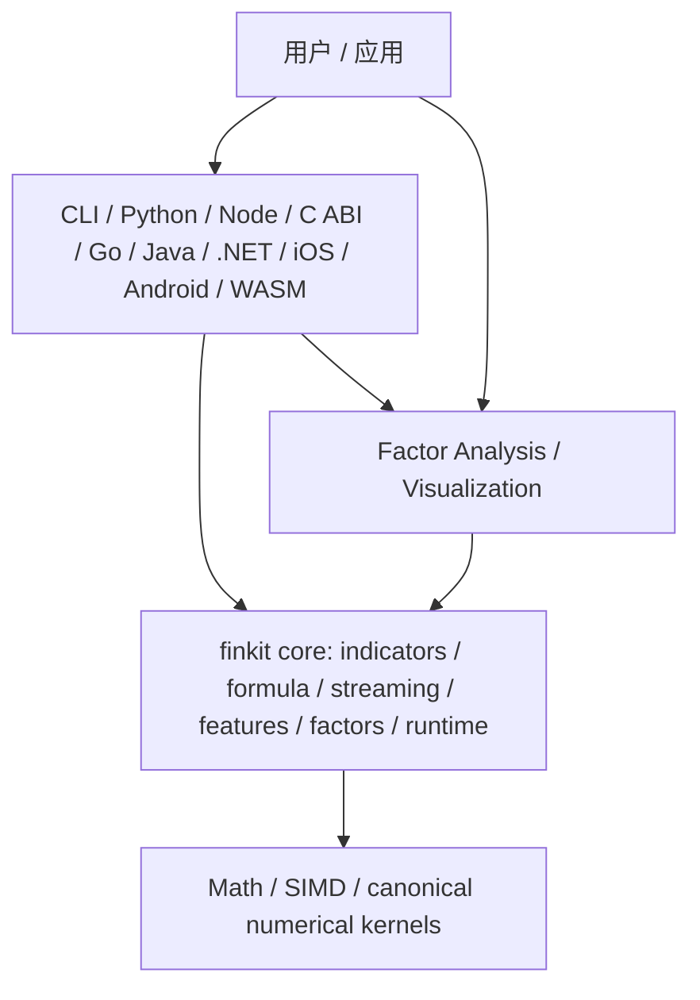
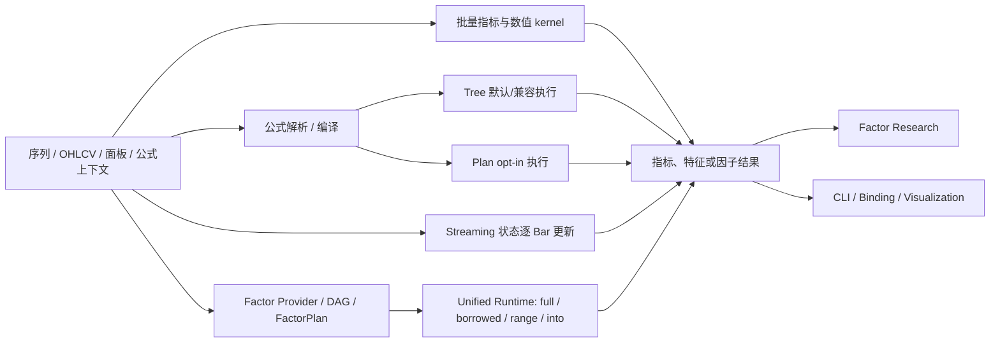

# Finkit 功能、架构与实现审查及重构建议

> 审查基线：`main` / `origin/main`，`5252c15b`，标签 `v0.2.0`，workspace 版本 `0.2.0`（2026-10-23）。
> 审查对象：仓库源码、Cargo workspace、公开文档、指标注册表、覆盖扫描脚本、CI 工作流，以及用户提供的《Finkit 与 TA-Lib 对比分析及优化改进方案.docx》。
> 证据分层：源码/配置静态审查与本地执行结果分别陈述；当前 GitHub Actions、公共包仓库和未在本机运行的平台没有被推定为已验证。
> 本文是当前审查快照和现状证据；重构目标、阶段顺序与验收门槛以 [TA-Lib 全量兼容与公式系统重构方案](TA_LIB_PARITY_AND_FORMULA_DIALECT_REFACTOR_PLAN_2026-10-23.md) 为准。旧 [V5 架构与重构总纲](FINKIT_ARCHITECTURE_AND_REFACTOR_PLAN_V5.md) 仅作为历史架构背景，不覆盖本方案中用户后来确认的范围。

## 结论

Finkit 已经是具有实质计算内核和多种用户入口的 Rust workspace，不是只有架构草图的项目。批量指标、公式、逐 Bar Streaming、特征工程、因子 DAG/计划、统一 Runtime、因子研究、CLI、图表渲染和多语言绑定都能在源码中找到实现。当前仓库版本为 `v0.2.0`。

但“主要子系统存在”不等于“所有核心能力全部完成”，也不等于“一条统一链路已经覆盖每种语言和平台”：

1. Rust 的指标、公式、流式、因子计算与研究能力都是真实代码；核心用户链路基本存在，但子系统并非全都通过同一个 Runtime 执行。
2. 公式仍有 Tree 与 Plan 两条执行路线，Tree 是默认/兼容路径；Plan 有明确的能力边界。Bytecode/JIT/SIMD 相关公式入口也不能仅凭名字视为同一条生产执行路线，仓库文档声明其中部分 API 冻结。
3. 指标注册表、代码符号、公式注册、语言绑定与生成文档之间的覆盖数不能直接互换。初审发现旧 `check_coverage.py` 的公式扫描结果为 0，且名称模糊匹配可能造成假阳性；本轮已将扫描改为使用真实公式函数提取器、规范化精确匹配和显式审核别名，并新增回归测试。
4. Cargo 的类别 feature 仍有 scaffold/不支持组合；是否能裁剪构建必须看 `check_feature_matrix.py` 中的实际支持名单。
5. 多语言绑定具有不同 API 面、运行平台和发布级别。绑定源码存在、CI 构建产物、GitHub Release 资产和公共包仓库发行是不同状态。
6. 最新项目审查矩阵仍以 2026-10-18 的候选 SHA 和旧版本状态为基线；仓库已进入 `v0.2.0` 源码/tag，但截至 2026-10-23 GitHub Releases 最新公开版本仍为 `v0.1.15`，应区分源码/tag 与公开发行并更新当前状态入口。

建议按“先修正能力事实和验证合同，再打通关键端到端链路，再收敛执行语义与 feature，最后依据证据治理内部模块边界”的顺序推进。不建议推倒重写，也不建议一开始拆 crate。

## 1. 项目主要功能

| 功能域 | 主要源码/入口 | 能力说明 | 当前判断 |
|---|---|---|---|
| 指标与数值计算 | `core/src/indicators/`、`core/src/math/`、`core/src/patterns/` | 技术指标、数学运算、形态与量化特征的批量计算；提供部分 caller-owned 输出和 SIMD kernel | 主体实现成熟；每个指标的 warm-up、NaN、数据形状、精度与语言暴露面仍需按合同核对 |
| 公式引擎 | `core/src/formula/`、`FormulaEngine` | 公式解析、方言兼容、AST/优化、缓存、Tree/Plan 执行、range/last/append 等 | 可用且能力面广；后端并存造成行为与支持范围不完全一致 |
| 流式计算 | `core/src/streaming/` | 为支持的指标逐 Bar 更新并保留状态，处理形成中数据的更新语义 | 独立状态机真实存在；不是每个批量指标都有流式实现，且未统一经 Runtime |
| 因子/复合 DAG | `core/src/factor_graph.rs`、`compute.rs`、`composite.rs`、`factor_system.rs` | 命名节点、依赖图、计划编译、缓存、借用输入和范围执行 | 核心 Rust 路径存在；与公式、Streaming 的共享合同和消费者覆盖仍需逐路径维护 |
| Unified Runtime | `core/src/unified_runtime.rs`、`unified_executor.rs` | 语义图编译、FactorPlan 执行、借用/范围/into 路径、缓存 artifact 与 DirtyRange | 有可调用实现；增量能力须遵循安全门槛，无法证明时回退完整计算，不应宣称任意 DAG 都可增量执行 |
| 特征工程 | `core/src/features/`、`core/src/transforms/` | rolling、归一化、标签、特征选择/组合及数据转换 | 能力存在；时间方向、未来数据泄漏、输出对齐和导出语义应以明确工作流合同覆盖 |
| 因子研究 | `factor-analysis/src/`、`run_factor_study` / JSON API | 数据准备、因子分析/验证、多因子与组合研究、绩效/风险统计及报告 | 研究链路存在；它评估传入的数据和收益，不是回测器、交易模拟器或完整选股/组合构建系统 |
| CLI | `cli/src/`、`finkit-factor-study` | 指标、公式、数据适配及因子研究命令行入口 | 有多个可执行入口；主 CLI 与研究 CLI 是不同产品路径，应分开做消费者级验收 |
| 可视化 | `visualization/` | 图表模型和 SVG/PNG/HTML 渲染，以及相应前端适配 | 独立能力存在；须明确其与数据/研究输出的格式合同和各 feature 输出 |
| 语言绑定 | `ffi/`、`wasm/` | Python、Node、C、Go、Java、.NET、iOS、Android、WASM 等入口 | 共享 Rust 核心是正确方向；各语言 API surface、平台支持和发行成熟度不同，不能用单一覆盖率概括 |

## 2. 架构与关键实现链路

### Workspace 分层

workspace 的依赖方向总体合理：语言适配和产品层消费 Rust 核心，计算逻辑不需要在每个语言中重写。主要结构压力集中在 `core` 内部：指标、公式、流式、因子图、缓存、执行 Runtime、schema 等职责都在同一 crate 下，通过大量模块/API 维持边界。

### 主要执行路线

图中表达的是现有能力之间的关系，不意味着各入口拥有相同输入合同、错误语义、缓存、增量行为或跨语言 API。Rust 侧从数据进入计算到研究/输出的关键路径基本贯通；“统一 Runtime”目前是局部收敛目标，不是所有 formula、streaming、指标和 binding 的共同调度器。

### 研究主流程

面板/因子输入 → 研究请求与 schema 校验 → prepare/收益与样本准备 → 单因子/多因子/组合分析与验证 → JSON/报告输出。Python、Node、Rust 和独立研究 CLI 提供相应入口；这些入口的存在和 CI 近期对它们执行消费者测试，是比单纯有函数实现更强的链路证据。研究统计结果仍不等价于模拟交易结果。

## 3. 完成度与链路判断

### 覆盖扫描快照

初审扫描器的旧结果已被本轮修复取代。当前 `scripts/check_coverage.py` 运行结果如下：

| 维度 | 匹配数 | 精确匹配数 | 解释 |
|---|---:|---:|---|
| 注册表指标总数 | 235 | — | 来自 `docs/indicator_registry.json` |
| 批量符号 | 235 | 精确 214、显式别名 21 | 没有未匹配项；名称存在不等同于数值语义 parity |
| 流式符号 | 144 项声明支持 | 精确 136、显式别名 8 | 没有未匹配项；Williams %R 与 LINEAR_REG 均映射到真实状态类型，名称存在不等同于 batch/stream 数值 parity |
| 公式函数 | 452 个注册函数 | 指标名重合仅作诊断 | 使用 `gen_ssot_docs.parse_formula_functions()`；指标名称重合不是公式支持率分母，也不等同于 Tree/Plan parity |

扫描器匹配规则由 `scripts/test_check_coverage.py` 覆盖：规范化精确匹配、禁止前缀/子串误判、显式别名目标存在性及当前 registry 抽取。它仍是符号/声明诊断，不是算法正确率或跨入口语义门禁。

上述数字是符号扫描器的结果，不是算法正确率、契约覆盖率、绑定 parity 或发行覆盖率。已有 2026-10-23 对比文档中的 TA-Lib 函数数量、绑定 surface 和性能数值仍需各自回到对应 SSOT/测试文件按同一 SHA 复算；本文不把该 Word 文档中的快照直接当作当前事实。

### 关键问题回答

| 问题 | 判断 |
|---|---|
| 核心功能是否全部实现？ | 否，不能这样概括。主要产品子系统有实现，但不同功能的支持矩阵不等价：公式后端存在能力差异，部分指标没有 streaming，类别 feature 不是都可构建，binding surface 和发行状态分级，增量 Runtime 需要保守回退。 |
| 核心 Rust 计算是否可用？ | 源码与现有测试/CI 合同表明是可用的稳定主干；本次对当前 SHA 执行了全 workspace Rust 测试，结果见文末验证记录。 |
| 主体链路是否贯通？ | Rust 指标、公式、因子计算及 Factor Research 的主干已贯通；Python/Node/研究 CLI 也有明确 JSON/消费者链路。它们不是一个共享 executor，且并非所有语言/平台都验证同一端到端能力。 |
| 全部 bindings 是否端到端完成？ | 否。每个 binding 的可编译、consumer 测试、目标平台、候选包、公开发行应分别核实；不得从 workspace 测试推出全部原生平台打包成功。 |
| 库是否提供回测、选股或组合构建引擎？ | 按仓库已确认的产品边界，这些不属于本项目承诺。研究层可分析用户提供的收益/组合数据，不能表述为回测或完整选股平台。 |

## 4. 不合理点与风险排序

| 优先级 | 问题 | 影响 | 建议 |
|---|---|---|---|
| P0 | 当前事实基线落后于 release：状态矩阵和工作流文档仍标注 10/18、v0.1.15 或候选 SHA | 读者会把历史 candidate 误解成 `v0.2.0` 当前行为/发行状态 | 更新状态矩阵的 SHA、版本、日期和证据；旧数据留在历史章节，不宣称已在本次重跑 |
| P0 | 指标覆盖扫描器的匹配规则与当前注册架构不一致 | `formula_hit=0` 是假阴性；模糊符号匹配也可能制造假阳性，排期和宣传数字不可依赖 | 改为从 canonical function registry/生成 schema 导出能力映射；别名必须显式声明；不允许把 prefix/substring 当精确实现 |
| P1 | 公式执行后端并行，公开 API 入口繁多 | Tree/Plan、缓存、bytecode/JIT/`eval_simd` 容易被误认为同一能力，跨入口语义差异提高维护成本 | 维持兼容 facade；用一个公开后端能力矩阵登记每个 API；以 absolute golden + differential gate 扩 Plan 覆盖，再讨论默认切换 |
| P1 | capability registry 表达与运行时实际能力之间仍有待对账项 | batch/streaming/formula 支持情况分散在源码、registry、文档、测试 allowlist | 将“输入类型、warm-up、NaN、batch/stream、formula backend、binding、feature”变成可机读能力合同并生成文档/测试清单 |
| P1 | core crate 内部职责密集，边界主要依赖约定 | 变更影响面、编译成本和维护者理解成本上升；但现在拆 crate 会引入依赖/版本/feature 新复杂性 | 先加模块依赖方向、稳定 façade、owner 与编译基线；后续按依赖图和构建收益拆分 |
| P1 | Cargo feature 的名字可读作已支持裁剪能力，但有明确 scaffold/known-broken 组合 | 用户可能错误配置依赖，feature 组合漂移也难被默认构建发现 | 只把 feature matrix 脚本中的 supported 组合列为支持合同；公开分类 feature 先明确标记/收窄，真正实现后逐项纳入 CI |
| P1 | 多语言能力矩阵把 API 数量、CI、产物和发布混淆的风险仍在 | “绑定有源码”或“78/78 指标接口”容易被理解为公式/研究 parity 和公开发布 | 分层为 source / compile / unit+consumer / platform artifact / public registry，并逐项列产品能力 |
| P2 | 公开 API 面较宽且相近入口多 | 文档难以让使用者选对路径，弃用成本随 binding 扩大 | 优先做推荐入口、迁移说明和稳定 façade；冻结接口按既有兼容承诺处理，不做无计划删除 |
| P2 | 设计目标和性能优化项多，容易将微基准领先当作整体完成度 | 端到端性能受分配、数据复制、缓存、内存带宽和绑定边界影响 | benchmark 同时覆盖单 kernel、公式/因子工作流、安装包消费者与多数据规模；报告绑定 SHA/平台/编译器 |

## 5. 重构路线

### 阶段 0：固定事实基线（P0）

1. 将 [实现状态矩阵](architecture/status-matrix.md) 更新为 `5252c15b` / `v0.2.0` / 2026-10-23，按“源码、专项测试、语义 parity、CI target、产物、公开发行”拆列。
2. 更新 `workflow-matrix.md`、`docs/README.md` 和 README 的版本/成熟度表述，标注本地验证、远端 CI、公共 registry 的证据来源和未知项。
3. 明确指标 registry、公式函数 registry、binding spec、feature matrix 哪些是 SSOT，哪些为生成物；不再手工维护同一清单的多份拷贝。
4. 修复 `check_coverage.py`：从真实注册表导出 formula/batch/streaming 映射；对于无法自动判断的名称映射，要求显式 alias；输出 exact/alias/unsupported/unknown，而不是模糊匹配命中即算覆盖。

**验收：** 每一条能力数字均可由当前 SHA 的机器可读合同复算；零误报/漏报样例有测试；文档中不混用旧 release 和当前状态。

### 阶段 1：打通并固化用户端到端闭环（P0）

按用户确认，Rust + Python/Node 是首要端到端支持层级；其他 binding 按能力 tier 登记并逐步扩展。

逐条建立最小但完整的工作流：

1. 数组/OHLCV → 指标 → NaN/warm-up 正确结果。
2. 公式文本 → 编译/校验 → Tree 与受支持 Plan 执行 → 多 channel 结果。
3. 逐 Bar 输入 → Streaming 状态更新 → formed-bar 修订或明确拒绝。
4. 因子依赖图 → 计划编译 → full/range/into 执行 → 结果/缓存 artifact。
5. 面板研究请求 → schema 校验 → prepare/analyze/validate → 报告 JSON；分别由 Rust、Python/Node 和研究 CLI 消费。
6. binding 安装包 → 从包外导入 → 一项指标与一个公式/研究工作流 → 验证错误/返回值。

每条测试都声明数据输入、公开 API、输出 schema、错误语义、NaN/warm-up、支持平台、绑定 tier 和对应 CI job。跨语言目标不必接口长得一样，但结果和错误类别必须有可比较合同。

**验收：** Rust 主路径及 active binding 各有包外消费者测试；流程失败不会被仅有单元测试或 `cargo check` 替代；支持声明与 CI job 一一对应。

### 阶段 2：收敛能力合同与公式执行（P1）

1. 保留 Tree 参考/兼容路径，逐项扩 Plan 支持矩阵；Plan 不支持的入口必须稳定报类型化错误或显式回退。
2. 对公式运行绝对数值合同和 Tree/Plan 差分合同，覆盖主要方言、缓存冷/热、空/短/长序列、warm-up NaN、字符串/多输出和输入修订。
3. 不根据局部 benchmark 直接切换默认后端；只有能力矩阵完整、差分无漂移、典型消费者工作负载性能和分配收益成立后，再进行兼容性决策。
4. 将 bytecode/JIT/`eval_simd` 的实际实现、冻结状态、调用路径与 binding 暴露收录到公式入口单一矩阵，防止名称造成错误预期。

**验收：** 每个公开入口有实现状态与后端适用范围；Tree/Plan 支持域、绝对正确性和运行性能均可复现。

### 阶段 3：收紧 feature 与运行时语义（P1）

1. 以 `check_feature_matrix.py` 的 supported 列表作为用户合同；禁止将 `all-features` 当作可验证配置（特别是 `std` / `no_std` 互斥时）。
2. 移除或明确标注不可独立构建的指标类别 feature scaffold；如需可裁剪构建，按指标家族拆出真实模块依赖，再为每一组合加独立 CI build。
3. 对 full、borrowed、range、into、DirtyRange 明确数据所有权、范围边界、缓存失效和 fallback 规则；Formula、Factor 与 Streaming 只共享相同语义，不强行合并不同执行器。

**验收：** 用户文档只推荐可构建组合；增量路径与 full recompute 等价，安全条件不满足时可观察地回退。

### 阶段 4：内部模块治理与拆分决策（P2）

1. 先给 `core` 建立稳定模块 façade、依赖方向规则、owner 和变更影响矩阵；禁止新的横向循环依赖。
2. 以责任内聚和单向依赖为标准分离纯数值 kernels、公式语言/执行、流式状态、因子 Runtime/缓存及公共 schema；首批只做模块级隔离和纯移动。
3. 记录 clean build 与增量 build 时间、依赖编译工作量、公共 API 变化和维护 ownership；只有实际收益超过版本/发布/feature 维护成本时才提取 crate。
4. 任何拆分保持现有 `finkit` public façade，提供兼容层和 deprecation 迁移周期。

**验收：** 模块依赖图无环；纯移动提交行为不变；crate 拆分有量化收益、稳定合同和迁移策略。

### 阶段 5：性能、绑定与发布治理（持续）

1. 对照本次绝对数值合同，按 kernel、公式/因子工作流、binding consumer 和大输入规模分层测量性能。
2. 所有 benchmark 记录 SHA、CPU/OS、Rust/Python/Node 版本、feature、数据形状和重复次数；用中位数/允许误差，不使用单轮噪声做门禁。
3. 对每个 binding 分别记录 source、编译、语言级单测、包外 consumer、平台产物、公开 registry 状态；只为产品承诺的 tier 设置发布门禁。
4. release 从干净 tag 构建，并以安装包消费者验证结束；CI 成功不能自动等价为 registry 已发布。

## 6. 验收指标

- 关键指标、公式、流式、FactorPlan、研究、CLI、Python/Node 六类工作流均有机器可读能力合同和端到端/消费者测试。
- registry 中声称支持的每个指标，其 batch/streaming/formula 适用性都有可核对状态；没有靠 substring 模糊匹配的覆盖结论。
- 所有公开 feature 组合均进入 CI；不可构建组合不作为公开支持项。
- Formula Tree/Plan 的绝对 golden 和差分覆盖采用同一输入语料，并在不支持场景明确失败或回退。
- 绑定矩阵按语言 API、平台产物和发行渠道分列；每个 `released` 状态可追溯到 tag、资产或公共 registry URL。
- core 拆 crate 前具备依赖图和 clean/incremental build 对比；无可量化收益时维持 façade 与内部模块治理。

## 7. 本次验证与限制

### 已核对

- Git 基线：`5252c15b`，`main` 与 `origin/main` 一致，tag 为 `v0.2.0`。
- Workspace 版本：`0.2.0`；Rust/Cargo 工具链：`1.98.1`。
- 静态审查：Cargo workspace、crate 依赖、关键 Formula/Runtime/Factor Study 入口、工作流矩阵、状态矩阵、coverage scanner。
- 覆盖扫描：`python scripts/check_coverage.py --json`，结果见第 3 节；扫描器本身的公式统计不可信，方案要求先修复。
- 用户提供的 Word 分析已阅读，并与当前 repo 文档/代码入口交叉核对；其中口径及旧指标没有作为未经复核的当前事实引用。

### 自动化测试

本次执行 `cargo test --workspace --locked --no-fail-fast`。第一次因环境没有注册 Python 解释器，Python FFI crate 的 PyO3 构建失败；将应用内 Python 显式配置为 `PYO3_PYTHON` 后，命令完成并以退出码 **0** 结束。核心、因子研究、CLI、可视化、FFI 和文档测试均由 workspace 测试命令覆盖。该结果证明本机 Windows x64 当前源码的 workspace 测试通过，不证明所有目标平台原生构建、包外安装或发布通过。

本次未覆盖所有操作系统原生工具链、干净安装的各语言包和公开 registry 发布；这些状态应继续以对应 CI/consumer 工作流分别证明。

## 8. 参考

- [架构总览](architecture/overview.md)
- [核心工作流矩阵](architecture/workflow-matrix.md)
- [实现状态矩阵（当前内容需升级到本基线）](architecture/status-matrix.md)
- [核心合同](core-contracts.md)
- [运行时与缓存合同](architecture/runtime-and-cache-contract.md)
- [V5 架构与重构执行基线](FINKIT_ARCHITECTURE_AND_REFACTOR_PLAN_V5.md)
- [2026-10-18 审查快照（历史证据）](PROJECT_REVIEW_AND_REFACTOR_PLAN_2026-10-18.md)
- [GitHub Releases（核对日期：2026-10-23）](https://github.com/coeasy/finkit/releases)

## 9. 按 V5 方案落地进度（2026-10-23）

本节记录本轮“按方案全部落地实现”的实施状态。用户确认首要绑定层为 Rust + Python/Node，并明确**不实现回测**；因子研究仅分析请求中提供的数据/收益，不扩展为交易模拟器、回测、选股或组合构建引擎。

| 阶段 | 状态 | 本轮落地 / 依据 | 后续边界 |
|---|---|---|---|
| 0. 事实基线与覆盖合同 | 已完成 | 覆盖扫描器使用实际公式函数提取器；精确匹配与显式别名分离；4 项回归测试加入 `research-test` CI；更新本审查、状态矩阵、工作流矩阵与 README；公开发行与仓库 tag 分开表述 | 新文档尚未暂存，所以链接门禁要求在进入 Git index 后再复跑；其他 registry 发行信息随 release 单独核对 |
| 1. 端到端闭环 | 核心与 active binding 合同通过；包外安装闭环持续验证 | 共享 `engine_contract_v1.json` 被 Node/Python 消费；Node 16/16、Python 3/3；workspace 全测试通过；CLI CSV→报告和 Rust runtime/Factor/Formula 用例执行 | 最终包外 clean install 与各平台 artifact 仍由 release workflow 证明；不扩展到回测 |
| 2. Formula Tree/Plan | 已落地并通过当前全套测试 | 默认 Tree、opt-in Plan、差分语料和 tree-only 入口由 tests 与 `check_formula_engine_contract.py` 约束；workspace 测试本轮通过 | 不在完整差分与性能数据不足时切换默认后端 |
| 3. Feature 与 Runtime 语义 | 合同已落地；类别裁剪明确不支持 | `check_feature_matrix.py` 本机验证 4 个受支持组合可构建、6 个已知不支持组合仍失败；Cargo 注释标明类别 feature 是 scaffold；Runtime 收敛/回退合同在全 workspace tests 中 | 不把类别 feature 宣称为可裁剪构建；真正支持前继续维持不支持矩阵 |
| 4. 模块治理 | crate 依赖门禁和 core 边界文档已落地 | `check_dependency_direction.py` 验证 14 crate 的 30 条生产依赖边单向向下；新增 core 职责/变更影响矩阵；不为拆分而拆 crate | clean/incremental build 基线尚未建立，故按方案不提取新 crate |
| 5. 性能、绑定与发布 | 持续执行 | 复用仓库已有 benchmark、绑定 parity、包外消费者和 release workflows | 远端 CI、其他 OS、公开 registry 与 release 资产必须分别核验；不以本地 workspace 通过代替 |

### 本轮新增/复验记录

- `scripts/test_check_coverage.py`：4/4 通过。
- `scripts/check_coverage.py`：235 个 registry 指标；batch 214 exact + 21 alias；streaming 136 exact + 8 alias（144 项均有匹配）；公式 registry 452 个函数。
- `scripts/check_streaming_registry_contract.py`：通过；235 registry 行、169 个 `IndicatorMeta` 实现、144 条 streaming 声明一致。
- `scripts/check_feature_matrix.py`：4 个 supported 组合通过，6 个 known-broken 组合仍按预期失败。
- `scripts/check_dependency_direction.py`：30 条生产依赖边全部向下；1 条 dev-only 边明确记录。
- `scripts/check_formula_engine_contract.py`：13 条 Tree-only 边界与文档/测试名册一致，默认后端为 Tree。
- `cargo test --workspace --locked --no-fail-fast`：本轮工作树退出码 0，workspace crate 测试与可执行 doctest 通过。
- Node `npm test`：16/16 通过；共享 Rust/Python/Node contract fixture、公式与 factor-study JSON consumer 均执行。
- Python `test_engine_contract_v1.py`：3 个测试函数直接执行并通过；当前应用内 Python 有 NumPy，但无 pytest，因此没有声称 pytest runner 本身通过。
- `gen_ssot_docs.py --check`、`check_orphan_scripts.py`、`check_orphan_docs.py`：通过。`check_docs_links.py` 因本审查文档尚未加入 Git index 而报未跟踪链接（文档存在且链接目标正确）；本轮不替用户暂存或提交文件。
- 回测：明确排除；本轮没有新增回测代码、模拟成交、策略执行或组合构建接口。
