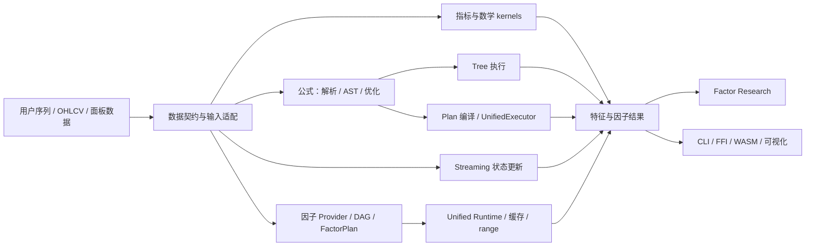

# Finkit 项目功能、架构与重构审查（2026-10-18）

> 审查起点：`main` HEAD `8b398999`（`fix formula and package release paths`），workspace `0.2.0`。当前执行分支：`codex/release-v0.2.0-convergence`。
> 本文包含源码审查、Windows x64 候选工作树复验和 PR #30 远端 CI 观察。原 155 项 TA-Lib 对照中 APO、BETA、HT_TRENDMODE、STOCHRSI 的差异已在当前候选工作树修复并通过；最终提交 SHA 的 CI 仍待复验。验证明细见 [实现状态矩阵](architecture/status-matrix.md)。
> 范围依据仓库已有的产品边界决定：Rust 金融计算引擎、公式/流式/因子计算、因子研究、CLI/可视化及语言绑定；不把回测引擎或选股/组合构建引擎列为本库目标。

## 结论摘要

Finkit 是一个以 Rust 为中心、功能面较广的金融数值计算 workspace。主要算法和多个产品入口已经存在，不属于只有架构草图的原型；Rust 端从 OHLCV/序列输入到指标、公式、因子计算，再到因子研究分析的主要路径基本贯通。

但不能据此认定“核心功能全部实现”或“所有入口完全统一”：

1. 公式有 Tree 与 Plan 两套路径；Tree 仍是默认参考/执行路径，Plan 是可选路径，并有登记的 Tree-only 入口。
2. 指标类别 feature 仍是 tree-shaking scaffold；Cargo 清单明确记录多种 feature 子集不能构建。
3. `core` 集中了指标、公式、流式、特征、因子图和 Runtime 等大量职责。crate 依赖方向整体清晰，但 crate 内部边界与 feature 合同仍是主要复杂度来源。
4. 多语言绑定的指标 surface 数字不能代表完整能力 parity；移动端是有意收窄的子集，其他 binding 的发布成熟度也不一致。
5. 统一 Runtime、DirtyRange 与 Factor Research 属于源码中的较新能力，其远端 CI、多平台发布状态仍未知；本地 workspace、Python/Node 和 CLI consumer 测试已在候选工作树重跑通过。

**建议：不推倒重写，也不先拆 crate。先收敛产品能力合同、修正文档/状态矩阵、明确执行路径与功能边界，再根据实测维护成本逐步治理 `core`。**

## 1. 功能地图与实现状态

| 能力 | 主要实现位置 | 当前判断 | 已知边界 |
|---|---|---|---|
| 技术指标与数值 kernel | `core/src/indicators/`、`core/src/math/`、`core/src/patterns/` | 核心实现较完整 | 指标数量大不等于所有数据形态/语言绑定/feature 组合都完整 |
| 公式语言与执行 | `core/src/formula/` | Tree 与 Plan 均有实现；Tree 仍为默认 | Plan 对登记的部分入口明确报 `BackendUnsupported`；兼容 bytecode/JIT/SIMD 名称中有冻结接口，不能把名称理解为真实 native JIT 或公式 SIMD |
| Streaming | `core/src/streaming/` | 有逐 bar 状态更新实现 | 批量、流式、形成中 bar 修订等场景的覆盖需按具体指标合同逐项看；不是所有调用都经统一 executor |
| 因子与组合执行 | `core/src/factor_graph.rs`、`factor_provider.rs`、`semantic_graph.rs`、`compute.rs`、`unified_runtime.rs` | 有依赖图、计划、执行和缓存实现 | 与公式、streaming 的语义入口尚非一条全覆盖执行通道；增量路径须按安全条件回退 |
| 特征工程 | `core/src/features/`、`transforms/` | 变换、rolling、标签、选择和导出能力存在 | API 面较宽；需要维护算子清单、时间方向/未来数据泄漏合同及各出口的可验证性 |
| 因子研究 | `factor-analysis/src/` | 独立 crate，具备数据准备、分析/验证、组合与报告类能力 | 属于研究分析，不应宣传为完整回测/交易模拟或选股平台 |
| CLI | `cli/src/` | 提供指标、公式、数据输入及研究相关入口 | CLI 是否贯通每个 Runtime/研究特性应以命令矩阵为准；源码存在不等于每个入口都有稳定交付合同 |
| 可视化 | `visualization/src/` | 独立渲染 crate | 需要与分析/CLI 的支持格式和数据合同明确对应 |
| 多语言绑定 | `ffi/`、`wasm/` | 多种绑定源码存在，部分 indicator API 达到登记 surface | 78/78 是 `docs/ffi_registry.json` 的指标 surface；不代表公式、流式、研究 API 全对等，也不代表已在所有平台发布 |
| Cargo feature 子集 | `core/Cargo.toml`、`scripts/check_feature_matrix.py` | default、bare/no_std 等有受支持合同 | 分类指标 feature 标注为 scaffold，单类/若干 feature-only 组合明确登记为 KNOWN_BROKEN；不可宣称为可用的按需裁剪构建 |

### 核心计算与研究主链路

该图表示源码能力关系，不表示每种输入都能经过同一个执行器，也不表示每个 binding 都暴露每个节点。较可靠的结论是：**Rust 主计算路径已贯通；统一运行时的覆盖是局部且正在收敛；多语言交付链路按 API 和平台分层，不是完整功能 parity。**

## 2. 架构与实现评价

### 合理之处

- 用 Rust core 承载数值算法，binding 负责语言适配，避免在多语言重复维护计算语义。
- workspace crate 依赖大体向下：CLI/绑定/研究与可视化依赖 core，没有证据显示需要整体反转依赖方向。
- 对数值语义、输入边界、公式后端能力、缓存和 feature 组合已经建立多份合同及脚本守卫；已知不支持的能力有一部分被显式登记，而非完全隐藏。
- Factor Research 单独成 crate，说明产品工作流可在不拆主计算 crate 的情况下隔离。
- 对增量计算采取安全优先、不能证明时回退完整执行的设计原则是合适的。

### 不合理或维护风险

| 优先级 | 发现 | 影响与判断 |
|---|---|---|
| P0 | 多份“架构/状态/产品”文档基线过期或互相冲突 | 原状态矩阵以历史 SHA 为当前基线，README 的版本用语和目录索引也过期。本轮已加入候选验证状态、修正架构 crate 图、整理 10/18 文档索引；最终提交后仍需固定 SHA 与 CI/发布状态。 |
| P0 | crates.io 发布 job 的 docs.rs 配置启用互斥 feature | `all-features=true` 同时启用 `std` 和 `no_std`，编译期必然失败。本轮将 docs.rs 元数据和 tag 工作流改为相同的显式默认 feature allowlist，并用对应命令在本机验证通过。 |
| P0 | Python wheel 准备脚本仍指向旧版扁平源码路径 | PR #30 首轮四个平台都在 wheel 编译前失败：`binding_spec.py` 读取已拆分移位的 `core/src/indicators/momentum.rs`，且 batch contract 仍检查旧 `lib.rs`。已改为实际的 `momentum/mfi_impl.rs`、`momentum/willr_impl.rs` 与 `talib_compat.rs`，增强末尾函数边界支持；`verify_python_bindings.py`、完整 `prepare_python_hot_bindings.py` 本机复跑通过；最新 SHA 的 Linux、macOS arm64/x86_64 wheel 均通过，Windows job 仍运行。 |
| P0 | 平台目标安装与仓库 Rust 工具链不一致 | PR #30 的 wasm、Android、iOS 和 AArch64 job 在安装目标到 `stable` 后，被 `rust-toolchain.toml` 覆盖到 1.98，导致目标组件缺失。显式固定 `toolchain: "1.98"` 后 AArch64 warning contract、WASM、iOS XCFramework/Swift typecheck、Android AAR、Rust package 及 Java/.NET/Go/Node 多平台 job 全部通过。 |
| P0 | macOS Python wheel stub 检查受系统 site-packages 污染 | 只固定 setup-python 解释器仍导入旧的 `/Library/Frameworks/.../site-packages/finkit`。在 macOS wheel job 新建 venv 后，最新 arm64 wheel 构建、135 项测试和 stub 对扩展检查均通过。 |
| P0 | C 数值契约生成器没有输出 JSON 字符串 token | PR #30 `cpp-linux` 的 C numeric contract 因请求生成成 `{"operation":ACCBANDS,...}` 而解析失败。已让生成器对 semantic profile 与 operation 先 JSON 序列化再做 C 字符串转义并重产 C 头文件；生成器 `--check` 通过，最新 Linux C unit、C++ indicator/catalog、C API smoke 与 201-vector numeric contract 全部成功。Windows 本机目标成功编译，但运行未在本轮完成。 |
| P0 | 安装 wheel 的 Architecture v3 性能发布门禁原始阈值和单轮判定不稳定 | 三个独立 Ubuntu Actions 运行总体几何平均为 1.170/1.170/1.097x，100K 为 1.206/1.207/1.106x，1M 为 1.151/1.154/1.082x；可见跨运行噪声，而原始 1.20x 1M 与 Top-20 最低 1.05x 也不符合现有基线。按用户选择，已新增三轮中位数 gate 与三次 Actions 观测基线，使用 10% 非回归容差，并将单项最低值降为诊断指标；新 gate 需在新 SHA 上复验。 |
| P0（候选已修复） | 扩展 TA-Lib 覆盖门禁暴露四个数值 parity 差异 | 已修复 APO 默认 EMA 与 matype 语义、BETA 近常量收益窗口的数值退化、Python HT_TRENDMODE warm-up 输出及 STOCHRSI 参数映射。当前 Windows x64 安装 wheel 对照 155/155 项通过，Python 合同测试 8/8 通过；最终提交 SHA 的远端 CI 尚未复验。 |
| P1 | 公式双路径行为面复杂，默认与“统一运行时”产品叙述有距离 | Tree 仍是默认；Plan 可选且有 Tree-only 入口。旧审查的特定 workload 性能数据不是当前候选重测。本轮已为 Rust/Python/Node 增加 backend 查询与选择，继续保留 Tree 默认；切换默认仍要基于有代表性的 benchmark 决策。 |
| P1 | Cargo feature 名称容易被误读为可用裁剪功能 | 分类 feature 在 `core/Cargo.toml` 中明确不可独立使用；多个组合被登记为 KNOWN_BROKEN。对使用者来说 feature 合同可理解性不足，未来拆模块前需先让声明和构建事实一致。 |
| P1 | 完成度叙述把“源码存在、测试覆盖、CI target、发布”并列但更新节奏不同 | 项目当前有细致矩阵的雏形，不过旧矩阵只记旧 SHA/旧状态。不同成熟度 binding 与 next-release 能力容易被营销或 API 数字误推为已交付。 |
| P1 | `core` 单 crate 职责集中，内部边界弱于 workspace 边界 | 指标、公式、streaming、features、factor systems、Runtime 和 schema 同处核心 crate；增加修改的耦合与全量编译/feature 组合成本。当前没有证据证明立即拆 crate 的净收益，先加依赖方向和模块 API 约束更稳妥。 |
| P2 | API 路径多，名称/语义相近的执行入口较多 | 批量 kernel、compiled formula、plan、streaming、factor plan、FFI 包装都有各自的输入/输出/错误语义。调用者容易选错入口；维护者需持续维持矩阵和差分合同。应逐步收敛公共 façade，而非强行统一底层实现。 |
| P2 | 公开 binding surface 与内部核心能力不对称 | 多语言指标生成/同步已有工具；研究、streaming、公式入口和错误语义的统一程度不足。只做 indicator parity 无法证明端到端产品流程可用。 |
| P2 | Clippy pedantic warning 数量过大，质量信号被淹没 | 当前候选 `cargo clippy --workspace --all-targets --locked` 退出码为 0，但输出数千条 warning（core test target 单项 7419 条；CLI 60 条等）。warning budget 可允许既有告警，但缺少趋势/上限会使新增问题难以辨认。应分 crate 建基线、分类降噪并防止数量回升，而非一次性机械套用 `-D warnings`。 |

## 3. 核心功能是否全部实现？主体链路是否全部贯通？

| 问题 | 审查结论 |
|---|---|
| 核心计算功能是否存在？ | 是。指标、公式、流式、特征、因子图/Runtime 与因子研究都有实际源码和公开文档入口。 |
| 所有目标功能是否已实现？ | 否，至少不能作此结论。公式 Plan 有显式不支持的入口；feature 子集存在已知不可构建组合；移动端是 15/78 子集；binding 发布状态不一致；部分 Runtime/研究能力属候选或源码能力。 |
| Rust 主链路是否贯通？ | 基本贯通：序列/面板数据可进入数值或语义计算，结果进入因子研究、CLI 或其他输出适配。不同子系统不是都经过同一个统一 executor。 |
| 全仓库主体链路是否端到端贯通？ | Rust 主计算路径存在且 workspace 测试通过；Python/Node 公式与 Factor Study JSON、Factor Study CLI CSV→报告 consumer tests 已在候选工作树通过。所有目标平台的干净安装及 Release runner 尚未完成验证，因此不能判为全平台闭环。 |
| 回测、完整选股是否已实现？ | 不属于已确认的产品范围；公式可表达筛选条件，因子研究可分析组合结果，但库内不提供回测器、横截面选股或组合构建引擎。 |

## 4. 建议的重构与收敛方案

原则：**先清理合同和验证路径，再动模块边界；保持兼容 facade；不以重写或 crate 拆分作为第一步。**

### 阶段 0：确立当前事实基线（立即）

1. 已建立本审查与状态矩阵作为当前入口；README 与架构索引已更新。PR #30 已提供远端 Linux wheel、绑定包和失败门禁证据；本轮修复候选提交后仍须绑定新 SHA，并对照完整 CI / Release。
2. 每个状态记录 `commit SHA + 日期 + 平台 + 命令或发布 URL`；无法读取当前 CI/平台时明确标 unknown。
3. 继续维护已确认的产品边界（不做回测引擎、选股/组合构建引擎），避免将公式筛选和研究统计误读成这些产品能力。
4. 对公式入口矩阵、binding 矩阵、Cargo feature 矩阵设一个明确的 SSOT 和生成/对账门禁，避免手工表重复维护。

**验收条件：** README、架构总览、状态矩阵和发布说明对同一 SHA 的功能成熟度无冲突；每项“已完成/已验证/已发布”均能追溯到对应证据。

### 阶段 1：定义核心工作流与端到端合同

1. 明确最重要的用户工作流（建议最小集合：批量指标；公式编译/执行；streaming 更新；因子图执行；因子研究 prepare→analyze→report；每个 active binding 的安装→输入→计算→取回结果）。
2. 对每个工作流列出输入类型、执行入口、warm-up/NaN/错误行为、输出类型、缓存与增量语义、支持的语言/平台。
3. 对目前仅有源码/单元测试但没有跨层 consumer 闭环的流程标记 gap；按产品优先级补接线，而非增加新的 API 名称。
4. Rust/Python/Node backend 可查询和显式选择已落地；跨语言错误分类与其他 binding 的 backend 可观测性仍需逐项收敛。

**验收条件：** 主工作流矩阵中每一条都能从公开入口跑到结果；失败路径有类型化错误；声称支持的平台均有干净 consumer 安装/运行证据。

### 阶段 2：收敛公式与 Runtime 路径

1. 保留 Tree 作为 reference 路径，继续完善 Plan 的支持矩阵与 Tree/Plan 数值差分；Tree-only 能力逐项标为保留、接线或弃用，并附迁移入口。
2. 重新基于当前 HEAD 对代表性公式/方言/长度/缓存冷暖态测性能和分配；旧提交的测量只用于选取用例，不作为退出门槛结果。
3. Rust/Python/Node 已提供 backend 查询和可选显式选择；默认保持 Tree。Plan 是否达到切换默认的 workload 门槛仍待当前 HEAD 性能证据。
4. 对公式、FactorPlan、range、DirtyRange 和 streaming 定义共享的数据/错误/缓存观测合同；保留各自确有不同语义的 executor。

**验收条件：** 支持矩阵覆盖公开入口；差分/绝对语义门禁通过；性能、内存与兼容策略达到由产品确认的门槛；每个 active binding 可以查询并在需要时锁定 backend。

### 阶段 3：修整 feature 与模块边界

1. 短期将已支持的 Cargo feature 组合当作唯一用户合同；分类指标 feature 在真正可独立构建前，明确标成内部 scaffold 或从用户推荐路径隐藏。
2. 将 `core` 内部依赖按 kernel、语义/公式、运行时、研究适配划出模块层次，启用依赖方向守卫和稳定模块 façade。
3. 通过实际增量编译耗时、依赖树、API 稳定性、维护 ownership 指标决定是否拆分 crate；若拆，先抽取依赖图已单向、公共合同已稳定的模块，`finkit` facade 保持兼容。
4. 继续控制超大源文件，按职责切分，并为每个 SSOT/生成代码维护单向生成关系。

**验收条件：** 每个公开 feature 组合都在 CI 构建；未支持组合不误导使用者；模块依赖图无循环；拆 crate 的提案有构建/发布/维护收益证据。

### 阶段 4：按交付层治理 bindings 与 release

1. 按 Rust / active bindings / deferred bindings / mobile subset / WASM / CLI 维护能力表，每行分别标指标、公式、streaming、研究 API、错误语义、平台 runner、发行渠道。
2. 对 active tier 做安装后 API smoke 和最小端到端计算；其他 tier 先声明支持面和发布计划，不用覆盖率百分比替代成熟度。
3. 将候选包、CI artifact、公开 release、registry package 分开标注，发布证据绑定 tag 与 SHA。
4. 对跨绑定公共业务操作优先复用共享 host contract；只有语言惯例差异留在 adapter 层。

**验收条件：** 绑定矩阵能区分 API 覆盖、真实运行平台、包产物和公开发行；release tag 对应的包可被干净消费者安装并跑通最小核心链路。

## 5. 当前建议优先级

| 次序 | 事项 | 原因 |
|---|---|---|
| 1 | 最终提交后更新状态矩阵与 README/产品说明的 SHA、远端 CI 和发行状态 | 本地候选证据已补，最终远端状态未核 |
| 2 | 列出端到端工作流矩阵并找出未贯通项 | 将架构能力映射到实际用户成果 |
| 3 | 基于最终 HEAD 重核公式 Plan 性能和扩展到其他绑定的 backend 语义 | Rust/Python/Node backend 已收敛；默认切换仍是兼容性决策 |
| 4 | 修正/收窄 feature 声明和用户指引 | 避免 feature 名称成为错误产品承诺 |
| 5 | 用证据决定 `core` 内部治理或拆 crate | 现在拆分会扩大合同和依赖不稳定的维护面 |

## 6. 风险、假设与待确认

- 本审查遵守仓库现有产品定调：不做回测引擎和选股/组合构建引擎；这不是待确认项。
- 当前 GitHub Actions 运行结果、远端平台 runner、公开 registry 与 release 资产未在本轮读取，因此状态均需以对应外部证据更新。
- 2026-10-18 候选工作树本地测试已通过，但无远程 GitHub Actions、macOS/Linux/移动端 runner 与 registry 发布证据；最终发布依赖这些外部结果。
- 本地 `cargo test --workspace` 初次编译出现 Windows incremental lock 清理权限警告，命令最终退出码 0；不影响这次测试结果，若 CI 重现需单独诊断。
- 已按用户确认的仓库范围评估；回测、选股/组合构建不是本次重构目标。

## 7. 相关文档

- [架构总览](architecture/overview.md)
- [实现状态矩阵（需按本文更新基线）](architecture/status-matrix.md)
- [公式入口矩阵](architecture/formula-entry-matrix.md)
- [数据流](architecture/dataflow.md)
- [运行时与缓存合同](architecture/runtime-and-cache-contract.md)
- [多语言绑定](language-bindings.md)
- [历史审查：2026-10-13](ARCHITECTURE_REVIEW_AND_REFACTOR_PLAN_2026-10-13.md)
