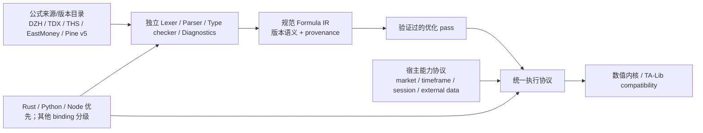

# Finkit TA-Lib 全量兼容与公式系统重构方案

> 日期：2026-10-23
> 仓库基线：`main` / `5252c15b` / workspace `0.2.0`（工作区有未提交的用户改动，实施时必须保留）。
> 目标：以最新正式版 TA-Lib 为对照，完整覆盖其公开公式/功能面；完整支持大智慧、通达信、同花顺、东方财富、TradingView Pine Script v5；每个公平可比性能项 `TA-Lib elapsed / Finkit elapsed >= 1.0x`，并有可复现、逐项、跨层验证。
> 明确排除：回测引擎。AlphaTA 是历史项目名/兼容遗留，不再作为目标公式系统或产品定位。

## 用户已确认的决策（本方案基线）

- 优先完成 Rust 核心与 Python、Node 的端到端支持；其他已有绑定保留分层能力矩阵并逐步补齐。
- 公式系统目标为大智慧、通达信、同花顺、东方财富和 TradingView Pine Script **v5**；AlphaTA 是已废弃的旧项目名，不属于目标方言。
- “完整支持”按公开语法和内置公式完整实现；跨周期/证券请求、交易时段、财务/盘口等依赖外部宿主上下文的能力，提供清晰接口并以真实数据适配器验证。缺少上下文时必须明确报错，不得伪造结果。
- TA-Lib 基线跟随最新正式上游版本，但每次升级都要锁定版本与资产信息、审计差异并保留历史合同/测量；当前方案基线为 TA-Lib C/Python 0.8.1。
- 性能目标是每一个公平可比项均达到 `TA-Lib elapsed / Finkit elapsed >= 1.0x`；这是未完成的验收目标，不代表当前状态。
- 不实现回测，也不把因子研究、增量计算或验证分析包装成回测能力。

以上边界已确认，后续执行无需再对这些产品决策重复提问；遇到无法从官方公开资料确定的方言版本或宿主私有扩展时，再就具体范围单独确认。

## 1. 已确认的产品目标与边界

### 对标基线

截至本文日期，TA-Lib C 最新正式发布为 **0.8.1**（2026-09-12），TA-Lib Python 最新正式发布为 **0.8.1**（2026-09-21）。TA-Lib C 0.8.1发布了 40 个新增指标/运算，并带来 streaming API 等能力。版本来源：

- [TA-Lib C releases](https://github.com/TA-Lib/ta-lib/releases)，官方 release 页标记 v0.8.1 为 Latest。
- [TA-Lib Python releases](https://github.com/TA-Lib/ta-lib-python/releases)，官方 release 页标记 v0.8.1 为 Latest。
- [TA-Lib function reference](https://ta-lib.org/functions/)，作为函数定义、输入输出及类别目录的核对入口。

基线更新采用显式锁定（release/tag + hash/发行资产信息），禁止使用浮动 `latest` 让历史结果失去可复现性。每次上游出现新正式版时，单独生成新增/删除/签名/默认参数/输出/语义差异报告，完成合同更新后再升级锁。

### 必须支持的公式系统

| 产品公式系统 | 目标 | 当前已知问题 |
|---|---|---|
| 大智慧 | 完整公开公式语言、函数和语义；宿主依赖通过定义清晰的宿主接口支持 | 现有矩阵有部分覆盖，host-required 与未支持项不能算完成；部分终端标签曾与同花顺共享映射 |
| 通达信 | 完整公开公式语言、函数和语义 | 当前状态含大量 `near`，不是终端级语义等价证明 |
| 同花顺 | 完整公开公式语言、函数和语义 | 当前状态含大量 `near`/`host_required`，需补函数目录与实测差分 |
| 东方财富 | 完整公开公式语言、函数和语义 | 实现枚举和测试存在，但未进入现有版本化覆盖矩阵，缺统一可量化基线 |
| TradingView Pine | 明确锁定 **Pine v5**，完整支持该版本文法、类型/执行模型、内置命名空间和可实现宿主 API | 当前矩阵引用 Pine v6；旧矩阵数据不可直接用于 v5 完成度声明 |

“完整支持”要由版本化参考资料、可机读函数/语法清单、执行状态、语义 golden、终端/官方行为差分和端到端测试共同证明，不能以注册表中存在一个名称作为证据。用户已确认宿主能力边界：公开语法和内置公式完整支持；跨周期/证券请求、交易时段、财务/盘口等依赖宿主数据的能力提供明确接口并通过真实数据接入测试；数据缺失时禁止返回看似有效的假值。AlphaTA 公共名称的废弃/兼容迁移范围也在实施前单独核对 API 兼容策略；它不会继续被统计为目标方言。

### 性能合同

唯一速度比定义为：

```text
speedup = median(TA-Lib elapsed) / median(Finkit elapsed)
```

对每一个双方语义和输入可比的“函数 × 参数组 × 输入规模 × API/执行路径 × 工作负载”，发布验收要求 `speedup >= 1.0x`。不以几何平均掩盖慢项，不以最优单轮代替稳健统计，不将不可比项目混入总平均。每个不可比较项需解释原因，列出 Finkit 专属替代指标，且仍需独立端到端性能预算。若噪声/置信区间无法证明达到 1.0x，则判为未通过并复测/优化，不将它四舍五入为通过。

“全面超越”是目标和发布门槛，不是当前状态陈述；在完整数据产生前不得宣称已达成。

## 2. 当前基线审计与判断

1. 主合同现已迁移并锁定 TA-Lib C 0.8.1 / Python 0.8.1；0.8.0 profile 留作兼容请求别名。历史 benchmark/报告仍保留其原始版本，不得被批量改写。
2. 上游 Python 0.8.1 返回 201 个函数名，与当前 dispatcher smoke/numeric reference 名称差集为 0。它们表明目录与单组黄金样本的基础覆盖，不证明每个函数全部参数边界、输出数、lookback/warm-up、NaN、索引、全局设置、streaming/abstract 行为均 parity；黄金样本也不是完整参数域证明。
3. FFI C 头文件核验发现 158 个指标声明属于 201 函数目录；其余 API/函数是否由其他路径完整实现需另行逐项确认。`docs/formula-talib-contract.md` 的 profile-only 数字已按矩阵修正为 143，但需由未来 SSOT 生成链永久消除重复维护。
4. 当前公式覆盖文件收录 Pine v6，不满足 Pine v5 的目标版本；东方财富不在该覆盖矩阵；大智慧、通达信、同花顺状态中 `near`、`approximate`、`host_required` 和 `unsupported` 都不能计为 exact complete。
5. 现有 TA-Lib 性能基准只测部分指标和公式，CI 门禁主要看总体阈值/汇总，未强制所有行速度比 >= 1.0x。历史报告记录过显著慢于 TA-Lib 的单项，因此当前性能目标尚未实现。
6. 现有主架构包含 Rust 核心、公式 Tree/Plan、Streaming、Factor/Runtime 和多语言 binding。公式实现内部使用 AlphaTA 命名/IR 的历史痕迹不应迫使产品继续暴露 AlphaTA 方言；通过稳定的规范 IR 和适配层逐步隔离。
7. 不实现回测：任何重构、能力清单、路线图、命令或宣传都不得把研究分析、增量计算或因子验证包装为交易回测。

## 3. 目标架构



### 关键设计约束

- 每种方言有独立的版本化语法/语义 profile 与 adapter。AST/IR 可以共享，但不可把共享运行时误称为终端语义相同。
- 定义 `DialectFunctionSpec`/等效 manifest：来源 URL、版本、函数签名、参数默认与范围、输入输出类型/个数、warm-up、NaN、跨周期/未来数据、host capability、支持级别、测试语料和负责人。
- 状态采用可机读枚举：`exact`（经差分证明）、`compatible`（有明示偏差）、`host_required`（所需宿主接口已定义但需要注入数据）、`unsupported`、`unverified`。只有 `exact` 且目标需求允许该偏差时才可计入完整完成率；`host_required` 必须有真实 host adapter integration test 才转完成。
- 编译、静态检查、执行、追加数据/形成中 bar 更新共享同一语义合同；Tree/Plan/bytecode/JIT 等后端采用差分测试。若无法证明等价，稳定报错或显式回退，不静默改变结果。
- 公共接口先围绕 Rust + Python + Node 做完整 E2E；其它现有绑定按明确能力矩阵扩展，避免所有适配层各自实现公式语义。
- TA-Lib compatibility 是显式兼容 profile，不污染 Finkit 原生语义；所有已完成 profile/函数通过版本标识暴露给 API。

## 4. 分阶段重构与实施

### P0 — 基线与能力事实锁定

1. 维护 TA-Lib Core `0.8.1` 与 Python `0.8.1` 可复现依赖/资产锁；核验 C 版实际导出函数全集、各函数元数据/API 和 Python wrapper surface。生成上游与仓库差集，不仅看 `get_functions()`。
2. 把 0.8.0 semantic profile、coverage matrix、numeric contract、201 golden 元数据、审计/生成脚本、workflow、bench 报告路径统一迁移至 `talib_0_8_1`。保留旧合同为历史版本，不原位重写历史测量数据。
3. 用 TA-Lib 0.8.1 重新生成可追溯 golden。逐项验证输入数、输出数、默认/非默认参数、可变参数、边界/非法参数、warm-up/lookback、NaN/Inf、索引语义、兼容/不稳定周期全局设置以及空/短序列。记录数值容差并区分 bitwise 与 tolerance parity。
4. TA-Lib 功能清单按公开 C API 分类，而非仅 201 个名字：指标和 candlestick 函数、抽象/反射元数据 API、streaming API、全局 compatibility/candle settings/unstable period、错误与生命周期/版本信息。将对外承诺映射到 Rust/Python/Node API；wrapper 专属功能另列。
5. 由生成器修正文档中 138/143 等矛盾，CI 对上游版本意外变动、合同缺项和 generated docs 漂移失败。

**验收：** 最新版本锁可复现；上游 public surface 与仓库 manifest 零 unexplained diff；全部 0.8.1 函数至少具备签名、输出、默认参数、lookback 和数值 golden。此阶段不把“具备一条 golden”定义为完整实现。

### P1 — TA-Lib 功能与公式全面 parity

1. 对每个 TA-Lib 函数以 metadata 驱动生成参数测试矩阵：默认、典型、最小/最大边界、特殊参数类型和错误路径；多输出按名称/顺序逐项比较。
2. 对全 0.8.1 函数覆盖语义边界、所有公开参数组合可枚举的部分及经风险分类抽样的高维组合。对全局状态 API 测试隔离、恢复、并发及跨调用污染。
3. 完成批处理/单值/streaming 关系：流开仓历史、update、peek、copy、open-and-fill、InsufficientHistory/空输入、状态复制与错误恢复；逐项对照官方 C 0.8.1 行为。
4. 建立 Abstract API 风格的统一 function metadata/参数绑定机制，防止各绑定自行维护另一份签名表；Rust/Python/Node 对同一 manifest 做合同测试。
5. 把函数新增、默认变化和 enum 类型变化绑定至数据生成签名；版本迁移时同时更新 CI benchmark baseline 的 metadata，但历史报告不可改写。

**验收：** TA-Lib 公共承诺功能映射无未解释 `unsupported/unverified`；每个函数的正确性与参数合同覆盖通过；Rust、Python、Node 从用户公开入口测试同一组合同。确因平台/宿主不能实现的能力需由用户接受产品边界后单列，不能宣称全覆盖。

### P2 — 五种公式系统完整支持

1. 按用户确认的系统分别锁定 reference snapshot / 文档出处 / 目标 Pine v5 文档版本，收录全部文法产生式、操作符、语句、类型、内置常量、函数/命令、输出/绘图、历史索引及运行时约束。
2. 分方言构建 parser/type/runtime 分层。国内公式 parser 可复用无歧义的 lexer/IR 与运算 kernel，但变量命名、周期语义、绘图/选股、跨日与未来函数必须在各自 profile 实现并测试。
3. Pine v5 实现版本化 parser/类型系统/执行模型、`var`/bar state/series-simple 类型、函数与 tuple 返回、request/security 的 host protocol 等；不能用 Pine v6 矩阵证明 v5，也不能把 Pine AST 简化映射后声称全语言支持。
4. 重新核验大智慧、通达信、同花顺、东方财富各自参考资料和术语；重复名字但参数/输出/未来数据语义不同的函数分开维护。补充东方财富完整目录，停止将大智慧与同花顺标识混用。
5. 定义宿主能力 API（周期/证券查询、时区与交易日历、行情、财务与盘口数据）。宿主能力接入通过真实 adapter 测试；没有该输入时报带 capability 名称的类型化错误；禁止以 NaN/零值等静默假结果冒充完成。
6. 每系统都有正向/负向 parser corpus、terminal/reference 导出样本、golden 数据集、host simulation 和消费者 E2E；完整度按语法/内置函数/语义/宿主/API 分项报告，不能单一“函数数”概括。
7. AlphaTA 旧 public dialect：列举 API、序列化标识、配置、文档和绑定残留；制定 deprecated alias/迁移告警和移除周期。规范 IR 在内部暂不要求一次性大规模符号改名，避免破坏 Rust API 与实现稳定性。

**验收：** 五个目标系统的版本化参考清单均为 100% 已审计；目标承诺语法/内置功能无 `unsupported/unverified`；宿主依赖能力具备 host adapter E2E；同一公式在相应参考实现/终端语料中语义一致；不存在 AlphaTA 被宣传成目标系统的地方。

### P3 — 逐项性能达到 TA-Lib 1.0× 下限

1. 先做 correctness gate，再做 performance gate；构建 manifest 驱动的 all-function benchmark，清单与 P0 上游函数 manifest 同源。
2. 场景至少覆盖每个函数的典型/多输出/高计算成本参数、多个长度（短输入、warm cache、100K、1M；可运行资源允许时 10M）、连续调用与 batch-many，以及 Rust core / Python NumPy / Node TypedArray 可公平配对的端到端入口。
3. 每个结果记录上游/仓库版本与 SHA、CPU/OS、编译器和 flags、数组布局/dtype/连续性、线程数、数据生成 seed、warmup、重复次数、耗时分布、精度状态及 speedup。TA-Lib 与 Finkit 同机交错运行，避免频率/热状态偏置。
4. 对每个可比行强制 `median(T)/median(F) >= 1.0x`，另用稳健置信区间判定噪声。不足 1.0x 的行自动列为性能债务，按算法复杂度、数据复制、分配、缓存局部性、向量化/批处理与 FFI 开销分类优化。
5. 汇总 geomean 仅作趋势指标，不能抵消任意逐项 fail；多公式/多指标、冷/热编译缓存、增量更新和安装包 E2E 作为额外工作负载，不能拿单 kernel 代替。
6. 面向公平性审计基准：算法同义、参数与精度合同相同、数据布局一致；任何使用更宽松精度、不同 lookback、短输出、硬件专属而对手不可用的比较都标记非公平并剔除。
7. 以 release 前全量 benchmark 为硬门槛；PR 使用稳定的关键子集和统计回归警报，定期 workflow 运行全量矩阵。速度低于 1.0× 时不得发布“所有可比指标不慢于 TA-Lib”的声明。

**验收：** 全量公平可比项逐项 `>=1.0x`；正确性合同全过；所有 binding/工作流报告可复现；所有排除项有理由和替代预算。若仍存在慢项，目标尚未完成，不降低门槛或藏入平均数。

### P4 — API 收敛、模块边界与迁移发布

1. 稳定 Formula IR、Dialect Manifest、Host Capability、Indicator Spec、TA-Lib Compatibility profile 几个核心合同，并生成语言绑定元数据与文档。
2. 把 parser/frontend、公式优化与执行、stream state、数值 kernel、compat adapter、binding adapter 先在 `core` 内建立单向模块边界；依据构建和维护数据再决定是否拆 crate，不预先拆分。
3. Rust 为规范 API；Python/Node 优先达到完整端到端一致合同；其它已有绑定按能力 tier 单独发布状态，不以编译通过冒充特性 parity。
4. AlphaTA alias 迁移按语义版本、弃用周期和序列化兼容处理；旧数据可以读取并发迁移提示，不把旧名当正式方言新增能力。
5. Release gate 包括清洁 tag 构建、Rust workspace、Python/Node 包外安装、公式系统 smoke/full corpus、TA-Lib parity、逐项 benchmark 报告及资产校验。

## 5. 统一交付物和门禁

- `tests/contracts/talib_coverage_matrix_v2.json`：版本、导出函数、类别、签名、参数、lookback、输出、功能/API 面状态和证据。
- `tests/contracts/formula_systems_v2.json`：五种目标方言及版本、reference provenance、语法/函数/宿主能力覆盖和支持级别。
- TA-Lib 0.8.1 golden generator、运行时差分工具和已发布 golden 数据，保存生成器版本、输入 seed、对照资产哈希。
- 公式系统 corpus：每个系统独立语料、明确参考版本/来源、正负例、语义和跨入口 golden。
- 全量公平性能 manifest、逐项 JSON 结果、历史趋势与未通过清单。
- CI 门禁：schema/差异清单、正确性/兼容、multi-backend/multilang consumer、公式语料、性能关键行；夜间/发布跑全量 benchmark。
- 文档状态只由 manifest 与验证报告生成；verified/registered/corpus-exercised/exact/performance-passed 分开，不合并为一个“覆盖率”。

## 6. 执行优先顺序与停止条件

严格依序执行：

1. 宿主依赖公式功能边界已确认；确认上游 Python reference 0.8.1 可在所有目标 CI 平台安装/构建。
2. 建立 TA-Lib 0.8.1 锁与功能差集，迁移并重建 golden/合同；先修版本错配与脏状态。
3. 修复 TA-Lib 全部函数数值/参数/流式/抽象 API 的缺口，保持 correctness first。
4. 固化五种公式系统的权威目录和 Pine v5 parser/运行时合同，按系统补齐。
5. 建全量配对基准，并按逐项慢项优先级优化；性能目标未达不得提前发布全量兼容/全面领先宣称。
6. 完成 Python/Node 包外端到端及各平台的分级交付，最后再评估 core crate 拆分和发布。

若官方资料无法明确某终端的“全部”范围，先标 `unverified` 并请产品负责人确定对应终端/版本/私有扩展边界；不将未知静默转成假设。若某 TA-Lib API 无法由 Finkit 产品形态公平复现，提交有证据的差异和可替代接口让用户确认；在确认前不可宣称 TA-Lib 全功能覆盖。回测引擎始终不实现、不纳入验收。

## 7. 当前状态与变更纪律

P0 的“最新版本重新锁定”子项已在本轮完成：

- 通过隔离环境安装并核验官方 TA-Lib Python 0.8.1 wheel：C core `0.8.1`，Python wrapper `0.8.1`，`get_functions()` 返回 201 项；与版本化 Finkit numeric reference 名称做差集，missing = 0。
- 将主合同迁移到 `talib_0_8_1`，更新 Python reference pin、生成器/审计器默认版本、CI release gate 和操作性 binding 合同。保留显式 `talib_0_8_0` 请求作为旧客户端兼容别名，响应规范化为 `talib_0_8_1`。
- 由锁定的 TA-Lib 0.8.1 重建 201 个指标 golden 文件及跨语言 numeric contract；6 组非默认 MA-type fixture 用 0.8.1 重新计算首个有效位置和末值并逐输出核对。
- 该结果仅证明 201 个函数名称集合一致和当前 goldens 由新版 wrapper 生成，不证明参数全域与 TA-Lib 全公开 API 已 parity。P0 的 metadata/API 全面枚举仍未完成；P1–P4 均未完成。
- 本地验证通过：`scripts/audit_talib_surface.py --require-complete`（201/201）；`scripts/gen_talib_numeric_contract.py --check`；`scripts/check_talib_ffi_contract.py`（158 个 C 声明、201 名称目录）；Rust TA-Lib 定向测试 37 passed；`cargo test -p finkit-ffi-common --locked`（85 unit + 1 integration passed）；Node 17/17；Python TA-Lib numeric 与 engine contracts 5/5。Node/Python/Rust 均验证旧 profile 请求会规范化到新 profile。
- 当前性能目标仍未满足：既有基准只覆盖部分指标并以汇总门槛为主，历史测量有单项低于 1.0x；五种公式系统也尚未逐项证明完整支持。不能据此宣称“全面超越”。

本轮补充的严格性能门禁与 release-wheel 诊断（2026-10-23）：

- 新增 `scripts/benchmark_gate_contract.py`，按 `函数 × 输入长度` 独立核验覆盖与 `TA-Lib elapsed / Finkit elapsed >= 1.0x`；任何一行慢于门槛、缺失或非法测量均失败，不允许汇总抵消。`scripts/test_benchmark_gate_contract.py` 的 5 个测试通过；workflow path coverage 与脚本孤儿检查通过。
- `scripts/benchmark_talib_all_current_gate.py` 默认规模为 1K、100K、1M，并以安装后的 wheel 对照 TA-Lib Python `0.8.1`。Windows 本机 release wheel 诊断报告：`dist/bench/talib-all-current-gate-release-081.json`（该文件位于本地忽略的 `dist/bench`，目前不是已提交的公开附件）。环境：Windows 10 19045、Intel i7-9700K、Python 3.12.14、NumPy 2.3.3、TA-Lib C/Python 0.8.1、Rust 1.98.1；Finkit checkout HEAD `5252c15b7d67354d9a1e4aa27176198cc34dc655`，release wheel 已安装到临时隔离 venv。
- 诊断覆盖了 TA-Lib 201 名称中的 155 个 Python 对比 case，三档合计 465 条观测。原始 JSON 的另 46 个 `missing_functions` 精确表示“基准没有对应 case”，不单独证明 Finkit Python wrapper 是否存在；对应实现状态须查公开入口及签名。本节后面的 2026-10-24 代码面复核和基准补录已对其中一部分完成校正。数值 parity 在 1K、100K 均通过，但 1M 有 3 项误差超出当时基准容差：`BETA`（abs/rel 4.511e-8）、`LINEARREG_ANGLE`（1.863e-8）、`LINEARREG_SLOPE`（2.874e-6）。
- 几何平均约 1.4045x，但仍有 144/465 条观测低于 1.0x：1K 为 82/155、100K 为 32/155、1M 为 30/155，因此严格逐项门禁失败。1K 慢项主要受 Python 调用/分配固定成本影响；较大规模的明显慢项包括 `CDLHOMINGPIGEON`、`CDLEVENINGSTAR`、`CDLMORNINGSTAR`、`CDLPIERCING`、`MINMAX`、`AROON`、`AROONOSC`、`STOCHRSI` 等。不能以该单机诊断推广为跨平台性能结论，也不能以几何平均宣称达到用户目标。
- 该基准不代表全量功能已实现，也不覆盖参数组合、各语言 E2E、所有数组布局/数据类型或公平统计区间；P0 全部公开 API 清单和 P1 correctness 仍未完成。下一步应优先补 Python 公共 wrapper 覆盖，查明并修复 1M parity 差异，再按慢项的函数/算法/FFI 成本分类优化并重新进行完整可复现测量。

本轮回归修复后的 TA-Lib 0.8.1 release-wheel 定向复测（2026-10-23）：

- 使用同一台 Windows 10 19045 / Intel i7-9700K / Python 3.12.14 / NumPy 2.3.3 机器、同一百万点确定性数据，对已安装的 Finkit release wheel 与 TA-Lib Python/C 0.8.1 交错测量；速度比仍按 `median(TA-Lib elapsed) / median(Finkit elapsed)`。这是诊断性单机测量，不等于完整发布门禁或跨平台结论。
- `LINEARREG_SLOPE`：数值和 NaN mask 通过当前 `rtol=1e-8, atol=1e-8` parity；最大绝对误差 `3.2253e-10`；Finkit `3332.63 µs`、TA-Lib `3498.50 µs`、`1.0498x`。斜率结果达到当前单项门槛。
- `LINEARREG_ANGLE`：NaN mask 一致，但数值 parity 未通过；最大绝对误差 `1.8475e-8`，高于容差；Finkit `8646.40 µs`、TA-Lib `9439.05 µs`、`1.0917x`。当前实现复用 `linreg_slope` 后做 `atan`，而官方上游角度实现维护独立滚动计算路径；需核对并移植其舍入/重锚语义，不能通过放宽容差解决。官方参考：[LINEARREG_ANGLE](https://github.com/TA-Lib/ta-lib/blob/main/ta_codegen/input/linearreg_angle/linearreg_angle.c)、[LINEARREG_SLOPE](https://github.com/TA-Lib/ta-lib/blob/main/ta_codegen/input/linearreg_slope/linearreg_slope.c)。
- `BETA`：NaN mask、数值 parity 完全一致（最大绝对/相对误差均为 0）；Finkit `10366.75 µs`、TA-Lib `8427.70 µs`、`0.8130x`，约慢 18.7%，性能门禁未通过。后续需在不改变 parity 的前提下做热点分析和优化；官方参考：[BETA](https://github.com/TA-Lib/ta-lib/blob/main/ta_codegen/input/beta/beta.c)。
- 数据与重复次数来自当前 benchmark helper；受运行时长约束，百万点每次计时使用少量循环（BETA/ANGLE 2 次、SLOPE 7 次），后续正式门禁需沿用完整重复/稳健统计设置并在优化后重测。当前结果说明此前 1M BETA 和线性回归问题有部分修复，但完整 parity 与逐项性能目标仍不满足。
- 用户已确认公式系统最终范围为 **大智慧、通达信、同花顺、东方财富、TradingView Pine v5**，对公开语法/内置公式按完整支持验收；宿主数据依赖按已确认的接口与真实适配器验收。AlphaTA 只作为待盘点的历史命名/兼容遗留，不列入目标方言。**不实现回测**。

长序列线性回归与 BETA 优化、全量 current gate 复验（2026-10-24）：

- 参考 TA-Lib 官方 `LINEARREG_ANGLE`/`LINEARREG_SLOPE` 实现，将滚动斜率 SIMD/标量路径的重锚移至当前输出计算之前，并加入 `32*period` 定期重锚及异常大离窗值触发；`LINEARREG_ANGLE` 继续由共享 slope 路径生成，避免独立算法漂移。100K 长序列 Rust 定向测试通过。参考：[TA-Lib LINEARREG_ANGLE](https://github.com/TA-Lib/ta-lib/blob/main/ta_codegen/input/linearreg_angle/linearreg_angle.c)、[TA-Lib LINEARREG_SLOPE](https://github.com/TA-Lib/ta-lib/blob/main/ta_codegen/input/linearreg_slope/linearreg_slope.c)。
- BETA 的输出缓冲改为只初始化 warm-up NaN 前缀，并缓存窗口内已中心化收益率；滑窗正常前进时复用离窗收益率，中心值重建时同步重填缓存。缓存索引环绕改为分支，不在每根 bar 上执行整数取模。依据 [TA-Lib BETA 算法](https://github.com/TA-Lib/ta-lib/blob/main/ta_codegen/input/beta/beta.c) 做实现与差分核对。
- 发布 wheel 上 BETA 的压力差分覆盖 3 类序列（随机游走、极端跳变、零价格）× 6 个周期（2/5/14/30/100/252），共 18 组，全部 mask 与数值逐位一致；Rust BETA 定向测试 4/4 通过。长测量（9 组交错样本、每样本 20 次）百万点 BETA `1.024x`、`LINEARREG_ANGLE` `1.060x`、`LINEARREG_SLOPE` `1.008x`，三者均 parity 通过。该长测量是单机诊断，不取代严格 CI gate。
- 已用安装后的 release wheel 对 TA-Lib C/Python 0.8.1 重跑当时手工登记的 Python 全量基准，规模 1K/100K/1M；报告：`dist/bench/talib-all-current-gate-release-081-20261023b.json`（本机 ignored `dist/bench`，不是公开提交文件）。环境仍为 Windows 10 19045 / Intel i7-9700K / Python 3.12.14 / NumPy 2.3.3 / Rust 1.98.1。报告含 155 个 case；剩余 46 个 TA-Lib 名称没有被登记为 case，造成 138 个缺失观测（3 个规模 × 46），不能据此断定这些名称都缺少 Python 直接入口。错误 0、现有 465 个观测的 parity 失败 0，但不能将这视为未覆盖函数或全公开 C API 已 parity。
- 全量门禁失败：465/603 个预期观测，覆盖门禁失败；133/465 个已测观测低于 1.0x，其中 1K 为 82、100K 为 27、1M 为 24，涉及 84 个不同函数名。几何平均 1.4396x 仅作趋势信息，不抵消这些逐项失败。1K 慢项广泛集中在 Python/FFI 固定开销；较大规模的主要慢项包括 `ADX`、`AROON`/`AROONOSC`、`VAR`、`MAX`/`MIN`/`MINMAX`、`STOCHRSI` 和若干蜡烛形态（例如 `CDLEVENINGSTAR`、`CDLMORNINGSTAR`、`CDLHOMINGPIGEON`、`CDLPIERCING`）。
- 当前可比层的个别进步并不等于目标实现：全量 gate 中 BETA 为 1K `0.868x`、100K `1.024x`、1M `1.026x`；`LINEARREG_SLOPE` 为 `0.755x` / `1.006x` / `1.012x`，`LINEARREG_ANGLE` 为 `0.984x` / `1.102x` / `1.075x`。这再次证明必须逐项、逐规模验收，不能以百万点单测或全局几何均值宣称全面达标。
- 可复核资产：benchmark JSON SHA-256 `3BD5CF82A5EA14048F6D194A0D805F425D511536274EEF1EE78B075B96C62E90`；该轮临时 release wheel SHA-256 `0F821C0B6EF26ED18295F93BD21595AA030A831A9ED5148192547C387D1C7593`。wheel 位于系统临时目录，报告和 SHA 只作为本机诊断证据，不替代可归档 CI artifact。工作树有未提交改动，报告中的基线 Git SHA 不代表这些改动的唯一源码版本；发布级可复现还需在 CI 归档 wheel、源码树/补丁哈希及完整环境元数据。
- 下一步优先级更新：① 将 benchmark 缺项逐项定性为“case 未登记”“直接 binding 缺失”“签名/语义不等价”或“实现缺失”，补齐相应 API/合同；② 优化 `ADX`、`AROON`、极值族、`STOCHRSI` 与蜡烛形态的算法/批量访问成本；③ 处理 1K 规模 Python/FFI 固定开销并设计可公平的端到端门禁；④ 多平台、多 dtype/layout、Python/Node/Rust E2E 及五个公式系统覆盖仍需各自独立完成。目标继续保持未完成，不下调 `>=1.0x` 门槛，不实现回测。

当前工作区有用户既有未提交改动；本轮未暂存、提交或推送，后续必须增量修改并保留。
- 未经用户明确要求，不提交、不推送、不创建/发布 GitHub Release。
- 每阶段完成后更新本文件的状态、commit/SHA、测试命令与原始报告链接；不得只更新勾选状态。

TA-Lib 46 个 benchmark 缺项的代码面复核（2026-10-24）：

- 对隔离安装的 TA-Lib Python 0.8.1 调用 `talib.get_functions()`，确认函数目录为 201 项；严格门禁报告的 46 个缺失名均属于这 201 项，但“缺失”指没有 benchmark case，并不等于 Python API 缺失。逐项 `hasattr` 核对中至少 7 项已有同名小写入口（`DONCHIAN`、`MINUS_DM`、`PLUS_DM`、`SUM`、`SUPERTREND`、`VORTEX`、`VWAP`）；因此原始 coverage 字段不能单独作为公开 API 缺口统计。
- 源码检索确认并非所有 46 项都“仅在 core/JSON dispatcher 实现”：其中部分能在 `core/src/formula/functions_talib_081.rs` 找到 canonical formula adapter（本次文本级核对为 29/46），另有一些名称在其他公式/指标文件出现，但单纯出现名称不构成可执行、语义 parity 或公开 API 证据。尚未完成逐函数实现合同、dispatcher 路由与 Rust/Python/Node E2E 的分层矩阵；不得据此声称 core 或公式覆盖已完整。
- 后续 P0/P1 必须为 46 项逐个标注 TA-Lib 原型/输入输出/默认参数、Rust kernel、公式注册、通用 dispatcher、Rust 用户 API、Python/Node 公开入口、官方 parity 测试及 benchmark 配对状态。先让 coverage gate 的“目录、能力、语言入口”使用各自清晰的清单与判定，避免以单个 `missing_functions` 字段混合描述。
- 当时登记的 155 项 release-wheel 基准仍可作为已登记 case 的诊断，但其余名称的性能数字属于缺测，不应推导其性能；严格全量覆盖和逐项 `>=1.0x` 目标仍未达成。随后已将现存且可配对的入口逐步补入基准；仍需逐项核实剩余名称的 API、算法与语义。

五项现有公开入口纳入 TA-Lib 全量性能 gate（2026-10-24）：

- 复核发现之前的 46 项“missing”不全是 wrapper 缺失：`SUM`、`VORTEX`、`VWAP` 已有直接 Python 函数，但 benchmark 手工 cases 未登记。更新 `scripts/benchmark_talib_all_current_gate.py`，把三者以各自可比的签名纳入 coverage/parity/performance gate；其余同名入口（例如 `DONCHIAN`、`SUPERTREND`、`PLUS_DM`、`MINUS_DM`）暂不以名称存在视为可比，必须先解决输出形状、默认值/参数和语义差异。
- 使用隔离的 TA-Lib/Finkit Python 0.8.1 wheel，在 1K/100K/1M 数组上逐项交错测量，`TA-Lib elapsed / Finkit elapsed` 为：`SUM` 0.916x / 1.406x / 0.897x；`VORTEX` 0.566x / 0.707x / 0.775x；`VWAP` 0.715x / 1.510x / 1.072x。额外确定性随机输入与周期差分（SUM 周期 2/3/14/30；VORTEX 有效长度/周期组合；VWAP）均为 parity 和 NaN-mask 通过。以上性能数值为单机诊断测量，不是跨平台或置信区间验收；低于 1.0x 的行仍为债务。
- 更新后的 1K 全量 gate 观测数 158/201，缺项 43；新增三项均正确但三项在 1K 都慢于 TA-Lib。另有大量已有观测低于门槛，所以全量 gate 继续失败。原始单规模结果位于本机忽略目录 `dist/bench/talib-all-current-gate-20261024-sum-vortex-vwap.json`，SHA-256 `E959D7583D4C7E3AFB3D5EF18C89C7F9A9E56CCD67AD16E42DD0554D6EEB7A71`，非公开交付物。
- 下一步不把剩余缺项统一称为 Python wrapper 缺失：从 TA-Lib 0.8.1 的公开签名出发建立 43 项差异矩阵，并分开记录“未登记基准”“缺少 Finkit 直接 binding”“函数已存在但参数/返回合同不同”“核心或公式实际未实现”。然后按实际可比合同补绑定/多输出适配与差分用例，再用准确 coverage gate 驱动优化；目标和 `>=1.0x` 门槛不变。
- VORTEX 快速优化实验：将三个 period 环形缓冲合并为 `Vec<[f64; 3]>`，release wheel 的 parity 仍完全通过，但单轮诊断速度比为 1K `0.555x`、100K `0.378x`、1M `0.701x`；相较之前的诊断结果没有稳定改善，100K 明显回退，因此已撤销该改动，恢复原来的三个独立环缓冲。回退后 `cargo test -p finkit vortex --locked` 7/7 通过、`cargo fmt --all -- --check` 通过；临时 venv 也已重新安装 SHA-256 `0F821C0B6EF26ED18295F93BD21595AA030A831A9ED5148192547C387D1C7593` 的基线 wheel，避免测试环境残留候选二进制。该失败实验不计入性能进步，VORTEX 仍是未解决的慢项。
- 进一步通过签名/输出顺序核对，将 `DONCHIAN` 与 `SUPERTREND` 加入可比 case：Donchian 仅比较两边相同顺序的前三个结果，排除 Finkit 专有 width；SuperTrend 的方向与趋势线按其实际公开输出合同映射到 TA-Lib 顺序。三档合成数据和 31/257/2048 长度、周期 2/10/20 随机数据差分均通过；后一组 SuperTrend/Donchian 组合共 18 组无 parity 失败。

SuperTrend Python 边界与 TA-Lib 两输出兼容路径（2026-10-24）：

- `ffi/python-binding/src/price_extra.rs` 原先将四个 `Vec` 返回给 PyO3，包层随后再把 Python list 转成 NumPy 数组；已改为直接构造并返回 ndarray，避免逐元素列表转换。另在 Rust 核心加入 `supertrend_talib_compat` 共用同一算法，但用 const-specialized 路径不分配 Finkit 专有 upper/lower 数组；Python 暴露 `supertrend_talib(high, low, close, timeperiod=10, multiplier=3.0)`，只输出 TA-Lib 同序的两个 float64 数组。既有 `supertrend` 四输出接口仍保留。
- `cargo test -p finkit supertrend_talib_compat_matches_primary_outputs --locked` 通过（1/1），证明新两输出路径逐点匹配原生四输出路径的趋势线和方向；`cargo fmt --all -- --check` 通过；release Python 扩展构建成功。在隔离 venv 的 release editable extension 上验证入口返回两项 ndarray，三档 TA-Lib parity/NaN mask 均通过；另有 `ffi/python-binding/tests/test_supertrend_talib_compat.py`，定向 pytest 1/1 通过。
- 同机交错对照新两输出入口与原生四输出入口：`TA-Lib / native four-output` 为 1K `0.633x`、100K `0.412x`、1M `0.488x`；`TA-Lib / two-output compatibility` 为 `0.732x`、`0.670x`、`0.614x`。新路径在三档均更快于 Finkit 原生四输出，但仍未达到 `1.0x`，不能算目标通过；还需优化共享 ATR/带状态滚动内核。
- 当时的 1K 全量 gate 结果：160/201 个 case，0 errors、0 parity failures，coverage 与 speed 均未过。该报告中的 SuperTrend 两输出入口尚未 fuse ATR，不能代表随后版本；其余登记指标和报告仍是该时点诊断：`dist/bench/talib-all-current-gate-20261024-supertrend-compat.json`，SHA-256 `D9FC627B43902FD87AAFB87433EA5946C37588500F04DE3163F7DF1B53DAB3AB`（本地 ignored artifact）。
- coverage 目前剩余 41 个无 benchmark case 的 TA-Lib 名称。该数字仍不等于 binding/core 缺失数；需继续拆签名、输出合同和算法实际状态。所有性能低于 `1.0x` 的公平可比项仍是债务，不能以加 case 或输出 adapter 宣称全面领先。
- 后续把无 warm-up 前缀的 Wilder ATR 更新 fuse 到 SuperTrend 状态循环，保留前导非有限值时既有 ATR 路径；用 `Direction: From<i32>` 编译期泛型直接输出兼容所需的 float64 方向，避免 i32→f64 整数组复制。`cargo test -p finkit supertrend_ --locked` 22/22 通过（含 leading-NaN seed 对齐及精确最短长度边界），`cargo fmt --all -- --check`、release Python 扩展构建和 `pytest ffi/python-binding/tests/test_supertrend_talib_compat.py -q`（1/1）通过；再以 TA-Lib 0.8.1 对 31/257/2048 点×4 周期随机价格差分，9 组均 parity 通过。
- 最终扩展构建上的 SuperTrend 两输出入口使用 9 轮交错、每轮每函数 3 次的中位耗时测量，`TA-Lib / Finkit` 为 1K `0.607x`、100K `0.620x`、1M `0.634x`；数值/NaN mask 全通过，但三个规模仍全部慢于 TA-Lib，因此此热点尚未达标。最新 1K 全量 gate 为 160/201，0 errors、0 parity failures，覆盖和速度门槛都失败；五项 ratio 为 `SUM 0.91x`、`VORTEX 0.56x`、`VWAP 0.70x`、`DONCHIAN 1.48x`、`SUPERTREND 0.61x`。报告 `dist/bench/talib-all-current-gate-20261024-supertrend-final.json`，SHA-256 `E7817F7755CDB57F7F376906C12FC7F77ACC1708649F09FF9666F7ABA70625D2`（ignored、本机诊断）。

TA-Lib 0.8.1 unary compatibility surface 扩展与 VHF 滚动优化（2026-10-24）：

- 在 Python 兼容层新增 `AVGDEV`、`DPO`、`ER`、`FOSC`、`PERCENTRANK`、`RMA`、`VHF`、`HMA`、`ZLEMA`、`RVI` 10 个直接入口，并以 TA-Lib 同名函数及参数默认值配对加入全量 gate；`RVI` 参数名沿用 TA-Lib 的 `stddevperiod`。新增差分测试覆盖 31/257/2048 点确定性随机价格序列，TA-Lib Python 0.8.1 mask 和数值检查通过（使用 numeric contract 一致的 `1e-8` atol/rtol）。
- `VHF` 的有限行情热路径由每根 Bar 重扫窗口（`O(n·period)`）改为复用 rolling max/min 与滚动绝对变化和（`O(n)`）；任何非有限输入保留原计算路径，以免改变既有 NaN/Inf 处理。Rust 测试验证多种周期下与原窗口定义一致，以及 NaN 窗口退出后的恢复行为；Python TA-Lib 差分也通过。
- 最新 release 扩展全量 gate 覆盖 **170/201** 个函数、**510/603** 个函数×规模观测；0 error、0 parity failure，但覆盖和速度门禁均未通过。158/510 行低于 1.0x（1K 89、100K 32、1M 37），几何平均 1.3858x 不可抵消逐项失败。31 个函数仍无 benchmark case：`AC`、`ACCBANDS`、`ADR`、`AO`、`CMF`、`CMOU`、`COPPOCK`、`CUMSUM`、`CVI`、`EFI`、`ERI`、`FRACTAL`、`HA`、`IMI`、`KC`、`KDJ`、`MARKETFI`、`MASSI`、`MINUS_DM`、`NVI`、`PERCENTILE`、`PLUS_DM`、`PVI`、`PVO`、`PVT`、`QSTICK`、`RVOL`、`SMI`、`TSI`、`VWMA`、`WAD`；此列表仍代表基准缺项，不等同于 Rust 核心或所有 binding 均未实现。
- 新增 10 项在 1K/100K/1M 的 `TA-Lib/Finkit` 速度比依序为：`AVGDEV` 1.046/1.084/1.127x、`DPO` 0.759/0.400/0.431x、`ER` 0.807/1.105/0.882x、`FOSC` 0.819/0.886/0.943x、`PERCENTRANK` 2.028/2.155/2.103x、`RMA` 1.119/1.466/1.234x、`VHF` 3.460/2.504/2.008x、`HMA` 0.647/0.407/0.464x、`ZLEMA` 1.161/1.494/1.147x、`RVI` 0.577/0.393/0.423x。该表明确留下 DPO/FOSC/HMA/RVI 的性能债务；ER 仅 100K 达标。
- 可复核报告 `dist/bench/talib-all-current-gate-20261024-vhf-optimized.json`（本机 ignored）；SHA-256 `af513dc273de216c3985c74169f847988d9b59888bb6394108bc01ada19a1353`。Rust VHF 定向测试 2/2 通过；新增 Python 差分测试 1/1 通过；release 扩展构建成功；本次全量 gate 按预期以非零状态退出，因为全覆盖与逐项速度目标仍未达成。
- 下一步优先推进其余 31 个缺项的分层实现/公开入口/benchmark 合同，然后对 DPO、FOSC、HMA、RVI 做算法与分配热点分析；所有既有 1.0x 以下观测继续逐项追踪，不将局部达标或总体几何平均表述为“全面超越”。

TA-Lib Python 兼容面补齐至 201 项及 PERCENTILE 单次搬移优化（2026-10-24）：

- 按用户确认的正式范围继续执行：目标公式系统是大智慧、通达信、同花顺、东方财富、TradingView Pine v5；AlphaTA 为废弃旧项目名，不作为目标方言；不实现回测。公开语法/内置公式按完整支持验收，外部数据依赖走明确宿主接口并以真实适配器验证。
- Python 直接兼容入口与基准 case 已覆盖 TA-Lib Python 0.8.1 暴露的 **201/201** 个名称，并在 1K/100K/1M 三种输入规模获得 **603/603** 行观测。当前 release gate 结果为 0 个运行错误、0 个 parity/NaN-mask 失败、0 个缺失函数或观测；这证明当前登记输入及合同上的数值兼容，不等同于所有参数组合、dtype/layout、其他绑定或公式方言均已完整验证。
- `PERCENTILE` 从每个窗口分配并完整排序改为滚动排序窗口、年龄环形缓冲和每步单段搬移。有限行情快路径采用稳定比较；含 NaN/Inf 时保留确定性的 total-order 窗口处理；兼容入口周期下限修正为 TA-Lib 要求的 2。Rust 秩位/边界测试 7/7、Python 差分/参数边界测试 2/2、signed-zero/重复值 24 组差分均通过，格式检查通过，隔离环境 release 扩展构建成功；完整 gate 中 PERCENTILE 的 TA-Lib/Finkit 耗时比为 1K **1.126x**、100K **1.246x**、1M **1.112x**，数值和 NaN mask 均通过。此结果是当前 Windows 单机诊断值，不构成跨平台统计置信结论。
- 最新全量报告 `dist/bench/talib-all-current-gate-20261024-percentile-single-shift.json`（本机 ignored artifact），SHA-256 `1cc0b2ea5a1a1a536ef7993fb6b794f7a2a682260d0c5b6f968d2691c6c7ec57`；603 行中仍有 **237 行**低于 1.0x，几何平均 **1.235x**，故逐项性能 gate 仍失败。该报告的 `source_git_sha` 是运行时 HEAD 标识；报告对应的工作区包含尚未提交的代码改动。
- 后续以逐行慢项为债务列表，优先分离 1K 固定调用/分配成本与大规模算法成本；全量 201 项 parity 仅是 TA-Lib 兼容层里程碑。Rust + Python/Node 的 E2E 优先级和五种方言的独立完整性语料、host-adapter 验收仍按原方案执行；未完成前不得宣称覆盖 TA-Lib 全部功能及“全面超越”。

CMOU 算法复杂度和 Python 输出路径优化复测（2026-10-24）：

- `CMOU` 原实现对每个输出窗口重新扫描全部周期变化，复杂度为 O(n·period)。改为滚动 absolute-change 总和，利用 `sum(up)-sum(down) = close[t]-close[t-period]` 直接得到分子；为避免每根 bar 的 ring/heap 操作，窗外变化通过 trailing/previous 缓存读取。平坦窗口连续计数清除滚动浮点残差；非有限变化和累计溢出回退到窗口参考实现。Python 兼容入口对很短序列不释放 GIL，延续仓库既有 16,384 点阈值策略；核心使用 `Vec::spare_capacity_mut` 只写 lookback NaN 和有效输出，避免先填满整条输出再覆盖。输出缓冲初始化只在所有槽位都写入后才扩展 `Vec` 长度。
- TA-Lib 0.8.1 要求 CMOU 的 `timeperiod >= 2`；已将 Rust/Python 入口校验与 TA-Lib 对齐。Rust rolling/reference、多周期、NaN 恢复、最小周期测试 3/3；Python 兼容测试 3/3；`cargo check -p finkit-python --locked`、release extension 构建和 rustfmt 检查均通过。Python 对 31/257/2048 点随机市场序列的 CMOU parity/NaN mask 通过。
- 最新完整 gate 报告 `dist/bench/talib-all-current-gate-20261024-cmou-rolling.json`（本机 ignored artifact），SHA-256 `ae586db01bf569857cdc2905949cf4e0343b8d2c02c7f8a7fca9369b2acbf0f7`。201/201 函数、603/603 观测，0 error、0 parity failure、0 missing；232/603 行仍低于 1.0x，几何平均 1.2545x，故整体严格性能 gate 仍失败。CMOU 三种规模分别为 **0.7924x / 0.9801x / 0.9974x**；比旧 O(n·period) 实测约 0.14–0.15x 大幅改善，但各规模仍未通过，不能按四舍五入计为 1.0x。
- 下一步按这份全量报告的跨规模慢项排序推进 `AC`、`RVOL`、`AO`、`FRACTAL`、`RVI`、`MASSI`、`CMF`、`HMA` 等；CMOU 的短数组 Python/FFI 固定开销和长数组剩余差距仍保留为债务。所有测试结果局限于当前 Windows/TA-Lib 0.8.1 环境；Rust + Python/Node E2E、其他 dtype/layout、五个公式系统完整度和真实宿主数据适配尚未因此证明。

AC 融合滚动内核与全量复测（2026-10-24）：

- `AC` 旧实现先构造 median 数组、两组全长 rolling sum、全长 AO 数组，再对每个输出重扫 signal 窗口。新实现按 TA-Lib 的复合 SMA 顺序初始化 fast/slow 累计量，在一条主循环内生成 AO 并维护 signal 环；默认 signal ≤32 使用栈缓冲，较大 signal 才走堆缓冲。仅为 warm-up 前缀写 NaN，输出有效区间直接写入预留容量，避免全长 NaN 初始化及中间序列分配。加 lookback 溢出检查，避免极端 usize 参数溢出。
- Rust 融合内核对 materialized rolling-sum + SMA 参考组合测试通过；Python 对 TA-Lib 0.8.1 在 64/257/2048 点及 `(fast,slow,signal)=(2,5,2),(5,34,5),(40,10,7)` 共 9 种长度/参数组合，数值与 NaN mask 全通过。兼容测试文件 4/4 通过，release Python 扩展构建成功，`cargo fmt --all -- --check` 通过。
- 全量 release gate 最新报告 `dist/bench/talib-all-current-gate-20261024-ac-fused.json`（本机 ignored artifact），SHA-256 `044f86024d8e3e3da957d890c07df6b8b672305e2d4544ec9b953529a7c57711`：201/201 case、603/603 观测，0 errors、0 parity failures、0 missing；237/603 行低于 1.0x，几何平均 1.2620x，严格速度门禁仍失败。AC 三档 `TA-Lib/Finkit` 为 **0.5076x / 0.6564x / 0.7426x**；相对前一份全量报告的约 `0.2946x / 0.1974x / 0.1866x` 有明显提升，但仍不能算达标。低于门槛行数与上次 232 行不同，说明单机运行存在测量波动；两份报告都未通过硬门槛。
- 后续最慢项排序已变为 `RVOL`、`FRACTAL`、`AO`、`CMF`、`RVI`、`HMA`、`MASSI` 等；AC 仍保留三档性能债务。参考的 TA-Lib 复合 AC 算法说明及真实执行可查[官方 C 实现](https://github.com/TA-Lib/ta-lib/blob/main/src/ta_func/ta_AC.c)。所有结果仍限当前 Windows/TA-Lib 0.8.1 与 Python f64 连续数组，不能外推到跨平台、其他绑定、其他 layout/dtype 或全方言支持。

RVOL 滚动总和优化和 201 项复测（2026-10-24）：

- `RVOL` 原实现逐个输出对前 `period` 个 volume 重新求和，复杂度 O(n·period)。现改为初始窗口求和后滚动移入/移出，复杂度 O(n)，并只初始化 lookback NaN 及直接写有效输出。非有限值在滚动累计和变为非有限时回退窗口参考实现，从而保留 NaN/Inf 随窗口退出后的恢复行为；零均值仍输出 0。使用 `volume * period / sum` 减少常规热路径除法，同时对次正规数均值与乘法溢出走保守处理。
- Rust 测试：周期 1/2/20/127 与朴素窗口定义差分通过，NaN 恢复、零均值通过（2/2）；Python/TA-Lib 差分测试文件 5/5 通过，另在随机行情上检查周期 1/2/20/127；AC 参数排列差分仍通过。release Python 扩展构建成功，rustfmt 检查通过。
- 最新完整报告 `dist/bench/talib-all-current-gate-20261024-ac-rvol-rolling.json`（ignored、本机），SHA-256 `8ddfe310a3bdb6fa8eeedbb4ebf141daafa58fc361458aadd45f06bd6fe8c6eb`：201/201 个函数、603/603 行观测，0 errors、0 parity failures、0 missing；234/603 行低于 1.0x，几何平均 1.2599x，整体严格性能 gate 仍失败。RVOL 三档为 **0.6091x / 0.8139x / 0.9246x**，相比前期约 0.27–0.39x 有明显改善但仍未达标；AC 为 **0.5043x / 0.6476x / 0.7626x**。此报告低速行数较上一轮 237 行减少 3 行，仍需通过稳定重复和其他环境验证。
- 下一步最慢项排序为 `AO`、`FRACTAL`、`RVI`、`HMA`、`CMF`、`ADR`、`MASSI`、`NVI`、`HA`、`PVT` 等。AC/RVOL 仍列入三档性能债务；201 项 Python 基准 parity 不能代替目标方言的完整语法/宿主能力合同，也不能证明 Rust/Node 及其他绑定已完成。

RVI 上游滚动方差重锚与 FRACTAL 输出/默认窗口优化（2026-10-24）：

- `RVI` 的 O(n·stddevperiod) 标准差窗口重扫，替换为 TA-Lib 上游的移位累计平方和、32×周期重锚、近零方差重定位与融合上下行 RMA；通常每 bar O(1)，并省去 sigma/up/down/RMA 多条全长中间数组。短周期差分发现朴素 rolling sum-of-squares 会漂移，因此没有采用或放宽容差。依据[TA-Lib 官方 RVI 实现](https://github.com/TA-Lib/ta-lib/blob/main/ta_codegen/input/rvi/rvi.c)核对数值步骤。常数序列（零波动）特别验证输出为 50，与 TA-Lib 0.8.1 一致；非有限输入保留参考回退路径。
- `FRACTAL` 只初始化 lookback NaN 前缀，并为 benchmark 默认的 2/2 pivot 两侧显式展开四点比较；其他 left/right 周期仍走通用逻辑。溢出检查覆盖 `left + right + 1`。Rust 对照测试覆盖 (1,1)/(2,2)/(4,3) 和前缀 mask。1M 测量较旧路径约从 0.35x 提高至 0.58x，但仍慢于 TA-Lib。
- 尝试为 HMA 融合两个首级 WMA、避免中间序列；Rust 多周期参考差分通过，但全量对照显示速度无稳定收益且百万点变慢，故撤回该内核和改动，恢复原 HMA 路径。当前 HMA 仍是明显性能债务（1M 约 0.41x）。
- Rust HMA/FRACTAL/RVI 定向测试及 rustfmt 检查通过；release Python 扩展上的 TA-Lib 0.8.1 定向比较通过。最新同一源码全量报告 `dist/bench/talib-all-current-gate-20261024-fractal-rvi-final.json`，SHA-256 `2AD28E1E3C3CC16E94A35AF6A047A045A748E2A94D32F1DAF862C2BD5165E16E`：201/201 函数、603/603 观测，0 errors/parity failures/missing，237 行仍低于 1.0x，几何平均 1.2830x，严格整体速度门禁失败。RVI 三档为 **1.25x / 1.45x / 1.41x**；FRACTAL 为 **0.68x / 0.88x / 0.58x**；HMA 为 **0.65x / 0.61x / 0.41x**。结果为当前 Windows 10 / Python 3.12.14 / NumPy 2.3.3 / TA-Lib 0.8.1 / Rust 1.98.1 单机 release-wheel 诊断，不能外推跨平台表现。
- 下一步继续按全量慢项处理 FRACTAL/HMA，并重视低于 1.0x 的其他 231 个函数/规模点；公式方言的完整语法、宿主数据适配和 Rust/Node 多语言合同仍是独立未完成项，目标范围不变，不实现回测。

AO 融合滚动实现和 TA-Lib 0.8.1 全量门禁复测（2026-10-24）：

- `AO` 已改为双滚动和单遍输出，不再物化全长 Median Price、fast SMA、slow SMA 三条中间数组；仅初始化 warm-up NaN 前缀，常规有限数据下直接写入输出预留区。遇到非有限 median 时回退到 materialized SMA 路径，以保留现有 leading warm-up 和非有限输入校验语义。
- Rust 定向测试覆盖 `(fast,slow)=(5,34),(2,5),(40,10),(127,128)` 与 materialized SMA 参考差分，并验证非有限数据回退；AO 相关 Rust 测试 6/6 通过，`cargo fmt --all -- --check` 通过。release Python 扩展上 TA-Lib `AO` 的确定性基准样本 1K/100K/1M 均通过 NaN-mask/数值 parity。
- 全量报告 `dist/bench/talib-all-current-gate-20261024-ao-fused.json`（本机 ignored artifact），SHA-256 `9514052694C7512967B6B1658ADBD783748F327FF33402010A9611C5A6EA21A3`；环境为 Windows 10 19045、Intel Family 6 Model 158、Python 3.12.14、NumPy 2.3.3、TA-Lib Python/C 0.8.1、Rust 1.98.1。201/201 函数、603/603 观测，0 errors、0 parity failures、0 missing；234/603 个单项/规模组合仍低于 1.0x，几何平均 1.2665x，整体严格速度门槛失败。AO 三档分别为 **0.59x / 0.79x / 0.94x**（TA-Lib elapsed / Finkit elapsed），尚未满足任何规模全部不慢于 TA-Lib 的要求。
- 对 median 价格环形缓存做过隔离实验；同样输入的单项复测约为 100K `0.72x`、1M `0.92x`，弱于不缓存版本的全量结果（100K `0.79x`、1M `0.94x`），故已撤回，不保留额外内存/索引成本。此对照是单机测量，存在噪声；报告中的全量门禁仍为当前权威基线。
- 当前慢项继续按全量结果和稳定复测排序；AO 仍是性能债务，下一步转向更慢的 `FRACTAL` / `RVI` / `HMA`，并持续关注 1K 固定开销及各项低于 1.0x 的结果。该性能里程碑不代表 TA-Lib 全功能/全部参数/绑定合同或五种公式系统已经完整；这些验收仍未完成，不实现回测。

FRACTAL 自适应窗口内核与 HMA 输出分配复核（2026-10-24）：

- `FRACTAL` 按窗口宽度选择实现：`2/2` 继续使用展开比较；最多 17 个元素的窗口用左右两段直接扫描，避免跳过 pivot 的分支；更大窗口用四个单调双端队列，使滑动极值处理为线性时间。窗口溢出仍在进入内核前校验。Rust 差分覆盖 `(1,1)`、`(2,2)`、`(4,3)`、`(20,20)`、`(64,32)` 和含 NaN 的 `(20,20)`，包含 warm-up NaN 前缀，全部通过；`cargo fmt --all -- --check` 通过。
- 对 release 扩展另做 `(1,1)/(2,2)/(4,3)/(20,20)/(100,100)` × `1K/100K/1M` 与 TA-Lib 0.8.1 配对，15/15 数值和 mask 均通过。`100/100` 时比值约 `5.45x/6.24x/6.46x`，证实大窗口队列有效；短窗口仍慢，`4/3` 约 `0.30x/0.26x/0.31x`，该分流只是在直接扫描与队列之间选择较不差者，尚未达到性能目标。
- HMA 保留原始两级 WMA 数值组合，只将最终结果组装改为一次性写入 warm-up NaN 前缀并追加有效值；新增 Rust 多周期组合差分通过。该分配改动没有消除主要性能差距，仍须把 HMA 作为独立热点处理。
- 在上述源码上重建 Windows release Python 扩展成功；FRACTAL 与 HMA Rust 定向测试各 1/1 通过。随后全量 TA-Lib 0.8.1 门禁在 1K/100K/1M 跑完：201/201 函数、603/603 观测，0 errors、0 parity failures、0 missing；但 **235/603** 个函数×规模组合仍低于 `1.0x`，几何平均 `1.2799x`，coverage 通过、speed gate 失败。FRACTAL（默认 `2/2`）为 **0.646x / 0.835x / 0.545x**，HMA 为 **0.643x / 0.596x / 0.460x**，RVI 为 **1.240x / 1.475x / 1.405x**。所有值是当前 Windows 单机诊断，不作为置信区间或跨平台结论。
- 全量报告 `dist/bench/talib-all-current-gate-20261024-fractal-adaptive-final.json`（本机 ignored artifact），SHA-256 `3C08AF5BCEE1EA75B1033AA5994712C973C9B01B8ACBB62551BE3A83ACC4E87C`。报告证明该次登记的 TA-Lib Python 201 项与三种规模的 parity，但**不能**证明所有输入参数、dtype/layout、其他绑定或目标方言均完整。全面速度目标和公式系统/宿主适配验收仍未完成；下一步应按 235 条逐格慢项定位算法与 FFI 成本，再重测；不实现回测、不以几何均值抵消单项失败。

FRACTAL Python 兼容层零中间复制与 TA-Lib 全量复测（2026-10-24）：

- 性能剖析发现 Python `FRACTAL` 兼容 wrapper 先拿到两条核心 `f64` 输出，再逐元素收集为 TA-Lib 合同要求的 `int32`，同时保留两份中间输出。为去除这次全长复制，将核心窗口算法抽成通用输出类型内核，新增直接返回两条 `int32` 数组的 `fractal_i32`；现存 Rust `fractal` 的 `f64` 接口及其 NaN warm-up 保持不变，Python 入口直接消费 `int32` 输出，warm-up 仍与 TA-Lib 相同为 0。
- Rust 差分测试验证 `f64` Rust API 与 `int32` API 在 `(1,1)/(2,2)/(4,3)/(20,20)/(64,32)` 多周期下逐项对应，并包含 NaN 样本；定向 Rust 测试 1/1、rustfmt 和 diff whitespace 检查通过。Python TA-Lib 0.8.1 交错测量 `(1,1)/(2,2)/(4,3)/(20,20)/(100,100)` × `1K/100K/1M` 共 15 组，15/15 数值、NaN mask、输出 dtype (`int32`) 全通过。FRACTAL 默认 `(2,2)` 定向比值约 `0.97x/1.61x/1.46x`；短窗口 `(4,3)` 仍只有 `0.34x/0.38x/0.41x`，大窗口 `(100,100)` 达 `5.53x/7.31x/7.21x`。
- 修改后 release Python 扩展构建成功；新增兼容测试文件 5/5 通过。全量 201 项×3 档 gate：201/201 名称、603/603 观测、0 errors、0 parity failures、0 missing；低于 `1.0x` 的行从上一次同口径 235 行降为 **230/603**，geomean `1.2868x`。FRACTAL 全量 gate 比值为 `0.980x/1.791x/1.321x`。严格逐项 speed gate 仍失败；HMA 仍为 `0.651x/0.394x/0.457x`，其余 230 个慢项必须继续解决，不得以总均值替代。
- 新报告 `dist/bench/talib-all-current-gate-20261024-fractal-i32-final.json`（本机 ignored artifact），SHA-256 `4FC1A402EF711554FB14DB702A55F66AD64491D6A3A9C610280758FB8A54AE6F6`。该轮全量 parity/coverage 仍只证明登记的 TA-Lib Python 0.8.1 公共函数、当前默认参数和三种连续 `float64` 数组；其它参数、Rust/Node 与其它语言契约、五个公式系统及宿主数据适配仍未完整验证。下一轮继续从全量低速项提取共性热点并严格复测；不实现回测、不放宽 `1.0x` 门槛。

HMA 第三层 WMA 流式融合实验（2026-10-24，未保留）：

- 尝试保留两条首级 WMA 输出，同时在其结果差值上直接滚动第三层 WMA，以省去整条差值序列与第三个中间 WMA 数组；非有限输入仍走原 materialized 路径。实现过程中的重锚索引错误先由 HMA materialized-composition 单测捕获并修正，之后该定向差分通过，release 构建也通过。
- TA-Lib 0.8.1 交错测量 `(period=20)` 在 1K/100K/1M 的比值为 **0.627x / 0.349x / 0.468x**，parity/NaN mask 通过，但相对当前已归档全量 gate 的 `0.651x / 0.394x / 0.457x` 没有可确认的稳定收益，100K 反而下降。故已撤回流式融合，恢复 materialized HMA 内核；只保留既有 compact output 组装。
- 撤回后 `hma_compact_output_matches_materialized_composition` Rust 定向测试通过，`cargo fmt --all -- --check` 通过；按恢复后的工作树重新构建 release 扩展成功，TA-Lib HMA parity/NaN mask 通过，兼容测试 5/5 通过。恢复版 HMA 再测比值约 `0.623x/0.309x/0.450x`（1K/100K/1M）；波动较大且没有与流式版 A/B 同进程交错对照，因此不能归因于任何一版更快。此实验不作为性能进步，不改变前述 603 行完整 gate 结果或 HMA 未达标结论。后续 HMA 优化需先做内核级 profiling / 多轮 A/B 配对评估，不能继续叠加未经证实的复杂度。

Python unary-period 短数组 GIL 策略试验（2026-10-24）：

- Python 兼容层 `unary_period` 宏族（20 个入口）此前无论数组长度都调用 `py.detach`。为降低短数组同步调用固定开销，新增 16,384 元素分界：更短输入持有 GIL 直接执行，长输入继续 `detach`；该分界沿用 CMOU 已存在的策略，不改变指标 kernel、签名或输出合同。`cargo check -p finkit-python --locked`、release wheel 构建、Python 兼容测试 5/5、rustfmt 检查通过。
- 改动后 20 个入口在 1K/100K/1M 的直接 TA-Lib 对照共 60 组，全部数值/NaN-mask parity 通过。短数组该组的几何均值从上一份全量报告约 `0.9519x` 到本轮约 `0.9550x`，1K 慢项从 14 项降到 13 项；但两者并非同进程 A/B，变化小且处于当前 benchmark 抖动量级，不能宣称统计显著。
- 全量 gate 201/201、603/603、0 errors、0 parity failures、coverage 通过；234 行低于 `1.0x`，其中 1K/100K/1M 分别 115/55/64，geomean `1.2758x`。上次报告相应总慢项为 230（117/55/58）：1K 两行减少、1M 六行增加，未配对全量测量受系统噪声影响，整体并未证明优化了严格逐格性能目标。函数级门槛仍失败。
- 报告 `dist/bench/talib-all-current-gate-20261024-gil-threshold.json`（本机 ignored），SHA-256 `FB383DF0275B49A8CF5C0975A4148D55776458EE32A44A64F5B2C414DB601309`。此策略先保留为短数组吞吐的候选微优化，但后续要增加同进程显式 GIL/no-GIL A/B 及多轮置信测量；不得将其推广到所有绑定宏族，或用其掩盖现有数量庞大的 algorithm-level 慢项。其余完整方言与多语言目标仍需独立验证，不实现回测。

MIN/MAX/MINMAX 双输出 Van Herk 融合试验（2026-10-24，已撤回）：

- 先试用 `rolling_minmax_visit` 复用 high/low visitor 计算单输入 MINMAX。TA-Lib parity 通过，但 1K/100K/1M 配对测得 `TA-Lib/Finkit` 仅约 `0.125x/0.278x/0.206x`；缓存极值过期导致窗口重扫，故不保留。
- 随后实现面向有限输入的双输出 Van Herk 分块内核，NaN/Inf 回退旧实现。Rust 差分测试通过；release-wheel TA-Lib 0.8.1 parity 与 NaN mask 均通过。七轮同进程测量中，融合实现比 TA-Lib 为 `0.480x/0.812x/0.801x`，当前分开计算 MIN+MAX 的基线为 `0.512x/0.854x/0.804x`（1K/100K/1M）。融合版三个规模均未证明更快，故已撤回融合内核，MINMAX 恢复为原先调用 MIN 与 MAX 的实现。
- 结论：渐进复杂度和共享遍历本身不构成性能证据；以后先用 profiler 区分算法、分配和 FFI 成本，并用同进程多轮 A/B，只有达到无回归且有稳定收益才保留专用路径。此次是局部候选实验，未重跑全量 gate，不改变最新完整基线 `dist/bench/talib-all-current-gate-20261024-gil-threshold.json` 的结论；全量严格性能门槛、全部 TA-Lib 覆盖及五种目标方言均仍未达成，不实现回测。

MASSI 单遍 EMA/滚动和优化与全量复验（2026-10-24）：

- 原实现先物化 high-low、EMA1、EMA2、ratio 等完整数组，并对每个输出再次扫描 `slowperiod` 个值，后段为 O(n·slow)。改为一遍处理 high-low 与两级 EMA 状态，并用 `slowperiod` 环形槽维护 TA-Lib 顺序的“加新值、输出、移除最旧值”滚动和；删除多个 O(n) 中间数组，整体为 O(n)，临时状态降为 O(slowperiod)。零分母 ratio 按 TA-Lib 定义为 1，因此平盘市场输出 `slowperiod`。实现参考 [TA-Lib 官方 MASSI 源码](https://github.com/TA-Lib/ta-lib/blob/main/ta_codegen/input/massi/massi.c)。
- Rust 参考窗口测试覆盖 `(fast,slow)=(1,1),(1,7),(2,3),(5,34),(9,25),(31,64)` 及 128 点平盘；TA-Lib golden 全指标测试、格式检查通过。发布版 Python 扩展对 TA-Lib 0.8.1 的 1K/100K/1M 默认参数差分全部通过，最大绝对误差不超过 `1.42e-13`；额外 `(2,3),(5,34),(31,64),(50,150)` 组合和常数输入也通过，Python 新增兼容测试 5/5。
- 最新完整门禁 `dist/bench/talib-all-current-gate-20261024-massi-pipeline.json`（本机 ignored artifact），SHA-256 `F81F97C5148BF442E8DEEC53FF858C3ACC22B1EB399DE25DD31A1BDFFCD314A4`。201/201 函数、603/603 观测，0 errors、0 parity failures、0 missing；全量 coverage 通过。MASSI 三档 `TA-Lib/Finkit` 为 **1.503x / 1.953x / 1.677x**。低于 `1.0x` 的行从前一份完整 gate 的 234 降至 **220/603**，geomean 从 `1.2758x` 到 `1.2970x`；但严格性能 gate 仍失败，不以均值替代逐项门槛。数字为单机 Windows/Python 3.12/NumPy 2.3.3/TA-Lib 0.8.1 release-wheel 诊断，不代表跨平台结论。
- 最新慢项按该轮报告排序：DPO 1M `0.339x`、CMF 1K `0.363x`、HA/AVGPRICE 1K 各约 `0.373x`、CMF 100K `0.377x`、HMA 1M `0.418x`；下一轮优先 profiling，检查 DPO 运算/移位路径及 CMF 多输入 FFI/环形状态成本。完整公式方言、其它语言绑定与全部 TA-Lib 参数/API 仍未达到目标；本里程碑不实现回测。

DPO 滚动均值与输出融合（2026-10-24）：

- 原 `DPO` 先分配并逐项写满 `ma_buf`，再遍历一次生成 DPO。保持 rolling-SMA 的加减次序、`period/2+1` 的历史位移和原 warm-up 起点，将两个循环融合，并取消中间数组；随后进一步只初始化 NaN warm-up 前缀，输出有效区由同一 rolling loop 全量写入。
- Rust 窗口参考覆盖 period `1/2/3/4/5/20/30`，包含最短输入边界；定向 DPO 测试、兼容测试 5/5 通过，TA-Lib 0.8.1 多周期 (`2/3/5/14/30/100/252`) 的 mask/数值 parity 全通过。Release Python 扩展定向 1K/100K/1M 默认参数 parity 通过，误差在 `1.36e-10` 以内。
- 全量报告 `dist/bench/talib-all-current-gate-20261024-dpo-massi.json`（本机 ignored），SHA-256 `A3E847881CC7FD7CB071C1775F6FA948706EC67AEC12FF215CF8302096C5AF42`：201/201 case、603/603 观测，0 errors、0 parity failures、0 missing；coverage 通过但 speed gate 失败。DPO 三档 `TA-Lib/Finkit` 为 **0.986x / 1.701x / 1.088x**，100K/1M 从上一报告的 `0.789x/0.339x` 改善到高于 1.0x；1K 与底线仅差约 1.4%，仍按失败处理。全体有 **230/603** 行低于 1.0x，geomean `1.2925x`；前一报告为 220 行，非配对测量波动明显，不能将此差异归因于 DPO，也不能宣称全局变快。
- 本次报告排序的最差项转为 1K AVGPRICE `0.347x`、MEDPRICE `0.355x`、HA `0.368x`、CMF `0.373x`，另有 CMF 100K `0.393x`、HMA 100K `0.395x`、ADR 1M `0.441x`。下一阶段应先对共同的短数组 Python/FFI、输出分配和批量输入转换做 profiling，再针对 CMF/ADR/HMA 等长数组核剖析；严格逐项门槛不变。TA-Lib 完整参数/所有语言合同与五种目标公式系统仍未完整验收，不实现回测。

CMF TA-Lib 边界语义修正与全量复测（2026-10-24）：

- 对照 [TA-Lib 官方 CMF 源码](https://github.com/TA-Lib/ta-lib/blob/main/ta_codegen/input/cmf/cmf.c) 发现 Finkit 对平盘区间、全零成交量和缺失价格的处理与上游不同：旧版会产生 NaN，而 TA-Lib 对零区间/零量输出 0，并以滚动零成交量段重置累积状态。核心现按上游公式运算次序及零量重置语义实现，使用成对流量/成交量环形状态；Python 短输入遵守统一 GIL 分界策略。
- 新增 Rust 边界用例（CMF 定向测试 9/9）与 Python TA-Lib 合同用例（6/6）。包含平盘、零量、NaN 高低收及负成交量的专项测试均通过；release Python 扩展与 TA-Lib 0.8.1 在全零、缺失和常规样本的数值及 NaN mask 一致。格式检查通过。
- 最新全量 release gate：`dist/bench/talib-all-current-gate-20261024-cmf-contract.json`（本机 ignored artifact），SHA-256 `FCCD7D0FD3BCB490EFD5881F17FB20C8E0736BF67F99F2426C5E5CF0F0E98E1C`。201/201 函数、603/603 观测，0 errors、0 parity failures、coverage 通过；228/603 行低于 1.0x（1K/100K/1M 分别 116/54/58），几何平均 1.2887x，但严格逐行速度门禁仍失败。
- CMF 三档 `TA-Lib/Finkit` 为 **0.577x / 0.694x / 0.921x**，parity、mask 和报告中的最大绝对误差均通过（0）。故语义修复已证实，但速度目标没有达到；当前报告最慢项为 ADR 100K `0.327x`、AVGPRICE 1K `0.341x`、MEDPRICE 1K `0.350x`、HA 1K `0.370x`、HMA 100K `0.402x`。下一步应针对 ADR/价格简单算子/HA/HMA 做逐层 profiling，并分别量化 Python FFI 固定成本与 Rust 核成本。报告为当前 Windows 单机诊断，不能推广为跨平台结论；TA-Lib 全部参数及其他 binding、五种公式系统和宿主数据适配仍需独立验收，不实现回测。

ADR 单遍融合及全量复测（2026-10-24）：

- TA-Lib profile 的 ADR 原先创建完整 high-low 区间数组，调用通用 `rolling_sum` 再创建整列和，最后映射收集为第三个整列输出。改为单次遍历中生成 range、滚动更新 sum 并直接写输出，保留累加/移除顺序、NaN/Inf 传播以及除以周期的语义。临时态由两条全长中间数组降至一个输出数组，算法仍为 O(n)。
- 新增 Rust 对照测试，将融合实现与旧 materialized reference 在多个周期、确定性输入和 NaN 输入上的每个输出逐位比较；定向测试 1/1 通过。release 扩展构建成功，Python TA-Lib 兼容测试 6/6 通过，格式检查通过。
- 全量报告 `dist/bench/talib-all-current-gate-20261024-adr-fused.json`（本机 ignored artifact），SHA-256 `c445b22102546effa674873e1dc7b2441e8cddc31e0d1d0b5ea3fffa34380f5d`：201/201 函数、603/603 观测，0 errors、0 parity failures、coverage 通过；218/603 行低于 1.0x（1K/100K/1M 分别 110/54/54），geomean 1.3094x，逐项速度 gate 仍失败。ADR 三档为 **0.626x / 0.877x / 0.878x**，parity 与 NaN mask 一致、报告最大绝对误差为 0。
- 相比先前报告 ADR 100K/1M 的观测比值，本轮数值有所改善；各轮未做同进程旧版/新版配对 A/B，因此不能把波动归因于本次代码，也不能声称已达到目标。最新报告中最慢项转为 AVGPRICE 1K `0.357x`、QSTICK 100K `0.364x`、HA 1K `0.367x`、HMA 100K `0.369x`、MEDPRICE 1K `0.382x`。下一轮将分析生成式 Python API 共用的 GIL detach 与数组返回开销，并为 AVGPRICE/MEDPRICE 小输入设计可配对验证；严格 `>=1.0x` 门槛、全部 TA-Lib 参数/其他语言合同及五种公式系统目标不变，不实现回测。

Python NumPy-direct 入口元数据与包层转换削减（2026-10-24）：

- `finkit` 包入口此前对全部原生函数叠加 `_as_numpy_result`，即使扩展已经直接返回 NumPy ndarray，也仍额外执行一次 Python 包装和类型递归检查。同步生成器现在从注册表中的实际包装体识别 NumPy-direct API，生成 63 项 `PY_NUMPY_DIRECT_NAMES` 元数据并暴露给包层；只对这些结果跳过冗余转换，错误翻译继续保留。元数据在生成文件中生成，不维护易漂移的手写名单。
- 在同一进程、同一输入上的交错包装 A/B（1000 点，9 轮中位数）验证：与保留 `_as_numpy_result` 相比，仅做错误翻译的 direct-return 包装，VORTEX 提速 **1.187x**、ZSCORE **1.083x**、HEIKIN_ASHI **1.215x**；这些是具体包层路径的短数组测量，不外推到其他函数/输入规模。100K 配对结果处于噪声范围，没有稳定大数组收益。
- 全量 TA-Lib 门禁 `dist/bench/talib-all-current-gate-20261024-numpy-direct.json`（本机 ignored），SHA-256 `4a4424d99089080136b197fce7e7f515527aeee91258a96e717958bc549bbde2`：201/201 函数、603/603 观测，0 errors、0 parity failures、coverage 通过；222/603 行低于 1.0x（1K/100K/1M 分别 114/54/54），geomean 1.3098x，严格性能门禁仍失败。与前一轮全量报告相比，总慢项数变化很小且 1K 慢项数未下降；非配对全量数据不能证明整体提速。VORTEX 全量观测为 **0.696x / 0.764x / 0.760x**，较前轮 1K 有改善迹象但三档仍未达标。
- 当前最慢项为 AVGPRICE 1K `0.358x`、HA 1K `0.365x`、MEDPRICE 1K `0.371x`、QSTICK 100K `0.384x`、NVI 1K `0.410x`、HMA 100K `0.418x`。下一步应分别剖析这些公开包层的特例包装、输出分配和算法核；GIL 阈值策略需单独做同进程 A/B 与并发吞吐测试，不能把本次转换层 A/B 归因给它。Rust/Python 检查、release 构建及 Python 测试套件 **146 passed / 1 skipped** 通过；完整 TA-Lib、其他 binding、多语言合同和五种方言目标仍在进行，不实现回测。

短数组价格转换 direct/fast 分流与全量复测（2026-10-24）：

- 分层计时发现，`__init__.py` 的价格转换 facade 为每次调用做 3–4 次 Python 层数组归一化，然后再进入专用 PyO3 fast path；1K 时这些固定成本超过了内核工作量，但 100K+ 专用 fast path 较强。对 4096 点及以下输入先尝试原生直接入口，只有数组格式/类型不适用时才捕获类型/布局异常并走原有归一化路径；更长输入保持原 fast path。适用于 AVGPRICE、MEDPRICE、TYPPRICE、WCLPRICE，未改公开签名。
- 同进程交错微测显示 1K direct 原生入口相对重建的“归一化+fast facade”参考路径：AVGPRICE **2.072µs vs 3.732µs**、MEDPRICE **1.020µs vs 2.138µs**。这是路径内 A/B，不替代端到端 TA-Lib gate。float64 连续数组、float32、反向非连续数组和 Python list 的公开入口回归通过。
- 全量报告 `dist/bench/talib-all-current-gate-20261024-price-small-dispatch.json`（本机 ignored artifact），SHA-256 `09e77aaa9a223dcac1cb7e0cdff3454e8409439a06ed164f5532195390724918`：201/201 函数、603/603 观测，0 errors、0 parity failures、coverage 通过；仍有 **232/603** 行低于 1.0x（1K/100K/1M：115/56/61），geomean 1.2795x，整体速度 gate 未过。价格转换四项 1K 的 TA-Lib/Finkit 比为 AVGPRICE **0.644x**、MEDPRICE **0.607x**、TYPPRICE **0.818x**、WCLPRICE **3.579x**；相比上一份全量报告观测更好，但整体报告为非配对测量，不能归因全局变化。4 项在 100K/1M 分别为 AVGPRICE `1.229x/1.124x`、MEDPRICE `1.139x/1.034x`、TYPPRICE `1.722x/1.081x`、WCLPRICE `7.968x/1.760x`。
- 最新门禁慢项转为 HA 1K `0.357x`、QSTICK 100K `0.386x`、HMA 100K `0.392x`、NVI 1K `0.418x`、PVT 1K `0.423x`。Python 套件 **147 passed / 1 skipped**、rustfmt 检查通过。后续优先对 HA/QSTICK/HMA/NVI/PVT 做端到端分层剖析；全部指标逐项 `>=1.0x`、TA-Lib 完整功能、多语言合同和五种公式系统目标仍未完成，不实现回测。

HA 输出构建及 Python 包层转换削减（2026-10-24）：

- HA 核心先前为四个输出向量各写入一遍 NaN 初值，再在第二次遍历中覆盖有效点；改为预留容量并在单次循环中 push 最终值，缺失值位置仍 push NaN，保留 OHLC 输出顺序、重置状态和数值语义。Python compat binding 对不超过统一阈值的输入不释放 GIL；`ha` 加入 NumPy-direct 元数据名单，避免包层对原生 ndarray 再做递归转换，异常翻译保留。
- 核心 Heikin-Ashi 定向 Rust 测试 **5/5** 通过；Python 全套 **147 passed / 1 skipped**，rustfmt 检查通过；发布版 Python 扩展重建成功。NumPy-direct 回归测试现覆盖 `ha` 元数据和包层 wrapper 行为。
- 全量报告 `dist/bench/talib-all-current-gate-20261024-ha-output-init.json`（本机 ignored），SHA-256 `03548E18939F964B903DBC2D664E4891E8E8E2B3F9944F8AEABDEDCAD9DA311F`：201/201 函数、603/603 观测，0 errors、0 parity failures、0 missing；coverage 通过。HA 三档 TA-Lib/Finkit 为 **0.45x / 0.82x / 0.97x**，三档仍未全部达标。全体 **227/603** 行低于 1.0x（1K/100K/1M 分别 110/54/63），几何平均 `1.2839x`，严格逐项 speed gate 失败。
- 当前报告最慢项为 HMA 100K `0.38x`、NVI 1K `0.42x`、PVT 1K `0.43x`、HMA 1M `0.44x`、COPPOCK 1M `0.45x`、HA 1K `0.45x`。较之前报告 HA 观察值有所提高，但全量门禁为非配对计时，不能单独据此归因于此实现。环境是 Windows 单机、Python 3.12、NumPy 2.3.3、TA-Lib 0.8.1 release 扩展；不能外推到其他平台。TA-Lib 全参数/其他 bindings 与大智慧、通达信、同花顺、东方财富、Pine v5 仍未完整验收，不实现回测。

HMA 融合滚动核、上游参数语义对齐与完整门禁（2026-10-24）：

- 分层计时确认原 HMA 直接 Python native 路径 100K 约 `1.28 ms`，TA-Lib 约 `0.47 ms`；原核心物化半周期、全周期两条全长 WMA 数组，随后第三遍平滑。改成同一遍输入扫描中交错更新两组 WMA 状态，并只以 `sqrt(period)` 大小环形缓冲维护末级 WMA，移除了两条 O(n) 中间数组及其写读；非有限输入/中间溢出保留旧物化路径，以维持异常数值处理。
- 同进程、相同确定性输入的交错配对测量（9 轮中位数）显示 HMA 默认参数改动前后：1K **13.08→6.94 µs**、100K **1277→589 µs**、1M **13297→7294 µs**，分别约 **1.88x/2.17x/1.82x** 更快；配对 TA-Lib 的最终速度比仍只有 **0.729x/0.798x/0.809x**，所以 HMA 尚未达逐项 1.0x 门槛。
- 查对 [TA-Lib 上游 HMA 源码](https://github.com/TA-Lib/ta-lib/blob/main/ta_codegen/input/hma/hma.c)发现派生平方根周期应使用整数截断，且周期 1 按恒等映射处理；Finkit 原来对平方根四舍五入并拒绝周期 1。现已对齐截断和 identity 语义。Rust HMA 定向单测 **6/6**，包含 9 个周期与物化旧路径逐位一致、周期 1（含 NaN）恒等；Python TA-Lib 多参数差分覆盖 `1/2/3/4/5/8/14/20/30/31/100` 并通过；完整 Python 测试 **148 passed / 1 skipped**，格式和 diff 检查通过。
- 完整报告 `dist/bench/talib-all-current-gate-20261024-hma-fused.json`（本机 ignored），SHA-256 `216FEBC747B7A83FC2EE300313EB8AEB4964F32EFCC695C5F7C6D9346292F4E2`：201/201 函数、603/603 观测，0 errors、0 parity failures、coverage 通过；HMA 三档 **0.730x / 0.808x / 0.797x**。全体 219/603 项低于 1.0x（1K/100K/1M 为 111/52/56），几何均值 `1.3136x`，严格逐项性能 gate 仍失败。最新慢项转为 QSTICK 100K `0.40x`、PVT 1K `0.43x`、NVI 1K `0.45x`、HA 1K `0.46x`、WAD 1K `0.46x`。全量 gate 各轮不是配对测量，不能用其全局均值变化归因于 HMA；平台限定为 Windows/Python 3.12/NumPy 2.3.3/TA-Lib 0.8.1。其他指标性能、完整参数/语言合同及大智慧、通达信、同花顺、东方财富、Pine v5 均未完成，不实现回测。

QSTICK 中间数组消除与全量复测（2026-10-24）：

- 原 TA-Lib 兼容路径先分配 `close-open` 全长差分，再调用 SMA 做校验、初始和与滚动更新。有限行情输入现合并为单遍：只维护滚动差分和并直接写输出；若遇 NaN/Inf 或累积溢出，则回退原物化路径，保留非有限输入与错误合同。
- 新增 Rust 对照覆盖周期 `1/2/3/10/17/64/252`，与差分后 SMA 参考输出误差不超过 `1e-12`；另有非有限输入回退测试。核心定向测试 **2/2**、全套 Python 测试 **148 passed / 1 skipped**，release 扩展构建成功。
- 同进程交错专项测量 (9 轮中位数) 的 QSTICK TA-Lib/Finkit 为 1K/100K/1M **0.594x / 0.890x / 0.915x**，mask 完全一致、最大绝对误差 `2.22e-16`。完整门禁 `dist/bench/talib-all-current-gate-20261024-qstick-fused.json`（本机 ignored），SHA-256 `168E5B1F11DC0C51CB0387F3DA265EE02148CAA961191364413661AD5F66AC95`：201/201 函数、603/603 观测，0 errors、0 parity failures、coverage 通过；QSTICK 三档 **0.592x / 0.823x / 0.897x**。全体 225/603 行低于 1.0x（1K/100K/1M：113/53/59），几何均值 `1.3144x`，严格 speed gate 失败。HMA 为 `0.724x/0.794x/0.820x`，QSTICK 仍未达到逐项速度目标；最慢项转为 PVT 1K `0.42x`、NVI 1K `0.44x`、WAD 1K `0.45x`。全量轮次非配对，数值不能用于归因全局提速。其余 TA-Lib 功能、多语言合同及五种公式系统仍未完成，不实现回测。

NVI/PVI/PVT NaN 检测单遍化及 compat 宏短数组开销削减（2026-10-24）：

- NVI/PVI/PVT 原正常路径先扫描 close、volume 两列判断是否含 NaN，再进行主计算；现在在主循环逐项检测，正常数据不再额外遍历全列，遇 NaN 才重算原兼容路径。保留 volume-index 的 NaN 状态传播，以及 PVT 的零前收盘价语义（包括 volume[0] 为 NaN 时必须选择慢路径）。
- Python compat 宏生成的 QSTICK、NVI/PVI/PVT、MARKETFI、WAD 本来直接返回 NumPy ndarray，却漏出 NumPy-direct 元数据；现纳入名单，避免包层重复结果转换。相关 binary/three-input/HL-first-value 宏改为按统一输入阈值选择 GIL detach，避免小输入固定切换成本。
- Rust volume-ext 全模块 **20/20** 测试、Python 全套 **148 passed / 1 skipped**，release 扩展构建通过。完整 gate `dist/bench/talib-all-current-gate-20261024-nvi-pvt-fused.json`（本机 ignored），SHA-256 `943CCC4E8A94A025EC0D187CF6143F21AA976D337C5F4DCCF53F18D56C6995AD`：201/201 函数、603/603 观测，0 errors、0 parity failures、coverage 通过；NVI **0.505x/0.553x/0.755x**，PVT **0.628x/0.694x/0.932x**，QSTICK **0.686x/0.822x/0.943x**，HMA **0.735x/0.805x/0.814x**。全体 219/603 行低于 1.0x（1K/100K/1M：110/52/57），几何均值 `1.3277x`，严格速度门禁仍失败。
- 当前门禁最慢项为 CDLSTICKSANDWICH 1K `0.45x`、BOP 1K `0.46x`、HA 1K `0.46x`、MULT/ADD/SUB 1K 约 `0.48x`、MINMAX 1K `0.50x`、NVI 1K `0.50x`。下一轮转向短数组 FFI 与算子/蜡烛核；非配对全量报告不证明全局收益。完整 TA-Lib 参数/API、所有语言 binding 和大智慧/通达信/同花顺/东方财富/Pine v5 仍未验收，不实现回测。

ADD/SUB/MULT/DIV Python 绑定短输入开销优化（2026-10-24）：

- 分层测量确认 `binary_transform` 对所有输入都无条件释放/重取 GIL；这些函数已经直接返回 NumPy ndarray，却也未纳入包层 NumPy-direct 名单。现改为按统一 16,384 点阈值决定是否 detach，并把四个算子标记为 NumPy-direct；对应回归测试检查入口 metadata 与原生函数身份。
- Release 扩展重建成功，`test_talib_added_compat_functions.py` **9/9** 通过，rustfmt 检查通过。ADD/SUB/MULT 对 TA-Lib 数值/NaN parity 全通过。同进程交错专项计时（TA-Lib/Finkit，µs 中位数）：1K 分别约 **0.79x/0.75x/0.75x**，100K 为 **1.13x/1.14x/1.06x**，1M 为 **0.99x/1.23x/1.06x**。短输入从此前 Python 包层约 **1.7–2.1µs** 降至约 **1.2–1.4µs**，但仍未过逐项 `>=1.0x` 门槛；不同轮次/机器的数据不能视为跨平台结论。
- 本专项说明绑定固定成本已减少，但三种简单算子的 1K 输入仍慢于 TA-Lib；尚未跑新的 201×3 全量 gate，故不能宣称全量性能状态改善。继续定位短输入调用成本及其他慢项，完整覆盖与逐项速度目标仍在进行；不实现回测。

蜡烛图绑定统一与 WAD 输出初始化优化（2026-10-24）：

- `candle!` 生成的 TA-Lib 蜡烛形态原本无条件 detach；现按统一 16,384 点阈值运行小数组，并将所有 61 个 TA-Lib CDL 入口标记为 NumPy-direct。合同测试从 TA-Lib 公开函数列表动态检查全部 61 个入口及包层包装身份；CDL3OUTSIDE/CDLDOJISTAR 两个手写未初始化输出缓冲入口也纳入相同阈值与名单。
- WAD 原来先把整条输出填为 NaN、再逐点覆盖 `1..n`，现改为预留容量并直接 push 最终序列，保持首个输出 NaN、累积次序、NaN 比较行为。新增 Rust 对照用例与初始化旧实现逐位一致（含 NaN 输入）。
- release Python 全套 **149 passed / 1 skipped**；定向 Python 合同 **10/10**；WAD Rust 单测 **1/1**；rustfmt 通过。最终代码完整 release gate：`dist/bench/talib-all-current-gate-20261024-wad-candles.json`，SHA-256 `886DC011B9CF6EEFE8BCF98176399BB6F04128B38FE9ADB43F685F52F75D95D9`。201/201 函数、603/603 观测、0 errors、0 parity failures，coverage 通过；218/603 项仍低于 1.0x（1K/100K/1M 分别 108/54/56），几何均值 1.3154x，逐项 speed gate 失败。
- 最终 gate 中 WAD TA-Lib/Finkit 比值为 **0.53x / 0.58x / 0.86x**，1M 相较此前完整报告约 `0.76x` 有提升，但仍未达线；蜡烛 CDLSTICKSANDWICH 为 **0.50x / 0.53x / 1.00x**，小数组慢项仍在。配对专项计时与完整 gate 均会受本机波动影响，不把几何均值或非配对变化解释为全局收益。
- COPPOCK 的单遍融合实验经 release gate 与原实现的同机测量未证明可靠收益，且短数组有回退，已撤回；当前代码保留经过证据支持的实现。下一阶段热点包括短输入 BOP/HA/蜡烛、WAD/NVI/PVT、窗口 extrema/MINMAX、KDJ/SMI、STOCHRSI 与 COPPOCK；逐项门槛、全部 TA-Lib 功能与参数、多语言合同以及大智慧/通达信/同花顺/东方财富/Pine v5 全面验收继续保持为未完成目标，不实现回测。

BOP Python 调用路径减负（2026-10-24）：

- 剖析发现 `finkit.bop` 在已有 ndarray 上仍对四列分别做 Python 层 dtype/布局归一化，并调用 `_fast_bop` 的无条件 GIL detach 路径；其计算本身并不比 `_native.bop` 快。现公开入口先尝试 `_native.bop`（使用统一 GIL 阈值），只有输入 dtype/布局、长度或参数异常时才退回原归一化入口，异常翻译及 list/float32/非连续数组行为保留。
- 新增 Python 合同覆盖连续 float64 直达、float32/list/反向非连续数组回退、长度错误和空输入；Python 全套 **150 passed / 1 skipped**。同进程交错计时相对旧归一化 wrapper，BOP 在 32/128/1K/4K/16K/100K/1M 点约提速 **2.58x/2.58x/2.11x/1.58x/1.19x/1.04x/1.08x**；数值/NaN mask 与 TA-Lib 一致。专项对 TA-Lib 比值为 **0.50x/0.67x/0.90x/1.15x/1.22x/1.21x/1.13x**，故最小 1K 正式 gate 仍未过线。
- 完整报告 `dist/bench/talib-all-current-gate-20261024-bop-python-direct.json`，SHA-256 `C134C78FA033DF9B39BB89084132B4976F62BBC34C9D41C158BF7AC3EFDE0695`：201/201 函数、603/603 观测、0 errors、0 parity failures、coverage 通过；220/603 项低于 1.0x，几何均值 `1.3325x`，逐项性能 gate 仍失败。报告 BOP 为 **0.88x/1.17x/1.10x**。其它函数仍有大量未达标项；全量数据非配对，不能将整体几何均值变化归因于 BOP。本轮只确认 BOP 调用路径改进，不声称已达成全局超越目标。

NVI/PVI/PVT 输出单写与重复 NaN 检查削减（2026-10-24）：

- NVI/PVI 原循环每次重复检查当前及上一根 close/volume 的 NaN，输出则先以常量填满整列再覆盖；现对首根输入检查一次，每轮仅检查当前值，采用预留容量并顺序 push 最终值。PVT 同样改为单次写输出并消除重复 previous-close NaN 检查。首次/后续 NaN 仍转入原 NaN 兼容路径；PVT 的 `volume[0]` NaN、零前收盘语义保持。
- Rust volume-ext 定向测试 **20/20**、Python 全套 **150 passed / 1 skipped**、release 构建通过。最终全量 release gate `dist/bench/talib-all-current-gate-20261024-volume-push-output.json`，SHA-256 `99353AD88E1BECEC6E01BF3AE56BB0F9DF69C3FD651C4002BCD6BC7484378F7F`：201/201 函数、603/603 观测，0 errors、0 parity failures、coverage 通过；219/603 项仍低于 1.0x（1K/100K/1M 分别 104/55/60），几何均值 `1.3526x`，逐项 speed gate 未过。
- NVI 三档 TA-Lib/Finkit 比值为 **0.624/0.754/0.964x**，PVI 为 **0.793/0.914/0.998x**，PVT 为 **0.657/0.736/0.926x**。NVI/PVI 有跨规模改善，PVI 1M 仍略低于 1.0；PVT 各档仍未达线。完整门禁显示最慢项已转为 HA 1K `0.46x`、MINMAX 1K `0.50x`、KDJ 100K `0.50x`、蜡烛形态等；不以几何均值替代逐项目标。

MINMAX 双极值融合实验（2026-10-24，已撤回）：

- 尝试将有限值输入的 Van Herk 最小值/最大值 block 扫描融合为一个内核，并扩大 MINMAX 多周期正确性对照。Rust 对照覆盖周期 1/2/30/64/65/513/2048，以及含 NaN/无穷值输入，全部通过。
- release 扩展的 Python 全套 **150 passed / 1 skipped**；完整 TA-Lib gate 201/201 函数、603/603 观测、0 errors、0 parity failures、coverage 通过。但 MINMAX 对 TA-Lib 仅 **0.44x / 0.54x / 0.72x**，全体 217/603 项低于 1.0x（1K/100K/1M：104/55/58），几何均值 `1.3391x`；因目标实现比原路径更慢，融合代码已撤回，保留扩大后的回归测试。
- 实验报告 `dist/bench/talib-all-current-gate-20261024-minmax-fused.json`（撤回实现构建时的实测，不代表当前源码状态），SHA-256 `33714E6C5A98F8C8F4047BC01CCACB3D986BC447B3DAF385BE8A1F08480A9FCA`。完整逐项速度门禁仍未满足；后续需以配对计时定位单项开销，不能用总体几何平均证明达标。
- 撤回后的 release 源码已重建并复测：Rust MINMAX 对照 **1/1**、Python 全套 **150 passed / 1 skipped**；最终源码 gate `dist/bench/talib-all-current-gate-20261024-minmax-reverted.json`，SHA-256 `8C50AA115B70735FD0F46BD0A1DFC4D243052C2A4DBC909C676A3B302B6F1FFF`。201/201 函数、603/603 观测、0 errors、0 parity failures、coverage 通过；仍有 **212/603** 项低于 1.0x（106/52/54），几何均值 `1.3514x`。当前保留原 MINMAX 实现，速度为 **0.51x / 0.69x / 0.77x**；TA-Lib 逐项性能门槛仍未满足。

MINMAX 双调队列融合实验（2026-10-24，已撤回）：

- 尝试为有限值且窗口 ≤512 的输入使用固定环形单调队列，一趟扫描同时生成 MIN 与 MAX；非有限值和更大窗口仍走原实现。Rust 输出与分别调用 MIN/MAX 的对照通过，包括窗口 512 边界。
- release Python 全套 **150 passed / 1 skipped**，完整 TA-Lib gate 数值与覆盖通过，但 MINMAX **0.37x / 0.45x / 0.63x**，明显慢于原实现；实验已撤回。报告 `dist/bench/talib-all-current-gate-20261024-minmax-dual-deque.json`（撤回实现构建），SHA-256 `400BC42A6D26A3F310AC5FD285DB187E0E234036007DD16534DC3DA48F2CD8B0`，全体 212 项低于 1.0x（102/54/56），几何均值 `1.3495x`。作为替代，下一次优化转向减少 Python 包层对 NumPy 原生结果的冗余递归转换包装；同进程 n=1000 微测观察到 `finkit.minmax` 约 **7.55µs**、`_native.minmax` 约 **5.95µs**，但该差值仍需通过正式全量门禁复核。
- 包层优化已落地：`min`、`max`、`minmax` 的原生 NumPy 返回结果加入 direct metadata，跳过 `_as_numpy_result` 递归转换，仅保留错误翻译 wrapper；新增元数据与返回类型合同。构建后 Python 全套 **150 passed / 1 skipped**。复测 n=1000 public/native 时间约 **4.48µs/4.27µs**，说明此次可稳定确认的差值远小于初次观测，不将初次微测作为收益结论。
- 源码对应完整 gate `dist/bench/talib-all-current-gate-20261024-minmax-direct-results.json`，SHA-256 `077AADEFB66A150C472B9490E88783DB17EF731C5A5B361A9704EBA82AB98AF6`：201/201 函数、603/603 观测，0 errors、0 parity failures、coverage 通过；215/603 行低于 1.0x（105/55/55），几何均值 `1.3471x`。MIN/MAX/MINMAX 三档分别为 MIN **0.67/0.77/0.83x**、MAX **0.72/0.82/0.84x**、MINMAX **0.64/0.68/0.76x**。direct 包装优化没有解决指标内核的主要差距，不能据此声称整体性能改善；逐项速度门槛仍失败。
