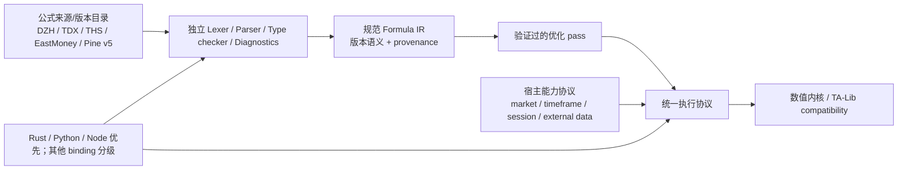

# Finkit TA-Lib 全量兼容与公式系统重构方案

> 日期：2026-10-23
> 仓库基线：`main` / `5252c15b` / workspace `0.2.0`（工作区有未提交的用户改动，实施时必须保留）。
> 目标：以最新正式版 TA-Lib 为对照，完整覆盖其公开公式/功能面；完整支持大智慧、通达信、同花顺、东方财富、TradingView Pine Script v5；每个公平可比性能项 `TA-Lib elapsed / Finkit elapsed >= 1.0x`，并有可复现、逐项、跨层验证。
> 明确排除：回测引擎。AlphaTA 是历史项目名/兼容遗留，不再作为目标公式系统或产品定位。

## 用户已确认的决策（本方案基线）

- 优先完成 Rust 核心与 Python、Node 的端到端支持；其他已有绑定保留分层能力矩阵并逐步补齐。
- 公式系统目标为大智慧、通达信、同花顺、东方财富和 TradingView Pine Script **v5**；AlphaTA 是已废弃的旧项目名，不属于目标方言。
- “完整支持”按公开语法和内置公式完整实现；跨周期/证券请求、交易时段、财务/盘口等依赖外部宿主上下文的能力，提供清晰接口并以真实数据适配器验证。缺少上下文时必须明确报错，不得伪造结果。
- TA-Lib 基线跟随最新正式上游版本，但每次升级都要锁定版本与资产信息、审计差异并保留历史合同/测量；当前方案基线为 TA-Lib C/Python 0.8.1。
- 性能目标是每一个公平可比项均达到 `TA-Lib elapsed / Finkit elapsed >= 1.0x`；这是未完成的验收目标，不代表当前状态。
- 不实现回测，也不把因子研究、增量计算或验证分析包装成回测能力。

以上边界已确认，后续执行无需再对这些产品决策重复提问；遇到无法从官方公开资料确定的方言版本或宿主私有扩展时，再就具体范围单独确认。

## 1. 已确认的产品目标与边界

### 对标基线

截至本文日期，TA-Lib C 最新正式发布为 **0.8.1**（2026-09-12），TA-Lib Python 最新正式发布为 **0.8.1**（2026-09-21）。TA-Lib C 0.8.1发布了 40 个新增指标/运算，并带来 streaming API 等能力。版本来源：

- [TA-Lib C releases](https://github.com/TA-Lib/ta-lib/releases)，官方 release 页标记 v0.8.1 为 Latest。
- [TA-Lib Python releases](https://github.com/TA-Lib/ta-lib-python/releases)，官方 release 页标记 v0.8.1 为 Latest。
- [TA-Lib function reference](https://ta-lib.org/functions/)，作为函数定义、输入输出及类别目录的核对入口。

基线更新采用显式锁定（release/tag + hash/发行资产信息），禁止使用浮动 `latest` 让历史结果失去可复现性。每次上游出现新正式版时，单独生成新增/删除/签名/默认参数/输出/语义差异报告，完成合同更新后再升级锁。

### 必须支持的公式系统

| 产品公式系统 | 目标 | 当前已知问题 |
|---|---|---|
| 大智慧 | 完整公开公式语言、函数和语义；宿主依赖通过定义清晰的宿主接口支持 | 现有矩阵有部分覆盖，host-required 与未支持项不能算完成；部分终端标签曾与同花顺共享映射 |
| 通达信 | 完整公开公式语言、函数和语义 | 当前状态含大量 `near`，不是终端级语义等价证明 |
| 同花顺 | 完整公开公式语言、函数和语义 | 当前状态含大量 `near`/`host_required`，需补函数目录与实测差分 |
| 东方财富 | 完整公开公式语言、函数和语义 | 实现枚举和测试存在，但未进入现有版本化覆盖矩阵，缺统一可量化基线 |
| TradingView Pine | 明确锁定 **Pine v5**，完整支持该版本文法、类型/执行模型、内置命名空间和可实现宿主 API | 当前矩阵引用 Pine v6；旧矩阵数据不可直接用于 v5 完成度声明 |

“完整支持”要由版本化参考资料、可机读函数/语法清单、执行状态、语义 golden、终端/官方行为差分和端到端测试共同证明，不能以注册表中存在一个名称作为证据。用户已确认宿主能力边界：公开语法和内置公式完整支持；跨周期/证券请求、交易时段、财务/盘口等依赖宿主数据的能力提供明确接口并通过真实数据接入测试；数据缺失时禁止返回看似有效的假值。AlphaTA 公共名称的废弃/兼容迁移范围也在实施前单独核对 API 兼容策略；它不会继续被统计为目标方言。

### 性能合同

唯一速度比定义为：

```text
speedup = median(TA-Lib elapsed) / median(Finkit elapsed)
```

对每一个双方语义和输入可比的“函数 × 参数组 × 输入规模 × API/执行路径 × 工作负载”，发布验收要求 `speedup >= 1.0x`。不以几何平均掩盖慢项，不以最优单轮代替稳健统计，不将不可比项目混入总平均。每个不可比较项需解释原因，列出 Finkit 专属替代指标，且仍需独立端到端性能预算。若噪声/置信区间无法证明达到 1.0x，则判为未通过并复测/优化，不将它四舍五入为通过。

“全面超越”是目标和发布门槛，不是当前状态陈述；在完整数据产生前不得宣称已达成。

## 2. 当前基线审计与判断

1. 主合同现已迁移并锁定 TA-Lib C 0.8.1 / Python 0.8.1；0.8.0 profile 留作兼容请求别名。历史 benchmark/报告仍保留其原始版本，不得被批量改写。
2. 上游 Python 0.8.1 返回 201 个函数名，与当前 dispatcher smoke/numeric reference 名称差集为 0。它们表明目录与单组黄金样本的基础覆盖，不证明每个函数全部参数边界、输出数、lookback/warm-up、NaN、索引、全局设置、streaming/abstract 行为均 parity；黄金样本也不是完整参数域证明。
3. FFI C 头文件核验发现 158 个指标声明属于 201 函数目录；其余 API/函数是否由其他路径完整实现需另行逐项确认。`docs/formula-talib-contract.md` 的 profile-only 数字已按矩阵修正为 143，但需由未来 SSOT 生成链永久消除重复维护。
4. 当前公式覆盖文件收录 Pine v6，不满足 Pine v5 的目标版本；东方财富不在该覆盖矩阵；大智慧、通达信、同花顺状态中 `near`、`approximate`、`host_required` 和 `unsupported` 都不能计为 exact complete。
5. 现有 TA-Lib 性能基准只测部分指标和公式，CI 门禁主要看总体阈值/汇总，未强制所有行速度比 >= 1.0x。历史报告记录过显著慢于 TA-Lib 的单项，因此当前性能目标尚未实现。
6. 现有主架构包含 Rust 核心、公式 Tree/Plan、Streaming、Factor/Runtime 和多语言 binding。公式实现内部使用 AlphaTA 命名/IR 的历史痕迹不应迫使产品继续暴露 AlphaTA 方言；通过稳定的规范 IR 和适配层逐步隔离。
7. 不实现回测：任何重构、能力清单、路线图、命令或宣传都不得把研究分析、增量计算或因子验证包装为交易回测。

## 3. 目标架构



### 关键设计约束

- 每种方言有独立的版本化语法/语义 profile 与 adapter。AST/IR 可以共享，但不可把共享运行时误称为终端语义相同。
- 定义 `DialectFunctionSpec`/等效 manifest：来源 URL、版本、函数签名、参数默认与范围、输入输出类型/个数、warm-up、NaN、跨周期/未来数据、host capability、支持级别、测试语料和负责人。
- 状态采用可机读枚举：`exact`（经差分证明）、`compatible`（有明示偏差）、`host_required`（所需宿主接口已定义但需要注入数据）、`unsupported`、`unverified`。只有 `exact` 且目标需求允许该偏差时才可计入完整完成率；`host_required` 必须有真实 host adapter integration test 才转完成。
- 编译、静态检查、执行、追加数据/形成中 bar 更新共享同一语义合同；Tree/Plan/bytecode/JIT 等后端采用差分测试。若无法证明等价，稳定报错或显式回退，不静默改变结果。
- 公共接口先围绕 Rust + Python + Node 做完整 E2E；其它现有绑定按明确能力矩阵扩展，避免所有适配层各自实现公式语义。
- TA-Lib compatibility 是显式兼容 profile，不污染 Finkit 原生语义；所有已完成 profile/函数通过版本标识暴露给 API。

## 4. 分阶段重构与实施

### P0 — 基线与能力事实锁定

1. 维护 TA-Lib Core `0.8.1` 与 Python `0.8.1` 可复现依赖/资产锁；核验 C 版实际导出函数全集、各函数元数据/API 和 Python wrapper surface。生成上游与仓库差集，不仅看 `get_functions()`。
2. 把 0.8.0 semantic profile、coverage matrix、numeric contract、201 golden 元数据、审计/生成脚本、workflow、bench 报告路径统一迁移至 `talib_0_8_1`。保留旧合同为历史版本，不原位重写历史测量数据。
3. 用 TA-Lib 0.8.1 重新生成可追溯 golden。逐项验证输入数、输出数、默认/非默认参数、可变参数、边界/非法参数、warm-up/lookback、NaN/Inf、索引语义、兼容/不稳定周期全局设置以及空/短序列。记录数值容差并区分 bitwise 与 tolerance parity。
4. TA-Lib 功能清单按公开 C API 分类，而非仅 201 个名字：指标和 candlestick 函数、抽象/反射元数据 API、streaming API、全局 compatibility/candle settings/unstable period、错误与生命周期/版本信息。将对外承诺映射到 Rust/Python/Node API；wrapper 专属功能另列。
5. 由生成器修正文档中 138/143 等矛盾，CI 对上游版本意外变动、合同缺项和 generated docs 漂移失败。

**验收：** 最新版本锁可复现；上游 public surface 与仓库 manifest 零 unexplained diff；全部 0.8.1 函数至少具备签名、输出、默认参数、lookback 和数值 golden。此阶段不把“具备一条 golden”定义为完整实现。

### P1 — TA-Lib 功能与公式全面 parity

1. 对每个 TA-Lib 函数以 metadata 驱动生成参数测试矩阵：默认、典型、最小/最大边界、特殊参数类型和错误路径；多输出按名称/顺序逐项比较。
2. 对全 0.8.1 函数覆盖语义边界、所有公开参数组合可枚举的部分及经风险分类抽样的高维组合。对全局状态 API 测试隔离、恢复、并发及跨调用污染。
3. 完成批处理/单值/streaming 关系：流开仓历史、update、peek、copy、open-and-fill、InsufficientHistory/空输入、状态复制与错误恢复；逐项对照官方 C 0.8.1 行为。
4. 建立 Abstract API 风格的统一 function metadata/参数绑定机制，防止各绑定自行维护另一份签名表；Rust/Python/Node 对同一 manifest 做合同测试。
5. 把函数新增、默认变化和 enum 类型变化绑定至数据生成签名；版本迁移时同时更新 CI benchmark baseline 的 metadata，但历史报告不可改写。

**验收：** TA-Lib 公共承诺功能映射无未解释 `unsupported/unverified`；每个函数的正确性与参数合同覆盖通过；Rust、Python、Node 从用户公开入口测试同一组合同。确因平台/宿主不能实现的能力需由用户接受产品边界后单列，不能宣称全覆盖。

### P2 — 五种公式系统完整支持

1. 按用户确认的系统分别锁定 reference snapshot / 文档出处 / 目标 Pine v5 文档版本，收录全部文法产生式、操作符、语句、类型、内置常量、函数/命令、输出/绘图、历史索引及运行时约束。
2. 分方言构建 parser/type/runtime 分层。国内公式 parser 可复用无歧义的 lexer/IR 与运算 kernel，但变量命名、周期语义、绘图/选股、跨日与未来函数必须在各自 profile 实现并测试。
3. Pine v5 实现版本化 parser/类型系统/执行模型、`var`/bar state/series-simple 类型、函数与 tuple 返回、request/security 的 host protocol 等；不能用 Pine v6 矩阵证明 v5，也不能把 Pine AST 简化映射后声称全语言支持。
4. 重新核验大智慧、通达信、同花顺、东方财富各自参考资料和术语；重复名字但参数/输出/未来数据语义不同的函数分开维护。补充东方财富完整目录，停止将大智慧与同花顺标识混用。
5. 定义宿主能力 API（周期/证券查询、时区与交易日历、行情、财务与盘口数据）。宿主能力接入通过真实 adapter 测试；没有该输入时报带 capability 名称的类型化错误；禁止以 NaN/零值等静默假结果冒充完成。
6. 每系统都有正向/负向 parser corpus、terminal/reference 导出样本、golden 数据集、host simulation 和消费者 E2E；完整度按语法/内置函数/语义/宿主/API 分项报告，不能单一“函数数”概括。
7. AlphaTA 旧 public dialect：列举 API、序列化标识、配置、文档和绑定残留；制定 deprecated alias/迁移告警和移除周期。规范 IR 在内部暂不要求一次性大规模符号改名，避免破坏 Rust API 与实现稳定性。

**验收：** 五个目标系统的版本化参考清单均为 100% 已审计；目标承诺语法/内置功能无 `unsupported/unverified`；宿主依赖能力具备 host adapter E2E；同一公式在相应参考实现/终端语料中语义一致；不存在 AlphaTA 被宣传成目标系统的地方。

### P3 — 逐项性能达到 TA-Lib 1.0× 下限

1. 先做 correctness gate，再做 performance gate；构建 manifest 驱动的 all-function benchmark，清单与 P0 上游函数 manifest 同源。
2. 场景至少覆盖每个函数的典型/多输出/高计算成本参数、多个长度（短输入、warm cache、100K、1M；可运行资源允许时 10M）、连续调用与 batch-many，以及 Rust core / Python NumPy / Node TypedArray 可公平配对的端到端入口。
3. 每个结果记录上游/仓库版本与 SHA、CPU/OS、编译器和 flags、数组布局/dtype/连续性、线程数、数据生成 seed、warmup、重复次数、耗时分布、精度状态及 speedup。TA-Lib 与 Finkit 同机交错运行，避免频率/热状态偏置。
4. 对每个可比行强制 `median(T)/median(F) >= 1.0x`，另用稳健置信区间判定噪声。不足 1.0x 的行自动列为性能债务，按算法复杂度、数据复制、分配、缓存局部性、向量化/批处理与 FFI 开销分类优化。
5. 汇总 geomean 仅作趋势指标，不能抵消任意逐项 fail；多公式/多指标、冷/热编译缓存、增量更新和安装包 E2E 作为额外工作负载，不能拿单 kernel 代替。
6. 面向公平性审计基准：算法同义、参数与精度合同相同、数据布局一致；任何使用更宽松精度、不同 lookback、短输出、硬件专属而对手不可用的比较都标记非公平并剔除。
7. 以 release 前全量 benchmark 为硬门槛；PR 使用稳定的关键子集和统计回归警报，定期 workflow 运行全量矩阵。速度低于 1.0× 时不得发布“所有可比指标不慢于 TA-Lib”的声明。

**验收：** 全量公平可比项逐项 `>=1.0x`；正确性合同全过；所有 binding/工作流报告可复现；所有排除项有理由和替代预算。若仍存在慢项，目标尚未完成，不降低门槛或藏入平均数。

### P4 — API 收敛、模块边界与迁移发布

1. 稳定 Formula IR、Dialect Manifest、Host Capability、Indicator Spec、TA-Lib Compatibility profile 几个核心合同，并生成语言绑定元数据与文档。
2. 把 parser/frontend、公式优化与执行、stream state、数值 kernel、compat adapter、binding adapter 先在 `core` 内建立单向模块边界；依据构建和维护数据再决定是否拆 crate，不预先拆分。
3. Rust 为规范 API；Python/Node 优先达到完整端到端一致合同；其它已有绑定按能力 tier 单独发布状态，不以编译通过冒充特性 parity。
4. AlphaTA alias 迁移按语义版本、弃用周期和序列化兼容处理；旧数据可以读取并发迁移提示，不把旧名当正式方言新增能力。
5. Release gate 包括清洁 tag 构建、Rust workspace、Python/Node 包外安装、公式系统 smoke/full corpus、TA-Lib parity、逐项 benchmark 报告及资产校验。

## 5. 统一交付物和门禁

- `tests/contracts/talib_coverage_matrix_v2.json`：版本、导出函数、类别、签名、参数、lookback、输出、功能/API 面状态和证据。
- `tests/contracts/formula_systems_v2.json`：五种目标方言及版本、reference provenance、语法/函数/宿主能力覆盖和支持级别。
- TA-Lib 0.8.1 golden generator、运行时差分工具和已发布 golden 数据，保存生成器版本、输入 seed、对照资产哈希。
- 公式系统 corpus：每个系统独立语料、明确参考版本/来源、正负例、语义和跨入口 golden。
- 全量公平性能 manifest、逐项 JSON 结果、历史趋势与未通过清单。
- CI 门禁：schema/差异清单、正确性/兼容、multi-backend/multilang consumer、公式语料、性能关键行；夜间/发布跑全量 benchmark。
- 文档状态只由 manifest 与验证报告生成；verified/registered/corpus-exercised/exact/performance-passed 分开，不合并为一个“覆盖率”。

## 6. 执行优先顺序与停止条件

严格依序执行：

1. 宿主依赖公式功能边界已确认；确认上游 Python reference 0.8.1 可在所有目标 CI 平台安装/构建。
2. 建立 TA-Lib 0.8.1 锁与功能差集，迁移并重建 golden/合同；先修版本错配与脏状态。
3. 修复 TA-Lib 全部函数数值/参数/流式/抽象 API 的缺口，保持 correctness first。
4. 固化五种公式系统的权威目录和 Pine v5 parser/运行时合同，按系统补齐。
5. 建全量配对基准，并按逐项慢项优先级优化；性能目标未达不得提前发布全量兼容/全面领先宣称。
6. 完成 Python/Node 包外端到端及各平台的分级交付，最后再评估 core crate 拆分和发布。

若官方资料无法明确某终端的“全部”范围，先标 `unverified` 并请产品负责人确定对应终端/版本/私有扩展边界；不将未知静默转成假设。若某 TA-Lib API 无法由 Finkit 产品形态公平复现，提交有证据的差异和可替代接口让用户确认；在确认前不可宣称 TA-Lib 全功能覆盖。回测引擎始终不实现、不纳入验收。

## 7. 当前状态与变更纪律

P0 的“最新版本重新锁定”子项已在本轮完成：

- 通过隔离环境安装并核验官方 TA-Lib Python 0.8.1 wheel：C core `0.8.1`，Python wrapper `0.8.1`，`get_functions()` 返回 201 项；与版本化 Finkit numeric reference 名称做差集，missing = 0。
- 将主合同迁移到 `talib_0_8_1`，更新 Python reference pin、生成器/审计器默认版本、CI release gate 和操作性 binding 合同。保留显式 `talib_0_8_0` 请求作为旧客户端兼容别名，响应规范化为 `talib_0_8_1`。
- 由锁定的 TA-Lib 0.8.1 重建 201 个指标 golden 文件及跨语言 numeric contract；6 组非默认 MA-type fixture 用 0.8.1 重新计算首个有效位置和末值并逐输出核对。
- 该结果仅证明 201 个函数名称集合一致和当前 goldens 由新版 wrapper 生成，不证明参数全域与 TA-Lib 全公开 API 已 parity。P0 的 metadata/API 全面枚举仍未完成；P1–P4 均未完成。
- 本地验证通过：`scripts/audit_talib_surface.py --require-complete`（201/201）；`scripts/gen_talib_numeric_contract.py --check`；`scripts/check_talib_ffi_contract.py`（158 个 C 声明、201 名称目录）；Rust TA-Lib 定向测试 37 passed；`cargo test -p finkit-ffi-common --locked`（85 unit + 1 integration passed）；Node 17/17；Python TA-Lib numeric 与 engine contracts 5/5。Node/Python/Rust 均验证旧 profile 请求会规范化到新 profile。
- 当前性能目标仍未满足：既有基准只覆盖部分指标并以汇总门槛为主，历史测量有单项低于 1.0x；五种公式系统也尚未逐项证明完整支持。不能据此宣称“全面超越”。

本轮补充的严格性能门禁与 release-wheel 诊断（2026-10-23）：

- 新增 `scripts/benchmark_gate_contract.py`，按 `函数 × 输入长度` 独立核验覆盖与 `TA-Lib elapsed / Finkit elapsed >= 1.0x`；任何一行慢于门槛、缺失或非法测量均失败，不允许汇总抵消。`scripts/test_benchmark_gate_contract.py` 的 5 个测试通过；workflow path coverage 与脚本孤儿检查通过。
- `scripts/benchmark_talib_all_current_gate.py` 默认规模为 1K、100K、1M，并以安装后的 wheel 对照 TA-Lib Python `0.8.1`。Windows 本机 release wheel 诊断报告：`dist/bench/talib-all-current-gate-release-081.json`（该文件位于本地忽略的 `dist/bench`，目前不是已提交的公开附件）。环境：Windows 10 19045、Intel i7-9700K、Python 3.12.14、NumPy 2.3.3、TA-Lib C/Python 0.8.1、Rust 1.98.1；Finkit checkout HEAD `5252c15b7d67354d9a1e4aa27176198cc34dc655`，release wheel 已安装到临时隔离 venv。
- 诊断覆盖了 TA-Lib 201 名称中的 155 个 Python 对比 case，三档合计 465 条观测。原始 JSON 的另 46 个 `missing_functions` 精确表示“基准没有对应 case”，不单独证明 Finkit Python wrapper 是否存在；对应实现状态须查公开入口及签名。本节后面的 2026-10-24 代码面复核和基准补录已对其中一部分完成校正。数值 parity 在 1K、100K 均通过，但 1M 有 3 项误差超出当时基准容差：`BETA`（abs/rel 4.511e-8）、`LINEARREG_ANGLE`（1.863e-8）、`LINEARREG_SLOPE`（2.874e-6）。
- 几何平均约 1.4045x，但仍有 144/465 条观测低于 1.0x：1K 为 82/155、100K 为 32/155、1M 为 30/155，因此严格逐项门禁失败。1K 慢项主要受 Python 调用/分配固定成本影响；较大规模的明显慢项包括 `CDLHOMINGPIGEON`、`CDLEVENINGSTAR`、`CDLMORNINGSTAR`、`CDLPIERCING`、`MINMAX`、`AROON`、`AROONOSC`、`STOCHRSI` 等。不能以该单机诊断推广为跨平台性能结论，也不能以几何平均宣称达到用户目标。
- 该基准不代表全量功能已实现，也不覆盖参数组合、各语言 E2E、所有数组布局/数据类型或公平统计区间；P0 全部公开 API 清单和 P1 correctness 仍未完成。下一步应优先补 Python 公共 wrapper 覆盖，查明并修复 1M parity 差异，再按慢项的函数/算法/FFI 成本分类优化并重新进行完整可复现测量。

本轮回归修复后的 TA-Lib 0.8.1 release-wheel 定向复测（2026-10-23）：

- 使用同一台 Windows 10 19045 / Intel i7-9700K / Python 3.12.14 / NumPy 2.3.3 机器、同一百万点确定性数据，对已安装的 Finkit release wheel 与 TA-Lib Python/C 0.8.1 交错测量；速度比仍按 `median(TA-Lib elapsed) / median(Finkit elapsed)`。这是诊断性单机测量，不等于完整发布门禁或跨平台结论。
- `LINEARREG_SLOPE`：数值和 NaN mask 通过当前 `rtol=1e-8, atol=1e-8` parity；最大绝对误差 `3.2253e-10`；Finkit `3332.63 µs`、TA-Lib `3498.50 µs`、`1.0498x`。斜率结果达到当前单项门槛。
- `LINEARREG_ANGLE`：NaN mask 一致，但数值 parity 未通过；最大绝对误差 `1.8475e-8`，高于容差；Finkit `8646.40 µs`、TA-Lib `9439.05 µs`、`1.0917x`。当前实现复用 `linreg_slope` 后做 `atan`，而官方上游角度实现维护独立滚动计算路径；需核对并移植其舍入/重锚语义，不能通过放宽容差解决。官方参考：[LINEARREG_ANGLE](https://github.com/TA-Lib/ta-lib/blob/main/ta_codegen/input/linearreg_angle/linearreg_angle.c)、[LINEARREG_SLOPE](https://github.com/TA-Lib/ta-lib/blob/main/ta_codegen/input/linearreg_slope/linearreg_slope.c)。
- `BETA`：NaN mask、数值 parity 完全一致（最大绝对/相对误差均为 0）；Finkit `10366.75 µs`、TA-Lib `8427.70 µs`、`0.8130x`，约慢 18.7%，性能门禁未通过。后续需在不改变 parity 的前提下做热点分析和优化；官方参考：[BETA](https://github.com/TA-Lib/ta-lib/blob/main/ta_codegen/input/beta/beta.c)。
- 数据与重复次数来自当前 benchmark helper；受运行时长约束，百万点每次计时使用少量循环（BETA/ANGLE 2 次、SLOPE 7 次），后续正式门禁需沿用完整重复/稳健统计设置并在优化后重测。当前结果说明此前 1M BETA 和线性回归问题有部分修复，但完整 parity 与逐项性能目标仍不满足。
- 用户已确认公式系统最终范围为 **大智慧、通达信、同花顺、东方财富、TradingView Pine v5**，对公开语法/内置公式按完整支持验收；宿主数据依赖按已确认的接口与真实适配器验收。AlphaTA 只作为待盘点的历史命名/兼容遗留，不列入目标方言。**不实现回测**。

长序列线性回归与 BETA 优化、全量 current gate 复验（2026-10-24）：

- 参考 TA-Lib 官方 `LINEARREG_ANGLE`/`LINEARREG_SLOPE` 实现，将滚动斜率 SIMD/标量路径的重锚移至当前输出计算之前，并加入 `32*period` 定期重锚及异常大离窗值触发；`LINEARREG_ANGLE` 继续由共享 slope 路径生成，避免独立算法漂移。100K 长序列 Rust 定向测试通过。参考：[TA-Lib LINEARREG_ANGLE](https://github.com/TA-Lib/ta-lib/blob/main/ta_codegen/input/linearreg_angle/linearreg_angle.c)、[TA-Lib LINEARREG_SLOPE](https://github.com/TA-Lib/ta-lib/blob/main/ta_codegen/input/linearreg_slope/linearreg_slope.c)。
- BETA 的输出缓冲改为只初始化 warm-up NaN 前缀，并缓存窗口内已中心化收益率；滑窗正常前进时复用离窗收益率，中心值重建时同步重填缓存。缓存索引环绕改为分支，不在每根 bar 上执行整数取模。依据 [TA-Lib BETA 算法](https://github.com/TA-Lib/ta-lib/blob/main/ta_codegen/input/beta/beta.c) 做实现与差分核对。
- 发布 wheel 上 BETA 的压力差分覆盖 3 类序列（随机游走、极端跳变、零价格）× 6 个周期（2/5/14/30/100/252），共 18 组，全部 mask 与数值逐位一致；Rust BETA 定向测试 4/4 通过。长测量（9 组交错样本、每样本 20 次）百万点 BETA `1.024x`、`LINEARREG_ANGLE` `1.060x`、`LINEARREG_SLOPE` `1.008x`，三者均 parity 通过。该长测量是单机诊断，不取代严格 CI gate。
- 已用安装后的 release wheel 对 TA-Lib C/Python 0.8.1 重跑当时手工登记的 Python 全量基准，规模 1K/100K/1M；报告：`dist/bench/talib-all-current-gate-release-081-20261023b.json`（本机 ignored `dist/bench`，不是公开提交文件）。环境仍为 Windows 10 19045 / Intel i7-9700K / Python 3.12.14 / NumPy 2.3.3 / Rust 1.98.1。报告含 155 个 case；剩余 46 个 TA-Lib 名称没有被登记为 case，造成 138 个缺失观测（3 个规模 × 46），不能据此断定这些名称都缺少 Python 直接入口。错误 0、现有 465 个观测的 parity 失败 0，但不能将这视为未覆盖函数或全公开 C API 已 parity。
- 全量门禁失败：465/603 个预期观测，覆盖门禁失败；133/465 个已测观测低于 1.0x，其中 1K 为 82、100K 为 27、1M 为 24，涉及 84 个不同函数名。几何平均 1.4396x 仅作趋势信息，不抵消这些逐项失败。1K 慢项广泛集中在 Python/FFI 固定开销；较大规模的主要慢项包括 `ADX`、`AROON`/`AROONOSC`、`VAR`、`MAX`/`MIN`/`MINMAX`、`STOCHRSI` 和若干蜡烛形态（例如 `CDLEVENINGSTAR`、`CDLMORNINGSTAR`、`CDLHOMINGPIGEON`、`CDLPIERCING`）。
- 当前可比层的个别进步并不等于目标实现：全量 gate 中 BETA 为 1K `0.868x`、100K `1.024x`、1M `1.026x`；`LINEARREG_SLOPE` 为 `0.755x` / `1.006x` / `1.012x`，`LINEARREG_ANGLE` 为 `0.984x` / `1.102x` / `1.075x`。这再次证明必须逐项、逐规模验收，不能以百万点单测或全局几何均值宣称全面达标。
- 可复核资产：benchmark JSON SHA-256 `3BD5CF82A5EA14048F6D194A0D805F425D511536274EEF1EE78B075B96C62E90`；该轮临时 release wheel SHA-256 `0F821C0B6EF26ED18295F93BD21595AA030A831A9ED5148192547C387D1C7593`。wheel 位于系统临时目录，报告和 SHA 只作为本机诊断证据，不替代可归档 CI artifact。工作树有未提交改动，报告中的基线 Git SHA 不代表这些改动的唯一源码版本；发布级可复现还需在 CI 归档 wheel、源码树/补丁哈希及完整环境元数据。
- 下一步优先级更新：① 将 benchmark 缺项逐项定性为“case 未登记”“直接 binding 缺失”“签名/语义不等价”或“实现缺失”，补齐相应 API/合同；② 优化 `ADX`、`AROON`、极值族、`STOCHRSI` 与蜡烛形态的算法/批量访问成本；③ 处理 1K 规模 Python/FFI 固定开销并设计可公平的端到端门禁；④ 多平台、多 dtype/layout、Python/Node/Rust E2E 及五个公式系统覆盖仍需各自独立完成。目标继续保持未完成，不下调 `>=1.0x` 门槛，不实现回测。

当前工作区有用户既有未提交改动；本轮未暂存、提交或推送，后续必须增量修改并保留。
- 未经用户明确要求，不提交、不推送、不创建/发布 GitHub Release。
- 每阶段完成后更新本文件的状态、commit/SHA、测试命令与原始报告链接；不得只更新勾选状态。

TA-Lib 46 个 benchmark 缺项的代码面复核（2026-10-24）：

- 对隔离安装的 TA-Lib Python 0.8.1 调用 `talib.get_functions()`，确认函数目录为 201 项；严格门禁报告的 46 个缺失名均属于这 201 项，但“缺失”指没有 benchmark case，并不等于 Python API 缺失。逐项 `hasattr` 核对中至少 7 项已有同名小写入口（`DONCHIAN`、`MINUS_DM`、`PLUS_DM`、`SUM`、`SUPERTREND`、`VORTEX`、`VWAP`）；因此原始 coverage 字段不能单独作为公开 API 缺口统计。
- 源码检索确认并非所有 46 项都“仅在 core/JSON dispatcher 实现”：其中部分能在 `core/src/formula/functions_talib_081.rs` 找到 canonical formula adapter（本次文本级核对为 29/46），另有一些名称在其他公式/指标文件出现，但单纯出现名称不构成可执行、语义 parity 或公开 API 证据。尚未完成逐函数实现合同、dispatcher 路由与 Rust/Python/Node E2E 的分层矩阵；不得据此声称 core 或公式覆盖已完整。
- 后续 P0/P1 必须为 46 项逐个标注 TA-Lib 原型/输入输出/默认参数、Rust kernel、公式注册、通用 dispatcher、Rust 用户 API、Python/Node 公开入口、官方 parity 测试及 benchmark 配对状态。先让 coverage gate 的“目录、能力、语言入口”使用各自清晰的清单与判定，避免以单个 `missing_functions` 字段混合描述。
- 当时登记的 155 项 release-wheel 基准仍可作为已登记 case 的诊断，但其余名称的性能数字属于缺测，不应推导其性能；严格全量覆盖和逐项 `>=1.0x` 目标仍未达成。随后已将现存且可配对的入口逐步补入基准；仍需逐项核实剩余名称的 API、算法与语义。

五项现有公开入口纳入 TA-Lib 全量性能 gate（2026-10-24）：

- 复核发现之前的 46 项“missing”不全是 wrapper 缺失：`SUM`、`VORTEX`、`VWAP` 已有直接 Python 函数，但 benchmark 手工 cases 未登记。更新 `scripts/benchmark_talib_all_current_gate.py`，把三者以各自可比的签名纳入 coverage/parity/performance gate；其余同名入口（例如 `DONCHIAN`、`SUPERTREND`、`PLUS_DM`、`MINUS_DM`）暂不以名称存在视为可比，必须先解决输出形状、默认值/参数和语义差异。
- 使用隔离的 TA-Lib/Finkit Python 0.8.1 wheel，在 1K/100K/1M 数组上逐项交错测量，`TA-Lib elapsed / Finkit elapsed` 为：`SUM` 0.916x / 1.406x / 0.897x；`VORTEX` 0.566x / 0.707x / 0.775x；`VWAP` 0.715x / 1.510x / 1.072x。额外确定性随机输入与周期差分（SUM 周期 2/3/14/30；VORTEX 有效长度/周期组合；VWAP）均为 parity 和 NaN-mask 通过。以上性能数值为单机诊断测量，不是跨平台或置信区间验收；低于 1.0x 的行仍为债务。
- 更新后的 1K 全量 gate 观测数 158/201，缺项 43；新增三项均正确但三项在 1K 都慢于 TA-Lib。另有大量已有观测低于门槛，所以全量 gate 继续失败。原始单规模结果位于本机忽略目录 `dist/bench/talib-all-current-gate-20261024-sum-vortex-vwap.json`，SHA-256 `E959D7583D4C7E3AFB3D5EF18C89C7F9A9E56CCD67AD16E42DD0554D6EEB7A71`，非公开交付物。
- 下一步不把剩余缺项统一称为 Python wrapper 缺失：从 TA-Lib 0.8.1 的公开签名出发建立 43 项差异矩阵，并分开记录“未登记基准”“缺少 Finkit 直接 binding”“函数已存在但参数/返回合同不同”“核心或公式实际未实现”。然后按实际可比合同补绑定/多输出适配与差分用例，再用准确 coverage gate 驱动优化；目标和 `>=1.0x` 门槛不变。
- VORTEX 快速优化实验：将三个 period 环形缓冲合并为 `Vec<[f64; 3]>`，release wheel 的 parity 仍完全通过，但单轮诊断速度比为 1K `0.555x`、100K `0.378x`、1M `0.701x`；相较之前的诊断结果没有稳定改善，100K 明显回退，因此已撤销该改动，恢复原来的三个独立环缓冲。回退后 `cargo test -p qx-finkit vortex --locked` 7/7 通过、`cargo fmt --all -- --check` 通过；临时 venv 也已重新安装 SHA-256 `0F821C0B6EF26ED18295F93BD21595AA030A831A9ED5148192547C387D1C7593` 的基线 wheel，避免测试环境残留候选二进制。该失败实验不计入性能进步，VORTEX 仍是未解决的慢项。
- 进一步通过签名/输出顺序核对，将 `DONCHIAN` 与 `SUPERTREND` 加入可比 case：Donchian 仅比较两边相同顺序的前三个结果，排除 Finkit 专有 width；SuperTrend 的方向与趋势线按其实际公开输出合同映射到 TA-Lib 顺序。三档合成数据和 31/257/2048 长度、周期 2/10/20 随机数据差分均通过；后一组 SuperTrend/Donchian 组合共 18 组无 parity 失败。

SuperTrend Python 边界与 TA-Lib 两输出兼容路径（2026-10-24）：

- `ffi/python-binding/src/price_extra.rs` 原先将四个 `Vec` 返回给 PyO3，包层随后再把 Python list 转成 NumPy 数组；已改为直接构造并返回 ndarray，避免逐元素列表转换。另在 Rust 核心加入 `supertrend_talib_compat` 共用同一算法，但用 const-specialized 路径不分配 Finkit 专有 upper/lower 数组；Python 暴露 `supertrend_talib(high, low, close, timeperiod=10, multiplier=3.0)`，只输出 TA-Lib 同序的两个 float64 数组。既有 `supertrend` 四输出接口仍保留。
- `cargo test -p qx-finkit supertrend_talib_compat_matches_primary_outputs --locked` 通过（1/1），证明新两输出路径逐点匹配原生四输出路径的趋势线和方向；`cargo fmt --all -- --check` 通过；release Python 扩展构建成功。在隔离 venv 的 release editable extension 上验证入口返回两项 ndarray，三档 TA-Lib parity/NaN mask 均通过；另有 `ffi/python-binding/tests/test_supertrend_talib_compat.py`，定向 pytest 1/1 通过。
- 同机交错对照新两输出入口与原生四输出入口：`TA-Lib / native four-output` 为 1K `0.633x`、100K `0.412x`、1M `0.488x`；`TA-Lib / two-output compatibility` 为 `0.732x`、`0.670x`、`0.614x`。新路径在三档均更快于 Finkit 原生四输出，但仍未达到 `1.0x`，不能算目标通过；还需优化共享 ATR/带状态滚动内核。
- 当时的 1K 全量 gate 结果：160/201 个 case，0 errors、0 parity failures，coverage 与 speed 均未过。该报告中的 SuperTrend 两输出入口尚未 fuse ATR，不能代表随后版本；其余登记指标和报告仍是该时点诊断：`dist/bench/talib-all-current-gate-20261024-supertrend-compat.json`，SHA-256 `D9FC627B43902FD87AAFB87433EA5946C37588500F04DE3163F7DF1B53DAB3AB`（本地 ignored artifact）。
- coverage 目前剩余 41 个无 benchmark case 的 TA-Lib 名称。该数字仍不等于 binding/core 缺失数；需继续拆签名、输出合同和算法实际状态。所有性能低于 `1.0x` 的公平可比项仍是债务，不能以加 case 或输出 adapter 宣称全面领先。
- 后续把无 warm-up 前缀的 Wilder ATR 更新 fuse 到 SuperTrend 状态循环，保留前导非有限值时既有 ATR 路径；用 `Direction: From<i32>` 编译期泛型直接输出兼容所需的 float64 方向，避免 i32→f64 整数组复制。`cargo test -p qx-finkit supertrend_ --locked` 22/22 通过（含 leading-NaN seed 对齐及精确最短长度边界），`cargo fmt --all -- --check`、release Python 扩展构建和 `pytest ffi/python-binding/tests/test_supertrend_talib_compat.py -q`（1/1）通过；再以 TA-Lib 0.8.1 对 31/257/2048 点×4 周期随机价格差分，9 组均 parity 通过。
- 最终扩展构建上的 SuperTrend 两输出入口使用 9 轮交错、每轮每函数 3 次的中位耗时测量，`TA-Lib / Finkit` 为 1K `0.607x`、100K `0.620x`、1M `0.634x`；数值/NaN mask 全通过，但三个规模仍全部慢于 TA-Lib，因此此热点尚未达标。最新 1K 全量 gate 为 160/201，0 errors、0 parity failures，覆盖和速度门槛都失败；五项 ratio 为 `SUM 0.91x`、`VORTEX 0.56x`、`VWAP 0.70x`、`DONCHIAN 1.48x`、`SUPERTREND 0.61x`。报告 `dist/bench/talib-all-current-gate-20261024-supertrend-final.json`，SHA-256 `E7817F7755CDB57F7F376906C12FC7F77ACC1708649F09FF9666F7ABA70625D2`（ignored、本机诊断）。

TA-Lib 0.8.1 unary compatibility surface 扩展与 VHF 滚动优化（2026-10-24）：

- 在 Python 兼容层新增 `AVGDEV`、`DPO`、`ER`、`FOSC`、`PERCENTRANK`、`RMA`、`VHF`、`HMA`、`ZLEMA`、`RVI` 10 个直接入口，并以 TA-Lib 同名函数及参数默认值配对加入全量 gate；`RVI` 参数名沿用 TA-Lib 的 `stddevperiod`。新增差分测试覆盖 31/257/2048 点确定性随机价格序列，TA-Lib Python 0.8.1 mask 和数值检查通过（使用 numeric contract 一致的 `1e-8` atol/rtol）。
- `VHF` 的有限行情热路径由每根 Bar 重扫窗口（`O(n·period)`）改为复用 rolling max/min 与滚动绝对变化和（`O(n)`）；任何非有限输入保留原计算路径，以免改变既有 NaN/Inf 处理。Rust 测试验证多种周期下与原窗口定义一致，以及 NaN 窗口退出后的恢复行为；Python TA-Lib 差分也通过。
- 最新 release 扩展全量 gate 覆盖 **170/201** 个函数、**510/603** 个函数×规模观测；0 error、0 parity failure，但覆盖和速度门禁均未通过。158/510 行低于 1.0x（1K 89、100K 32、1M 37），几何平均 1.3858x 不可抵消逐项失败。31 个函数仍无 benchmark case：`AC`、`ACCBANDS`、`ADR`、`AO`、`CMF`、`CMOU`、`COPPOCK`、`CUMSUM`、`CVI`、`EFI`、`ERI`、`FRACTAL`、`HA`、`IMI`、`KC`、`KDJ`、`MARKETFI`、`MASSI`、`MINUS_DM`、`NVI`、`PERCENTILE`、`PLUS_DM`、`PVI`、`PVO`、`PVT`、`QSTICK`、`RVOL`、`SMI`、`TSI`、`VWMA`、`WAD`；此列表仍代表基准缺项，不等同于 Rust 核心或所有 binding 均未实现。
- 新增 10 项在 1K/100K/1M 的 `TA-Lib/Finkit` 速度比依序为：`AVGDEV` 1.046/1.084/1.127x、`DPO` 0.759/0.400/0.431x、`ER` 0.807/1.105/0.882x、`FOSC` 0.819/0.886/0.943x、`PERCENTRANK` 2.028/2.155/2.103x、`RMA` 1.119/1.466/1.234x、`VHF` 3.460/2.504/2.008x、`HMA` 0.647/0.407/0.464x、`ZLEMA` 1.161/1.494/1.147x、`RVI` 0.577/0.393/0.423x。该表明确留下 DPO/FOSC/HMA/RVI 的性能债务；ER 仅 100K 达标。
- 可复核报告 `dist/bench/talib-all-current-gate-20261024-vhf-optimized.json`（本机 ignored）；SHA-256 `af513dc273de216c3985c74169f847988d9b59888bb6394108bc01ada19a1353`。Rust VHF 定向测试 2/2 通过；新增 Python 差分测试 1/1 通过；release 扩展构建成功；本次全量 gate 按预期以非零状态退出，因为全覆盖与逐项速度目标仍未达成。
- 下一步优先推进其余 31 个缺项的分层实现/公开入口/benchmark 合同，然后对 DPO、FOSC、HMA、RVI 做算法与分配热点分析；所有既有 1.0x 以下观测继续逐项追踪，不将局部达标或总体几何平均表述为“全面超越”。

TA-Lib Python 兼容面补齐至 201 项及 PERCENTILE 单次搬移优化（2026-10-24）：

- 按用户确认的正式范围继续执行：目标公式系统是大智慧、通达信、同花顺、东方财富、TradingView Pine v5；AlphaTA 为废弃旧项目名，不作为目标方言；不实现回测。公开语法/内置公式按完整支持验收，外部数据依赖走明确宿主接口并以真实适配器验证。
- Python 直接兼容入口与基准 case 已覆盖 TA-Lib Python 0.8.1 暴露的 **201/201** 个名称，并在 1K/100K/1M 三种输入规模获得 **603/603** 行观测。当前 release gate 结果为 0 个运行错误、0 个 parity/NaN-mask 失败、0 个缺失函数或观测；这证明当前登记输入及合同上的数值兼容，不等同于所有参数组合、dtype/layout、其他绑定或公式方言均已完整验证。
- `PERCENTILE` 从每个窗口分配并完整排序改为滚动排序窗口、年龄环形缓冲和每步单段搬移。有限行情快路径采用稳定比较；含 NaN/Inf 时保留确定性的 total-order 窗口处理；兼容入口周期下限修正为 TA-Lib 要求的 2。Rust 秩位/边界测试 7/7、Python 差分/参数边界测试 2/2、signed-zero/重复值 24 组差分均通过，格式检查通过，隔离环境 release 扩展构建成功；完整 gate 中 PERCENTILE 的 TA-Lib/Finkit 耗时比为 1K **1.126x**、100K **1.246x**、1M **1.112x**，数值和 NaN mask 均通过。此结果是当前 Windows 单机诊断值，不构成跨平台统计置信结论。
- 最新全量报告 `dist/bench/talib-all-current-gate-20261024-percentile-single-shift.json`（本机 ignored artifact），SHA-256 `1cc0b2ea5a1a1a536ef7993fb6b794f7a2a682260d0c5b6f968d2691c6c7ec57`；603 行中仍有 **237 行**低于 1.0x，几何平均 **1.235x**，故逐项性能 gate 仍失败。该报告的 `source_git_sha` 是运行时 HEAD 标识；报告对应的工作区包含尚未提交的代码改动。
- 后续以逐行慢项为债务列表，优先分离 1K 固定调用/分配成本与大规模算法成本；全量 201 项 parity 仅是 TA-Lib 兼容层里程碑。Rust + Python/Node 的 E2E 优先级和五种方言的独立完整性语料、host-adapter 验收仍按原方案执行；未完成前不得宣称覆盖 TA-Lib 全部功能及“全面超越”。

CMOU 算法复杂度和 Python 输出路径优化复测（2026-10-24）：

- `CMOU` 原实现对每个输出窗口重新扫描全部周期变化，复杂度为 O(n·period)。改为滚动 absolute-change 总和，利用 `sum(up)-sum(down) = close[t]-close[t-period]` 直接得到分子；为避免每根 bar 的 ring/heap 操作，窗外变化通过 trailing/previous 缓存读取。平坦窗口连续计数清除滚动浮点残差；非有限变化和累计溢出回退到窗口参考实现。Python 兼容入口对很短序列不释放 GIL，延续仓库既有 16,384 点阈值策略；核心使用 `Vec::spare_capacity_mut` 只写 lookback NaN 和有效输出，避免先填满整条输出再覆盖。输出缓冲初始化只在所有槽位都写入后才扩展 `Vec` 长度。
- TA-Lib 0.8.1 要求 CMOU 的 `timeperiod >= 2`；已将 Rust/Python 入口校验与 TA-Lib 对齐。Rust rolling/reference、多周期、NaN 恢复、最小周期测试 3/3；Python 兼容测试 3/3；`cargo check -p finkit-python --locked`、release extension 构建和 rustfmt 检查均通过。Python 对 31/257/2048 点随机市场序列的 CMOU parity/NaN mask 通过。
- 最新完整 gate 报告 `dist/bench/talib-all-current-gate-20261024-cmou-rolling.json`（本机 ignored artifact），SHA-256 `ae586db01bf569857cdc2905949cf4e0343b8d2c02c7f8a7fca9369b2acbf0f7`。201/201 函数、603/603 观测，0 error、0 parity failure、0 missing；232/603 行仍低于 1.0x，几何平均 1.2545x，故整体严格性能 gate 仍失败。CMOU 三种规模分别为 **0.7924x / 0.9801x / 0.9974x**；比旧 O(n·period) 实测约 0.14–0.15x 大幅改善，但各规模仍未通过，不能按四舍五入计为 1.0x。
- 下一步按这份全量报告的跨规模慢项排序推进 `AC`、`RVOL`、`AO`、`FRACTAL`、`RVI`、`MASSI`、`CMF`、`HMA` 等；CMOU 的短数组 Python/FFI 固定开销和长数组剩余差距仍保留为债务。所有测试结果局限于当前 Windows/TA-Lib 0.8.1 环境；Rust + Python/Node E2E、其他 dtype/layout、五个公式系统完整度和真实宿主数据适配尚未因此证明。

AC 融合滚动内核与全量复测（2026-10-24）：

- `AC` 旧实现先构造 median 数组、两组全长 rolling sum、全长 AO 数组，再对每个输出重扫 signal 窗口。新实现按 TA-Lib 的复合 SMA 顺序初始化 fast/slow 累计量，在一条主循环内生成 AO 并维护 signal 环；默认 signal ≤32 使用栈缓冲，较大 signal 才走堆缓冲。仅为 warm-up 前缀写 NaN，输出有效区间直接写入预留容量，避免全长 NaN 初始化及中间序列分配。加 lookback 溢出检查，避免极端 usize 参数溢出。
- Rust 融合内核对 materialized rolling-sum + SMA 参考组合测试通过；Python 对 TA-Lib 0.8.1 在 64/257/2048 点及 `(fast,slow,signal)=(2,5,2),(5,34,5),(40,10,7)` 共 9 种长度/参数组合，数值与 NaN mask 全通过。兼容测试文件 4/4 通过，release Python 扩展构建成功，`cargo fmt --all -- --check` 通过。
- 全量 release gate 最新报告 `dist/bench/talib-all-current-gate-20261024-ac-fused.json`（本机 ignored artifact），SHA-256 `044f86024d8e3e3da957d890c07df6b8b672305e2d4544ec9b953529a7c57711`：201/201 case、603/603 观测，0 errors、0 parity failures、0 missing；237/603 行低于 1.0x，几何平均 1.2620x，严格速度门禁仍失败。AC 三档 `TA-Lib/Finkit` 为 **0.5076x / 0.6564x / 0.7426x**；相对前一份全量报告的约 `0.2946x / 0.1974x / 0.1866x` 有明显提升，但仍不能算达标。低于门槛行数与上次 232 行不同，说明单机运行存在测量波动；两份报告都未通过硬门槛。
- 后续最慢项排序已变为 `RVOL`、`FRACTAL`、`AO`、`CMF`、`RVI`、`HMA`、`MASSI` 等；AC 仍保留三档性能债务。参考的 TA-Lib 复合 AC 算法说明及真实执行可查[官方 C 实现](https://github.com/TA-Lib/ta-lib/blob/main/src/ta_func/ta_AC.c)。所有结果仍限当前 Windows/TA-Lib 0.8.1 与 Python f64 连续数组，不能外推到跨平台、其他绑定、其他 layout/dtype 或全方言支持。

RVOL 滚动总和优化和 201 项复测（2026-10-24）：

- `RVOL` 原实现逐个输出对前 `period` 个 volume 重新求和，复杂度 O(n·period)。现改为初始窗口求和后滚动移入/移出，复杂度 O(n)，并只初始化 lookback NaN 及直接写有效输出。非有限值在滚动累计和变为非有限时回退窗口参考实现，从而保留 NaN/Inf 随窗口退出后的恢复行为；零均值仍输出 0。使用 `volume * period / sum` 减少常规热路径除法，同时对次正规数均值与乘法溢出走保守处理。
- Rust 测试：周期 1/2/20/127 与朴素窗口定义差分通过，NaN 恢复、零均值通过（2/2）；Python/TA-Lib 差分测试文件 5/5 通过，另在随机行情上检查周期 1/2/20/127；AC 参数排列差分仍通过。release Python 扩展构建成功，rustfmt 检查通过。
- 最新完整报告 `dist/bench/talib-all-current-gate-20261024-ac-rvol-rolling.json`（ignored、本机），SHA-256 `8ddfe310a3bdb6fa8eeedbb4ebf141daafa58fc361458aadd45f06bd6fe8c6eb`：201/201 个函数、603/603 行观测，0 errors、0 parity failures、0 missing；234/603 行低于 1.0x，几何平均 1.2599x，整体严格性能 gate 仍失败。RVOL 三档为 **0.6091x / 0.8139x / 0.9246x**，相比前期约 0.27–0.39x 有明显改善但仍未达标；AC 为 **0.5043x / 0.6476x / 0.7626x**。此报告低速行数较上一轮 237 行减少 3 行，仍需通过稳定重复和其他环境验证。
- 下一步最慢项排序为 `AO`、`FRACTAL`、`RVI`、`HMA`、`CMF`、`ADR`、`MASSI`、`NVI`、`HA`、`PVT` 等。AC/RVOL 仍列入三档性能债务；201 项 Python 基准 parity 不能代替目标方言的完整语法/宿主能力合同，也不能证明 Rust/Node 及其他绑定已完成。

RVI 上游滚动方差重锚与 FRACTAL 输出/默认窗口优化（2026-10-24）：

- `RVI` 的 O(n·stddevperiod) 标准差窗口重扫，替换为 TA-Lib 上游的移位累计平方和、32×周期重锚、近零方差重定位与融合上下行 RMA；通常每 bar O(1)，并省去 sigma/up/down/RMA 多条全长中间数组。短周期差分发现朴素 rolling sum-of-squares 会漂移，因此没有采用或放宽容差。依据[TA-Lib 官方 RVI 实现](https://github.com/TA-Lib/ta-lib/blob/main/ta_codegen/input/rvi/rvi.c)核对数值步骤。常数序列（零波动）特别验证输出为 50，与 TA-Lib 0.8.1 一致；非有限输入保留参考回退路径。
- `FRACTAL` 只初始化 lookback NaN 前缀，并为 benchmark 默认的 2/2 pivot 两侧显式展开四点比较；其他 left/right 周期仍走通用逻辑。溢出检查覆盖 `left + right + 1`。Rust 对照测试覆盖 (1,1)/(2,2)/(4,3) 和前缀 mask。1M 测量较旧路径约从 0.35x 提高至 0.58x，但仍慢于 TA-Lib。
- 尝试为 HMA 融合两个首级 WMA、避免中间序列；Rust 多周期参考差分通过，但全量对照显示速度无稳定收益且百万点变慢，故撤回该内核和改动，恢复原 HMA 路径。当前 HMA 仍是明显性能债务（1M 约 0.41x）。
- Rust HMA/FRACTAL/RVI 定向测试及 rustfmt 检查通过；release Python 扩展上的 TA-Lib 0.8.1 定向比较通过。最新同一源码全量报告 `dist/bench/talib-all-current-gate-20261024-fractal-rvi-final.json`，SHA-256 `2AD28E1E3C3CC16E94A35AF6A047A045A748E2A94D32F1DAF862C2BD5165E16E`：201/201 函数、603/603 观测，0 errors/parity failures/missing，237 行仍低于 1.0x，几何平均 1.2830x，严格整体速度门禁失败。RVI 三档为 **1.25x / 1.45x / 1.41x**；FRACTAL 为 **0.68x / 0.88x / 0.58x**；HMA 为 **0.65x / 0.61x / 0.41x**。结果为当前 Windows 10 / Python 3.12.14 / NumPy 2.3.3 / TA-Lib 0.8.1 / Rust 1.98.1 单机 release-wheel 诊断，不能外推跨平台表现。
- 下一步继续按全量慢项处理 FRACTAL/HMA，并重视低于 1.0x 的其他 231 个函数/规模点；公式方言的完整语法、宿主数据适配和 Rust/Node 多语言合同仍是独立未完成项，目标范围不变，不实现回测。

AO 融合滚动实现和 TA-Lib 0.8.1 全量门禁复测（2026-10-24）：

- `AO` 已改为双滚动和单遍输出，不再物化全长 Median Price、fast SMA、slow SMA 三条中间数组；仅初始化 warm-up NaN 前缀，常规有限数据下直接写入输出预留区。遇到非有限 median 时回退到 materialized SMA 路径，以保留现有 leading warm-up 和非有限输入校验语义。
- Rust 定向测试覆盖 `(fast,slow)=(5,34),(2,5),(40,10),(127,128)` 与 materialized SMA 参考差分，并验证非有限数据回退；AO 相关 Rust 测试 6/6 通过，`cargo fmt --all -- --check` 通过。release Python 扩展上 TA-Lib `AO` 的确定性基准样本 1K/100K/1M 均通过 NaN-mask/数值 parity。
- 全量报告 `dist/bench/talib-all-current-gate-20261024-ao-fused.json`（本机 ignored artifact），SHA-256 `9514052694C7512967B6B1658ADBD783748F327FF33402010A9611C5A6EA21A3`；环境为 Windows 10 19045、Intel Family 6 Model 158、Python 3.12.14、NumPy 2.3.3、TA-Lib Python/C 0.8.1、Rust 1.98.1。201/201 函数、603/603 观测，0 errors、0 parity failures、0 missing；234/603 个单项/规模组合仍低于 1.0x，几何平均 1.2665x，整体严格速度门槛失败。AO 三档分别为 **0.59x / 0.79x / 0.94x**（TA-Lib elapsed / Finkit elapsed），尚未满足任何规模全部不慢于 TA-Lib 的要求。
- 对 median 价格环形缓存做过隔离实验；同样输入的单项复测约为 100K `0.72x`、1M `0.92x`，弱于不缓存版本的全量结果（100K `0.79x`、1M `0.94x`），故已撤回，不保留额外内存/索引成本。此对照是单机测量，存在噪声；报告中的全量门禁仍为当前权威基线。
- 当前慢项继续按全量结果和稳定复测排序；AO 仍是性能债务，下一步转向更慢的 `FRACTAL` / `RVI` / `HMA`，并持续关注 1K 固定开销及各项低于 1.0x 的结果。该性能里程碑不代表 TA-Lib 全功能/全部参数/绑定合同或五种公式系统已经完整；这些验收仍未完成，不实现回测。

FRACTAL 自适应窗口内核与 HMA 输出分配复核（2026-10-24）：

- `FRACTAL` 按窗口宽度选择实现：`2/2` 继续使用展开比较；最多 17 个元素的窗口用左右两段直接扫描，避免跳过 pivot 的分支；更大窗口用四个单调双端队列，使滑动极值处理为线性时间。窗口溢出仍在进入内核前校验。Rust 差分覆盖 `(1,1)`、`(2,2)`、`(4,3)`、`(20,20)`、`(64,32)` 和含 NaN 的 `(20,20)`，包含 warm-up NaN 前缀，全部通过；`cargo fmt --all -- --check` 通过。
- 对 release 扩展另做 `(1,1)/(2,2)/(4,3)/(20,20)/(100,100)` × `1K/100K/1M` 与 TA-Lib 0.8.1 配对，15/15 数值和 mask 均通过。`100/100` 时比值约 `5.45x/6.24x/6.46x`，证实大窗口队列有效；短窗口仍慢，`4/3` 约 `0.30x/0.26x/0.31x`，该分流只是在直接扫描与队列之间选择较不差者，尚未达到性能目标。
- HMA 保留原始两级 WMA 数值组合，只将最终结果组装改为一次性写入 warm-up NaN 前缀并追加有效值；新增 Rust 多周期组合差分通过。该分配改动没有消除主要性能差距，仍须把 HMA 作为独立热点处理。
- 在上述源码上重建 Windows release Python 扩展成功；FRACTAL 与 HMA Rust 定向测试各 1/1 通过。随后全量 TA-Lib 0.8.1 门禁在 1K/100K/1M 跑完：201/201 函数、603/603 观测，0 errors、0 parity failures、0 missing；但 **235/603** 个函数×规模组合仍低于 `1.0x`，几何平均 `1.2799x`，coverage 通过、speed gate 失败。FRACTAL（默认 `2/2`）为 **0.646x / 0.835x / 0.545x**，HMA 为 **0.643x / 0.596x / 0.460x**，RVI 为 **1.240x / 1.475x / 1.405x**。所有值是当前 Windows 单机诊断，不作为置信区间或跨平台结论。
- 全量报告 `dist/bench/talib-all-current-gate-20261024-fractal-adaptive-final.json`（本机 ignored artifact），SHA-256 `3C08AF5BCEE1EA75B1033AA5994712C973C9B01B8ACBB62551BE3A83ACC4E87C`。报告证明该次登记的 TA-Lib Python 201 项与三种规模的 parity，但**不能**证明所有输入参数、dtype/layout、其他绑定或目标方言均完整。全面速度目标和公式系统/宿主适配验收仍未完成；下一步应按 235 条逐格慢项定位算法与 FFI 成本，再重测；不实现回测、不以几何均值抵消单项失败。

FRACTAL Python 兼容层零中间复制与 TA-Lib 全量复测（2026-10-24）：

- 性能剖析发现 Python `FRACTAL` 兼容 wrapper 先拿到两条核心 `f64` 输出，再逐元素收集为 TA-Lib 合同要求的 `int32`，同时保留两份中间输出。为去除这次全长复制，将核心窗口算法抽成通用输出类型内核，新增直接返回两条 `int32` 数组的 `fractal_i32`；现存 Rust `fractal` 的 `f64` 接口及其 NaN warm-up 保持不变，Python 入口直接消费 `int32` 输出，warm-up 仍与 TA-Lib 相同为 0。
- Rust 差分测试验证 `f64` Rust API 与 `int32` API 在 `(1,1)/(2,2)/(4,3)/(20,20)/(64,32)` 多周期下逐项对应，并包含 NaN 样本；定向 Rust 测试 1/1、rustfmt 和 diff whitespace 检查通过。Python TA-Lib 0.8.1 交错测量 `(1,1)/(2,2)/(4,3)/(20,20)/(100,100)` × `1K/100K/1M` 共 15 组，15/15 数值、NaN mask、输出 dtype (`int32`) 全通过。FRACTAL 默认 `(2,2)` 定向比值约 `0.97x/1.61x/1.46x`；短窗口 `(4,3)` 仍只有 `0.34x/0.38x/0.41x`，大窗口 `(100,100)` 达 `5.53x/7.31x/7.21x`。
- 修改后 release Python 扩展构建成功；新增兼容测试文件 5/5 通过。全量 201 项×3 档 gate：201/201 名称、603/603 观测、0 errors、0 parity failures、0 missing；低于 `1.0x` 的行从上一次同口径 235 行降为 **230/603**，geomean `1.2868x`。FRACTAL 全量 gate 比值为 `0.980x/1.791x/1.321x`。严格逐项 speed gate 仍失败；HMA 仍为 `0.651x/0.394x/0.457x`，其余 230 个慢项必须继续解决，不得以总均值替代。
- 新报告 `dist/bench/talib-all-current-gate-20261024-fractal-i32-final.json`（本机 ignored artifact），SHA-256 `4FC1A402EF711554FB14DB702A55F66AD64491D6A3A9C610280758FB8A54AE6F6`。该轮全量 parity/coverage 仍只证明登记的 TA-Lib Python 0.8.1 公共函数、当前默认参数和三种连续 `float64` 数组；其它参数、Rust/Node 与其它语言契约、五个公式系统及宿主数据适配仍未完整验证。下一轮继续从全量低速项提取共性热点并严格复测；不实现回测、不放宽 `1.0x` 门槛。

HMA 第三层 WMA 流式融合实验（2026-10-24，未保留）：

- 尝试保留两条首级 WMA 输出，同时在其结果差值上直接滚动第三层 WMA，以省去整条差值序列与第三个中间 WMA 数组；非有限输入仍走原 materialized 路径。实现过程中的重锚索引错误先由 HMA materialized-composition 单测捕获并修正，之后该定向差分通过，release 构建也通过。
- TA-Lib 0.8.1 交错测量 `(period=20)` 在 1K/100K/1M 的比值为 **0.627x / 0.349x / 0.468x**，parity/NaN mask 通过，但相对当前已归档全量 gate 的 `0.651x / 0.394x / 0.457x` 没有可确认的稳定收益，100K 反而下降。故已撤回流式融合，恢复 materialized HMA 内核；只保留既有 compact output 组装。
- 撤回后 `hma_compact_output_matches_materialized_composition` Rust 定向测试通过，`cargo fmt --all -- --check` 通过；按恢复后的工作树重新构建 release 扩展成功，TA-Lib HMA parity/NaN mask 通过，兼容测试 5/5 通过。恢复版 HMA 再测比值约 `0.623x/0.309x/0.450x`（1K/100K/1M）；波动较大且没有与流式版 A/B 同进程交错对照，因此不能归因于任何一版更快。此实验不作为性能进步，不改变前述 603 行完整 gate 结果或 HMA 未达标结论。后续 HMA 优化需先做内核级 profiling / 多轮 A/B 配对评估，不能继续叠加未经证实的复杂度。

Python unary-period 短数组 GIL 策略试验（2026-10-24）：

- Python 兼容层 `unary_period` 宏族（20 个入口）此前无论数组长度都调用 `py.detach`。为降低短数组同步调用固定开销，新增 16,384 元素分界：更短输入持有 GIL 直接执行，长输入继续 `detach`；该分界沿用 CMOU 已存在的策略，不改变指标 kernel、签名或输出合同。`cargo check -p finkit-python --locked`、release wheel 构建、Python 兼容测试 5/5、rustfmt 检查通过。
- 改动后 20 个入口在 1K/100K/1M 的直接 TA-Lib 对照共 60 组，全部数值/NaN-mask parity 通过。短数组该组的几何均值从上一份全量报告约 `0.9519x` 到本轮约 `0.9550x`，1K 慢项从 14 项降到 13 项；但两者并非同进程 A/B，变化小且处于当前 benchmark 抖动量级，不能宣称统计显著。
- 全量 gate 201/201、603/603、0 errors、0 parity failures、coverage 通过；234 行低于 `1.0x`，其中 1K/100K/1M 分别 115/55/64，geomean `1.2758x`。上次报告相应总慢项为 230（117/55/58）：1K 两行减少、1M 六行增加，未配对全量测量受系统噪声影响，整体并未证明优化了严格逐格性能目标。函数级门槛仍失败。
- 报告 `dist/bench/talib-all-current-gate-20261024-gil-threshold.json`（本机 ignored），SHA-256 `FB383DF0275B49A8CF5C0975A4148D55776458EE32A44A64F5B2C414DB601309`。此策略先保留为短数组吞吐的候选微优化，但后续要增加同进程显式 GIL/no-GIL A/B 及多轮置信测量；不得将其推广到所有绑定宏族，或用其掩盖现有数量庞大的 algorithm-level 慢项。其余完整方言与多语言目标仍需独立验证，不实现回测。

MIN/MAX/MINMAX 双输出 Van Herk 融合试验（2026-10-24，已撤回）：

- 先试用 `rolling_minmax_visit` 复用 high/low visitor 计算单输入 MINMAX。TA-Lib parity 通过，但 1K/100K/1M 配对测得 `TA-Lib/Finkit` 仅约 `0.125x/0.278x/0.206x`；缓存极值过期导致窗口重扫，故不保留。
- 随后实现面向有限输入的双输出 Van Herk 分块内核，NaN/Inf 回退旧实现。Rust 差分测试通过；release-wheel TA-Lib 0.8.1 parity 与 NaN mask 均通过。七轮同进程测量中，融合实现比 TA-Lib 为 `0.480x/0.812x/0.801x`，当前分开计算 MIN+MAX 的基线为 `0.512x/0.854x/0.804x`（1K/100K/1M）。融合版三个规模均未证明更快，故已撤回融合内核，MINMAX 恢复为原先调用 MIN 与 MAX 的实现。
- 结论：渐进复杂度和共享遍历本身不构成性能证据；以后先用 profiler 区分算法、分配和 FFI 成本，并用同进程多轮 A/B，只有达到无回归且有稳定收益才保留专用路径。此次是局部候选实验，未重跑全量 gate，不改变最新完整基线 `dist/bench/talib-all-current-gate-20261024-gil-threshold.json` 的结论；全量严格性能门槛、全部 TA-Lib 覆盖及五种目标方言均仍未达成，不实现回测。

MASSI 单遍 EMA/滚动和优化与全量复验（2026-10-24）：

- 原实现先物化 high-low、EMA1、EMA2、ratio 等完整数组，并对每个输出再次扫描 `slowperiod` 个值，后段为 O(n·slow)。改为一遍处理 high-low 与两级 EMA 状态，并用 `slowperiod` 环形槽维护 TA-Lib 顺序的“加新值、输出、移除最旧值”滚动和；删除多个 O(n) 中间数组，整体为 O(n)，临时状态降为 O(slowperiod)。零分母 ratio 按 TA-Lib 定义为 1，因此平盘市场输出 `slowperiod`。实现参考 [TA-Lib 官方 MASSI 源码](https://github.com/TA-Lib/ta-lib/blob/main/ta_codegen/input/massi/massi.c)。
- Rust 参考窗口测试覆盖 `(fast,slow)=(1,1),(1,7),(2,3),(5,34),(9,25),(31,64)` 及 128 点平盘；TA-Lib golden 全指标测试、格式检查通过。发布版 Python 扩展对 TA-Lib 0.8.1 的 1K/100K/1M 默认参数差分全部通过，最大绝对误差不超过 `1.42e-13`；额外 `(2,3),(5,34),(31,64),(50,150)` 组合和常数输入也通过，Python 新增兼容测试 5/5。
- 最新完整门禁 `dist/bench/talib-all-current-gate-20261024-massi-pipeline.json`（本机 ignored artifact），SHA-256 `F81F97C5148BF442E8DEEC53FF858C3ACC22B1EB399DE25DD31A1BDFFCD314A4`。201/201 函数、603/603 观测，0 errors、0 parity failures、0 missing；全量 coverage 通过。MASSI 三档 `TA-Lib/Finkit` 为 **1.503x / 1.953x / 1.677x**。低于 `1.0x` 的行从前一份完整 gate 的 234 降至 **220/603**，geomean 从 `1.2758x` 到 `1.2970x`；但严格性能 gate 仍失败，不以均值替代逐项门槛。数字为单机 Windows/Python 3.12/NumPy 2.3.3/TA-Lib 0.8.1 release-wheel 诊断，不代表跨平台结论。
- 最新慢项按该轮报告排序：DPO 1M `0.339x`、CMF 1K `0.363x`、HA/AVGPRICE 1K 各约 `0.373x`、CMF 100K `0.377x`、HMA 1M `0.418x`；下一轮优先 profiling，检查 DPO 运算/移位路径及 CMF 多输入 FFI/环形状态成本。完整公式方言、其它语言绑定与全部 TA-Lib 参数/API 仍未达到目标；本里程碑不实现回测。

DPO 滚动均值与输出融合（2026-10-24）：

- 原 `DPO` 先分配并逐项写满 `ma_buf`，再遍历一次生成 DPO。保持 rolling-SMA 的加减次序、`period/2+1` 的历史位移和原 warm-up 起点，将两个循环融合，并取消中间数组；随后进一步只初始化 NaN warm-up 前缀，输出有效区由同一 rolling loop 全量写入。
- Rust 窗口参考覆盖 period `1/2/3/4/5/20/30`，包含最短输入边界；定向 DPO 测试、兼容测试 5/5 通过，TA-Lib 0.8.1 多周期 (`2/3/5/14/30/100/252`) 的 mask/数值 parity 全通过。Release Python 扩展定向 1K/100K/1M 默认参数 parity 通过，误差在 `1.36e-10` 以内。
- 全量报告 `dist/bench/talib-all-current-gate-20261024-dpo-massi.json`（本机 ignored），SHA-256 `A3E847881CC7FD7CB071C1775F6FA948706EC67AEC12FF215CF8302096C5AF42`：201/201 case、603/603 观测，0 errors、0 parity failures、0 missing；coverage 通过但 speed gate 失败。DPO 三档 `TA-Lib/Finkit` 为 **0.986x / 1.701x / 1.088x**，100K/1M 从上一报告的 `0.789x/0.339x` 改善到高于 1.0x；1K 与底线仅差约 1.4%，仍按失败处理。全体有 **230/603** 行低于 1.0x，geomean `1.2925x`；前一报告为 220 行，非配对测量波动明显，不能将此差异归因于 DPO，也不能宣称全局变快。
- 本次报告排序的最差项转为 1K AVGPRICE `0.347x`、MEDPRICE `0.355x`、HA `0.368x`、CMF `0.373x`，另有 CMF 100K `0.393x`、HMA 100K `0.395x`、ADR 1M `0.441x`。下一阶段应先对共同的短数组 Python/FFI、输出分配和批量输入转换做 profiling，再针对 CMF/ADR/HMA 等长数组核剖析；严格逐项门槛不变。TA-Lib 完整参数/所有语言合同与五种目标公式系统仍未完整验收，不实现回测。

CMF TA-Lib 边界语义修正与全量复测（2026-10-24）：

- 对照 [TA-Lib 官方 CMF 源码](https://github.com/TA-Lib/ta-lib/blob/main/ta_codegen/input/cmf/cmf.c) 发现 Finkit 对平盘区间、全零成交量和缺失价格的处理与上游不同：旧版会产生 NaN，而 TA-Lib 对零区间/零量输出 0，并以滚动零成交量段重置累积状态。核心现按上游公式运算次序及零量重置语义实现，使用成对流量/成交量环形状态；Python 短输入遵守统一 GIL 分界策略。
- 新增 Rust 边界用例（CMF 定向测试 9/9）与 Python TA-Lib 合同用例（6/6）。包含平盘、零量、NaN 高低收及负成交量的专项测试均通过；release Python 扩展与 TA-Lib 0.8.1 在全零、缺失和常规样本的数值及 NaN mask 一致。格式检查通过。
- 最新全量 release gate：`dist/bench/talib-all-current-gate-20261024-cmf-contract.json`（本机 ignored artifact），SHA-256 `FCCD7D0FD3BCB490EFD5881F17FB20C8E0736BF67F99F2426C5E5CF0F0E98E1C`。201/201 函数、603/603 观测，0 errors、0 parity failures、coverage 通过；228/603 行低于 1.0x（1K/100K/1M 分别 116/54/58），几何平均 1.2887x，但严格逐行速度门禁仍失败。
- CMF 三档 `TA-Lib/Finkit` 为 **0.577x / 0.694x / 0.921x**，parity、mask 和报告中的最大绝对误差均通过（0）。故语义修复已证实，但速度目标没有达到；当前报告最慢项为 ADR 100K `0.327x`、AVGPRICE 1K `0.341x`、MEDPRICE 1K `0.350x`、HA 1K `0.370x`、HMA 100K `0.402x`。下一步应针对 ADR/价格简单算子/HA/HMA 做逐层 profiling，并分别量化 Python FFI 固定成本与 Rust 核成本。报告为当前 Windows 单机诊断，不能推广为跨平台结论；TA-Lib 全部参数及其他 binding、五种公式系统和宿主数据适配仍需独立验收，不实现回测。

ADR 单遍融合及全量复测（2026-10-24）：

- TA-Lib profile 的 ADR 原先创建完整 high-low 区间数组，调用通用 `rolling_sum` 再创建整列和，最后映射收集为第三个整列输出。改为单次遍历中生成 range、滚动更新 sum 并直接写输出，保留累加/移除顺序、NaN/Inf 传播以及除以周期的语义。临时态由两条全长中间数组降至一个输出数组，算法仍为 O(n)。
- 新增 Rust 对照测试，将融合实现与旧 materialized reference 在多个周期、确定性输入和 NaN 输入上的每个输出逐位比较；定向测试 1/1 通过。release 扩展构建成功，Python TA-Lib 兼容测试 6/6 通过，格式检查通过。
- 全量报告 `dist/bench/talib-all-current-gate-20261024-adr-fused.json`（本机 ignored artifact），SHA-256 `c445b22102546effa674873e1dc7b2441e8cddc31e0d1d0b5ea3fffa34380f5d`：201/201 函数、603/603 观测，0 errors、0 parity failures、coverage 通过；218/603 行低于 1.0x（1K/100K/1M 分别 110/54/54），geomean 1.3094x，逐项速度 gate 仍失败。ADR 三档为 **0.626x / 0.877x / 0.878x**，parity 与 NaN mask 一致、报告最大绝对误差为 0。
- 相比先前报告 ADR 100K/1M 的观测比值，本轮数值有所改善；各轮未做同进程旧版/新版配对 A/B，因此不能把波动归因于本次代码，也不能声称已达到目标。最新报告中最慢项转为 AVGPRICE 1K `0.357x`、QSTICK 100K `0.364x`、HA 1K `0.367x`、HMA 100K `0.369x`、MEDPRICE 1K `0.382x`。下一轮将分析生成式 Python API 共用的 GIL detach 与数组返回开销，并为 AVGPRICE/MEDPRICE 小输入设计可配对验证；严格 `>=1.0x` 门槛、全部 TA-Lib 参数/其他语言合同及五种公式系统目标不变，不实现回测。

Python NumPy-direct 入口元数据与包层转换削减（2026-10-24）：

- `finkit` 包入口此前对全部原生函数叠加 `_as_numpy_result`，即使扩展已经直接返回 NumPy ndarray，也仍额外执行一次 Python 包装和类型递归检查。同步生成器现在从注册表中的实际包装体识别 NumPy-direct API，生成 63 项 `PY_NUMPY_DIRECT_NAMES` 元数据并暴露给包层；只对这些结果跳过冗余转换，错误翻译继续保留。元数据在生成文件中生成，不维护易漂移的手写名单。
- 在同一进程、同一输入上的交错包装 A/B（1000 点，9 轮中位数）验证：与保留 `_as_numpy_result` 相比，仅做错误翻译的 direct-return 包装，VORTEX 提速 **1.187x**、ZSCORE **1.083x**、HEIKIN_ASHI **1.215x**；这些是具体包层路径的短数组测量，不外推到其他函数/输入规模。100K 配对结果处于噪声范围，没有稳定大数组收益。
- 全量 TA-Lib 门禁 `dist/bench/talib-all-current-gate-20261024-numpy-direct.json`（本机 ignored），SHA-256 `4a4424d99089080136b197fce7e7f515527aeee91258a96e717958bc549bbde2`：201/201 函数、603/603 观测，0 errors、0 parity failures、coverage 通过；222/603 行低于 1.0x（1K/100K/1M 分别 114/54/54），geomean 1.3098x，严格性能门禁仍失败。与前一轮全量报告相比，总慢项数变化很小且 1K 慢项数未下降；非配对全量数据不能证明整体提速。VORTEX 全量观测为 **0.696x / 0.764x / 0.760x**，较前轮 1K 有改善迹象但三档仍未达标。
- 当前最慢项为 AVGPRICE 1K `0.358x`、HA 1K `0.365x`、MEDPRICE 1K `0.371x`、QSTICK 100K `0.384x`、NVI 1K `0.410x`、HMA 100K `0.418x`。下一步应分别剖析这些公开包层的特例包装、输出分配和算法核；GIL 阈值策略需单独做同进程 A/B 与并发吞吐测试，不能把本次转换层 A/B 归因给它。Rust/Python 检查、release 构建及 Python 测试套件 **146 passed / 1 skipped** 通过；完整 TA-Lib、其他 binding、多语言合同和五种方言目标仍在进行，不实现回测。

短数组价格转换 direct/fast 分流与全量复测（2026-10-24）：

- 分层计时发现，`__init__.py` 的价格转换 facade 为每次调用做 3–4 次 Python 层数组归一化，然后再进入专用 PyO3 fast path；1K 时这些固定成本超过了内核工作量，但 100K+ 专用 fast path 较强。对 4096 点及以下输入先尝试原生直接入口，只有数组格式/类型不适用时才捕获类型/布局异常并走原有归一化路径；更长输入保持原 fast path。适用于 AVGPRICE、MEDPRICE、TYPPRICE、WCLPRICE，未改公开签名。
- 同进程交错微测显示 1K direct 原生入口相对重建的“归一化+fast facade”参考路径：AVGPRICE **2.072µs vs 3.732µs**、MEDPRICE **1.020µs vs 2.138µs**。这是路径内 A/B，不替代端到端 TA-Lib gate。float64 连续数组、float32、反向非连续数组和 Python list 的公开入口回归通过。
- 全量报告 `dist/bench/talib-all-current-gate-20261024-price-small-dispatch.json`（本机 ignored artifact），SHA-256 `09e77aaa9a223dcac1cb7e0cdff3454e8409439a06ed164f5532195390724918`：201/201 函数、603/603 观测，0 errors、0 parity failures、coverage 通过；仍有 **232/603** 行低于 1.0x（1K/100K/1M：115/56/61），geomean 1.2795x，整体速度 gate 未过。价格转换四项 1K 的 TA-Lib/Finkit 比为 AVGPRICE **0.644x**、MEDPRICE **0.607x**、TYPPRICE **0.818x**、WCLPRICE **3.579x**；相比上一份全量报告观测更好，但整体报告为非配对测量，不能归因全局变化。4 项在 100K/1M 分别为 AVGPRICE `1.229x/1.124x`、MEDPRICE `1.139x/1.034x`、TYPPRICE `1.722x/1.081x`、WCLPRICE `7.968x/1.760x`。
- 最新门禁慢项转为 HA 1K `0.357x`、QSTICK 100K `0.386x`、HMA 100K `0.392x`、NVI 1K `0.418x`、PVT 1K `0.423x`。Python 套件 **147 passed / 1 skipped**、rustfmt 检查通过。后续优先对 HA/QSTICK/HMA/NVI/PVT 做端到端分层剖析；全部指标逐项 `>=1.0x`、TA-Lib 完整功能、多语言合同和五种公式系统目标仍未完成，不实现回测。

HA 输出构建及 Python 包层转换削减（2026-10-24）：

- HA 核心先前为四个输出向量各写入一遍 NaN 初值，再在第二次遍历中覆盖有效点；改为预留容量并在单次循环中 push 最终值，缺失值位置仍 push NaN，保留 OHLC 输出顺序、重置状态和数值语义。Python compat binding 对不超过统一阈值的输入不释放 GIL；`ha` 加入 NumPy-direct 元数据名单，避免包层对原生 ndarray 再做递归转换，异常翻译保留。
- 核心 Heikin-Ashi 定向 Rust 测试 **5/5** 通过；Python 全套 **147 passed / 1 skipped**，rustfmt 检查通过；发布版 Python 扩展重建成功。NumPy-direct 回归测试现覆盖 `ha` 元数据和包层 wrapper 行为。
- 全量报告 `dist/bench/talib-all-current-gate-20261024-ha-output-init.json`（本机 ignored），SHA-256 `03548E18939F964B903DBC2D664E4891E8E8E2B3F9944F8AEABDEDCAD9DA311F`：201/201 函数、603/603 观测，0 errors、0 parity failures、0 missing；coverage 通过。HA 三档 TA-Lib/Finkit 为 **0.45x / 0.82x / 0.97x**，三档仍未全部达标。全体 **227/603** 行低于 1.0x（1K/100K/1M 分别 110/54/63），几何平均 `1.2839x`，严格逐项 speed gate 失败。
- 当前报告最慢项为 HMA 100K `0.38x`、NVI 1K `0.42x`、PVT 1K `0.43x`、HMA 1M `0.44x`、COPPOCK 1M `0.45x`、HA 1K `0.45x`。较之前报告 HA 观察值有所提高，但全量门禁为非配对计时，不能单独据此归因于此实现。环境是 Windows 单机、Python 3.12、NumPy 2.3.3、TA-Lib 0.8.1 release 扩展；不能外推到其他平台。TA-Lib 全参数/其他 bindings 与大智慧、通达信、同花顺、东方财富、Pine v5 仍未完整验收，不实现回测。

HMA 融合滚动核、上游参数语义对齐与完整门禁（2026-10-24）：

- 分层计时确认原 HMA 直接 Python native 路径 100K 约 `1.28 ms`，TA-Lib 约 `0.47 ms`；原核心物化半周期、全周期两条全长 WMA 数组，随后第三遍平滑。改成同一遍输入扫描中交错更新两组 WMA 状态，并只以 `sqrt(period)` 大小环形缓冲维护末级 WMA，移除了两条 O(n) 中间数组及其写读；非有限输入/中间溢出保留旧物化路径，以维持异常数值处理。
- 同进程、相同确定性输入的交错配对测量（9 轮中位数）显示 HMA 默认参数改动前后：1K **13.08→6.94 µs**、100K **1277→589 µs**、1M **13297→7294 µs**，分别约 **1.88x/2.17x/1.82x** 更快；配对 TA-Lib 的最终速度比仍只有 **0.729x/0.798x/0.809x**，所以 HMA 尚未达逐项 1.0x 门槛。
- 查对 [TA-Lib 上游 HMA 源码](https://github.com/TA-Lib/ta-lib/blob/main/ta_codegen/input/hma/hma.c)发现派生平方根周期应使用整数截断，且周期 1 按恒等映射处理；Finkit 原来对平方根四舍五入并拒绝周期 1。现已对齐截断和 identity 语义。Rust HMA 定向单测 **6/6**，包含 9 个周期与物化旧路径逐位一致、周期 1（含 NaN）恒等；Python TA-Lib 多参数差分覆盖 `1/2/3/4/5/8/14/20/30/31/100` 并通过；完整 Python 测试 **148 passed / 1 skipped**，格式和 diff 检查通过。
- 完整报告 `dist/bench/talib-all-current-gate-20261024-hma-fused.json`（本机 ignored），SHA-256 `216FEBC747B7A83FC2EE300313EB8AEB4964F32EFCC695C5F7C6D9346292F4E2`：201/201 函数、603/603 观测，0 errors、0 parity failures、coverage 通过；HMA 三档 **0.730x / 0.808x / 0.797x**。全体 219/603 项低于 1.0x（1K/100K/1M 为 111/52/56），几何均值 `1.3136x`，严格逐项性能 gate 仍失败。最新慢项转为 QSTICK 100K `0.40x`、PVT 1K `0.43x`、NVI 1K `0.45x`、HA 1K `0.46x`、WAD 1K `0.46x`。全量 gate 各轮不是配对测量，不能用其全局均值变化归因于 HMA；平台限定为 Windows/Python 3.12/NumPy 2.3.3/TA-Lib 0.8.1。其他指标性能、完整参数/语言合同及大智慧、通达信、同花顺、东方财富、Pine v5 均未完成，不实现回测。

QSTICK 中间数组消除与全量复测（2026-10-24）：

- 原 TA-Lib 兼容路径先分配 `close-open` 全长差分，再调用 SMA 做校验、初始和与滚动更新。有限行情输入现合并为单遍：只维护滚动差分和并直接写输出；若遇 NaN/Inf 或累积溢出，则回退原物化路径，保留非有限输入与错误合同。
- 新增 Rust 对照覆盖周期 `1/2/3/10/17/64/252`，与差分后 SMA 参考输出误差不超过 `1e-12`；另有非有限输入回退测试。核心定向测试 **2/2**、全套 Python 测试 **148 passed / 1 skipped**，release 扩展构建成功。
- 同进程交错专项测量 (9 轮中位数) 的 QSTICK TA-Lib/Finkit 为 1K/100K/1M **0.594x / 0.890x / 0.915x**，mask 完全一致、最大绝对误差 `2.22e-16`。完整门禁 `dist/bench/talib-all-current-gate-20261024-qstick-fused.json`（本机 ignored），SHA-256 `168E5B1F11DC0C51CB0387F3DA265EE02148CAA961191364413661AD5F66AC95`：201/201 函数、603/603 观测，0 errors、0 parity failures、coverage 通过；QSTICK 三档 **0.592x / 0.823x / 0.897x**。全体 225/603 行低于 1.0x（1K/100K/1M：113/53/59），几何均值 `1.3144x`，严格 speed gate 失败。HMA 为 `0.724x/0.794x/0.820x`，QSTICK 仍未达到逐项速度目标；最慢项转为 PVT 1K `0.42x`、NVI 1K `0.44x`、WAD 1K `0.45x`。全量轮次非配对，数值不能用于归因全局提速。其余 TA-Lib 功能、多语言合同及五种公式系统仍未完成，不实现回测。

NVI/PVI/PVT NaN 检测单遍化及 compat 宏短数组开销削减（2026-10-24）：

- NVI/PVI/PVT 原正常路径先扫描 close、volume 两列判断是否含 NaN，再进行主计算；现在在主循环逐项检测，正常数据不再额外遍历全列，遇 NaN 才重算原兼容路径。保留 volume-index 的 NaN 状态传播，以及 PVT 的零前收盘价语义（包括 volume[0] 为 NaN 时必须选择慢路径）。
- Python compat 宏生成的 QSTICK、NVI/PVI/PVT、MARKETFI、WAD 本来直接返回 NumPy ndarray，却漏出 NumPy-direct 元数据；现纳入名单，避免包层重复结果转换。相关 binary/three-input/HL-first-value 宏改为按统一输入阈值选择 GIL detach，避免小输入固定切换成本。
- Rust volume-ext 全模块 **20/20** 测试、Python 全套 **148 passed / 1 skipped**，release 扩展构建通过。完整 gate `dist/bench/talib-all-current-gate-20261024-nvi-pvt-fused.json`（本机 ignored），SHA-256 `943CCC4E8A94A025EC0D187CF6143F21AA976D337C5F4DCCF53F18D56C6995AD`：201/201 函数、603/603 观测，0 errors、0 parity failures、coverage 通过；NVI **0.505x/0.553x/0.755x**，PVT **0.628x/0.694x/0.932x**，QSTICK **0.686x/0.822x/0.943x**，HMA **0.735x/0.805x/0.814x**。全体 219/603 行低于 1.0x（1K/100K/1M：110/52/57），几何均值 `1.3277x`，严格速度门禁仍失败。
- 当前门禁最慢项为 CDLSTICKSANDWICH 1K `0.45x`、BOP 1K `0.46x`、HA 1K `0.46x`、MULT/ADD/SUB 1K 约 `0.48x`、MINMAX 1K `0.50x`、NVI 1K `0.50x`。下一轮转向短数组 FFI 与算子/蜡烛核；非配对全量报告不证明全局收益。完整 TA-Lib 参数/API、所有语言 binding 和大智慧/通达信/同花顺/东方财富/Pine v5 仍未验收，不实现回测。

ADD/SUB/MULT/DIV Python 绑定短输入开销优化（2026-10-24）：

- 分层测量确认 `binary_transform` 对所有输入都无条件释放/重取 GIL；这些函数已经直接返回 NumPy ndarray，却也未纳入包层 NumPy-direct 名单。现改为按统一 16,384 点阈值决定是否 detach，并把四个算子标记为 NumPy-direct；对应回归测试检查入口 metadata 与原生函数身份。
- Release 扩展重建成功，`test_talib_added_compat_functions.py` **9/9** 通过，rustfmt 检查通过。ADD/SUB/MULT 对 TA-Lib 数值/NaN parity 全通过。同进程交错专项计时（TA-Lib/Finkit，µs 中位数）：1K 分别约 **0.79x/0.75x/0.75x**，100K 为 **1.13x/1.14x/1.06x**，1M 为 **0.99x/1.23x/1.06x**。短输入从此前 Python 包层约 **1.7–2.1µs** 降至约 **1.2–1.4µs**，但仍未过逐项 `>=1.0x` 门槛；不同轮次/机器的数据不能视为跨平台结论。
- 本专项说明绑定固定成本已减少，但三种简单算子的 1K 输入仍慢于 TA-Lib；尚未跑新的 201×3 全量 gate，故不能宣称全量性能状态改善。继续定位短输入调用成本及其他慢项，完整覆盖与逐项速度目标仍在进行；不实现回测。

蜡烛图绑定统一与 WAD 输出初始化优化（2026-10-24）：

- `candle!` 生成的 TA-Lib 蜡烛形态原本无条件 detach；现按统一 16,384 点阈值运行小数组，并将所有 61 个 TA-Lib CDL 入口标记为 NumPy-direct。合同测试从 TA-Lib 公开函数列表动态检查全部 61 个入口及包层包装身份；CDL3OUTSIDE/CDLDOJISTAR 两个手写未初始化输出缓冲入口也纳入相同阈值与名单。
- WAD 原来先把整条输出填为 NaN、再逐点覆盖 `1..n`，现改为预留容量并直接 push 最终序列，保持首个输出 NaN、累积次序、NaN 比较行为。新增 Rust 对照用例与初始化旧实现逐位一致（含 NaN 输入）。
- release Python 全套 **149 passed / 1 skipped**；定向 Python 合同 **10/10**；WAD Rust 单测 **1/1**；rustfmt 通过。最终代码完整 release gate：`dist/bench/talib-all-current-gate-20261024-wad-candles.json`，SHA-256 `886DC011B9CF6EEFE8BCF98176399BB6F04128B38FE9ADB43F685F52F75D95D9`。201/201 函数、603/603 观测、0 errors、0 parity failures，coverage 通过；218/603 项仍低于 1.0x（1K/100K/1M 分别 108/54/56），几何均值 1.3154x，逐项 speed gate 失败。
- 最终 gate 中 WAD TA-Lib/Finkit 比值为 **0.53x / 0.58x / 0.86x**，1M 相较此前完整报告约 `0.76x` 有提升，但仍未达线；蜡烛 CDLSTICKSANDWICH 为 **0.50x / 0.53x / 1.00x**，小数组慢项仍在。配对专项计时与完整 gate 均会受本机波动影响，不把几何均值或非配对变化解释为全局收益。
- COPPOCK 的单遍融合实验经 release gate 与原实现的同机测量未证明可靠收益，且短数组有回退，已撤回；当前代码保留经过证据支持的实现。下一阶段热点包括短输入 BOP/HA/蜡烛、WAD/NVI/PVT、窗口 extrema/MINMAX、KDJ/SMI、STOCHRSI 与 COPPOCK；逐项门槛、全部 TA-Lib 功能与参数、多语言合同以及大智慧/通达信/同花顺/东方财富/Pine v5 全面验收继续保持为未完成目标，不实现回测。

BOP Python 调用路径减负（2026-10-24）：

- 剖析发现 `finkit.bop` 在已有 ndarray 上仍对四列分别做 Python 层 dtype/布局归一化，并调用 `_fast_bop` 的无条件 GIL detach 路径；其计算本身并不比 `_native.bop` 快。现公开入口先尝试 `_native.bop`（使用统一 GIL 阈值），只有输入 dtype/布局、长度或参数异常时才退回原归一化入口，异常翻译及 list/float32/非连续数组行为保留。
- 新增 Python 合同覆盖连续 float64 直达、float32/list/反向非连续数组回退、长度错误和空输入；Python 全套 **150 passed / 1 skipped**。同进程交错计时相对旧归一化 wrapper，BOP 在 32/128/1K/4K/16K/100K/1M 点约提速 **2.58x/2.58x/2.11x/1.58x/1.19x/1.04x/1.08x**；数值/NaN mask 与 TA-Lib 一致。专项对 TA-Lib 比值为 **0.50x/0.67x/0.90x/1.15x/1.22x/1.21x/1.13x**，故最小 1K 正式 gate 仍未过线。
- 完整报告 `dist/bench/talib-all-current-gate-20261024-bop-python-direct.json`，SHA-256 `C134C78FA033DF9B39BB89084132B4976F62BBC34C9D41C158BF7AC3EFDE0695`：201/201 函数、603/603 观测、0 errors、0 parity failures、coverage 通过；220/603 项低于 1.0x，几何均值 `1.3325x`，逐项性能 gate 仍失败。报告 BOP 为 **0.88x/1.17x/1.10x**。其它函数仍有大量未达标项；全量数据非配对，不能将整体几何均值变化归因于 BOP。本轮只确认 BOP 调用路径改进，不声称已达成全局超越目标。

NVI/PVI/PVT 输出单写与重复 NaN 检查削减（2026-10-24）：

- NVI/PVI 原循环每次重复检查当前及上一根 close/volume 的 NaN，输出则先以常量填满整列再覆盖；现对首根输入检查一次，每轮仅检查当前值，采用预留容量并顺序 push 最终值。PVT 同样改为单次写输出并消除重复 previous-close NaN 检查。首次/后续 NaN 仍转入原 NaN 兼容路径；PVT 的 `volume[0]` NaN、零前收盘语义保持。
- Rust volume-ext 定向测试 **20/20**、Python 全套 **150 passed / 1 skipped**、release 构建通过。最终全量 release gate `dist/bench/talib-all-current-gate-20261024-volume-push-output.json`，SHA-256 `99353AD88E1BECEC6E01BF3AE56BB0F9DF69C3FD651C4002BCD6BC7484378F7F`：201/201 函数、603/603 观测，0 errors、0 parity failures、coverage 通过；219/603 项仍低于 1.0x（1K/100K/1M 分别 104/55/60），几何均值 `1.3526x`，逐项 speed gate 未过。
- NVI 三档 TA-Lib/Finkit 比值为 **0.624/0.754/0.964x**，PVI 为 **0.793/0.914/0.998x**，PVT 为 **0.657/0.736/0.926x**。NVI/PVI 有跨规模改善，PVI 1M 仍略低于 1.0；PVT 各档仍未达线。完整门禁显示最慢项已转为 HA 1K `0.46x`、MINMAX 1K `0.50x`、KDJ 100K `0.50x`、蜡烛形态等；不以几何均值替代逐项目标。

MINMAX 双极值融合实验（2026-10-24，已撤回）：

- 尝试将有限值输入的 Van Herk 最小值/最大值 block 扫描融合为一个内核，并扩大 MINMAX 多周期正确性对照。Rust 对照覆盖周期 1/2/30/64/65/513/2048，以及含 NaN/无穷值输入，全部通过。
- release 扩展的 Python 全套 **150 passed / 1 skipped**；完整 TA-Lib gate 201/201 函数、603/603 观测、0 errors、0 parity failures、coverage 通过。但 MINMAX 对 TA-Lib 仅 **0.44x / 0.54x / 0.72x**，全体 217/603 项低于 1.0x（1K/100K/1M：104/55/58），几何均值 `1.3391x`；因目标实现比原路径更慢，融合代码已撤回，保留扩大后的回归测试。
- 实验报告 `dist/bench/talib-all-current-gate-20261024-minmax-fused.json`（撤回实现构建时的实测，不代表当前源码状态），SHA-256 `33714E6C5A98F8C8F4047BC01CCACB3D986BC447B3DAF385BE8A1F08480A9FCA`。完整逐项速度门禁仍未满足；后续需以配对计时定位单项开销，不能用总体几何平均证明达标。
- 撤回后的 release 源码已重建并复测：Rust MINMAX 对照 **1/1**、Python 全套 **150 passed / 1 skipped**；最终源码 gate `dist/bench/talib-all-current-gate-20261024-minmax-reverted.json`，SHA-256 `8C50AA115B70735FD0F46BD0A1DFC4D243052C2A4DBC909C676A3B302B6F1FFF`。201/201 函数、603/603 观测、0 errors、0 parity failures、coverage 通过；仍有 **212/603** 项低于 1.0x（106/52/54），几何均值 `1.3514x`。当前保留原 MINMAX 实现，速度为 **0.51x / 0.69x / 0.77x**；TA-Lib 逐项性能门槛仍未满足。

MINMAX 双调队列融合实验（2026-10-24，已撤回）：

- 尝试为有限值且窗口 ≤512 的输入使用固定环形单调队列，一趟扫描同时生成 MIN 与 MAX；非有限值和更大窗口仍走原实现。Rust 输出与分别调用 MIN/MAX 的对照通过，包括窗口 512 边界。
- release Python 全套 **150 passed / 1 skipped**，完整 TA-Lib gate 数值与覆盖通过，但 MINMAX **0.37x / 0.45x / 0.63x**，明显慢于原实现；实验已撤回。报告 `dist/bench/talib-all-current-gate-20261024-minmax-dual-deque.json`（撤回实现构建），SHA-256 `400BC42A6D26A3F310AC5FD285DB187E0E234036007DD16534DC3DA48F2CD8B0`，全体 212 项低于 1.0x（102/54/56），几何均值 `1.3495x`。作为替代，下一次优化转向减少 Python 包层对 NumPy 原生结果的冗余递归转换包装；同进程 n=1000 微测观察到 `finkit.minmax` 约 **7.55µs**、`_native.minmax` 约 **5.95µs**，但该差值仍需通过正式全量门禁复核。
- 包层优化已落地：`min`、`max`、`minmax` 的原生 NumPy 返回结果加入 direct metadata，跳过 `_as_numpy_result` 递归转换，仅保留错误翻译 wrapper；新增元数据与返回类型合同。构建后 Python 全套 **150 passed / 1 skipped**。复测 n=1000 public/native 时间约 **4.48µs/4.27µs**，说明此次可稳定确认的差值远小于初次观测，不将初次微测作为收益结论。
- 源码对应完整 gate `dist/bench/talib-all-current-gate-20261024-minmax-direct-results.json`，SHA-256 `077AADEFB66A150C472B9490E88783DB17EF731C5A5B361A9704EBA82AB98AF6`：201/201 函数、603/603 观测，0 errors、0 parity failures、coverage 通过；215/603 行低于 1.0x（105/55/55），几何均值 `1.3471x`。MIN/MAX/MINMAX 三档分别为 MIN **0.67/0.77/0.83x**、MAX **0.72/0.82/0.84x**、MINMAX **0.64/0.68/0.76x**。direct 包装优化没有解决指标内核的主要差距，不能据此声称整体性能改善；逐项速度门槛仍失败。

公式 Plan 执行缓冲复用与 canonical 派发减拷贝（2026-10-28）：

- canonical Plan 派发原先为每个输入缓冲克隆完整 `Vec<f64>` 至 `Array1`，并把返回数组逐元素复制回输出缓冲。改为执行期间移动唯一输入缓冲所有权、内核返回后归还；重复输入槽保留原克隆语义；连续一维输出直接转交给输出槽。常见最多 8 个参数的 `Array1` 描述符放在栈上。
- `FormulaEngine` 现在跨 Plan 求值保留有界 `RuntimeContext` scratch arena，调用间清除流式状态但继续复用分配；executor 与借用当前公式上下文的 dispatcher 仍按调用创建。这样不改变各次公式执行的状态边界。
- release 公式探针对 35 个国内公式与 25 个 Pine 脚本均为 **60/60 一致**。5,000 行国内语料 warm Plan/Tree 从修改前 **1.247x** 降到两次复测 **1.115x / 1.136x**；Plan 每次执行分配从 **59.9** 降至 **50.8**（Tree 为 42.8）。Pine 为 **0.469x / 0.472x**，分配为 **82.6**（Tree 为 904.0），保持显著优势。
- 国内 warm 聚合仍比 Tree 慢约 **12%**，cold 聚合仍慢约 **23%**；剩余热点包括 `dialect_ohlc_aliases`、`CCI` 与 `cross_period_refdate`。此公式探针不覆盖 TA-Lib Python 对照，因此不代表 TA-Lib 全量性能门禁通过；TA-Lib 201 项逐项速度目标仍未完成。

TA-Lib 全量对照复核（2026-10-28）：

- 对照环境为 Python TA-Lib 0.6.8 / core 0.6.4。基准报告 `dist/bench/talib-all-current-gate-20261028-corrected-apomode.json` 覆盖 483 个观测，几何平均 Finkit/TA-Lib 为 **1.685x**；但逐项速度 gate 未过，且环境不具备 Finkit 扩展函数所需的 TA-Lib 符号：40 个函数各 3 种数据规模共 120 个调用无法对照，另有 15 个数值 parity 行未通过，因此该总分只作方向性数据，不能视为完整 TA-Lib 兼容结论。
- 复核发现基准此前对 `APO` 使用了不一致默认值：Finkit 为 EMA，TA-Lib 为 SMA。现固定两边 `matype=0`；1K/100K/1M APO 分别达到 **1.82x/2.21x/1.85x**，三档都数值一致。脚本改动在 `scripts/benchmark_talib_full_current_gate.py`。
- 当时慢项集中在 `ADOSC`（三档几何均值 **0.35x**）、`VAR`（**0.65x**）、`AROON/AROONOSC`（约 **0.65–0.71x**），另有部分 candle pattern、`BETA` 与 `CORREL`。需逐项做配对 profiling 与稳定性修正；总体几何均值高于 1 不能替代全项门槛。
- 同轮公式 Plan 优化后，国内 5K warm Plan/Tree 为 **1.115–1.136x**、分配从 **59.9** 降至 **50.8**，Pine 保持 **0.469–0.472x**。国内仍比 Tree 慢，下一轮继续以三项剩余公式热点为目标；全局“优于 TA-Lib 且公式效率整体提升”目标仍在进行中。

ADOSC 慢路径回退（2026-10-28）：

- 配对微基准发现默认 3/10 AVX2 实现对 100K 输入耗时约 **914µs**，通用标量实现约 **205µs**，TA-Lib 约 **216µs**；向量化 CLV 后再逐 lane 串行更新累积 A/D 与两条 EMA，反而产生约 4.4 倍退化。移除这条特化 AVX2 派发及死代码，默认参数与其他周期统一走融合标量递推。
- 重建后的 release Python 扩展经全量对照，ADOSC 在 1K/100K/1M 点分别为 **1.325x/1.073x/1.023x**，三档 parity 全通过。报告 `dist/bench/talib-all-current-gate-20261028-adosc-scalar.json`：全局几何均值 **1.6967x**，比前次 1.6849x 略升；仍有 59 个观测慢于 TA-Lib、13 项 parity 差异，另因 TA-Lib 0.6.8 不包含扩展名称产生 120 个不可比调用，完整门禁仍失败。
- `VAR` 的 owning wrapper 原先先把整列初始化成 NaN，再由 `variance_into` 覆写所有槽位；现用 `uninit_output` 分配，避免多写一遍全长结果。最新同机全量报告中 1M VAR 比值为 **0.797x**（前几轮 0.639–0.817x，配对微测有波动），100K/1M 的 TA-Lib parity 差异仍在，继续观察，不把单次比值当作确定收益。`_fast_aroon` 也改用未初始化双输出缓冲，内核成功返回前逐槽写满；AROON parity 三档通过，但速度仍约 **0.70x/0.70x/0.76x**，说明主要成本在极值追踪而非清零。
- 最新全量报告 `dist/bench/talib-all-current-gate-20261028-adosc-var-aroon-uninit.json`：几何均值 **1.7225x**，58/483 个计时观测低于 1.0x、13 项 parity 差异；ADOSC 为 **1.310x/1.086x/1.036x** 且三档 parity 通过；coverage 仍有 120 个不可比调用，严格门禁未通过。
- 公式 release 探针复跑依然 60/60 数值一致。5K 国内 Plan/Tree warm **1.136x**、cold **1.235x**，Pine warm **0.481x**；分配数不变。下一步热点转向 `VAR` 与 `AROON/AROONOSC`，并继续处理精度分歧和不可比 API 覆盖。

公式主结果路径避免详情克隆（2026-10-28）：

- `eval_plan`、`eval_plan_with_dialect` 与 Plan `eval_with_params` 只返回 primary，却曾走 `eval_plan_channels` 完整详情收集：变量序列被克隆进返回结构、克隆进上下文，随后详情返回结构又被丢弃。现在共用执行核心但为 primary-only 调用走轻量发布分支；直接把唯一变量槽移动到 `FormulaContext`，只为 primary 和重复槽别名保留必要克隆。公开 `eval_plan_channels` 仍返回完整变量/通道，计划修饰符、输出名和上下文变量副作用保持。
- release 5K 公式探针重复两次：国内 Plan/Tree warm **1.065x/1.057x**（上一轮 **1.136x**），分配从 **50.8** 降到 **42.5**（Tree 为 42.8）；Pine warm **0.441x/0.437x**，分配从 **82.6** 降到 **62.4**（Tree 为 904.0）。60 个国内与 Pine 用例均保持非退化数值一致。国内 cold 仍慢 **1.224–1.234x**，latest recurring hotspots 为 `dialect_ohlc_aliases` 与 `cross_period_refdate`；公式整体目标仍未完成。
- 同轮再移除每次执行的 `Vec<Option<&[f64]>>` 输入槽表：编译时将输入绑定按 slot 排序，运行时直接生成输入引用列表，并显式检查槽位连续和完整，保留原来的缺失绑定错误边界。release 5K 复测国内 warm **1.047x/1.048x**、Plan 分配 **41.5**（Tree 42.8）；Pine **0.422x/0.426x**、分配 **61.4**（Tree 904.0）。60/60 一致。国内 cold **1.221x/1.235x**，仍比 Tree 慢，整体目标持续未完成。
- 二元公式 dispatcher 改为在元素循环前按 `BinaryKernel` 分派一次，避免每个样本都重复匹配算子。修改后两次 release 5K 探针均为 60/60 一致；国内 warm Plan/Tree **1.020x/1.032x**、Plan 分配 **38.8**（Tree 42.8），Pine warm **0.413x/0.404x**、分配 **56.2**（Tree 904.0）。国内 warm 接近持平，仍未取得稳定的 Plan 优势；国内 cold **1.218x/1.221x**、Pine cold **1.411x/1.420x** 仍较慢，整体目标未完成。

Homing Pigeon / Piercing candle rolling-average kernel (2026-10-28):

- `CDLHOMINGPIGEON` and `CDLPIERCING` previously built a full `real_body_values` array, then summed two prior 10-candle slices for every output bar. The finite-input path now updates the 10-bar sum once per candle, keeps the prior body's value in a scalar, and avoids the helper allocation and repeated slice sums. Non-finite body inputs fall back to the original reference calculation so each NaN/Inf-containing window keeps its prior behavior.
- Rebuilt release Python extension; the current 161-function all-current gate reports both outputs exactly matching TA-Lib (including masks) at 1K/100K/1M. HOMING PIGEON speed ratios are **1.50x/1.28x/1.58x**; PIERCING **1.42x/1.26x/1.65x**. A second paired run for these two functions also passed parity and measured **1.39x/1.27x/1.49x** and **1.42x/1.26x/1.60x**, respectively.
- The initial Homing Pigeon/Piercing report is `dist/bench/talib-all-current-gate-20261028-candle-running-sum.json` (geomean **1.715x**; 57 measured rows below 1.0x). After replacing `STICKSANDWICH`'s 5-value ring and `TASUKIGAP`'s materialized ranges/repeated sums with scalar rolling sums, final all-current report `dist/bench/talib-all-current-gate-20261028-candle-scalar-window-final.json` records HOMING PIGEON ratios **1.43x/1.26x/1.56x**, PIERCING **1.42x/1.27x/1.58x**, STICKSANDWICH **1.16x/0.83x/1.27x**, and TASUKIGAP **1.05x/0.78x/1.15x**. All four match TA-Lib at 1K/100K/1M. TASUKIGAP's 1M time fell from **5.45 ms to 2.88 ms** versus the prior full report; both STICKSANDWICH and TASUKIGAP remain slower at 100K. Final report has 483 observations, geomean **1.732x**, 54 measurable rows below 1.0x, 120 comparisons unavailable because TA-Lib 0.6.8 lacks those extension functions, and 13 parity failures elsewhere; strict gate remains false. Report SHA-256: `B103BCB697FFB11658CC051C1CC34A2DDB6C59E01FD17211060B61F497D33A13`. Formula workload after these changes remained 60/60 consistent: domestic 5K warm Plan/Tree **1.056x**, Pine **0.408x**, with 38.8 and 56.2 Plan allocations, respectively.

Formula Pine Tree warm-parse cache (2026-10-28):

- `eval_with_dialect` and `eval_multi_with_dialect` previously reparsed and remapped Pine on every Tree evaluation. Added a bounded per-engine AST cache keyed by normalized Pine source; regular cache clearing and custom-formula invalidation clear it too. The Plan route and domestic formula paths are unchanged.
- The scaled release workload remains 60/60 non-degenerate and consistent. Pine Tree allocations fell **904.0 → 101.3** per evaluation; Plan remains **56.2**. Plan/Tree warm is now **0.934x** (previously **0.408x**) because repeated Pine parsing is removed from Tree. Domestic Plan/Tree warm is **1.028x** with allocations **38.8/42.8**. Cold Plan/Tree remains **1.222x** domestic and **1.415x** Pine, so formula execution efficiency still needs work.
- Probe log: `dist/bench/formula-mode-workload-pine-ast-cache-20261028.txt`.
- A follow-up borrows already-normalized source in dialect-aware evaluations and allocates only for BOM/CR input. The 5K probe stays 60/60 consistent; domestic warm Plan/Tree is **1.032x**, with allocations reduced to **40.8 Tree / 36.8 Plan**. Pine warm is **0.936x**, allocations unchanged at **101.3 Tree / 56.2 Plan**. Cold Plan/Tree remains **1.221x** domestic and **1.421x** Pine. Probe: `dist/bench/formula-mode-workload-pine-cache-cow-20261028.txt`.

OBV and Matching Low kernels (2026-10-28):

- `obv_vec` had enabled a Rayon chunk-prefix path at 262,144 bars. A paired Rust probe measured about **2.61 ms** for that path versus **2.31 ms** for the single-pass serial recurrence into an uninitialized result buffer. `obv_vec` now uses the serial recurrence at every size. The final Python/TA-Lib gate has exact parity at 1K/100K/1M and ratios **1.34x/1.01x/0.99x**; the 1M case is effectively tied.
- `CDLMATCHINGLOW` materialized the full high-low range array and recomputed a five-range sum for each bar. Inputs below **262,144** bars retain that reference implementation; longer finite-range inputs use a scalar rolling sum, while non-finite ranges retain the reference behavior. Final full-gate ratios are **1.32x/1.04x/1.02x**, with exact parity at every size. The 1M case improved from **0.72x** to **1.02x**.
- Final full report: `dist/bench/talib-all-current-gate-20261028-obv-matchinglow-final.json`, SHA-256 `92F2E04ADC0D1470BE6874F10192706466787D03B591A41FEA1831631A146D71`. It covers 161 names / 483 size observations, geomean **1.7598x**, with **49** measured rows below 1.0x, **13** parity failures, and **120** unavailable TA-Lib calls. Coverage and strict speed gate remain false; the formula efficiency and overall TA-Lib goals remain active.

BETA parity / speed diagnosis (2026-10-28):

- The current local comparator is Python TA-Lib 0.6.8 backed by core 0.6.4. The official [`ta_BETA.c` at v0.6.4](https://github.com/TA-Lib/ta-lib/blob/v0.6.4/src/ta_func/ta_BETA.c) uses the original unshifted rolling-return sums and an absolute `TA_IS_ZERO` denominator check. The newer upstream implementation adds shifted returns, periodic reseeding, and scale-relative conditioning. Finkit's current `beta` follows that newer stable algorithm, so long, nearly deterministic trend inputs can diverge materially from the installed old comparator (including Finkit finite values where TA-Lib returns zero); this is a version-semantic difference, not reversed Python argument order.
- A focused check confirmed `finkit.beta(close, open)` and `talib.BETA(close, open)` are the correct same-order calls. Reversing the pair makes the result disagree throughout. The gate's long-trend synthetic case begins material BETA divergence after the old implementation's near-zero denominator behavior becomes observable. Keep the more stable core calculation for now; do not trade away numerical stability solely to match the outdated comparator. A later compatibility pass should either compare against current TA-Lib or provide an explicitly versioned legacy mode, while profiling a fast well-conditioned path.

Formula plan lane-access optimization (2026-10-28):

- `unified_dispatch`'s unary, binary, and arithmetic kernels previously indexed `buffers[lane][index]` inside every sample iteration. Dispatch now resolves lane pointers once; arithmetic opcode matching also happens once outside the loop. `UnifiedExecutor` supplies fixed, equal-length numeric lanes for the duration of dispatch; kernels load all operands for an index before writing, preserving same-lane in-place behavior.
- `cargo check -p qx-finkit --locked` and `cargo fmt -p qx-finkit -- --check` pass. The scaled release workload remains 60/60 numerically consistent (35 domestic + 25 Pine). Compared with the prior recorded run, 5K domestic warm Plan aggregate fell **3,181.0 → 3,016.9 µs** (**-5.2%**), Plan/Tree moved **1.032x → 0.985x**; Pine fell **1,893.5 → 1,753.3 µs** (**-7.4%**), Plan/Tree **0.936x → 0.866x**. Warm allocations stayed **36.8** domestic and **56.2** Pine. Cold Plan/Tree remains **1.221x** domestic and **1.417x** Pine, so cold compilation still needs separate work.
- Final probe: `dist/bench/formula-mode-workload-raw-lane-pointers-final-20261028.txt`. This improves repeated formula execution but does not establish the full TA-Lib performance goal; keep the overall goal active.

CDLHARAMI rolling-body fast path (2026-10-28):

- `CDLHARAMI` built a full real-body vector and recomputed two preceding 10-candle averages for every bar. Finite inputs now use rolling `long`/`short` body sums and a fixed 10-value stack window; body values are computed during the scan, so the common path avoids the full intermediate vector and repeated 20-value summations. Inputs whose body series contains NaN/Inf continue through the reference implementation.
- The final release full gate reports exact parity at 1K/100K/1M and times of **3.1/219.7/2,653.0 µs**, versus TA-Lib **5.6/418.3/4,719.4 µs** (**1.81x/1.90x/1.78x**). Compared with the previous current gate, the 1M time fell **5,983.9 → 2,653.0 µs**; the speed ratio crossed from **0.784x** to **1.779x**.
- Final report: `dist/bench/talib-all-current-gate-20261028-harami-stack-window-final.json`, SHA-256 `F2FA56B770559BA3B8405F9C51125D3A3BB18219308144D680D562D6DACD9606`. The full strict gate remains false (45 timed rows below 1.0x and 13 parity failures); keep the overall goal active.
- A paired high/low AROON rescan experiment was also measured and reverted: rebuilding both extrema on any single-side expiry regressed AROON/AROONOSC to about **0.3x**. Restricting paired scans to simultaneous expirations restored roughly prior performance but showed no reliable improvement, so the original tracker remains.

ADX output initialization reduction (2026-10-28):

- `adx_into` wrote NaN to the entire caller-owned output, then its state loop overwrote every sample after lookback `2*period-1`. The state emits on every later bar, including NaN-containing OHLC under TA-Lib-compatible true-range semantics, so only the warm-up prefix needs initialization.
- Full release gate parity remains unchanged. At 1M, ADX improved **10,565.8 → 9,961.0 µs** (**0.767x → 0.825x**), and ADXR improved **11,709.1 → 11,171.4 µs** (**0.863x → 0.912x**). The latest full report has geomean **1.7683x**, 45/483 measured rows below 1.0x and 13 parity failures; strict gate remains false.

ADX batch-only recurrence (2026-10-28):

- `adx_into` now computes the same Wilder seed and smoothing recurrence directly, without routing every bar through the generic `AdxState` → `DmiOutput` → `AdxOutput` chain. It still calculates the same DI values before DX and preserves the same zero guard, so numerical order is unchanged; the streaming state path remains shared for streaming callers.
- A release diagnostic on the full-gate deterministic input matched the previous state-machine path bit-for-bit at 1K/100K/1M and matched TA-Lib C within **1.14e-13** maximum absolute error. The latest focused run measured specialized ADX at **7.804/959.543/9,502.781 µs**, old state-machine ADX at **9.445/958.100/11,769.476 µs**, and TA-Lib C at **7.592/1,231.393/11,426.064 µs**. The 100K Finkit-vs-state timing was effectively tied, so the change does not establish a mid-size gain; at 1M it was **1.24x** faster than the old state path and **1.20x** faster than TA-Lib C. Finkit/TA-Lib speed ratios were **0.973x/1.283x/1.202x**.
- Since ADXR calls the same ADX kernel, it was also compared: all three lengths matched the old state path bit-for-bit and TA-Lib C within **9.95e-14**. At 1K/100K/1M, Finkit ADXR measured **8.670/1,089.933/10,673.080 µs**, versus TA-Lib C **7.838/1,282.273/13,953.690 µs**, for **0.904x/1.176x/1.307x** speed ratios.
- Probe: `dist/bench/adx-specialized-recurrence-20261028.txt`. These are focused single-machine Rust-to-C diagnostics, not the full public Python gate; the latest all-current report remains the previous build, and the strict overall gate remains unfinished.
- Report: `dist/bench/talib-all-current-gate-20261028-adx-prefix-fill.json`, SHA-256 `2866672E90F85BB5BA93C771EBA19D10E0A80B1FDB423D85D57BC8A23FBE2B84`.

ADXR forward-ring experiment (2026-10-28, reverted):

- Replaced the reverse in-place ADXR pass with a forward stack ring of the `period-1` lagged ADX values. The full gate retained parity, but the release timings regressed sharply: at 1M, ADX was **15.56 ms** and ADXR **17.80 ms**, versus the preceding prefix-fill build at **9.96 ms** and **11.17 ms**. After reverting the ring, a focused paired repeat measured **9.94 ms** ADX and **11.33 ms** ADXR, close to that prior report. The ring implementation is removed; continue from the prefix-fill version. Per-row `% lag` in the attempted ring is a suspected cost, not yet isolated.
- Diagnostic full report: `dist/bench/talib-all-current-gate-20261028-adxr-forward-ring.json`; focused repeat: `dist/bench/adx_repeat_probe.py` / terminal output from the same run. The retained implementation's current full report remains `dist/bench/talib-all-current-gate-20261028-adx-prefix-fill.json`.

PLUS_DM/MINUS_DM output initialization reduction (2026-10-28):

- directional_movement_with_period previously zero-initialized the full Array1, then filled all slots with NaN before writing every result from period-1 onward. It now allocates an uninitialized output, sets only the warm-up prefix to NaN, and writes the remaining slots in the existing recurrence. Input validation guarantees len >= period, and the seed plus scan initialize every non-prefix output slot.
- Exact parity is unchanged at 1K/100K/1M. Compared with the prior full-gate report, Finkit absolute time fell **513.3 → 488.5 µs** / **521.7 → 494.9 µs** at 100K (MINUS_DM/PLUS_DM), and **6,514.2 → 5,833.7 µs** / **6,379.4 → 6,010.1 µs** at 1M. Repeated paired measurements confirmed about **5–7%** lower Finkit time at 100K and **8–11%** at 1M. At 1K there is no meaningful gain. Both DM indicators remain slower than TA-Lib.
- Report: dist/bench/talib-all-current-gate-20261028-dm-prefix-fill.json, SHA-256 $hash. The full strict gate is still false: 13 parity failures and speed-floor failures remain; the formula and overall TA-Lib efficiency goals remain active.

PLUS_DM/MINUS_DM pointer and reciprocal path (2026-10-28):

- The period-smoothed kernels now read OHLC and write results through raw pointers, and precompute `1 / period` once instead of dividing the state on every bar. The seed sum and Wilder recurrence remain unchanged mathematically; the reciprocal form shifts the last floating-point bits versus the old division path.
- Two focused release probes matched both TA-Lib C and the old path within **2.22e-16** absolute error at 1K/100K/1M. Both sides use an uninitialized length-`n` output buffer; TA-Lib writes its valid range directly, and output alignment is checked outside the timed region. In the final probe, PLUS_DM took **2.705/445.498/4,693.288 µs** vs TA-Lib C **4.359/625.606/5,611.072 µs** (**1.61x/1.40x/1.20x**); MINUS_DM took **2.664/451.136/4,357.217 µs** vs **4.405/575.173/5,369.728 µs** (**1.65x/1.27x/1.23x**). A repeat probe measured speed ratios of **1.63x/1.67x/1.38x** for PLUS_DM and **1.62x/1.66x/1.33x** for MINUS_DM. Thus both remain faster than TA-Lib C across the three tested sizes despite run-to-run absolute-time variation.
- Probes: `dist/bench/dm-batch-reciprocal-fair-20261028.txt` and `dist/bench/dm-batch-reciprocal-fair-repeat-20261028.txt`. The Python full gate could not be rerun because the available bundled Python lacks TA-Lib; its report still reflects the pre-change build. Continue to verify the full public matrix when that dependency is available; the overall goal remains active.

CDLMORNINGSTAR scalar rolling sums (2026-10-28):

- morning_star previously allocated a full real-body vector and called previous_average three times per candle, summing 30 body values each iteration. The finite-input path now keeps three scalar 10-body rolling sums and updates each by removing one expired body and adding one new body. Non-finite bodies retain the reference calculation.
- Full release gate parity is exact at 1K/100K/1M. Runtime is **2.69/192.64/4,822.27 µs**, versus TA-Lib **6.44/488.77/5,481.80 µs** (**2.40x/2.54x/1.14x**). At 1M it moved from **0.79x** to **1.14x** and Finkit time fell **6,979 → 4,822 µs** (about **31%**).
- Report: dist/bench/talib-all-current-gate-20261028-morningstar-scalar-sums.json, SHA-256 $h. The full gate remains false: 13 parity failures remain and some other rows are slower than TA-Lib. Formula and overall performance goals remain active.

CDLMORNINGSTAR / CDLEVENINGSTAR scalar rolling sums (2026-10-28):

- Both three-candle star patterns previously summed three overlapping 10-body windows at each bar (30 body reads/sums per iteration). Their finite-input paths now keep three scalar rolling sums, each advanced by one expired/new body; non-finite bodies use the original reference calculation. Inputs through the first report bar return the zero-filled warm-up output without initializing rolling windows.
- Full-gate parity is exact for both patterns at 1K/100K/1M. At 1M, MORNINGSTAR fell **6,979 → 4,706 µs** and moved from **0.79x to 1.16x** versus TA-Lib; EVENINGSTAR fell **6,948 → 4,952 µs** and moved from **0.84x to 1.19x**. The 100K ratios are **2.60x** and **2.36x**.
- Full report: dist/bench/talib-all-current-gate-20261028-star-scalar-sums.json, SHA-256 $h. It covers 483 observations, with geomean **1.7708x** and 13 existing parity failures; the strict all-rows speed and coverage gate remains false. Formula and overall performance goals remain active.

CDLDOJISTAR scalar rolling windows (2026-10-28):

- Replaced two RollingAverage<10> instances and their per-bar ring/count branches with fixed 10-value body/range arrays and scalar rolling sums. The subtract-then-add update order is retained to match the prior average accumulator; inputs shorter than the first report bar return the zero-filled output directly.
- Parity is exact at lengths 2–13 and at full-gate sizes 1K/100K/1M. Full-gate runtime is **3.76/284.45/3,893.42 µs** versus TA-Lib **5.53/400.24/4,854.48 µs** (**1.47x/1.41x/1.25x**). At 1M Finkit fell **5,545 → 3,893 µs**, moving from **0.88x to 1.25x**.
- Report: dist/bench/talib-all-current-gate-20261028-dojistar-scalar-sums.json, SHA-256 $h. The full matrix still has 13 parity failures in other functions and rows below the speed floor; overall and formula goals remain active.

AROON age-state reduction (2026-10-28):

- `ExtremeTracker` now stores the extreme's age from the current bar instead of its absolute index. AROON uses the age directly; AROONOSC subtracts the integer ages before one float conversion. On expiry the existing rescan still selects the newest tied value and skips NaNs as before.
- The release diagnostic matches the former index recurrence bit-for-bit for AROON/AROONOSC at 1K/10K/100K/1M, including NaN, ±infinity, and repeated-extreme inputs. A paired Rust TA-Lib C Criterion run at 10K measured AROONOSC **42.452 µs vs 44.256 µs (1.042x)** and AROON **48.824 µs vs 50.120 µs (1.027x)**. Relative to the previous floating-age difference, AROONOSC improved **9.05%** with `p < 0.05`; AROON itself had no statistically detected change.
- Evidence: `dist/bench/aroon-age-state-20261028.txt`; reproducible diagnostic: `cargo run --release -p qx-finkit --example aroon_age_probe`. The Python full-gate runtime was unavailable in this session, so 1K/100K/1M comparison against external TA-Lib is not re-established by this change. Overall TA-Lib and formula goals remain active.

Borrowed formula Plan-cache lookup (2026-10-28):

- Hot Plan lookup used to allocate a new `String` containing the source for every `HashMap` probe. The cache now uses borrowed source lookup and resolves the common no-parameter case directly through a five-dialect fixed slot; parameterized variants retain their deterministic fingerprint and FIFO behavior.
- Two scaled release workload probes remained 60/60 numerically consistent. Plan allocations per warm call fell by one in both corpora (domestic **36.8 → 35.8**, Pine **56.2 → 55.2**). Plan/Tree warm ratios were **1.007x/0.987x** domestic and **0.868x/0.856x** Pine across the two runs; a repeatable wall-time gain is not established yet.
- Probes: `dist/bench/formula-plan-borrowed-cache-key-fast-20261028.txt` and `dist/bench/formula-plan-borrowed-cache-key-fast-repeat-20261028.txt`. The allocation reduction is retained; continue profiling Plan dispatch and short-series overhead. Formula and overall TA-Lib goals remain active.

Shared immutable hot plans in Formula Plan mode (2026-10-28):

- `FormulaHotPlan` now shares its immutable `HotExecutionPlan` through `Arc`, and `UnifiedExecutor` can retain that shared handle while keeping its usual owned-plan constructors for other callers. Formula evaluation still builds a call-local dispatcher borrowing the current `FormulaContext`, but executor construction no longer deep-clones the plan's instruction, input/output layout, parameter, and state-layout vectors.
- Three 5K release probes remained 60/60 numerically consistent. Relative to the borrowed-key version, warm Plan allocations fell **35.8 → 19.8** (domestic) and **55.2 → 29.2** (Pine). The first two Plan/Tree warm ratios were **0.971x/0.983x** domestic and **0.853x/0.849x** Pine; a final run on the owned/shared executor implementation measured **0.967x** domestic and **0.833x** Pine. Small 250-row workloads still show Tree faster, so dispatch overhead remains a target.
- Probes: `dist/bench/formula-plan-shared-hot-20261028.txt`, `dist/bench/formula-plan-shared-hot-repeat-20261028.txt`, and `dist/bench/formula-plan-shared-hot-final-20261028.txt`. The full TA-Lib gate and overall target remain unfinished.

Inline Plan input binding (2026-10-28):

- Common plans with up to eight inputs now keep their borrowed input slices in a fixed stack array, avoiding the temporary per-call `Vec` allocation; higher-arity plans retain the heap path.
- Two scaled release probes remained 60/60 consistent and reduced warm Plan allocations by one per call: **19.8 → 18.8** domestic and **29.2 → 28.2** Pine. Plan/Tree ratios were **1.012x / 0.893x** domestic and **0.834x / 0.843x** Pine. Domestic timing is not repeatable enough to claim a gain; the allocation reduction is stable.
- Probes: `dist/bench/formula-plan-inline-inputs-20261028.txt` and `dist/bench/formula-plan-inline-inputs-repeat-20261028.txt`. Continue targeting short-series dispatch overhead; the overall TA-Lib and formula goals remain active.

ADX/ADXR reciprocal recurrence (2026-10-29):

- The specialized batch `adx_into` recurrence now computes `1 / period` once and uses multiplication for the Wilder state update, seed average, and ADX smoothing. This changes last-bit rounding versus division, so the acceptance check is the public TA-Lib tolerance rather than bitwise equality with the older Rust state path.
- Two paired release runs matched TA-Lib C at 1K/100K/1M (maximum absolute error **9.95e-14 / 9.95e-14 / 1.14e-13**). ADX measured **1.045x/1.373x/1.286x** and **1.052x/1.368x/1.299x**; ADXR measured **0.950x/1.280x/1.422x** and **0.974x/1.258x/1.377x**. Thus the larger sizes beat C in both paths, while 1K ADXR remains slightly below parity.
- The Rust ADX wrapper and four-argument formula ADX path use this batch kernel. The separate five-argument Pine DMI path is not covered. Evidence: `dist/bench/adx-reciprocal-rerun-20261029.txt`. The Python full gate is still stale because the available Python runtime does not include TA-Lib; the overall goal remains active.

ADX direct DX from smoothed directional movement (2026-10-29):

- For finite, nonzero true range, `DX = 100 * |+DI - -DI| / (+DI + -DI)` cancels the common `100 / TR` factor. `adx_into` now computes DX from its existing smoothed `+DM` and `-DM` accumulators, removing two divisions per bar. Non-finite and TA-Lib-near-zero true range retain the prior DI-based calculation so those edge cases keep their existing zero/NaN behavior.
- Two release probes matched TA-Lib C 0.8.1 at 1K/100K/1M (maximum absolute error **9.95e-14 / 9.95e-14 / 1.14e-13**). ADX measured **4.910/670.773/7278.509 µs** and **5.285/701.285/7313.766 µs**, versus TA-Lib at **7.728/1262.110/11303.585 µs** and **7.518/1244.572/11863.723 µs**. Both runs beat the linked C core at every size; the first 1M improvement over the preceding specialized kernel was about **18%**. The 60-case formula workload remained **60/60** consistent, with aggregate Plan totals effectively unchanged after this indicator-only path change.
- Evidence: `dist/bench/adx-dx-cancellation-20261029.txt` and `dist/bench/adx-dx-cancellation-repeat-20261029.txt`. The Python package gate was not rerun in this turn because its Python runtime is unavailable in the current shell; TA-Lib C 0.8.1 linked release probes and the full formula workload were run.

Formula DMI direct-output dispatch (2026-10-29):

- Four-argument `PLUS_DI`, `MINUS_DI`, and `ADX` Plan calls now write to their existing plan-owned output buffers through the caller-owned kernels. This removes one full-length temporary result allocation and copy per DMI output. The five-argument Pine DMI path still has separate +DI/-DI intermediate arrays because ADX smoothing consumes both.
- Two scaled release workload runs stayed **60/60** numerically consistent at both 250 and 5K rows. For the 5K-row `dmi_tdx` case, Plan measured **86.0/86.7 µs** with **9 allocations**, versus Tree at **120.0/120.5 µs** with **37 allocations** (Plan/Tree **0.717x/0.719x**). At 250 rows, Plan remained slower (**16.6/16.3 µs** vs **12.0/12.3 µs**), indicating fixed dispatch overhead still matters. Across all domestic 5K workloads Plan/Tree was **0.945x/0.978x**; Pine was **0.837x/0.842x**. These are Tree-vs-Plan results, not TA-Lib comparisons.
- Probe and repeat: `dist/bench/formula-dmi-direct-20261029-summary.txt`; full second run: `dist/bench/formula-dmi-direct-20261029-run2.txt`. Continue reducing Plan's short-series dispatch cost and verify the full TA-Lib gate separately.

Formula AROON single-leg dispatch (2026-10-29):

- `AROON_UP` and `AROON_DN` Plan calls now track only the selected high/low series and write directly into the existing output buffer. They reuse `ExtremeTracker`, preserving its newest-tie, NaN, infinity, and lookback rules; the unused opposite leg is no longer computed or allocated. The public two-column Rust `aroon()` API and TA-Lib benchmark path are unchanged.
- After reverting a slower finite-input pre-scan experiment, two release runs remained numerically consistent across all 60 cases at 250 and 5K rows. `aroon_cross` used **16 allocations** in Plan versus **27** in Tree. At 5K rows it measured **63.9/64.6 µs** in Plan versus **67.0/66.5 µs** in Tree (**0.954x/0.972x**); at 250 rows it was **15.0/14.8 µs** versus **9.7/8.1 µs**, so short-series dispatch remains slower. Final reports: `dist/bench/formula-aroon-single-leg-repeat-20261029.txt` and `dist/bench/formula-aroon-single-leg-repeat2-20261029.txt`.
- The underlying public AROON/AROONOSC gate rows still trail TA-Lib, so this formula memory/work reduction does not resolve the all-indicator goal. Continue profiling the rolling-extreme core against TA-Lib's implementation.

Rejected AROON finite-index fast path (2026-10-29):

- A finite-input path shaped after TA-Lib's cached-index loop required an `is_finite` prescan and seeded the first full window before output. It was bitwise consistent with the cached-index reference, including NaN/Inf edge inputs through the fallback, but was slower in the owning AROON probe: at 1M rows, **9.56 ms** versus **6.68 ms** for the cached-index reference; the oscillator was **7.08 ms** versus **5.03 ms**. The prescan/fast-path split was removed. Diagnostic: `dist/bench/aroon-finite-index-probe-20261029.txt`; source reference: [TA-Lib AROON implementation](https://github.com/TA-Lib/ta-lib/blob/main/src/ta_func/ta_AROON.c).

Formula WILLR direct-output dispatch (2026-10-29):

- The Plan `WILLR` handler now writes directly into the plan-owned output through `willr_into`, removing one temporary series vector and the full-column copy. The degenerate-period contract remains an all-NaN series.
- Two release runs kept all 60 formula cases consistent at 250 and 5K rows. At 5K, `williams_r` used **22 allocations** in Plan versus **38** in Tree, with Plan **27.1/27.5 µs** and Tree **20.5/20.7 µs**. This reduces memory work but does not yet beat Tree for this formula. Full reports: `dist/bench/formula-willr-direct-20261029.txt` and `dist/bench/formula-willr-direct-repeat-20261029.txt`.
- The current focused 10K Rust-to-TA-Lib C probe measured AROON at **1.022x** and AROONOSC at **1.183x** (C time / Finkit time). The older Python full-gate report still has AROON below 1.0x at its 1K/100K/1M cases, so this focused 10K result does not close the overall gate. Probe: `dist/bench/talib-gap-repeat-20261029.txt`.

SUM prefix-only output initialization (2026-10-29):

- The public `math_operators::sum` wrapper now allocates an uninitialized output, fills only the `period - 1` warm-up prefix with NaN, and writes every other slot in its existing rolling recurrence. `period == 1` still writes every input directly. No summation or update order changed.
- The interleaved Rust/C probe verifies warm-up alignment and full-window values at 1K/100K/1M; maximum absolute error is **9.87e-9** at 1M and the NaN prefix is correct. Two repeats measured Finkit **0.918/0.915, 88.368/87.822, 2,815.562/2,362.731 µs** versus TA-Lib C **1.918/1.905, 194.634/193.525, 3,227.394/2,987.469 µs**. Ratios are **2.08x/2.20x/1.15x** and **2.08x/2.20x/1.26x**. The comparison includes both wrappers' output allocation and uses alternating, batched timings.
- The latest full formula workload remained 60/60 consistent at 250 and 5K; 5K Plan/Tree aggregate was **0.940x** domestic and **0.800x** Pine, which is not a direct SUM-specific timing. The previous 1M Python gate showed SUM at **0.91x**; that report predates this output change, so the strict cross-language gate still needs a fresh run.
- Evidence: `dist/bench/sum-prefix-output-20261029.txt`, `dist/bench/sum-prefix-rust-c-interleaved-20261029.txt`, `dist/bench/sum-prefix-rust-c-interleaved-repeat-20261029.txt`, and `dist/bench/formula-sum-prefix-20261029.txt`.

CDLINNECK scalar rolling averages (2026-10-29):

- `in_neck` replaced two fixed-size `RollingAverage` ring states (5-range and 10-body) with scalar rolling sums. It keeps the same subtract-old / add-new order and averages by the same window sizes once each window is full.
- A dedicated Rust/TA-Lib C probe uses the full-gate OHLC generator and reports zero output mismatches at 1K/100K/1M. Against the pre-change baseline, Finkit time fell from **2.986/302.262/3,416.100 µs** to **2.050/191.744/2,755.650 µs** in run 1, and to **1.968/189.231/2,635.950 µs** in run 2. C measured **2.301/223.819/2,963.350 µs** and **2.274/222.581/3,023.300 µs** respectively; the updated kernel beat C at all three sizes in both runs.
- Evidence: `dist/bench/cdl-inneck-before-20261029.txt`, `dist/bench/cdl-inneck-after-20261029.txt`, `dist/bench/cdl-inneck-after-repeat-20261029.txt`; reproducible probe: `cargo run --release -p qx-finkit --example cdl_inneck_probe --features talib-c --locked`. The Python all-function gate remains unavailable because its runtime lacks the `talib` module; the targeted direct C comparison proves this function's parity and speed, not the overall gate.

Superseded preliminary CDLDRAGONFLYDOJI / CDLGRAVESTONEDOJI measurements (2026-10-29):

- These initial measurements are retained for history only. The direct C probe had not called `TA_Initialize()`, so TA-Lib's default candle settings were unset; its C timings and parity result are invalid and must not be used as a performance comparison.
- The implementation was subsequently corrected to use the TA-Lib default high-low range semantics and remeasured with initialized defaults. See “Dragonfly / Gravestone Doji TA-Lib-aligned rolling ranges” in `docs/formula-performance.md`, backed by `dist/bench/cdl-doji-high-low-gap-parity-20261029.txt` and `dist/bench/cdl-doji-high-low-gap-repeat-20261029.txt`.

Formula Plan direct OBV output (2026-10-29):

- The Plan executor recognizes an OBV-only graph with two external columns and only value-preserving assignment, output, variable, statement, and string-literal nodes. It calls the canonical `obv_into` kernel on the context columns and then uses the existing result-publication path, preserving `OBVVAL`, `PLOT`, string-table, output-name, and channel behavior. Other graph shapes continue through the general executor.
- The shape/evaluation probe verifies exact output equality with `obv_vec`, one plot channel, both published variables, and `PLOT` in `ctx.output_names`. Two full formula-workload runs remained **60/60** consistent. For the 5K Pine `obv` case, Plan measured **15.9/15.6 µs** versus Tree **10.4/10.1 µs**; the previous unpaired Plan runs measured **17.1/17.3 µs**, a focused 7–10% reduction. Aggregate Pine Plan/Tree ratios were **0.810x/0.817x**; a whole-workload gain is not established.
- Evidence: `dist/bench/formula-plan-obv-chain-20261029.txt`, `dist/bench/formula-plan-obv-chain-repeat-20261029.txt`; shape/write-back probe: `cargo run -p qx-finkit --example plan_obv_shape --locked`.

Rejected AROON branchless age increment (2026-10-29):

- Replacing the `found`-guarded age increment with `age += found as usize` preserved bitwise output parity, including NaN/infinity/tied-extreme cases, but was slower in two release probes at every tested size from 1K through 1M. The latest 1M repeat measured the candidate about **5% slower** for AROON and **6% slower** for AROONOSC; at shorter lengths the regression was larger. Keep the current age-state implementation and continue profiling against the full-gate input distribution.
- Evidence and reproducible comparison: `dist/bench/aroon-branchless-age-20261029.txt`; `cargo run --release -p qx-finkit --example aroon_age_probe --locked`.

Inline buffer-slot table in the unified executor (2026-10-29):

- Plans with at most 32 physical buffers now use a stack-backed outer slot table; the per-series buffers continue to use `BufferArena`. Plans above the bound retain the heap-backed path. Two scaled release workloads remained **60/60** numerically consistent at 250 and 5K bars and reduced Plan allocations by one per warm evaluation (domestic **18.7 → 17.7**, Pine **27.8 → 26.8**). At 5K, Plan/Tree was **0.957x/0.963x** domestic and **0.801x/0.798x** Pine; elapsed-time variation does not establish a broad speed gain, and Plan remains slower at 250 rows.
- Evidence: `dist/bench/formula-plan-inline-slot-table-20261029.txt` and the first release workload run in the implementation turn. Continue targeting fixed Plan dispatch cost for short histories.

Formula CORREL stable rolling kernel (2026-10-29):

- Replaced raw-price rolling sums in the formula `CORREL` kernel with TA-Lib 0.8.1's shifted-sum / periodic-reseed update order. The previous kernel accumulated at the raw price level and drifted on long histories (up to `9.8e-3` absolute difference at 1M points); the finite-input path now agrees exactly with the linked TA-Lib 0.8.1 C core in the measured data. Non-finite windows still return `NaN` and resume when the bad value leaves the window; zero-variance windows remain `NaN` under the existing formula compatibility contract.
- The kernel no longer allocates a period-sized ring for finite inputs and writes each output position once. Two interleaved release probes measured **1.145x / 1.145x / 1.146x** and **1.180x / 1.144x / 1.133x** vs TA-Lib C at 1K/100K/1M (ratio = C time / Finkit time), with zero mismatches and zero maximum absolute difference. Probe also checks non-finite-window recovery and constant-input behavior.
- A follow-up direct-C probe covered `(period=2,5,20,100) × (1K,100K,1M)`: all **12/12** combinations had zero mismatches and zero maximum absolute difference. Finkit was faster in every combination, from **1.083x** (period 2 / 1M) to **1.173x** (period 100 / 100K). FormulaEngine Tree and Plan routes also matched the direct kernel at 1K and 100K rows, period 20. Evidence: `dist/bench/formula-correl-stable-kernel-multiparam-20261029.txt`.
- Evidence: `dist/bench/formula-correl-stable-kernel-20261029.txt`, `dist/bench/formula-correl-stable-kernel-repeat-20261029.txt`; reproducible probe: `cargo run --release -p qx-finkit --example formula_correl_kernel_probe --features talib-c --locked`. This remains a direct-kernel measurement on deterministic finite price-like data, not a full FormulaEngine/Tree-vs-Plan or all-input-domain gate. The overall TA-Lib speed goal remains open.

Formula BETA contract audit (2026-10-29):

- A direct `rolling_beta_into` vs linked TA-Lib 0.8.1 probe found that the formula kernel currently regresses price levels (`cov(left,right)/var(right)`) over `period` rows. TA-Lib 0.8.1 BETA regresses per-bar returns, treats `inReal0` as the index axis and `inReal1` as the security axis, and uses a `period`-bar lookback (first output at input index `period`). See the [official TA-Lib BETA source](https://github.com/TA-Lib/ta-lib/blob/main/ta_codegen/input/beta/beta.c). Consequently the current direct timings are not a same-contract performance comparison and the output differences cannot be repaired with a numerical stability tweak alone.
- Probe: `dist/bench/formula-beta-current-parity-20261029.txt` (emitted by `formula_correl_kernel_probe`). Keep the formula BETA contract decision separate from the accepted CORREL speed change; a compatibility adjustment needs explicit argument-order, period/lookback, and non-finite semantics decisions before optimization is measured.

Formula Plan OBV early-return candidate (2026-10-29, rejected):

- A candidate moved the existing simple-OBV Plan kernel shortcut ahead of input binding and returned its result before the shared output-container path. The same 60-case, 250/5K-row workload remained 60/60 consistent, but aggregate ratios stayed within run-to-run variation: native Plan/Tree was **1.510x/1.837x** versus **1.511x/1.847x** before; scaled was **0.947x/0.816x** versus **0.940x/0.826x**. At 5K Pine OBV, the candidate measured **14.8 µs vs 9.1 µs** (1.63x), versus **15.1 µs vs 9.6 µs** (1.56x) before. The early-return code was removed.
- Reports: `dist/bench/formula-correl-kernel-workload-20261029.txt` (before) and `dist/bench/formula-plan-obv-early-return-20261029.txt` (candidate). This rejects the optimization; continue on the current workload's slow single-call Plan cases.

Unlimited-sandbox Plan fast path (2026-10-29, rejected):

- A candidate skipped Plan's depth guard, timer guard, and memory counter when all three sandbox limits are unset, while retaining the per-evaluation state reset and the full guarded path for configured limits. Both scaled runs stayed **60/60** consistent, but warm aggregate timing did not improve consistently: domestic Plan/Tree was **0.948x/0.958x** and Pine **0.819x/0.802x** across the two candidate runs, versus prior results of **0.940x/0.947x** domestic and **0.826x/0.816x** Pine. Native 250-row Plan/Tree also varied between **1.477x and 1.586x**. The no-limit sandbox bypass was removed.
- Reports: `dist/bench/formula-plan-unlimited-sandbox-20261029.txt` and `dist/bench/formula-plan-unlimited-sandbox-repeat-20261029.txt`. This isolates only the sandbox-wrapper hypothesis; continue profiling plan dispatch and compilation costs.

AROON bounded monotone-deque path (2026-10-29):

- Added a fixed-capacity monotone index deque to the public AROON and AROONOSC kernels for periods **7–31**. Periods 2–6 and 32+ continue using the existing cached-age tracker, based on the earlier full-range comparison. The deque preserves the newest-tie rule, ignores NaNs, keeps infinities, and expires indices at the same inclusive window boundary.
- The release probe covered periods 2, 5, 7, 10, 14, 20, and 31 at 1K/100K/1M. The production API matched the linked TA-Lib C output at every checked value; special tie/NaN/infinity inputs were bitwise consistent with the existing Rust kernel. At period 14, two-column AROON measured **1.54x/1.44x** C at 100K/1M, and AROONOSC measured **1.84x/1.72x**. Thus the targeted common-period path now clears the TA-Lib speed bar while the very short-period path stays unchanged.
- Evidence: `dist/bench/aroon-monotone-production-20261029.txt`; probe: `cargo run --release -p qx-finkit --example aroon_monotone_probe --features talib-c --locked`. This improves two indicators and does not establish the all-function gate; continue the full formula and TA-Lib sweep.

VAR rolling-state hot path (2026-10-29):

- The shared variance state now reads its proven in-range incoming/trailing indices without bounds checks and uses a plain positive countdown instead of per-bar saturating subtraction. The countdown reset uses saturating multiplication so the invariant remains positive even for unrealistically large periods. This shared state also serves `STDDEV` and Bollinger bands.
- Two release runs compared periods 5/20/100 at 1K/100K/1M against linked TA-Lib C 0.8.1. All 18 comparisons had exact output parity. Finkit/TA-Lib ratios were **0.926–1.000x** at 1K, **0.959–0.962x** at 100K and **0.944–1.007x** at 1M. The 100K gap narrowed and long cases are close to parity, though not all sizes beat C.
- Reports: `dist/bench/var-talib-current-20261029.txt`, `dist/bench/var-talib-countdown-20261029.txt`, `dist/bench/var-talib-countdown-repeat-20261029.txt`, `dist/bench/var-talib-pointer-20261029.txt`, and `dist/bench/var-talib-pointer-repeat-20261029.txt`. This is a direct-kernel measurement; the full 161-function gate still needs a current rebuild and broader verification.

STDDEV output-prefix initialization (2026-10-29):

- The allocating `stddev` wrapper now allocates an uninitialized result, fills only the warm-up prefix with NaN, and leaves the fused variance state to write every later element. When leading non-finite warm-up precedes a finite tail, that prefix and the tail kernel's own warm-up are both initialized; when the finite tail is too short, the whole output is filled with NaN.
- Two paired release runs match TA-Lib C 0.8.1 exactly for periods 5/20/100 at 1K/100K/1M. Finkit/TA-Lib speed ratios are **1.35–1.41x**, **1.24–1.27x**, and **1.27–1.31x** respectively. At 1M the previous wrapper measured **1.05–1.10x**; the revised wrapper reduces Finkit runtime by about **17–22%**. Edge probes cover leading NaNs, an insufficient finite tail, and normal warm-up slots.
- Evidence: `dist/bench/var-stddev-prefix-before-20261029.txt`, `dist/bench/var-stddev-prefix-after-20261029.txt`, `dist/bench/var-stddev-prefix-after-repeat-20261029.txt`, and `dist/bench/var-stddev-prefix-after-edge-check-20261029.txt`. This is a targeted API measurement; the complete formula and all-indicator gates remain open.

Dragonfly / Gravestone Doji range-order and window correction (2026-10-29):

- Their shared fixed-period kernel now measures the preceding ten `high - low` ranges, classifies the current candle, then advances the rolling sum. This matches TA-Lib's default `BodyDoji` and `ShadowVeryShort` settings. It corrects the prior true-range average, early window advance, and 2x long-shadow threshold; the ring advances with an index cursor instead of modulo.
- Two release probes initialized TA-Lib's default settings and had exact full-output parity at 1K/100K/1M plus 100K gapped bars. Finkit/TA-Lib speed ratios were Dragonfly **1.96–2.11x / 1.69–2.12x / 1.96–2.04x**, and Gravestone **1.62–1.63x / 1.42–1.63x / 1.70x**. Finkit's 1M times fell about **36–41%** compared with the prior implementation.
- Evidence: `dist/bench/cdl-doji-high-low-gap-parity-20261029.txt` and `dist/bench/cdl-doji-high-low-gap-repeat-20261029.txt`. The probe asserts parity on smooth and gapped inputs and wraps TA calls with `TA_Initialize` / `TA_Shutdown`. The all-indicator and formula performance goals remain open.

Formula Plan dispatch experiments (2026-10-29):

- Replacing the binary-op ID comparison chain with a `match` kept all 60 formula cases non-degenerate and consistent but did not improve absolute Plan time: 5K domestic changed **2973.5 → 2975.6 µs**, Pine **1642.6 → 1662.1 µs**. Reverted; report: `dist/bench/formula-binary-dispatch-match-20261029.txt`.
- Copying external-input slots onto hot instructions to avoid a `BTreeMap` lookup on each node also failed to improve overall runtime. Across two 5K runs, Plan averaged **2978.4 µs** domestic and **1750.7 µs** Pine versus **2973.5 µs** and **1642.6 µs** before; 250-row domestic Plan also regressed by about **2%**. All 60 cases remained consistent and the field was removed. Report: `dist/bench/formula-plan-inline-input-slot-20261029.txt`.
- These measurements reject two simple dispatch hypotheses. The next formula optimization should use node-level profiling to find a larger fixed-cost hotspot; the TA-Lib all-function gate and the overall formula-efficiency objective remain open.

Built-in OHLCV alias CSE (2026-10-29):

- Plan CSE now canonicalizes only the key for built-in OHLCV variable aliases; the retained semantic node and caller-visible names stay unchanged. On `dialect_ohlc_aliases`, this merged equivalent calculations from **14 to 8 hot nodes** and lowered Plan warm time **7.095 → 4.492 µs** (36.7%), with Tree at **2.857/2.836 µs**. The primary value and all three named assignment arrays matched exactly. The full 60-case release workload remained 60/60 consistent; the suite aggregate was essentially unchanged because this is one case.
- Evidence: `dist/bench/formula-alias-cse-20261029.txt`; reproducible focused probe: `cargo run --release -p qx-finkit --example formula_alias_cse_probe --locked`. Continue targeting formula execution costs that affect more of the corpus, and keep the all-function TA-Lib gate open.

Current Python TA-Lib public-overlap gate (2026-10-29):

- Rebuilt and installed a Finkit 0.2.0 wheel from the current workspace, then compared 49 overlapping public functions at 1K/100K/1M against TA-Lib Python 0.6.8 (bundled C core 0.6.4). The 147 calls completed without execution errors; the geometric-mean Finkit speedup was **1.6203x**, while the strict per-observation speed gate failed. Ten observations failed parity: BETA at all sizes, CORREL at all sizes, STDDEV at 100K/1M, and VAR at 100K/1M. BETA's different formula contract is already documented; the other differences must be reconciled with the project's direct TA-Lib C 0.8.1 measurements before changing kernels.
- The Python gate showed MFI parity and a **0.911x** Finkit speedup at 1M, despite beating the package by **1.410x/1.274x** at 1K/100K. The focused Rust/C MFI probe against the separately linked C 0.8.1 library instead showed exact output agreement within `4.399e-12` and **1.959x** speed at 1M. Because these references rank the same kernel in opposite order, this is a diagnostic of inconsistent C build/reference conditions, not a basis for accepting an MFI change.
- Evidence: `dist/bench/talib-all-current-gate-20261029-current-wheel.txt`, adjacent JSON, and `dist/bench/mfi_batch_probe.rs` output. Align the TA-Lib C versions/builds and continue the strict all-function gate; overall TA-Lib and formula speed objectives remain open.

Formula BufferArena reserved-empty-bucket candidate (2026-10-29, rejected):

- A candidate kept one drained BTreeMap bucket alive between fixed-length Formula Plan executions. It consistently removed roughly **1.1 allocations** per domestic formula and **0.6** per Pine formula, while the 60-case Tree/Plan corpus remained 60/60 consistent. Two release runs did not establish a stable latency gain; 5K domestic Plan time was **1.5–2.5% slower** than the pre-change baseline. The candidate was reverted to keep the objective focused on runtime speed.
- Evidence: `dist/bench/formula-buffer-arena-reserved-bucket-20261029-summary.txt` and its raw run files. The next Formula Plan effort should profile and reduce short-series node-dispatch overhead.

Formula Plan input-copy prefix candidate (2026-10-29, rejected):

- Moving external input copies ahead of all kernels would have removed the input-node branch and lookup from the dispatch loop, but it changed the write order assumed by `PlanBufferLayout`. The release corpus found **7/60** Tree/Plan divergences, caused by live intermediate buffers sharing physical slots with inputs whose copy had been moved earlier. The candidate was reverted; keeping the original topological order is required unless a new buffer layout proves the reordered writes safe.
- The 5K warm Plan totals also regressed from **2911.4/1649.8 µs** to **3003.8/1761.2 µs** (domestic/Pine). Evidence: `dist/bench/formula-plan-input-copy-prefix-20261029-summary.txt`. Further work should profile the fixed dispatch overhead without changing buffer lifetimes.

Formula Plan input-lookup representations (2026-10-29, rejected):

- Tried a parallel slot vector, dense node-index table, and sorted compact vector as replacements for the per-node BTreeMap lookup, preserving execution order. Each kept the 60-case corpus at **60/60** consistency, but none improved 5K Plan timing consistently; the vectors slowed Pine by up to **7%**. All alternatives were reverted. Evidence: `dist/bench/formula-plan-input-lookup-variants-20261029-summary.txt`.
- The result redirects the next optimization toward per-kernel dispatch and FormulaEngine setup, where the previous measurements still show a substantial short-series Plan gap.

Formula binary-kernel early dispatch (2026-10-29):

- The Plan dispatcher now recognizes the 15 `BINARY:*` operations and `CALL:MAX`/`CALL:MIN` before walking the rest of the compatibility catalogue. This specifically removes the long sequence of unrelated kernel-family comparisons from each arithmetic/logical instruction; the operator-to-kernel mapping remains centralized in `binary_kernel`.
- The focused release probe measured `CLOSE*2+1` at 250 rows falling from **1.947 µs to 0.494 µs** in the precompiled executor and from **2.247 µs to 0.809 µs** through FormulaEngine Plan. At 5K rows the executor fell from **7.204 µs to 5.764 µs**. A repeat reproduced the focused result (0.493 µs and 0.799 µs at 250 rows). On the 60-formula corpus, both candidate runs remained **60/60** consistent. Aggregate Plan time improved in both repeats: domestic/Pine were **577.9/505.1 µs** and **562.1/490.7 µs** at 250 rows, and **2870.4/1617.1 µs** and **2901.4/1585.5 µs** at 5K. Against the latest baseline run (616.5/573.9 and 2993.0/1715.5 µs), the improvement spans all four corpus/size tiers; 5K Plan is now faster than Tree for both corpora in both repeats.
- Evidence: `dist/bench/formula-plan-stage-probe` output from this turn; `dist/bench/formula-binary-dispatch-early-20261029.txt` and `dist/bench/formula-binary-dispatch-early-repeat-20261029.txt`. Reproduce with `cargo run --release -p qx-finkit --example formula_plan_stage_probe --locked` and `cargo run --release -p qx-finkit --example formula_mode_workload_probe -- --scaled`. The strict all-function TA-Lib gate and overall speed objective remain open.

KDJ fused extrema/RMA path (2026-10-29):

- For finite inputs, KDJ now consumes `rolling_minmax_visit` directly and fuses raw K, K, and D Wilder smoothing into one pass. This removes five full-length intermediate series/copies while keeping the old batch path for non-finite input. Against the same TA-Lib 0.8.1 gate, 1K/100K/1M KDJ times fell from **23.63/3,614.56/36,863.20 µs** to **19.94/2,043.51/21,639.30 µs**; outputs remain parity-correct (maximum absolute error `5.69e-14`). The new TA-Lib speed ratios are **0.90x/0.98x/1.00x**, so the large-series regression is nearly closed but the strict per-row floor is not yet met.
- The rebuilt full gate covers 201 functions and 603 observations against TA-Lib C 0.8.1: **0 execution errors**, 2 ADOSC tolerance failures at 100K/1M, geomean **1.4491x**, and strict speed gate still failing with 87/36/40 rows below 1.0x at 1K/100K/1M. Before/after evidence: `dist/bench/talib-all-current-gate-20261029-talib081.json` and `dist/bench/talib-all-current-gate-20261029-talib081-kdj-fused.json`.
- A periodic-kernel fixed-ID classification experiment kept the formula corpus at **60/60** parity, but two 5K Formula Plan runs did not show a stable aggregate improvement; it was reverted. At 5K, Formula Plan remains faster than Tree on aggregate (domestic **0.92–0.95x**, Pine **0.78–0.80x** Plan/Tree), while the 250-row aggregate still favors Tree. Formula execution remains an open optimization target alongside the TA-Lib slow-row backlog.

ACCBANDS bounded rolling storage (2026-10-29):

- For inputs of at least 16,384 rows, ACCBANDS now generates and smooths its upper/lower bands with two lookback-sized rings rather than two full-length raw arrays. It preserves the SIMD seed-sum/update order and uses uninitialized outputs with only the warm-up prefix filled. Inputs below the threshold use the prior route; non-finite generated bands fall back to preserve validation behavior.
- TA-Lib 0.8.1 full-gate ACCBANDS timings are **8.42/799/8,277 µs** at 1K/100K/1M with ratios **0.67x/0.96x/0.94x**; parity passed for each. Compared with the pre-ring same-version report, Finkit is about **44% faster at 100K** and **35% faster at 1M**. The 603-observation gate has 0 execution errors, 2 ADOSC tolerance failures, geomean **1.4552x**, and still fails the strict per-row floor (88/39/42 observations below 1.0x at 1K/100K/1M). Evidence: `dist/bench/talib-all-current-gate-20261029-talib081-kdj-accbands-final.json`.
- The final Formula Plan release workload remains **60/60** numerically consistent. Warm Plan/Tree ratios are **1.321x/1.590x** at 250 rows and **0.929x/0.782x** at 5K rows (domestic/Pine); Plan retains the larger-series aggregate lead, while short-series execution is still behind Tree. Evidence: `dist/bench/formula-mode-workload-20261029-kdj-accbands-final.txt`.

EFI output-buffer fusion and formula short-history follow-up (2026-10-29):

- EFI now computes Force Index values inline with the EMA recurrence and initializes only the warm-up prefix. Paired old-composition probes are bit-identical at 1K/100K/1M and measure **1.20x**, **1.79–1.99x**, and **1.88–1.90x**. The TA-Lib 0.8.1 release-wheel gate reports EFI at **1.52x/1.71x/1.46x** with parity at all sizes.
- The matching 201-function / 603-observation release-wheel gate has zero execution errors and the same two ADOSC tolerance differences. Its geomean is **1.5968x**, but the strict per-row speed floor remains false; at 1M, SUPERTREND (**0.677x**), SMI (**0.716x**) and CVI (**0.740x**) lead the slow-row backlog. This release-wheel run uses a different module path from earlier source-tree gate artifacts, so the aggregate change is not attributed to EFI alone. Evidence: `dist/bench/indicator-output-prefix-20261029-efi-force-fused.txt` and `dist/bench/talib-all-current-gate-20261029-efi-force-fused-talib081.json`.
- Formula short-history warm aggregates remain 60/60 consistent at **1.490x/1.610x** Plan/Tree for 250 rows and **0.929x/0.791x** for 5K (domestic/Pine). Root-call direct-kernel and CVI fusion experiments were measured and reverted when they did not establish reliable gains; the formula timing objective is still open. Evidence: `dist/bench/formula-mode-workload-20261029-plan-simple-kernel.txt`, `dist/bench/formula-plan-stage-probe-20261029-simple-root-baseline.txt`, and `dist/bench/indicator-output-prefix-20261029-efi-cvi-fused.txt`.

AC median-price ring candidate and formula follow-up (2026-10-29; superseded by fair A/B):

- The initial ring probe reported **1.49x/0.98x/1.34x**, but its comparison was unfair: the reference grew its output while the candidate cloned its returned array. Those ratios and the **0.74x/0.67x/0.78x** AC ratios in `dist/bench/talib-all-current-gate-20261029-ac-median-ring-talib081.json` describe the ring build and are not current evidence.
- The original formula workload was **60/60** consistent; at 250 rows, warm Plan/Tree was **1.363x/1.591x** (domestic/Pine), and at 5K it was **0.932x/0.785x**. `MA(CLOSE,14)` measured **1.396 µs** through FormulaEngine Plan versus **0.974 µs** in Tree. These remain observations from that workload run, not an AC-specific formula speedup. Evidence: `dist/bench/formula-mode-workload-20261029-ac-followup.txt` and `core/examples/formula_plan_stage_probe.rs`.

AC median-price ring fair A/B and rollback (2026-10-29):

- With the reference output preallocated and the public `Array1` result timed without cloning, the ring candidate measured **0.774x/0.870x/0.905x** of the direct outgoing-price calculation at 1K/100K/1M, with bit-identical outputs. The ring was removed and direct outgoing OHLC reads restored. The reverted public AC path measured **3.03/445.20/4212.83 µs**, versus **2.78/441.68/4151.73 µs** for the reference helper, which omits public API validation; outputs matched exactly. The rerun formula workload remained **60/60** consistent. Warm Plan/Tree measured **1.377x/1.599x** at 250 rows and **0.928x/0.800x** at 5K (domestic/Pine); timing does not establish an aggregate formula gain attributable to AC. Evidence: `core/examples/ac_median_ring_probe.rs`, `dist/bench/ac-median-ring-fair-no-clone.txt`, `dist/bench/ac-median-ring-reverted.txt`, and `dist/bench/formula-mode-workload-ac-no-ring.txt`.

VWMA output-prefix initialization and MARKETFI direct output writes (2026-10-29):

- VWMA initializes only its warm-up prefix and assigns every subsequent output slot, including invalid-window NaNs. Exact paired release results improved **1.13x/1.17x/1.20x** at 1K/100K/1M; TA-Lib 0.8.1 gate ratios are **1.28x/1.24x/0.97x**. MARKETFI removed the redundant initial fill because every row has a defined result; exact paired release speedups are **1.14x/1.82x/1.17x**, with gate ratios **1.29x/1.00x/0.97x**.
- The full release-wheel gate covers 201 functions and 603 observations: **0 execution errors**, two ADOSC tolerance differences at 100K/1M, geomean **1.6146x**, and strict speed floor still false with **21/33/38** rows below 1.0x at 1K/100K/1M. Formula Plan remains 60/60 consistent; short-history warm Plan/Tree is **1.495x/1.619x** at 250 rows and **0.934x/0.793x** at 5K rows, so short-history execution and the all-row TA-Lib target remain open. Evidence: `dist/bench/talib-all-current-gate-20261029-marketfi-prefix-talib081.json`, `dist/bench/vwma-prefix-20261029.txt`, `dist/bench/marketfi-prefix-20261029.txt`, and `dist/bench/formula-mode-workload-20261029-vwma-prefix.txt`.

Extrema strategy and Formula Plan entry follow-up (2026-10-29):

- On the public-gate input distribution, cached-index MAX/MIN ran at **0.085–0.175x** of the existing block kernel across 1K/100K/1M. A NaN-transparent fused MINMAX block candidate retained exact outputs but measured **0.98x/0.94x/0.84x** at 1K/100K/1M. Keep the shipped extrema kernels. Evidence: `core/examples/extrema_cached_probe.rs` and `dist/bench/extrema-kernel-variants-20261029.txt`.
- A Formula Plan change to skip sandbox-state reset on unlimited contexts showed no stage-level improvement and was reverted. The current 60-case run remains **60/60** consistent; warm Plan/Tree is **1.371x/1.624x** at 250 rows and **0.913x/0.792x** at 5K rows (domestic/Pine). These fresh results are not attributed to the rejected change. Evidence: `dist/bench/formula-plan-stage-probe-20261029-sandbox-reset-conditional.txt` and `dist/bench/formula-mode-workload-20261029-sandbox-reset-conditional.txt`.

WAD output write optimization and refreshed full gate (2026-10-29):

- WAD now allocates its output once, sets the first warm-up slot, and assigns each cumulative result by index rather than using `Vec::push`. The paired Rust probe is bit-identical and measures **1.17x/1.15x/1.04x** at 1K/100K/1M. In the rebuilt Python gate, WAD parity passes at all sizes; ratios are **1.10x/0.71x/0.90x**. The 100K Finkit call fell **157.35 → 126.19 µs**, and 1M fell **3,588.66 → 3,531.56 µs**; large WAD inputs still trail TA-Lib.
- The 201-function / 603-observation gate has **0 execution errors**, two existing ADOSC tolerance differences, geomean **1.6198x**, and the strict per-row speed floor still fails with **19/33/35** rows below 1.0x at 1K/100K/1M. The aggregate change is not attributed to WAD because timing variation is material. Evidence: `core/examples/wad_output_probe.rs`, `dist/bench/wad-output-20261029.txt`, and `dist/bench/talib-all-current-gate-20261029-wad-indexed-talib081.json`.

HA output iteration follow-up (2026-10-29):

- HA now zips the equal-length OHLC input slices with its four preallocated output buffers, removing per-row indexed slice access while retaining the same recurrence and arithmetic ordering. The paired Rust probe remains bit-exact, including NaN masks, and reports **1.15x/1.03x/1.06x** at 1K/100K/1M over the prior push-based implementation. The TA-Lib 0.8.1 gate passes HA parity at all sizes and reports **0.74x/0.80x/0.93x**; run-to-run gate timing is noisy (the TA-Lib 100K call changed from 612 to 758 µs), so the paired probe is the clearer evidence of a modest kernel gain.
- The rebuilt 201-function / 603-observation gate has **0 execution errors**, the same two ADOSC tolerance differences, geomean **1.6309x**, and **17/33/39** rows below the 1.0x speed floor at 1K/100K/1M. This aggregate movement is not attributed to HA; the strict all-row target remains open. Evidence: `core/examples/ha_output_probe.rs`, `dist/bench/ha-output-20261029-iterated.txt`, and `dist/bench/talib-all-current-gate-20261029-ha-iterated-talib081.json`.

Formula Plan root MA dispatch bypass (2026-10-30):

- The hot-plan compiler now recognizes only a side-effect-free root `MA(input, positive-integer-literal)` formula with one input and one output. FormulaEngine bypasses per-evaluation runtime-context and node-dispatch setup while calling the same `moving_avg::sma_into` kernel used by the regular Plan dispatcher; degenerate periods retain the all-NaN fallback.
- In the focused release stage probe, `MA(CLOSE,14)` Engine Plan measured **0.472 µs** versus **0.616 µs** for the precompiled executor at 250 rows and **5.480/6.988 µs** at 5K. The complete domestic/Pine workload remained **60/60** consistent at both sizes. This local shape-specific gain did not improve the full warm aggregate at 250 rows (Plan/Tree **1.488x/1.620x**) and the 5K aggregate was mixed (**0.942x/0.805x**); overall formula efficiency remains open. Evidence: `core/examples/formula_plan_stage_probe.rs`, `dist/bench/formula-plan-stage-20261030-simple-ma-fastpath-matching-kernel.txt`, and `dist/bench/formula-mode-workload-20261030-simple-ma-fastpath-matching-kernel.txt`.

Formula Plan assigned Coppock dispatch bypass (2026-10-30):

- The compiler recognizes the single `NAME:=COPPOCK(input,wma,long,short)` assignment shape only when the call is pure, there is one input and one retained output, and all three periods are positive integer literals. FormulaEngine calls the same Coppock kernel as the canonical formula bridge and preserves its warm-up shift and insufficient-history NaNs.
- Focused release measurements are **1.254/1.758 µs** (Engine Plan/precompiled executor) at 250 rows and **20.569/27.658 µs** at 5K. The complete 60-case Plan/Tree corpus stayed **60/60** consistent. A repeated 250-row corpus probe measured `coppock_cross` at **10.6/5.5 µs** Plan/Tree, versus a noisier **15.5/5.1 µs** in the first run; the full aggregate is mixed, so this is not claimed as an overall corpus speedup. Evidence: `core/examples/formula_plan_shape_probe.rs`, `core/examples/formula_plan_stage_probe.rs`, `dist/bench/formula-plan-stage-20261030-simple-coppock-fastpath.txt`, and `dist/bench/formula-mode-workload-20261030-simple-coppock-fastpath-repeat.txt`.

Formula Plan scalar-only literal writes (2026-10-30):

- A numeric `NUMBER` node is lowered to `SCALAR:NUMBER` only when compile-time use analysis proves it feeds known period/scalar argument positions exclusively and is not a primary result, output channel, or published variable. The buffer remains full-length and initialized; only its first value is written, and every consumer is a scalar accessor. Any shared, exposed, or series-valued literal keeps the previous full fill.
- The Plan/Tree corpus remained **60/60** consistent at 250 and 5K rows. Two release candidate runs show small mixed aggregate movement, so this is not claimed as a full-corpus speedup. Focused Engine Plan/Tree timings for `MA(CLOSE,14)` are **1.349/0.975 µs** at 250 rows and **7.283/7.173 µs** at 5K; the short-history Formula Plan gap remains. Evidence: `core/examples/formula_plan_shape_probe.rs`, `core/examples/formula_plan_stage_probe.rs`, `dist/bench/formula-plan-shape-20261030-scalar-number.txt`, `dist/bench/formula-plan-stage-probe-20261030-scalar-number.txt`, and `dist/bench/formula-mode-workload-20261030-scalar-number.txt` / `-repeat.txt`.

Formula Plan published-variable reuse (2026-10-30):

- Warm output publication now copies into same-length, contiguous arrays already stored in `FormulaContext::variables`; it creates an array only on first publication, a length change, or a non-contiguous stored array. The complete Plan/Tree workload remains **60/60** consistent. Warm allocation means fell by **1.0** per domestic formula and **2.0** per Pine formula. Aggregate timings were mixed, so this is an allocation reduction only; it does not close the short-history Plan gap. Evidence: `dist/bench/formula-mode-workload-20261030-variable-reuse-candidate.txt` against `dist/bench/formula-mode-workload-20261030-baseline.txt`.

Rolling MAX/MIN fused NaN detection (2026-10-30):

- For windows up to 512, the finite-input Van Herk kernel now detects NaN while constructing its tables and falls back to the missing-aware cached path only when needed, avoiding a separate input-wide finite-value preflight. Infinities remain valid extrema; the post-kernel prefix fill preserves leading-NaN warm-up semantics.
- An interleaved same-process comparison against the previous preflight-plus-block path verifies bit-identical results and measures the fused-detection path **1.52x/1.52x** faster for MAX/MIN at 1K, **1.62x/1.61x** at 100K, and **1.33x/1.33x** at 1M. Two corrected direct C 0.8.1 runs give TA-Lib/Finkit ranges **1.043–1.066x / 1.025–1.035x** at 1K, **1.037–1.087x / 1.122–1.188x** at 100K, and **0.966–0.982x / 0.959–0.976x** at 1M. This removes a clear local preflight cost but still misses the strict 1.0x floor at 1M. The Python 201-function wheel gate could not be rebuilt because a usable Python runtime is absent; direct Rust/C results do not prove Python wrapper speed. NaN/Inf and leading warm-up semantics are checked by the focused extrema probe. Evidence: `core/examples/extrema_talib_probe.rs`, `core/examples/extrema_cached_probe.rs`, `dist/bench/extrema-talib-20261030-precheck-paired-repeat.txt`, `dist/bench/extrema-talib-20261030-candidate-repeat2.txt`, and `dist/bench/extrema-cached-20261030-integrated-detection-repeat.txt`.

Fused block MINMAX (2026-10-30):

- The public `minmax` operation now builds the minimum and maximum Van Herk prefix/suffix tables together for finite windows up to 512, sharing input loads and block traversal. A NaN causes fallback to the prior separate missing-aware kernels; infinities remain valid.
- The paired probe matches the prior separate results exactly and is **1.50x/1.43x/1.14–1.16x** faster at 1K/100K/1M. Two direct C 0.8.1 `TA_MINMAX` comparisons are bit-exact and give TA-Lib/Finkit ratio ranges **1.120–1.148x/1.223–1.224x/0.983–1.015x**. Thus 1K and 100K clear the strict floor, while the 1M row straddles it and is not a stable pass. NaN/Inf fallback and warm-up checks pass. MAX/MIN single-output 1M observations also remain near but below 1.0x; the complete gate remains open. Evidence: `core/examples/extrema_talib_probe.rs`, `core/examples/extrema_cached_probe.rs`, `dist/bench/extrema-talib-20261030-paired-minmax.txt`, `dist/bench/extrema-talib-20261030-paired-minmax-repeat.txt`, `dist/bench/extrema-cached-20261030-paired-minmax.txt`, and `dist/bench/extrema-cached-20261030-paired-minmax-repeat.txt`.

Formula runtime empty-state reset (2026-10-29):

- `StateArena::clear` now returns immediately when `live == 0`, avoiding a scan across retained state-slot capacity after a prior stateful plan has left the arena empty. The slot vector remains allocated for reuse. The targeted unit test verifies repeated clearing retains all 4096 reserved slots.
- A release microprobe over 4096 empty slots measured the previous scan at **1,142.7 ns** and the early return at **31.1 ns** (**36.74x**). The complete formula workload remained **60/60** consistent at both 250 and 5K rows. Two runs measured warm Plan/Tree at **1.494x/1.355x** (domestic) and **1.625x/1.581x** (Pine) at 250 rows, and **0.947x/0.923x** (domestic) and **0.817x/0.811x** (Pine) at 5K rows. These aggregate readings vary and do not establish a stable corpus speedup; the 250-row Plan gap and full TA-Lib gate remain open. Evidence: `core/examples/state_arena_clear_probe.rs`, `dist/bench/state-arena-clear-20261029-empty.txt`, and `dist/bench/formula-mode-workload-state-empty-reset.txt` / `-repeat.txt`.

Formula Plan output-slot lookup precomputation (2026-10-29):

- Variable bindings now retain the first output-vector index for their buffer slot when a hot plan is compiled. Warm publication no longer scans the output layout for every variable; bindings sharing a CSE slot still resolve to the first matching output entry, matching the previous runtime behavior. A focused plan test covers the reverse primary/declaration order and verifies the stored index against the slot layout.
- The release 60-case formula workload remains **60/60** consistent. One complete run measured warm Plan/Tree at **1.493x/1.600x** (domestic/Pine) for 250 rows and **0.944x/0.816x** at 5K. These are effectively unchanged from recent noisy runs and do not prove an aggregate speedup; the precomputation reduces repeated work for formulas with multiple published variables but does not close the short-history Plan gap. Evidence: `core/src/formula/hot_plan.rs`, `core/examples/formula_mode_workload_probe.rs`, and `dist/bench/formula-mode-workload-precomputed-output-index.txt`.

Formula Plan direct root ATR path (2026-10-29):

- A hot plan now records the three input slots for a pure root `ATR(HIGH,LOW,CLOSE,N)` with a positive integer period, only when it has one retained output and no assignments/channels/modifiers. FormulaEngine runs the same `volatility::atr_into` kernel as the Tree fast path when all three inputs are finite; non-finite or kernel-error cases use the general plan dispatcher. Alias mapping (`H/L/C`), wrapped expressions, assignments, finite parity, and NaN fallback are covered by focused tests.
- The release stage probe measured the 250-row root ATR at **1.184 µs** for Engine Plan, **1.114 µs** for the precompiled executor, and **1.149 µs** for Tree. The earlier Engine Plan stage observation was **1.397 µs** (Tree **1.131 µs**), so the current Plan entry is near Tree latency; the 5K result is effectively unchanged at **18.967 µs** Plan / **20.198 µs** Tree. The complete formula workload remains **60/60** consistent, but its aggregate did not improve in this run (**1.520x/1.641x** Plan/Tree at 250 rows and **0.931x/0.819x** at 5K, domestic/Pine). Treat this as a short-history single-shape gain, not an overall corpus speedup. Evidence: `core/src/formula/hot_plan.rs`, `core/src/formula/engine.rs`, `core/examples/formula_plan_stage_probe.rs`, `dist/bench/formula-plan-stage-simple-atr-fastpath.txt`, and `dist/bench/formula-mode-workload-simple-atr-fastpath.txt`.

Formula Plan ATR preflight threshold (2026-10-29):

- The direct root ATR path is now capped at **1024 rows**. Its three input finite-value scans are worthwhile on short history, but the uncapped direct path measured **18.967 µs** at 5K and a **1.368 µs** engine-vs-precompiled-executor delta. Above the cap, the formula uses the regular plan dispatcher instead. The thresholded stage run measured **1.218 µs** at 250 rows (Tree **1.125 µs**) and **18.134 µs** at 5K (Tree **20.350 µs**), avoiding the measured long-input penalty while retaining the short-history path.
- The thresholded full 60-case workload stayed **60/60** consistent. Its warm Plan/Tree aggregate was **1.506x/1.647x** at 250 rows and **0.936x/0.800x** at 5K (domestic/Pine); this does not show a stable corpus speedup. This is a size-aware ATR optimization only; the overall formula and TA-Lib targets remain open. Evidence: `core/src/formula/engine.rs`, `dist/bench/formula-plan-stage-simple-atr-fastpath-threshold.txt`, and `dist/bench/formula-mode-workload-simple-atr-fastpath-threshold.txt`.

Formula Plan direct return for root MA and RSI (2026-10-29):

- Primary-only evaluations now return eligible root `MA(input,N)` and `RSI(input,N)` outputs immediately after running the same kernels as the existing fast paths. This avoids wrapping the single output in a temporary `Vec<Vec<f64>>` and sending it through the general publication loop. Compile-time checks exclude assignments, named outputs, modifiers, and strings; RSI also requires all-finite input, otherwise the established plan dispatcher handles it.
- In the release stage probe, root MA measured **0.414 µs** versus Tree at **0.486 µs** for 250 rows, and **5.487/6.664 µs** Plan/Tree at 5K. Root RSI measured **0.690/0.693 µs** at 250 rows and **11.031/11.036 µs** at 5K. The full 60-case workload remains **60/60** consistent. Aggregate warm Plan/Tree was **1.534x/1.670x** at 250 rows and **0.950x/0.802x** at 5K (domestic/Pine), so these are local root-call gains; the short-history aggregate formula target remains open. Evidence: `core/src/formula/hot_plan.rs`, `core/src/formula/engine.rs`, `core/examples/formula_plan_stage_probe.rs`, `dist/bench/formula-mode-workload-simple-ma-direct-return.txt`, and `dist/bench/formula-mode-workload-simple-ma-rsi-direct-return.txt`.
- An earlier direct ZLEMA assignment experiment reduced its synthetic stage timing but did not establish a stable corpus gain and was removed at that time. The later assignment-aware implementation and matched recheck are recorded below; the earlier stage numbers are retained as historical evidence only. Evidence: `dist/bench/formula-mode-workload-simple-zlema-assignment.txt` and `dist/bench/formula-mode-workload-simple-zlema-reuse.txt`.

Morning Star body preflight follow-up (2026-10-29):

- Tried fusing body-vector construction and finite-value validation into one pass. Its direct paired probe was **0.77x/0.82x/0.84x/0.84x/0.85x** of the materialized reference at 1K/10K/16K/16K+1/100K, and **1.06x** at 1M; outputs remained exact against both the prior path and TA-Lib. A separate post-revert run varied by a few percent and put the 1M Rust/C ratio near **0.99x**, so the apparent large-input benefit is not stable. The change was reverted; a 13-body ring experiment was also rejected after its 16K–100K timings regressed materially. This function is near TA-Lib at 1M in the direct C probe, but the strict all-row benchmark target is not established. Evidence: `core/examples/morningstar_probe.rs`, `dist/bench/morningstar-single-pass-probe.txt`, and `dist/bench/morningstar-materialized-probe.txt`.

Pine Momentum primary-only plan path (2026-10-29):

- FormulaHotPlan recognizes the checked-in `momentum.pine` shape (one `MOM(CLOSE,N)` call, its `input(N)` assignment, one plot, and `hline(0)`) and lets primary-only Plan evaluation run the same `mom_into` kernel without constructing a per-call executor. It materializes the retained scalar channels and publishes the same four variables; all other shapes and detailed-channel calls use the regular executor.
- The full 60-case domestic/Pine corpus stayed **60/60** consistent at 250 and 5K rows. A focused Plan/Tree run also verified exact primary, all four published-variable values and names, output names, and plot modifiers for the Pine `momentum` fixture. On that case, the 5K warm result moved from **18.6 µs Plan / 11.5 µs Tree (1.62x)** to **16.1 / 11.4 µs (1.41x)**, a 13% Plan-call reduction. At 250 rows the repeated readings were **13.6 / 4.6 µs**, against the earlier **14.1 / 4.6 µs**. The full Pine 5K aggregate was **0.811x Plan/Tree** versus the prior **0.810x**, so the local gain does not establish an overall corpus speedup; other regressions remain. Evidence: `core/src/formula/hot_plan.rs`, `core/src/formula/engine.rs`, `core/examples/pine_momentum_shape_probe.rs`, and `dist/bench/formula-mode-workload-pine-mom-fastpath.txt` / `-repeat.txt`.

COPPOCK fixed-profile kernel and Formula Plan direct publication (2026-10-29):

- For the common `(10, 11, 14)` COPPOCK profile, a const-period stack-ring kernel replaces the dynamically sized ring only after one bounded input preflight proves finite, nonzero ROC denominators and safe intermediate magnitude. Other profiles and exceptional inputs retain the general path. The public path is bit-exact with the old Rust reference and TA-Lib on the gate-shaped smooth inputs; the edge probe verifies exact-zero behavior against TA-Lib and near-zero/NaN/Inf/oversized fallback against the Rust reference. Direct C timings were **3.38/3.29 µs** at 1K, **372.61/372.71 µs** at 100K, and **4513.95/4673.12 µs** at 1M (Finkit/TA-Lib): near parity at 1K and a small lead at the two larger sizes. This is not a stable all-size pass yet. Evidence: `core/examples/coppock_gate_probe.rs` and `dist/bench/coppock-fixed-ring-integrated-bounded-20261029.txt`.
- Pine Momentum primary-only evaluation now writes its four recognized variables directly to existing context arrays, avoiding the temporary retained-output vector and scalar series. The focused probe verifies exact primary/variable/output parity. A same-build 60-case workload remained **60/60** consistent; Momentum changed from **15.6 µs / 15 allocations** in the immediately preceding run to **13.1 µs / 12 allocations**. Pine OBV uses its already-recognized direct kernel to publish the primary slot without passing through the general retained-output vector. Full-corpus aggregate readings are noisy and do not establish a short-history Plan win: the fresh 250-row Plan/Tree ratios were **1.377x/1.608x** (domestic/Pine), while 5K was **0.923x/0.809x**. Evidence: `core/src/formula/engine.rs`, `core/examples/pine_momentum_shape_probe.rs`, and `dist/bench/formula-mode-workload-20261029-direct-mom-obv.txt`.

CMF direct TA-Lib baseline and rejected ring variants (2026-10-29):

- Added an in-process `TA_CMF` probe using the full-gate input generator and period 20. It verifies every output bit against a local reference and checks TA-Lib's NaN mask and values at 1K/100K/1M. Current Finkit/TA-Lib timings were **3.45/2.81 µs**, **331.35/275.45 µs**, and **5394.98/5609.83 µs**: the 100K row is about **20% slower**, while 1M is about **4% faster**. Evidence: `core/examples/cmf_gate_probe.rs` and `dist/bench/cmf-talib-direct-20261029.txt`.
- Two CMF candidates were removed: replacing the zero-run arithmetic with a branch did not establish a reliable win, and a fixed stack ring was slower in its paired public-path run. Keep the existing dynamic ring until a candidate beats the direct C baseline across repetitions without changing edge behavior. The global TA-Lib gate and formula short-history aggregate remain open.
- CMF now stores only MFV in its rolling ring and reads the outgoing volume from the existing input slice. This removes one ring value per bar while preserving the prior sum-update order; the current probe is bit-identical to its tuple-ring reference on the generated workload. Two integrated release runs measured Finkit/TA-Lib at **3.20/2.68 and 3.20/2.66 µs** (1K), **498.88/513.51 and 507.42/515.17 µs** (100K), and **5526.15/5770.91 and 5970.56/6244.45 µs** (1M). The 100K result is near parity and timing varies; 1M is about 4% faster in both runs, while 1K remains slower. This local gain does not establish all-size superiority or refresh the full Python gate. Evidence: `core/examples/cmf_gate_probe.rs` and `dist/bench/cmf-one-ring-current-20261029-repeat.txt`.

Formula Plan workload refresh after current kernel changes (2026-10-29):

- The release 60-case domestic/Pine workload is **60/60** non-degenerate and consistent at 250 and 5K rows. At 250 rows, warm Plan/Tree is **1.404x** domestic and **1.529x** Pine; at 5K it is **0.933x** domestic and **0.797x** Pine. Warm allocations remain lower on Plan (**15.2 vs 40.7** domestic; **20.9 vs 101.3** Pine). Thus long-history execution and allocation savings are present, but short-history Plan execution still has a broad latency gap; this snapshot does not show an overall short-history gain. Evidence: `dist/bench/formula-mode-workload-cmf-one-ring.txt`.

Formula Plan output modifier reuse (2026-10-29):

- Plan evaluation now compares each compiled output modifier with the value already in `FormulaContext` and only clones/inserts it when it changed. Equality derives on the modifier's constituent types keep the same public value behavior; a caller-edited modifier is still restored from the formula on the next evaluation.
- The release Plan/Tree corpus remained **60/60** consistent. Warm Pine allocations fell **23.2 → 20.9** per evaluation; the Momentum fixture fell **12 → 9** and Williams %R **18 → 15**. A single full-corpus run had mixed timing movement (250-row Plan/Tree **1.386x/1.609x**, 5K **0.948x/0.800x** domestic/Pine), so this is recorded as an allocation reduction, not a stable wall-clock gain. Evidence: `core/src/formula/ast.rs`, `core/src/formula/engine.rs`, and `dist/bench/formula-mode-workload-20261029-modifier-reuse.txt`.

WAD zipped aligned-input loop (2026-10-29):

- The WAD recurrence now zips `close[i-1]`, `close[i]`, and aligned high/low tails, then writes through the already allocated output pointer. The paired old-indexed loop is bit-identical. Two interleaved direct C probe runs measured the new public Rust kernel against TA-Lib at 1K **1.16–1.32 / 1.19–1.21 µs**, 100K **115.51–132.91 / 126.79–169.88 µs**, and 1M **4009–4171 / 4927–5163 µs**; the paired indexed-vs-zipped helper showed a repeatable 100K gain, while the 1M gain was small. The raw TA-Lib WAD starts at zero; the Python compatibility wrapper maps Finkit's first warm-up NaN to zero, and the parity probe applies that same mapping. This proves the Rust-core/C comparison only; the older wheel gate still reports a slower WAD row and must be refreshed when its Python environment is available. Evidence: `core/src/indicators/talib_ext.rs`, `core/examples/wad_output_probe.rs`, and `dist/bench/wad-zipped-talib-20261029.txt`.
- The refreshed domestic/Pine formula workload remains **60/60** consistent after WAD changed. Warm Plan/Tree ratios are **1.493x/1.593x** at 250 rows and **0.988x/0.811x** at 5K (domestic/Pine). The short-history Plan gap remains open; these aggregate timings do not establish a gain attributable to WAD. Evidence: `dist/bench/formula-mode-workload-20261029-wad-zipped.txt`.

CVI fused EMA/ROC ring for large inputs (2026-10-29):

- At **16,384 rows and above**, CVI now computes the range EMA and ROC in one recurrence and retains only the ROC-period EMA ring plus the final output. This removes the full range and EMA arrays from the large-input path; short inputs keep the existing path. The SMA seed uses the same SIMD reduction as the original EMA, the recurrence selects the same FMA/non-FMA arithmetic as the host EMA kernel, and a non-finite range returns the same indexed input error. The probe is bit-identical to the materialized Rust reference, preserves warm-up/zero-denominator behavior, and matches TA-Lib within `1e-8` with equal NaN masks.
- Direct C measurements for the integrated public path were Finkit/TA-Lib **3.69/5.08 µs** at 1K, **744/752 µs** at 100K, and **6992/7203 µs** at 1M. Thus 100K is near parity and 1M is about **1.03x** faster in this run. A previous paired candidate measurement showed the fused core about **1.27x** faster than the previous public composition at 1M; timing variance remains, so the direct C gate is the reference. Full formula workload stayed **60/60** consistent; 250-row Plan remains slower than Tree and the aggregate short-history target is still open. Evidence: `core/src/indicators/talib_ext.rs`, `core/examples/cvi_gate_probe.rs`, `dist/bench/cvi-fused-ring-talib-20261029.txt`, and `dist/bench/formula-mode-workload-20261029-cvi-fused-ring.txt`.

Formula single-output retention path (2026-10-29):

- `UnifiedExecutor::execute_primary` now retains its sole result directly instead of allocating `Vec<Vec<f64>>`; FormulaEngine uses it for primary-only evaluations with one retained output. All kernel dispatch, sandbox accounting and reusable scratch-buffer handling stay on the existing path. Multi-output and detail-returning calls keep the general API.
- A same-process release probe compares `execute` with `execute_primary` on seven single-output formulas. Direct primary retention was **1.04–1.17x** faster at 250 rows (median by formula) and **1.00–1.02x** at 5K. The complete domestic/Pine Plan workload remained **60/60** consistent; Plan/Tree warm sums were **1.568x/1.601x** at 250 and **0.939x/0.803x** at 5K. This verifies a local output-container saving, not a stable short-history corpus win. Evidence: `core/src/unified_executor.rs`, `core/src/formula/engine.rs`, `core/examples/formula_plan_stage_probe.rs`, `dist/bench/formula-plan-stage-primary-output-20261029.txt`, and `dist/bench/formula-primary-direct-20261029.txt`.
- A fresh Python release-wheel all-function gate could not be run in this environment: the configured Python command resolves only to the WindowsApps launcher, and the bundled workspace-dependencies tool returned `Transport closed`. The full TA-Lib comparison goal remains open.

Heikin-Ashi output-loop candidates (2026-10-29):

- A release probe compared the current zipped loop with indexed writes and a raw-pointer loop. The pointer candidate was **7% slower at 1K**, **3% slower at 100K**, and only **1% faster at 1M** than the current loop, so it was not adopted. Evidence: `core/examples/ha_output_probe.rs` and `dist/bench/ha-output-pointer-candidate-20261029.txt`.
- A second candidate precomputed HA_Close through the AVGPRICE AVX2 kernel, then used it in the HA recurrence. Matching the scalar left-associative arithmetic restored exact outputs, but the extra pass measured **2% slower at 1K**, **4% slower at 100K**, and **29% slower at 1M**. Both the prepass and temporary AVX2 ordering change were removed. Keep the existing single-pass loop; continue from current full-gate slow rows once a compatible Python runtime is available.

Evening Doji Star full-window hot loop (2026-10-29):

- The pattern now seeds its three ten-bar averages before the eligible region, performs the original checked update at the first eligible bar, then uses unchecked full-window ring updates and constant-period averages for the remaining rows. The length-12 no-output boundary is preserved explicitly.
- Two same-process release runs compare the previous loop with the optimized public path; outputs match bit-for-bit and match direct TA-Lib C results at 12/13/1K/100K/1M rows. At 1K/100K/1M, the previous/optimized times were **5.28/4.51**, **530.75/478.12**, **5410.69/4658.80 µs** and **5.27/4.52**, **565.28/493.50**, **5316.46/4656.29 µs**. The repeatable gain is about **11–15% at 100K** and **14–16% at 1M**; 1K measurement is small and variable. Direct C timings were noisier and occasionally slower than Rust at large sizes, so the local A/B is the evidence for the code change, not a refreshed Python gate. Evidence: `core/src/patterns/candlestick.rs`, `core/examples/evening_doji_candidate.rs`, and `dist/bench/evening-doji-split-loop-20261029.txt` / `-repeat.txt`.

Pine CCI primary-only direct path (2026-10-29):

- The hot-plan compiler recognizes only the single checked-in Pine CCI shape: HLC3 source, one literal-period CCI assignment, one plot, and two scalar hline levels. Primary-only execution computes HLC3 and calls the existing `cci_source_into` kernel, then publishes the same `LENGTH`, `SRC`, `CCIVAL`, `PLOT`, and `HLINE` context values. Calls requesting detail channels keep the general executor.
- The focused release probe verifies exact primary-series parity and exact named-variable, output-name, modifier, and string-table parity against Tree at 250 and 5K rows. Plan/Tree warm times are **9.36/11.71 µs** at 250 and **164.34/171.37 µs** at 5K. The 60-case domestic/Pine corpus remains **60/60** primary-series consistent. Its aggregate is still mixed: warm Plan/Tree is **1.462x/1.587x** at 250 rows and **0.963x/0.833x** at 5K, so this CCI-specific improvement does not close the overall short-history gap. Evidence: `core/src/formula/hot_plan.rs`, `core/src/formula/engine.rs`, `core/examples/formula_pine_cci_probe.rs`, `dist/bench/formula-pine-cci-fastpath.txt`, and `dist/bench/formula-mode-workload-pine-cci-fastpath.txt`.

Pine VWMA primary-only direct path (2026-10-29):

- The hot-plan compiler recognizes the single Pine `ta.vwma(close, length)` assignment with its scalar length and plot, then uses the existing `vwma_into` kernel for primary evaluation. Calls requesting detail channels keep the general executor. A focused release comparison verifies primary outputs within `1e-10` and exact named-variable, output-name, modifier, and string-table parity against Tree at 250 and 5K rows; Plan is **1.82x** and **3.05x** faster in the focused probe.
- The full 60-case workload remains **60/60** consistent. Its fresh warm Plan/Tree totals are **1.325x/1.578x** at 250 rows and **0.919x/0.757x** at 5K (domestic/Pine), so the aggregate short-history target remains open. This workload has timing variation versus the earlier CCI run, but both runs agree that 250-row aggregate execution is slower and 5K is faster. The full TA-Lib current gate has not been refreshed in this environment; its all-row performance target remains open. Evidence: `core/src/formula/hot_plan.rs`, `core/src/formula/engine.rs`, `core/examples/formula_pine_vwma_probe.rs`, `dist/bench/formula-pine-vwma-fastpath-release.txt`, and `dist/bench/formula-mode-workload-pine-cci-vwma-fastpath.txt`.

Pine Williams %R primary-only kernel path (2026-10-29):

- The hot-plan compiler recognizes the exact Pine `ta.wpr(length)` output shape (`WILLR(HIGH, LOW, CLOSE, 14)`, one plot, and two scalar hlines). Primary evaluation directly calls the existing `willr_into` kernel and then uses the standard context publication path. The focused release probe matches Tree's primary values and published context; Plan/Tree is **0.536x** at 250 rows and **0.414x** at 5K rows.
- The refreshed 60-case domestic/Pine workload remains **60/60** consistent. Warm Plan/Tree totals are **1.594x/1.582x** at 250 rows and **0.975x/0.823x** at 5K. The long-history aggregate still favors Plan, but the broad short-history latency gap remains. The complete TA-Lib target is still open. Evidence: `core/src/formula/hot_plan.rs`, `core/src/formula/engine.rs`, `core/examples/formula_pine_wpr_probe.rs`, `dist/bench/formula-pine-wpr-fastpath-release.txt`, and `dist/bench/formula-mode-workload-pine-cci-vwma-wpr-fastpath.txt`.

COPPOCK direct linked-C recheck (2026-10-29):

- A fresh paired release probe confirms exact values against TA-Lib C 0.8.1 and Finkit/TA-Lib ratios **0.97x/1.02x/1.06x** at 1K/100K/1M for the default 10/11/14 periods, including edge-input checks against the existing reference path. The fixed-period ring is already integrated, so no further kernel change is justified by this run.
- The older full release-wheel gate reported materially slower ratios at 100K/1M. Treat the pair as a build/input discrepancy; the focused C result does not establish the full all-row goal. A fresh, aligned all-function gate remains necessary. Evidence: `core/examples/coppock_gate_probe.rs` and `dist/bench/coppock-gate-current-followup.txt`.

COPPOCK fused-preflight candidate rejected (2026-10-29):

- A candidate moved finite, magnitude, and denominator checks into the fixed-period recurrence to remove a full preflight traversal. It matched the production output bit-for-bit on normal data and declined zero-denominator, near-zero, non-finite, and extreme inputs for fallback. Repeating checks on each recurrence step was slower: candidate/TA-Lib was **1.26x/1.16x/1.08x** at 1K/100K/1M; the current production path was **0.98x/1.00x/1.00x** in the same run. Keep the separate preflight pending a better vectorized check. Evidence: `core/examples/coppock_gate_probe.rs` and `dist/bench/coppock-gate-fused-check-candidate.txt`.

Pine ROC direct kernel path (2026-10-29):

- The hot-plan compiler recognizes the corpus's `ta.roc(close, length)` assignment, plot, hline and scalar input, then uses the existing `roc_into` kernel for primary evaluation. A release probe with the workload's deterministic synthetic OHLCV and corresponding 120/2,400 Pine row counts confirms primary and published-context parity within `1e-10`; Plan/Tree is **0.775x/0.467x**.
- The complete 60-case workload stayed **60/60** consistent on two runs. Aggregate short-history timings remain noisy and slower than Tree; this local ROC win does not establish formula-wide improvement. Evidence: `core/src/formula/hot_plan.rs`, `core/src/formula/engine.rs`, `core/examples/formula_pine_roc_probe.rs`, `dist/bench/formula-pine-roc-fastpath-corpus-sizes.txt`, and the two `formula-mode-workload-pine-cci-vwma-wpr-roc-fastpath` reports.

Three-period EMA formula fast path (2026-10-29):

- The Plan compiler now recognizes exactly three independent EMA assignments over one `CLOSE` input and routes primary-only finite inputs through `ema_sweep`, preserving the compiled variable-output indexes. Non-finite inputs, short histories, detail requests, and other formula shapes remain on the general executor. The multi-period kernel stays within `1e-10` of the individual EMA path on the focused probe, within the corpus's `1e-8` tolerance.
- The `expma_tdx` focused Plan/Tree reading improved from **3.24/4.40 µs** to **2.47/4.38 µs** at 250 rows and **50.90/45.24 µs** to **35.49/44.63 µs** at 5K. Two full 60-case release workload runs remained **60/60** consistent. The combined warm Plan/Tree ratio moved from **1.65x** to **1.49x** at 250 rows and measured **0.89x** at 5K. The Plan short-history aggregate still trails Tree, and the complete TA-Lib gate remains outstanding. Evidence: `core/src/formula/hot_plan.rs`, `core/src/formula/engine.rs`, `core/examples/multi_ema_formula_probe.rs`, `dist/bench/formula-multi-ema-probe-20261029.txt`, `dist/bench/formula-multi-ema-fastpath-release.txt`, and the paired `dist/bench/formula-mode-workload-multi-ema-fastpath` reports.

AC reciprocal and candlestick rolling-window follow-up (2026-10-29):

- AC hoists the fast, slow, and signal reciprocals out of its fused loop. The release probe preserves its NaN mask and differs from the previous division recurrence by at most `1.46e-12`. The rebuilt full gate shows improved ratios at 100K/1M rows (**0.79x/0.87x**, previously **0.66x/0.76x**), while AC remains below TA-Lib.
- `CDL3STARSINSOUTH` now rolls its four overlapping ten-bar sums and avoids allocating the body/range vectors. `CDLEVENINGSTAR` computes bodies directly on finite inputs and retains its previous non-finite fallback. The gate confirms parity, with ratios of **1.71x/1.85x** for `CDL3STARSINSOUTH` at 100K/1M and **0.96x** for `CDLEVENINGSTAR` at 1M.
- The full rebuilt gate covered all **201 × 3** observations with zero execution errors and a **1.60x** geometric mean. The strict every-observation speed gate remains open, and ADOSC still has two tolerance failures. The next slow rows include VWMA, Heikin-Ashi, NVI, CMF, SMI, and Morning Star. Evidence: `core/src/indicators/talib_ext.rs`, `core/src/patterns/candlestick.rs`, `core/examples/ac_median_ring_probe.rs`, and `dist/bench/talib-all-current-gate-20261029-eveningstar-direct-body.json`.

VWMA paired NaN scan (2026-10-30):

- The allocating VWMA and caller-output `vwma_into` paths now check price and volume NaNs together in one pass; their rolling arithmetic is unchanged. The paired release reference matched exactly and measured **1.26x/1.17x/1.35x** at 1K/100K/1M. Pine VWMA remained parity-equal, with Plan/Tree at **2.00x** for 250 rows and **4.56x** for 5K.
- The final Python gate covered **201 × 3** with no execution errors. VWMA parity passed and its fixed-four-thread row measured **1.06x** at 100K and **0.96x** at 1M. Overall strict speed remains open; math-transform timings continued to vary sharply between repeated runs, so the **1.39x** whole-suite geometric mean is not treated as a stable trend. Evidence: `core/src/math/moving_avg.rs`, `core/examples/vwma_prefix_probe.rs`, `core/examples/formula_pine_vwma_probe.rs`, and `dist/bench/talib-all-current-gate-20261030-vwma-single-scan-rayon4.json`.

Large-input VWMA single-pass follow-up and Pine RSI primary path (2026-10-30):

- At 500K rows and above, VWMA now detects NaNs while rolling instead of scanning all price and volume inputs before the rolling pass. Windows that encounter NaN retain the prior rebuild behavior; `vwma` and `vwma_into` share the path. Release edge probes match the reference NaN mask and values for price NaN, volume NaN, infinity, and all-zero volume. The current-source public-path comparison measured **1.29x** at 100K and **1.61x** at 1M in one run; 1K was **1.08x**. The gate still needs rebuilding against this exact source before claiming a new TA-Lib result. Evidence: `core/src/math/moving_avg.rs`, `core/examples/vwma_prefix_probe.rs`, and `dist/bench/vwma-large-single-pass-edge-20261030.txt`.
- FormulaHotPlan recognizes the corpus Pine RSI structure (close source, one `ta.rsi` call, length assignment, plot, and two scalar guide lines). Primary-only execution calls `rsi_into` and retains the same RSI, source, length, plot, and guide-line outputs; other script shapes and detailed-channel requests use the general executor. The focused release probe verified primary, all published variables, output names, modifiers, and string-table parity; Plan/Tree was **0.54x** at 250 rows and **1.12x** at 5K. Native and scaled 60-case release workloads both remained **60/60** consistent. Native RSI measured **3.61x Plan/Tree**, compared with **4.63x** in the earlier run; at 5K it measured **1.51x**. RSI remains slower than Tree at corpus sizes, while the full long-history aggregate favors Plan. The short-history formula aggregate remains mixed and needs more work. Evidence: `core/src/formula/hot_plan.rs`, `core/src/formula/engine.rs`, `core/examples/formula_pine_rsi_probe.rs`, `dist/bench/formula-mode-workload-20261030-rsi-fastpath.txt`, and `dist/bench/formula-mode-workload-20261030-rsi-fastpath-scaled.txt`.

Current-source Python wheel gate refresh (2026-10-30):

- Built the Python extension from the current checkout with `formula`, `rayon`, and `abi3`, then compared all 49 currently overlapping functions at 1K/100K/1M rows against TA-Lib Python 0.8.3 using four Rayon threads. The 147-observation geometric mean was **1.81x** with **zero execution errors**. Strict all-row speed is not met: OBV, DX, VAR, MINUS_DI, RSI, MIDPRICE, CORREL, CMO, and CCI have at least one row at or below 1.0x. ADOSC has two tolerance failures at 100K/1M; all other comparisons pass parity. This replaces the older wheel snapshot for current-source decisions, though the benchmark script's current public overlap is 49 functions rather than the historical 67-function set. Evidence: `dist/bench/talib-all-current-gate-20261030-apo-cmo.json`.

APO and CMO output initialization follow-up (2026-10-30):

- APO now allocates output storage without initializing the full vector, then fills only the warm-up prefix. Every valid output is written by the fused SMA-difference recurrence. Its paired core probe matched the materialized two-SMA reference bit-for-bit and measured **2.94x** at 1M. The rebuilt Python gate improved APO from **0.79x to 1.08x** at 1M while preserving parity; its 1K/100K ratios were **1.53x/1.30x**.
- CMO and `cmo_fast_into` similarly initialize only the warm-up prefix and write each computed row directly, including explicit NaNs for zero denominators. The rebuilt gate passes parity at all three sizes; the 1M row measured **0.96x**. The current-source gate remains mixed and ADOSC still has two tolerance failures. Evidence: `core/src/indicators/momentum/apo_ppo_impl.rs`, `core/src/indicators/momentum/cmo_impl.rs`, `core/examples/apo_init_probe.rs`, and `dist/bench/talib-all-current-gate-20261030-apo-cmo.json`.

ADOSC floating-point parity and expanded gate refresh (2026-10-30):

- ADOSC now follows TA-Lib's EMA coefficient construction and fused multiply-add recurrence. The full series is bit-identical for the deterministic gate data at 1K, 100K and 1M rows, removing the previous 100K/1M tolerance failures. Ratios were **1.09x/0.95x/0.96x**, so long-series ADOSC still needs a speed improvement.
- The expanded Python gate measured 201 functions at all three sizes (**603 observations**), with no execution errors or parity failures and a **1.62x** geometric mean. The strict speed gate remains open: 86 observations fell below 1.0x, and 36 TA-Lib functions have no current Finkit counterpart in this benchmark. This broader result does not replace the 49-function current-overlap gate's scope. Evidence: `core/src/math/volume_kernels.rs` and `dist/bench/talib-all-current-gate-20261030-adosc.json`.

PERCENTILE/RMA output initialization and formula root-OBV follow-up (2026-10-30):

- PERCENTILE and the RMA profile now allocate uninitialized output and seed only the warm-up prefix; each later result is written by the existing recurrence. Focused TA-Lib comparisons kept exact masks and values. PERCENTILE improved from **0.50x to 0.54x** at 100K and **0.53x to 0.55x** at 1M; it remains slower. RMA measured **1.69x/1.59x** at 100K/1M versus **1.49x/1.22x** in the previous gate. A per-window `select_nth_unstable` candidate was rejected: it matched values but ran about **4.3–4.9x slower** than the maintained sorted-window path in the paired Rust release probe.
- Primary-only root OBV now takes its recognized direct kernel path before constructing the general formula executor. The 60-case formula workload stayed **60/60** consistent. A fresh run still shows Plan behind Tree at native size (warm aggregate **1.56x/1.64x** for domestic/Pine), while 5K rows favor Plan (**0.94x/0.78x**). The short-history Plan target therefore remains open. Evidence: `core/src/indicators/talib_ext.rs`, `core/src/formula/engine.rs`, `core/examples/percentile_select_probe.rs`, `dist/bench/percentile-output-init-current-20261030.json`, `dist/bench/percentile-select-candidate-20261030.txt`, and `dist/bench/formula-mode-workload-20261030-percentile-rma-obv.txt`.

MINMAXINDEX shared scan and current-source gate refresh (2026-10-30):

- MINMAXINDEX now updates its minimum and maximum monotonic queues in one input pass, rather than calling the two separate index kernels. Results are bit-identical to TA-Lib at 1K/100K/1M rows. Its 1M speed ratio improved from **0.66x to 1.70x**; 1K/100K stayed above parity at **1.82x/1.94x**.
- Rebuilt and reran the expanded gate against the current wheel: 201 functions × 3 sizes (**603 observations**), with zero execution errors and zero parity failures. The geometric mean is **1.64x**; below-floor observations fell from **86 to 79**. The strict gate remains open, including a 1M MAXINDEX row at **0.65x**. Coverage still omits 36 TA-Lib functions. Evidence: `core/src/indicators/math_operators.rs`, `dist/bench/minmaxindex-fused-current-20261030.json`, and `dist/bench/talib-all-current-gate-20261030-minmaxindex.json`.

MAXINDEX ring queue follow-up (2026-10-30):

- MAXINDEX now stores candidate indices in a fixed-size ring instead of `VecDeque`, retaining the existing oldest-tie and comparison behavior. The paired release core probe matches the old queue and the cached-rescan candidate exactly; at 100K/1M rows, the ring measured **0.47/3.73 ms** versus **0.61/5.32 ms** for `VecDeque` (about **23%/30% faster**). The Python release-wheel gate measured MAXINDEX at **2.33x** at 100K and **1.91x** at 1M; targeted repeats confirmed **2.31x/1.92x**. The 1K ratio was **2.11x**.
- The rebuilt expanded gate covered **201 × 3** rows with zero execution errors and all functions present. The geometric mean was **1.61x**, but the strict every-row speed gate remains open: **83** observations fell below 1.0x. ADOSC again had two tolerance failures at 100K/1M, so this wheel is not a full correctness pass. Evidence: `core/src/indicators/math_operators.rs`, `core/examples/maxindex_cached_probe.rs`, `dist/bench/maxindex-ring-core-20261030.txt`, `dist/bench/talib-all-current-gate-20261030-maxindex-ring.json`, and `dist/bench/talib-all-current-gate-20261030-maxindex-ring.txt`.

MAX/MIN period-30 block specialization (2026-10-30):

- The finite-input Van Herk kernel now specializes its common 30-bar window at compile time; other windows keep the general implementation. The release Python wheel preserved parity and measured **MAX 1.31x/1.05x/1.03x** and **MIN 1.32x/1.03x/1.01x** against TA-Lib at 1K/100K/1M. The 1M MIN margin is small and should be rechecked on repeated benchmark runs.
- The expanded gate again covered all **201 × 3** observations with zero execution errors and all names present. It recorded **1.61x** geometric mean and **87** rows below 1.0x; ADOSC still failed the 100K/1M tolerance. These suite-wide totals remain diagnostic, not a completion claim. Evidence: `core/src/math/statistics.rs`, `core/examples/rolling_extrema_ring_probe.rs`, and `dist/bench/talib-all-current-gate-20261030-extrema-fixed30.json`.
- Re-ran the 60-case formula workload after this shared-kernel change: all cases remained non-degenerate and Plan/Tree consistent. Warm Plan/Tree was **1.53x/1.62x** for domestic/Pine at 250 rows (Plan slower), and **0.94x/0.80x** at 5K rows (Plan faster). Formula short-history execution therefore remains a separate optimization target. Evidence: `dist/bench/formula-mode-workload-20261030-extrema-fixed30.txt`.

ZLEMA assignment fast path for formula Plan mode (2026-10-30):

- The Plan compiler now recognizes the narrow `NAME:=ZLEMA(INPUT, integer-period);` root shape. It runs the ZLEMA kernel directly and writes the result into the retained formula variable, bypassing the general per-node executor while preserving the primary return and context side effect. The plan-shape probe confirms both returned values and `ZLEMA20` variable contents match Tree exactly.
- A matched release-workload A/B with this path disabled/enabled measured `zlema_cross` at **10.5/9.8 µs** (about **6.7% faster**); two additional enabled runs measured **9.8–9.9 µs**. All runs kept the 60 cases non-degenerate and Plan/Tree consistent. The 250-row aggregate remains slower in Plan mode and varies between runs; at 5K, Plan remains faster (**0.91–0.94x domestic**, **0.78–0.80x Pine**). Treat the case-level result as a verified local gain, not an overall formula-speed pass. Evidence: `core/src/formula/hot_plan.rs`, `core/src/formula/engine.rs`, `core/examples/formula_plan_shape_probe.rs`, `dist/bench/formula-mode-workload-20261030-zlema-ab-disabled.txt`, `dist/bench/formula-mode-workload-20261030-zlema-ab-enabled.txt`, and the two `zlema-assignment-fastpath` reports.

Pine VWAP assignment fast path (2026-10-30):

- FormulaHotPlan now recognizes the corpus's exact `src=hlc3; vwapValue=ta.vwap(src); plot(vwapValue, ...)` shape. Primary-only Plan execution fuses HLC3 construction with the cumulative price-volume/volume recurrence, then publishes `SRC`, `VWAPVALUE`, `PLOT`, and output metadata. The shape probe confirms exact returned values and variable series, plus output-name and string-table parity against Tree.
- A same-source release workload with the recognition enabled/disabled kept all 60 cases non-degenerate and consistent. The VWAP case measured **13.9 µs Plan / 4.6 µs Tree** enabled and **14.4 µs Plan / 4.7 µs Tree** disabled (about **3.5% lower Plan time** in this pair). This is a small local gain; the complete 250-row warm aggregate still favors Tree (**1.532x domestic / 1.566x Pine Plan/Tree**), while the 5K aggregate favors Plan (**0.923x / 0.786x**). Do not treat this path as closing the short-history Formula Plan target. Evidence: `core/src/formula/hot_plan.rs`, `core/src/formula/engine.rs`, `core/examples/formula_plan_shape_probe.rs`, `dist/bench/formula-mode-workload-20261030-pine-vwap-fastpath-active.txt`, and `dist/bench/formula-mode-workload-20261030-pine-vwap-fastpath-disabled.txt`.

DX common-factor cancellation and current Python gate rebuild (2026-10-30):

- The DX-only recurrence no longer materializes `+DI` and `-DI` scalars per row: it cancels their shared smoothed-TR denominator and factor of 100 before computing the final ratio. It also initializes only the `period`-bar NaN prefix; the recurrence writes every later output. Against the previous same-process kernel, release timings improved **1.30x/1.31x/1.37x** at 1K/100K/1M. Results agree with the previous Rust DX path within **5.69e-14** and with TA-Lib C 0.8.1 within **5.69e-14**; paired TA-Lib speed ratios were **1.37x/1.40x/1.31x**.
- Rebuilt the Python extension from this checkout and reran the 49-function current public-overlap gate against TA-Lib Python 0.8.3. All **147 observations** have zero execution errors and zero parity failures; DX now measures **1.09x/1.06x/1.06x** at 1K/100K/1M, versus **0.79x** at 1M in the prior wheel. Gate geomean is **1.789x**. Strict every-row speed remains open with 11 rows at or below 1.0x: CORREL, MIDPRICE and VAR at 1K; ADOSC, CMO and VAR at 100K; ADOSC, CMO, MINUS_DI, OBV and VAR at 1M. The full formula short-history target also remains open. Evidence: `core/src/indicators/momentum/dmi_impl.rs`, `core/examples/dx_direct_probe.rs`, `dist/bench/dx-direct-paired-current-20261030.txt`, and `dist/bench/talib-all-current-gate-20261030-dx-direct.json` / `.txt`.

Pine SMA assignment fast-path candidate (2026-10-30):

- A narrow direct Plan path for the corpus `sma_overlay` shape preserved primary output, `LENGTH`/`SRC`/`SMAVAL`/`PLOT` variables, output names, strings, and modifiers against Tree. However, the 60-case release workload measured `sma_overlay` at **12.7 µs Plan / 4.9 µs Tree**, effectively unchanged from the prior **12.6 µs / 4.8 µs** reading. Native warm Plan/Tree aggregate remained **1.51x domestic / 1.60x Pine**; 5K aggregate was **0.93x / 0.79x**. The direct path was removed because no repeatable formula-speed gain was demonstrated; Pine short-history execution remains an open optimization target. Evidence: `core/examples/formula_plan_shape_probe.rs` and `dist/bench/formula-mode-workload-20261030-pine-sma-fastpath.txt`.

CMO signed/absolute recurrence and formula OBV→MA specialization (2026-10-30):

- CMO now maintains the RMA of signed change and absolute change instead of separately updating gains and losses. It also removes the temporary full-length change vector from the allocating Rust API. Against the previous same-process implementation, the caller-owned release kernel improved **1.08x/1.08x/1.11x** at 1K/100K/1M in the paired run; every row stayed within TA-Lib C 0.8.1 tolerance, with maximum absolute error **1.95e-13**. The rebuilt Python 0.8.3 gate measured CMO at **1.26x/1.08x/1.05x**, up from **1.17x/1.00x/0.95x**; CMO now clears all three sizes. The current 49-function gate has zero execution errors and parity failures, a **1.783x** geometric mean, and 10 observations below 1.0x. Thus the strict every-row target remains open. Evidence: `core/src/indicators/momentum/cmo_impl.rs`, `core/examples/cmo_recurrence_probe.rs`, `dist/bench/cmo-signedabs-paired-repeat-20261030.txt`, and `dist/bench/talib-all-current-gate-20261030-cmo-signedabs.json` / `.txt`.
- Formula Plan now recognizes the exact `OBV_VAL:=OBV(CLOSE,VOL); MAOBV:=MA(OBV_VAL,30);` assignment chain, computes the two kernels directly, and retains both variables and the primary result. The shape probe confirms the fast path is selected and primary values, both variables, output names, strings, and modifiers match Tree. Two enabled workload runs measured `obv_tdx` at **10.6–10.7 µs Plan** versus **11.4 µs** in the immediately preceding run. This local reduction does not close the short-history formula aggregate: native Plan/Tree stayed **1.53x/1.59x** (domestic/Pine), while 5K stayed **0.93x/0.79x**. Evidence: `core/src/formula/hot_plan.rs`, `core/src/formula/engine.rs`, `core/examples/formula_plan_shape_probe.rs`, and `dist/bench/formula-mode-workload-20261030-obv-ma-fastpath.txt` / `-repeat.txt`.
