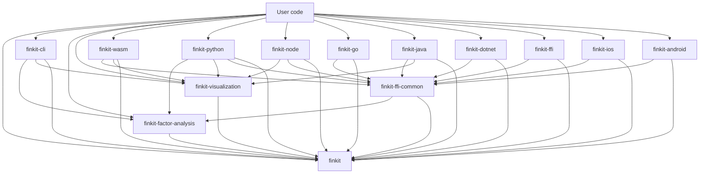

# Finkit — Architecture Overview

This document is the canonical reference for the Finkit crate structure,
dependency graph, and main entry points. Diagrams are Mermaid (rendered by
GitHub / GitLab / VS Code).

## Crate graph



## Crate roles

| Crate | Role | Output |
|-------|------|--------|
| `finkit` | Indicators, math, formula engine, traits | `rlib` (consumed by all others) |
| `finkit-factor-analysis` | Factor study, metrics, risk and cross-sectional analysis | `rlib` |
| `finkit-visualization` | Chart rendering (SVG/PNG/HTML) | `rlib` |
| `finkit-cli` | Formula/indicator/runtime and factor-study command-line workflows | CLI binaries |
| `finkit-wasm` | Browser / Node.js WASM bindings | `wasm-bindgen` output |
| `finkit-ffi-common` | Shared serialization, request types and language-neutral FFI helpers | `rlib` |
| `finkit-python` | PyO3 bindings | `.whl` / sdist |
| `finkit-node` | `napi-rs` bindings | Node native addon |
| `finkit-go` | `cgo` bindings | C-shim + Go package |
| `finkit-java` | JNI bindings | `.so` / `.dll` + `.jar` |
| `finkit-dotnet` | P/Invoke bindings | NuGet package candidate |
| `finkit-ffi` | C ABI | `.a` / `.so` / `.dll` |
| `finkit-ios` | Swift/iOS wrapper over C ABI | Swift package / XCFramework candidate |
| `finkit-android` | Kotlin/JNI wrapper over C ABI | AAR candidate |

## Layering

```
┌──────────────────────────────────────────────────────┐
│ User code (Python / Node / Go / Java / .NET / Rust)  │
└──────────────────────────────────────────────────────┘
                       ▲
┌──────────────────────────────────────────────────────┐
│ CLI / WASM / Python / Node / C ABI / mobile wrappers │
└──────────────────────────────────────────────────────┘
                       ▲
┌──────────────────────────────────────────────────────┐
│ Core (finkit) + Factor Analysis + Visualization     │
│  ├─ core: indicators / formula / streaming / math   │
│  ├─ factor-analysis: studies / risk / cross-section │
│  └─ visualization: renderers and chart models       │
└──────────────────────────────────────────────────────┘
                       ▲
┌──────────────────────────────────────────────────────┐
│ Math + SIMD kernels                                  │
│  • std / no_std split                                │
│  • AVX2 / FMA / BMI2 on x86-64-v3 (perf-gate)        │
└──────────────────────────────────────────────────────┘
```

## Cross-references

- [Data flow](dataflow.md) — request lifecycle.
- [Core workflow matrix](workflow-matrix.md) — end-to-end capability and validation coverage.
- [Formula engine](formula-engine.md) — internal stages of formula eval.
- [api-reference.md](../api-reference.md) — public API surface (English).
- [Benchmark results](../benchmark-results.md) — current performance summary.
